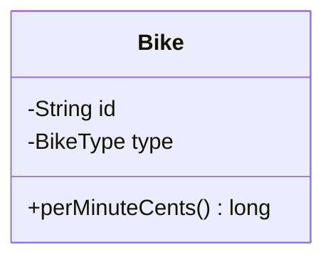
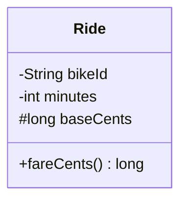
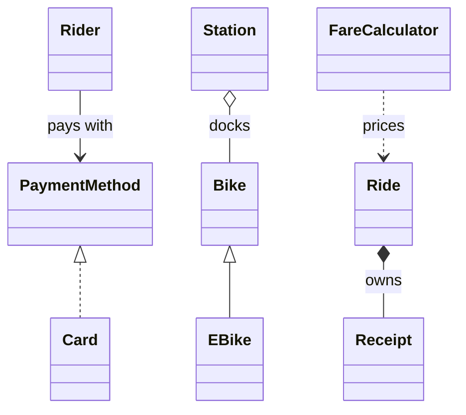
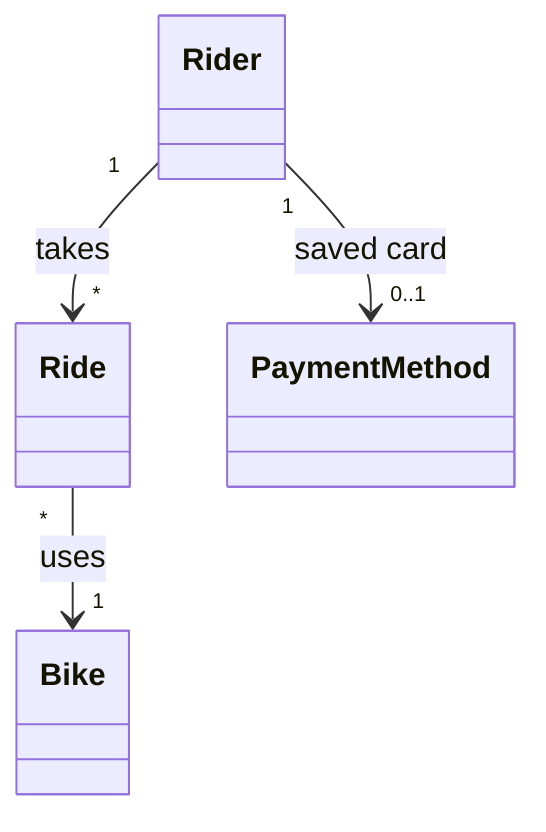
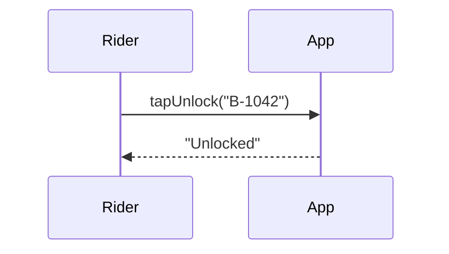
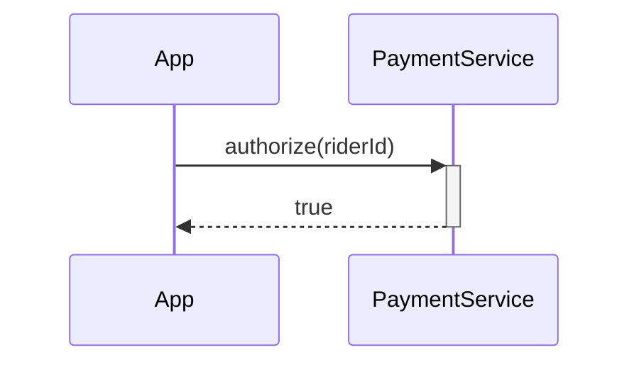
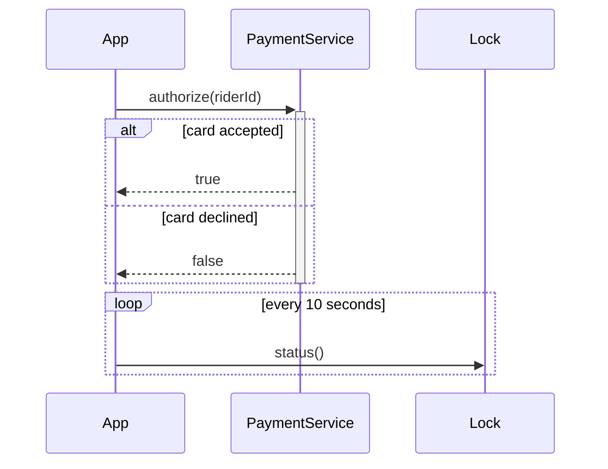
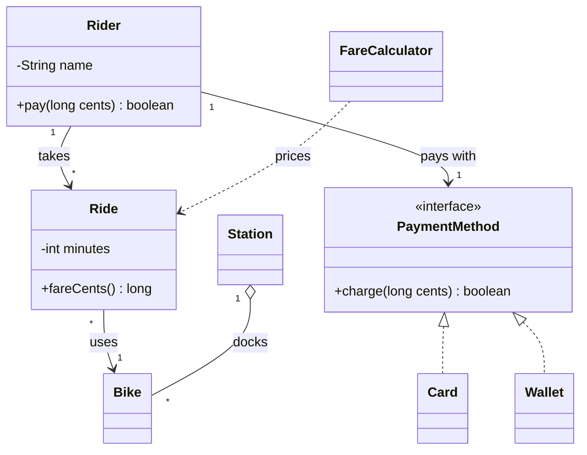
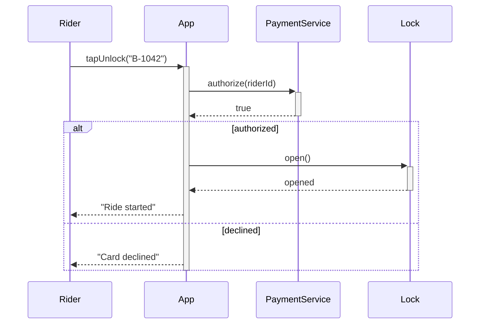

## Hook

Kakashi pins a photo on the board. It shows the last billing meeting at Riverside. There are boxes, arrows and a coffee stain. Nobody can say which arrow means what.

Tsunade's team is about to rewrite billing. Before anyone types a line, Kakashi wants one picture that everybody reads the same way. That needs shared rules for boxes and arrows. Those rules exist. They are called UML.

## Concept

```callout jargon
**UML** stands for Unified Modeling Language. It is a set of drawing rules for software. A **class diagram** shows which classes exist and how they connect. A **sequence diagram** shows who calls whom, in time order.
```

UML has many diagram types. You only need two of them most days. This topic draws both with **Mermaid**, a tool that turns a few lines of text into a picture. Text diagrams live in the repository next to the code, so they get reviewed like code.

### Syntax: a class box

A class box has three parts stacked on top of each other: the name, the fields, then the methods.



In Mermaid text, you write the class name, then each member on its own line. A method shows its return type after the brackets. The box above matches this Java:

```java
class Bike {
    private String id;
    private BikeType type;
    public long perMinuteCents() { return 15; }
}
enum BikeType { CLASSIC, EBIKE, CARGO }
```

### Syntax: visibility marks

The symbol in front of each member tells you who may use it.

| Mark | Java word | Who can use it |
|---|---|---|
| `+` | `public` | everyone |
| `-` | `private` | only this class |
| `#` | `protected` | this class, its subclasses, and classes in the same package |



So `-int minutes` is a private int field, and `+fareCents() long` is a public method that returns a long.

### Syntax: relationships

The lines between boxes are the real story. Each line style has one meaning.



- **Association** (`-->`, a plain arrow): one class knows about another. A rider has a payment method.
- **Aggregation** (`o--`, a hollow diamond): a whole holds parts that can live without it. A station holds bikes, but a bike survives when it leaves.
- **Composition** (`*--`, a filled diamond): a whole owns parts that die with it. A receipt has no meaning without its ride.
- **Inheritance** (`<|--`, a solid line with a hollow triangle): a subclass `extends` a parent. `EBike extends Bike`.
- **Realization** (`<|..`, a dashed line with a hollow triangle): a class `implements` an interface. `Card implements PaymentMethod`.
- **Dependency** (`..>`, a dashed arrow): one class uses another for a moment, as a parameter or a local variable, but keeps no field. `FareCalculator` prices a `Ride` it is handed.

The diamond and the triangle always sit at the end of the whole or the parent.

```callout analogy
Aggregation is a bike rack: take the bike away and both still exist. Composition is a sandwich and its filling: throw away the sandwich and the filling goes with it.
```

Here is aggregation and composition as Java. The station receives bikes from outside. The ride creates its own receipt.

```java
import java.util.ArrayList;
import java.util.List;

class Bike { }
class Receipt { }

class Station {
    private final List<Bike> bikes = new ArrayList<>();
    void dock(Bike bike) { bikes.add(bike); }
}

class Ride {
    private final Receipt receipt = new Receipt();
}
```

### Syntax: multiplicity

**Multiplicity** says how many objects sit at each end of a line. You write it in quotes next to the class.

| Mark | Meaning |
|---|---|
| `1` | exactly one |
| `0..1` | none or one |
| `*` | any number, including zero |
| `1..*` | at least one |



Read each end from the other side. One rider takes any number of rides. Each ride uses exactly one bike. A rider has no saved card or one saved card.

In Java, `*` usually becomes a `List`, and `1` becomes a plain field. `0..1` becomes a plain field that may be `null`. The getter then returns an `Optional`, so callers must handle the missing case.

```java
import java.util.Optional;

class PaymentMethod { }

class Rider {
    private PaymentMethod savedCard;   // 0..1: may be null

    Optional<PaymentMethod> savedCard() {
        return Optional.ofNullable(savedCard);
    }
}
```

`Optional` is made for return values, not fields. It is not `Serializable`, and it adds an extra object to every rider. See [when not to use Optional](/t/module-03-core-java/topic-16-optional).

### Syntax: a sequence diagram

A sequence diagram shows one scenario, step by step. Time runs from top to bottom.



- A **participant** is one object or person. Each gets a box at the top.
- A **lifeline** is the dashed line hanging down from each box. It is that participant's timeline.
- A **synchronous call** (`->>`, a solid arrow) means the caller waits for an answer.
- A **return** (`-->>`, a dashed arrow) is the answer coming back.

### Syntax: activation

An **activation** is a thin bar on a lifeline. It shows the time that participant is busy working. In Mermaid, add `+` after the arrow to start the bar and `-` to end it.



### Syntax: alt and loop fragments

A **fragment** is a labelled frame around some arrows. `alt` means "one of these branches", like `if` and `else`. `loop` means "repeat these arrows".



```callout tip
Keep each diagram small: five to seven boxes at most. A diagram that tries to show everything becomes the blurry whiteboard photo again. Draw two small pictures before one huge one.
```

## Worked example

Kakashi's billing picture. Riders take rides on bikes from stations. A fare calculator prices each ride. Payment methods come in two kinds.



Line by line:

1. `<<interface>>` marks `PaymentMethod` as an interface. `Card` and `Wallet` realize it with dashed triangle arrows.
2. One rider takes any number of rides. That becomes a `List<Ride>` in Rider.
3. Each ride uses one bike. That becomes a `Bike` field in Ride.
4. A station docks many bikes with a hollow diamond. A bike moves between stations, so it is aggregation.
5. `FareCalculator ..> Ride` is a dashed arrow called a **dependency**. The calculator uses a ride as a parameter but keeps no field for it.

Here is the code that matches the picture. Run it.

```java run
import java.util.ArrayList;
import java.util.List;

public class Main {
    public static void main(String[] args) {
        Rider ada = new Rider("Ada", new Card());
        ada.take(new Ride(new Bike("B-1042"), 12));
        FareCalculator calc = new FareCalculator();
        for (Ride r : ada.rides()) {
            long cents = calc.fareCents(r);
            System.out.println(r.bike().id() + " costs " + cents + " cents");
            System.out.println("paid: " + ada.pay(cents));
        }
    }
}

interface PaymentMethod { boolean charge(long cents); }
class Card implements PaymentMethod {
    public boolean charge(long cents) { return true; }
}
record Bike(String id) { }
record Ride(Bike bike, int minutes) { }
class Rider {
    private final String name;
    private final PaymentMethod method;
    private final List<Ride> rides = new ArrayList<>();
    Rider(String name, PaymentMethod method) { this.name = name; this.method = method; }
    void take(Ride ride) { rides.add(ride); }
    List<Ride> rides() { return rides; }
    boolean pay(long cents) { return method.charge(cents); }
}
class FareCalculator {
    long fareCents(Ride ride) { return 100 + ride.minutes() * 15L; }
}
```

Now the second picture: what happens when a rider taps unlock at Harbor.



Read it top to bottom. The rider taps unlock. The app asks the payment service and waits. The service answers true. Inside the `alt` frame, the authorized branch opens the lock. The declined branch only shows a message. Each `->>` arrow is one method call in the code below.

```java run
public class Main {
    public static void main(String[] args) {
        App app = new App(new PaymentService(), new Lock());
        System.out.println(app.tapUnlock("rider-7", "B-1042"));
        System.out.println(app.tapUnlock("rider-0", "B-1042"));
    }
}

class PaymentService {
    boolean authorize(String riderId) { return !riderId.equals("rider-0"); }
}
class Lock {
    String open() { return "opened"; }
}
class App {
    private final PaymentService payments;
    private final Lock lock;
    App(PaymentService payments, Lock lock) { this.payments = payments; this.lock = lock; }
    String tapUnlock(String riderId, String bikeId) {
        if (payments.authorize(riderId)) {
            lock.open();
            return "Ride started";
        } else {
            return "Card declined";
        }
    }
}
```

## Try it

Add a `status()` method to `Lock` that returns `"locked"` first. Add a `loop` to the sequence diagram on paper: the app checks `lock.status()` three times before it gives up. Then add a `for` loop in `tapUnlock` that matches it, and run the program again. One `loop` frame becomes one Java loop.

## Recap

- A class box lists the name, then fields, then methods. `+`, `-` and `#` mean public, private and protected.
- Association is a plain arrow. A hollow diamond is aggregation and a filled diamond is composition.
- A hollow triangle on a solid line is `extends`. On a dashed line it is `implements`.
- Multiplicity marks `1`, `0..1` and `*` say how many objects sit at each end.
- In a sequence diagram, time runs down. Solid arrows are calls, dashed arrows are returns, and `alt` and `loop` frames hold branches and repeats.

## Common mistakes

**1. Drawing composition where the part outlives the whole.**

A diagram shows `Station *-- Bike`. The code passes bikes in from outside and moves them between stations.

```java
import java.util.ArrayList;
import java.util.List;

class Bike { }
class Station {
    private final List<Bike> bikes = new ArrayList<>();
    void dock(Bike bike) { bikes.add(bike); }
    void release(Bike bike) { bikes.remove(bike); }
}
```

What you see: a reader of the diagram thinks closing a station destroys its bikes. The picture and the code disagree.

Fix: use a hollow diamond, `Station o-- Bike`. Keep the filled diamond for parts the whole creates and owns alone.

**2. Mixing up inheritance and realization arrows.**

A diagram shows `PaymentMethod <|-- Card` with a solid line. The code says `implements`.

```java
interface PaymentMethod { boolean charge(long cents); }
class Card implements PaymentMethod {
    public boolean charge(long cents) { return true; }
}
```

What you see: someone writes `class Card extends PaymentMethod` from the picture, and javac says `error: no interface expected here`.

Fix: draw a dashed line, `PaymentMethod <|.. Card`, and mark the interface with `<<interface>>`.

**3. Reading multiplicity from the wrong end.**

The diagram says `Rider "1" --> "*" Ride`. A new teammate gives each Ride a list of riders.

```java
import java.util.List;

class Rider { }
class Ride {
    private List<Rider> riders;
}
```

What you see: the code compiles, but it says one ride has many riders. The diagram says one rider has many rides.

Fix: the mark next to a class says how many of that class there are. The `*` sits next to `Ride`, so `Rider` holds a `List<Ride>`, and each `Ride` holds one `Rider`.
