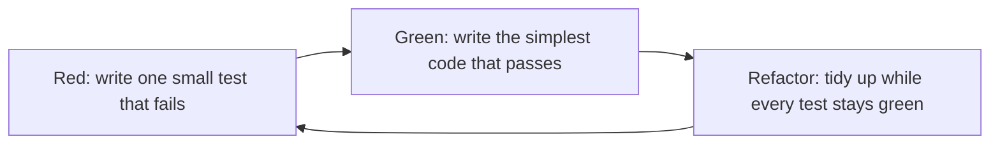

## Hook

Imagine building a bridge and only testing it on opening day. If it wobbles, hundreds of people are already on it.

Shizune's group ride discount is that bridge. Marketing has already told every rider about it. The first group of five will check their receipts, and a wrong cent becomes a support ticket for Iruka. So this time you write the checks **before** the code. That habit has a name: **test-driven development**, or **TDD**.

## Concept

### The loop: red, green, refactor

TDD is a short loop that you repeat many times. Each lap takes a minute or two.

```callout jargon
**Test-driven development (TDD)** means you write a failing test first, then just enough code to make it pass, then tidy up. **Red** is a failing test. **Green** is a passing test. **Refactor** means changing the shape of code without changing what it does.
```



1. **Red.** Write one small test. Run it. Watch it fail.
2. **Green.** Write the simplest code that makes it pass. Ugly is fine here.
3. **Refactor.** Clean up names, remove copy-paste, extract a method. Run the tests after each change. They must stay green.

### Why watch it fail first?

A test that has never failed might not test anything. Maybe it calls the wrong method. Maybe its assertion can never be false. Seeing red proves the test can catch a problem. Seeing green right after proves your new code fixed it.

### The smallest failing test

Pick the tiniest rule you can name. For the discount, that is "a solo rider pays the full fare". One rule gives one test with one clear failure message.

### Syntax: a TDD test

```java nocompile
@Test
void soloRiderPaysFullFare() {
    assertEquals(1000, new Groups().discountedCents(1000, 1), "a solo rider pays the full fare");
}
```

- The test uses `Groups` before `Groups` exists. That is on purpose.
- A compile error counts as red. It tells you the next thing to write.

### The simplest code that passes

Green means "passes", nothing more. If the test expects 1000, then `return 1000;` is allowed. This trick is called **faking it**. It feels silly, but it keeps each step tiny. The next test forces you to replace the fake with real code.

### Triangulation

```callout jargon
**Triangulation** means adding a second example with different numbers, so a faked answer can no longer pass. Sailors find a position from two directions. You find the real rule from two examples.
```

```java nocompile
assertEquals(1000, groups.discountedCents(1000, 1), "a solo rider pays the full fare");
assertEquals(1500, groups.discountedCents(1500, 1), "a solo rider pays the full fare");
```

`return 1000;` passes the first line and fails the second. Now you must write `return fareCents;`.

### Baby steps

A **baby step** is the smallest change that moves you forward. One new test, one small edit, one run. When a run fails, you know the cause: the last few lines you typed. Big steps fail in ten places at once, and then you are debugging instead of building.

```callout tip
Byte says: if a step takes more than five minutes to get green, undo it and take a smaller one.
```

### How TDD shapes your design

You must call your code from a test before it exists. So you design it from the caller's side first. Code that is hard to call in a test is usually hard to use anywhere. TDD pushes you toward:

- small methods that take inputs and return a value;
- interfaces, such as `GroupDiscount`, that a test can swap for a fake (you did this with Mockito in [Mockito](/t/module-06-craft/topic-09-mockito));
- no hidden reads from the clock, the screen or a database inside the rule itself.

### When TDD is awkward

TDD fits rules with clear right answers, like fares and discounts. It fits badly in two places.

- **User interfaces.** "Does this screen look right?" has no `assertEquals`. Test the logic behind the screen, and check the look by eye.
- **Exploration.** When you do not know what you are building yet, write a quick throwaway sketch. Once the idea is clear, delete the sketch and start again test first.

## Worked example

Here is a full TDD session for Shizune's ticket. Each cycle shows the new test, the red message, the code and the green result. The tests live in a class `GroupsTest`, with JUnit imported as in [JUnit](/t/module-06-craft/topic-08-junit).

### Cycle 1: a solo rider

Test:

```java nocompile
@Test
void soloRiderPaysFullFare() {
    assertEquals(1000, new Groups().discountedCents(1000, 1), "a solo rider pays the full fare");
}
```

Red. `Groups` does not exist yet, so javac stops:

```text
GroupsTest.java:7: error: cannot find symbol
  symbol:   class Groups
```

Code. Write the simplest thing that passes, which is a fake. The interface `GroupDiscount` already exists in the practice code.

```java nocompile
public class Groups implements GroupDiscount {
    public long discountedCents(long fareCents, int groupSize) {
        return 1000;
    }
}
```

Green: `1 tests successful`.

### Cycle 2: triangulate the fake away

Test. Add a second example to the same test:

```java nocompile
assertEquals(1500, new Groups().discountedCents(1500, 1), "a solo rider pays the full fare");
```

Red:

```text
a solo rider pays the full fare ==> expected: <1500> but was: <1000>
```

Code. Replace the fake with the real rule: `return fareCents;`. Green.

### Cycle 3: three riders get 20 percent off

Test:

```java nocompile
@Test
void threeRidersGetTwentyPercentOff() {
    assertEquals(800, new Groups().discountedCents(1000, 3), "three riders get 20 percent off");
}
```

Red:

```text
three riders get 20 percent off ==> expected: <800> but was: <1000>
```

Code:

```java nocompile
if (groupSize >= 3) {
    return fareCents * 80 / 100;
}
return fareCents;
```

Green. Both tests pass.

### Cycle 4: five riders get 30 percent off

Test:

```java nocompile
assertEquals(700, new Groups().discountedCents(1000, 5), "five riders get 30 percent off");
```

Red:

```text
five riders get 30 percent off ==> expected: <700> but was: <800>
```

Code. Put the bigger group first, because 5 is also "3 or more":

```java nocompile
if (groupSize >= 5) {
    return fareCents * 70 / 100;
}
if (groupSize >= 3) {
    return fareCents * 80 / 100;
}
return fareCents;
```

Green. All three tests pass.

### Cycle 5: no group of zero riders

Test:

```java nocompile
@Test
void rejectsGroupOfZero() {
    assertThrows(IllegalArgumentException.class, () -> new Groups().discountedCents(1000, 0),
            "a group of 0 riders makes no sense");
}
```

Red:

```text
a group of 0 riders makes no sense ==> Expected java.lang.IllegalArgumentException to be thrown, but nothing was thrown.
```

Code. Add a guard at the top of the method:

```java nocompile
if (groupSize < 1) {
    throw new IllegalArgumentException("group size must be at least 1, was " + groupSize);
}
```

Green. Four tests pass.

### Refactor

The tests are green, so now you may tidy. The numbers 70 and 80 are magic numbers. Name them as constants, then run the tests again. They stay green, so the rename broke nothing.

### A test that passes on its first run

You also add a rounding test: 1234 cents for 3 riders should be 987, because 987.2 rounds down. It passes at once. Integer division in Java already drops the fraction. Be suspicious of a test that is green from the start. Change `/ 100` to `(... + 99) / 100` for a moment, and watch the test go red. Then undo the change. Now you know the test really guards the rounding.

The same idea runs below in plain Java. Each check prints PASS or FAIL.

```java run
public class Main {
    public static void main(String[] args) {
        Groups groups = new Groups();
        check(1000, groups.discountedCents(1000, 1), "solo rider pays full fare");
        check(800, groups.discountedCents(1000, 3), "three riders get 20 percent off");
        check(700, groups.discountedCents(1000, 5), "five riders get 30 percent off");
        check(987, groups.discountedCents(1234, 3), "987.2 rounds down to 987");
    }

    static void check(long expected, long actual, String rule) {
        if (expected == actual) {
            System.out.println("PASS " + rule);
        } else {
            System.out.println("FAIL " + rule + ": expected " + expected + " but was " + actual);
        }
    }
}

class Groups {
    static final int TWENTY_OFF_PAYS = 80;
    static final int THIRTY_OFF_PAYS = 70;

    long discountedCents(long fareCents, int groupSize) {
        if (groupSize < 1) {
            throw new IllegalArgumentException("group size must be at least 1, was " + groupSize);
        }
        if (groupSize >= 5) {
            return fareCents * THIRTY_OFF_PAYS / 100;
        }
        if (groupSize >= 3) {
            return fareCents * TWENTY_OFF_PAYS / 100;
        }
        return fareCents;
    }
}
```

## Try it

This version has a bug: it gives 20 percent off to pairs. Run it and read which check goes red. Then fix the bug and run it again until every line says PASS.

```java run
public class Main {
    public static void main(String[] args) {
        check(1000, discountedCents(1000, 2), "two riders pay full fare");
        check(800, discountedCents(1000, 4), "four riders get 20 percent off");
        check(700, discountedCents(1000, 5), "five riders get 30 percent off");
    }

    static long discountedCents(long fareCents, int groupSize) {
        if (groupSize >= 5) {
            return fareCents * 70 / 100;
        }
        if (groupSize >= 2) {
            return fareCents * 80 / 100;
        }
        return fareCents;
    }

    static void check(long expected, long actual, String rule) {
        if (expected == actual) {
            System.out.println("PASS " + rule);
        } else {
            System.out.println("FAIL " + rule + ": expected " + expected + " but was " + actual);
        }
    }
}
```

## Recap

- TDD is a loop: red (a failing test), green (the simplest passing code), refactor (tidy with tests green).
- Start with the smallest rule you can name, and watch its test fail first.
- Triangulate: a second example with new numbers forces a fake answer into real code.
- Baby steps keep every failure close to the last thing you typed.
- TDD pushes you toward small, callable units. It fits poorly for screen layout and early exploration.

## Common mistakes

### 1. Checks that cannot tell right from wrong

Every check below uses a fare of 1000 cents. Every discount of 1000 is a whole number, so rounding never matters.

```java nocompile
assertEquals(800, discount.discountedCents(1000, 3), "three riders get 20 percent off");
assertEquals(700, discount.discountedCents(1000, 5), "five riders get 30 percent off");
```

A discount that rounds up still passes. You see `2 tests successful` while the bug ships. Fix it by adding a fare that leaves a fraction, such as 1234 cents, where the answer must be 987.

### 2. Percent math in the wrong order

```java
public class Main {
    public static void main(String[] args) {
        long fareCents = 1000;
        System.out.println(fareCents * (80 / 100));
    }
}
```

This prints `0`. The test says `expected: <800> but was: <0>`. `80 / 100` is integer division, which gives 0 before the multiply happens. Multiply first and divide last: `fareCents * 80 / 100`.

### 3. Writing all the code before the first test

You write the whole `Groups` class, then ten tests at once. Four go red:

```text
4 tests failed
```

Now you must hunt through every line for the cause. Fix it by going back to baby steps: one test, see it fail, make it pass, then write the next test.
