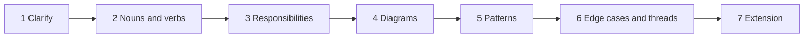
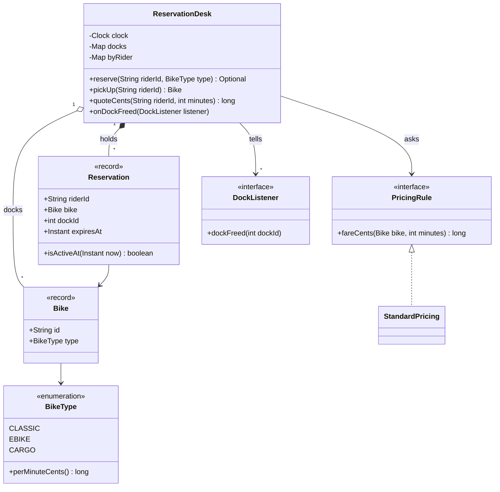
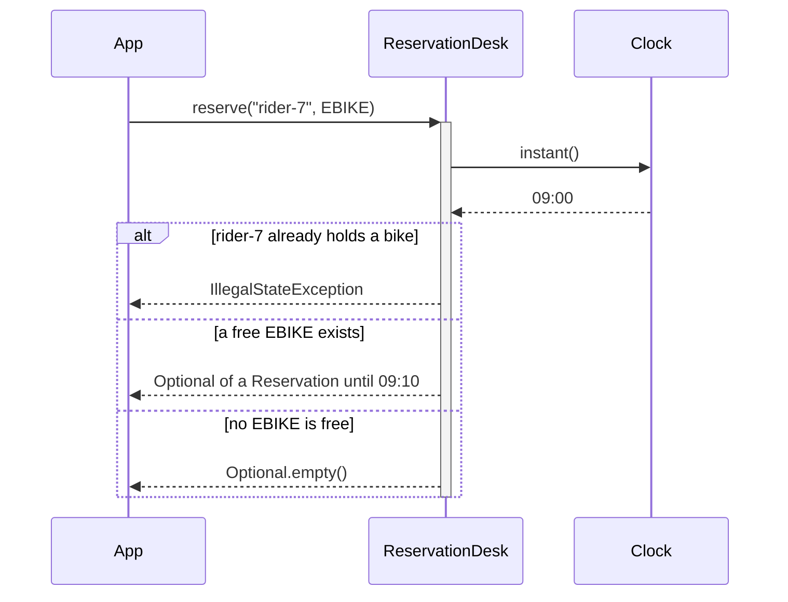

## Hook

Before a builder lays one brick, an architect asks the family questions. How many people live here? Who needs stairs? Then she draws a plan. The bricks come last.

Jiraiya's ticket is a feature with no code yet. Riders want to hold a bike from the app. Features like this go wrong when people skip the questions and the plan. This topic gives you a repeatable method that turns a request into classes. Big tech firms test exactly this skill in an interview round of its own.

## Concept

```callout jargon
**Object-oriented design** (OOD) means deciding which classes a program needs, what each one knows, and what each one does. Interviewers call it **low-level design** (LLD). That sets it apart from **system design**, which is about servers and databases.
```

The method has seven steps. You will walk through each one with Jiraiya's reservation feature.



### Step 1: Clarify requirements and scope

```callout jargon
A **requirement** is something the system must do. A **use case** is one goal a user reaches, told as a short story: "A rider reserves an e-bike at Old Mill." **Scope** is the line around what you build now.
```

Tickets are vague. Ask questions until every rule is a sentence you could test:

- How long does a hold last? *Ten minutes.*
- Can a rider hold two bikes? *No, one at a time.*
- What if no bike of that type is free? *Say so. That is normal at rush hour.*
- What happens when a hold runs out? *The bike is free again.*
- Who needs to hear when a dock empties? *The live map and the truck drivers.*

Then write down what is **out of scope**: payment, cancelling, broken bikes. Saying "not now" out loud stops a design from growing forever.

```callout jargon
**Functional requirements** say what the system does: "reserve a bike". **Non-functional requirements** say how well it does it: how fast, how many riders at once, how safe.
```

Ask about non-functional ones too. "Hundreds of riders tap at the same moment" changes the design a lot, as Step 6 shows.

### Step 2: Find the nouns and the verbs

Write the use cases as sentences. Nouns are candidate classes. Verbs are candidate methods.

"A **rider** **reserves** a **bike** of a **type** at a **station**. The **reservation** **expires** after ten minutes. When the rider **picks up** the bike, the **dock** **frees up** and **listeners** **hear** about it."

| Noun | Keep it as | Why |
|---|---|---|
| Station | a class, `ReservationDesk` | it owns the docks and the rules |
| Bike | a record | an id and a type |
| Type | an enum | a fixed list: CLASSIC, EBIKE, CARGO |
| Reservation | a record | a few values that never change |
| Rider | a `String` id | the desk needs nothing else about riders |
| Dock | an `int` id inside the desk | it only holds one bike |

Not every noun deserves a class. A noun with one value and no behaviour can be a plain field. The verbs become methods: `reserve`, `pickUp`, `isActiveAt`, `dockFreed`.

### Entities, value objects and services

Sort every class you keep into one of three kinds.

```callout jargon
An **entity** has an identity that stays the same while its data changes. Bike B-1042 is still B-1042 after a ride. A **value object** is defined only by its values and never changes: two fares of 250 cents are the same fare. A **service** is an object whose job is a process, such as "reserve a bike". It coordinates entities and values.
```

A [record](/t/module-02-oop/topic-11-records) is a natural value object. Its fields are final, and `equals` compares values.

### Syntax: the three kinds in Java

```java
import java.time.Instant;

record Reservation(String riderId, String bikeId, int dockId, Instant expiresAt) { }   // value object

class Bike {                                   // entity: same id, changing data
    private final String id;
    private int ridesTaken;

    Bike(String id) { this.id = id; }

    void finishRide() { ridesTaken++; }
}

class ReservationDesk {                        // service: runs the "reserve" process
}
```

What makes something an entity is its identity, not whether it changes. A bike is an entity by nature: its id is who it is. In the fix nothing about a bike changes, so a record is enough to hold it. Where a bike stands is the desk's job, kept in its dock map.

### Step 3: Assign responsibilities

```callout jargon
A **responsibility** is something a class knows or does. A good rule: give each job to the class that already has the data for it.
```

```callout jargon
**Tell, don't ask** means you tell an object to do a job with its own data. You do not pull its data out and do the job somewhere else.
```

Asking spreads one rule over many callers. Each caller reads `expiresAt()` and compares times its own way. Telling keeps the rule inside the reservation:

```java run
import java.time.Instant;

public class Main {
    public static void main(String[] args) {
        Instant nine = Instant.parse("2026-11-18T09:00:00Z");
        Hold hold = new Hold("rider-7", "B-1042", nine.plusSeconds(600));

        System.out.println("09:05 active? " + hold.isActiveAt(nine.plusSeconds(300)));
        System.out.println("09:10 active? " + hold.isActiveAt(nine.plusSeconds(600)));
    }
}

record Hold(String riderId, String bikeId, Instant expiresAt) {
    boolean isActiveAt(Instant now) {
        return now.isBefore(expiresAt);
    }
}
```

It prints `09:05 active? true`, then `09:10 active? false`. Exactly one place now decides what "active" means. Common mistake 3 shows what happens when two places decide.

Keep classes small, with one reason to change each, as in [SOLID](/t/module-06-craft/topic-02-solid). If a class name needs "And", or is a vague "Manager" that does everything, split it.

### Step 4: Draw the diagrams

Draw before you code, with the rules from [UML class and sequence diagrams](/t/module-06-craft/topic-07-uml-basics):

- One **class diagram** with five to seven boxes: names, key fields, key methods and the arrows between them.
- One **sequence diagram** for the most important use case. Here that is "reserve".

The worked example draws both for the reservation desk. A diagram is cheap to change. Code is not.

### Step 5: Pick patterns that earn their place

A pattern is worth it only when it solves a real problem in your requirements. Here is a cheat sheet.

| The requirement sounds like | Pattern | Spoke example |
|---|---|---|
| "The price depends on the bike type, and more rules are coming" | Strategy | a `PricingRule` interface |
| "A thing moves through stages, and some moves are not allowed" | State | a bike: AVAILABLE, RESERVED, RENTED, IN_REPAIR |
| "Several other parts must know when X happens" | Observer | listeners hear "dock freed" |
| "Build the right kind of object from a code" | Factory | `Bikes.of("E", "B-1042")` makes an e-bike |

You met these in [creational patterns](/t/module-06-craft/topic-03-creational-patterns) and [behavioral patterns](/t/module-06-craft/topic-05-behavioral-patterns).

Say when NOT to use one, too. Two bike states and one `if` do not need the state pattern. One price rule with no second one coming does not need a strategy. Interviewers like to hear: "I start simple, and add the pattern when the second case arrives."

### Step 6: Edge cases and errors

```callout jargon
An **edge case** is an input at the border of the rules: a station with zero docks, the last bike, a hold checked at exactly ten minutes.
```

List the edge cases out loud. Then decide how each one is reported:

- An outcome the caller should **expect** is a **result**. "No free e-bike" happens every rush hour, so return `Optional.empty()`.
- A **broken rule** is an **exception**. A second hold for the same rider, or a dock id that does not exist, means the caller made a mistake.

```java run
import java.util.HashMap;
import java.util.Map;
import java.util.Optional;

public class Main {
    public static void main(String[] args) {
        Kiosk harbor = new Kiosk();
        harbor.add("B-1042");

        System.out.println(harbor.take("rider-1"));
        System.out.println(harbor.take("rider-2"));
        try {
            harbor.take("rider-1");
        } catch (IllegalStateException e) {
            System.out.println("Refused: " + e.getMessage());
        }
    }
}

class Kiosk {
    private String freeBike;
    private final Map<String, String> holds = new HashMap<>();

    void add(String bikeId) { freeBike = bikeId; }

    Optional<String> take(String riderId) {
        if (holds.containsKey(riderId)) {
            throw new IllegalStateException(riderId + " already holds " + holds.get(riderId));
        }
        if (freeBike == null) {
            return Optional.empty();
        }
        holds.put(riderId, freeBike);
        String bike = freeBike;
        freeBike = null;
        return Optional.of(bike);
    }
}
```

The output is `Optional[B-1042]`, then `Optional.empty`, then `Refused: rider-1 already holds B-1042`. `Optional` makes the caller think about "no bike". A `null` lets them forget, and crash later.

### Step 6, continued: two riders, one bike

Rush hour at Old Mill. Two riders tap Reserve on the last e-bike in the same millisecond. Each tap runs on its own thread. If the check ("is it free?") and the act ("hold it") are separate steps, both riders can win. You met this **check-then-act** race in [synchronization](/t/module-05-advanced-java/topic-02-synchronization).

```animate
title: Two riders, one e-bike
kind: scene
nodes:
  - { id: one, label: rider-1, emoji: "📱", value: waiting, row: 0, col: 0 }
  - { id: two, label: rider-2, emoji: "📱", value: waiting, row: 1, col: 0 }
  - { id: desk, label: ReservationDesk, emoji: "🔒", value: open, row: 0, col: 2 }
  - { id: bike, label: B-1042, emoji: "🚲", value: free, row: 0, col: 4 }
steps:
  - say: Two riders tap Reserve on the last e-bike at the same moment. Each tap runs on its own thread.
    focus: [one, two]
  - say: rider-1's thread reaches the synchronized method first and takes the desk's lock.
    send: { from: one, to: desk, label: reserve }
    set: { desk: "locked by rider-1" }
  - say: rider-2's thread arrives a moment later. The lock is taken, so it waits outside.
    send: { from: two, to: desk, label: reserve }
    set: { two: blocked }
  - say: Inside, the desk checks that B-1042 is free and holds it. Check and act happen together, so nobody slips in between.
    send: { from: desk, to: bike, label: hold }
    set: { bike: "held by rider-1" }
  - say: rider-1 gets the reservation, and the lock is released.
    send: { from: desk, to: one, label: "Optional[B-1042]", back: true }
    set: { desk: open, one: "has B-1042" }
  - say: Now rider-2 gets in. The check sees the bike is held, so the answer is empty. Exactly one winner.
    send: { from: desk, to: two, label: Optional.empty, back: true }
    set: { two: "no bike" }
```

### Syntax: one synchronized method

```java nocompile
synchronized boolean tryHold(String riderId) {
    if (heldBy != null) {
        return false;      // check
    }
    heldBy = riderId;      // act
    return true;
}
```

`synchronized` lets only one thread at a time into the object's synchronized methods. The check and the act now happen as one step.

```java run
import java.util.ArrayList;
import java.util.List;
import java.util.concurrent.atomic.AtomicInteger;

public class Main {
    public static void main(String[] args) throws InterruptedException {
        Dock dock = new Dock("B-1042");
        AtomicInteger winners = new AtomicInteger();
        List<Thread> riders = new ArrayList<>();
        for (int r = 1; r <= 4; r++) {
            String riderId = "rider-" + r;
            riders.add(new Thread(() -> {
                if (dock.tryHold(riderId)) {
                    winners.incrementAndGet();
                }
            }));
        }
        for (Thread t : riders) t.start();
        for (Thread t : riders) t.join();
        System.out.println("Riders who got B-1042: " + winners.get());
    }
}

class Dock {
    private final String bikeId;
    private String heldBy;

    Dock(String bikeId) { this.bikeId = bikeId; }

    synchronized boolean tryHold(String riderId) {
        if (heldBy != null) {
            return false;
        }
        heldBy = riderId;
        return true;
    }
}
```

Four threads race, and it always prints `Riders who got B-1042: 1`. Which rider wins changes from run to run. How many win never does.

### Syntax: compareAndSet

```callout jargon
An **atomic** action happens all at once: no other thread can see it half done. **Compare-and-set** (CAS) is an atomic action that says "set this to rider-1, but only if it is still empty".
```

```java run
import java.util.concurrent.atomic.AtomicReference;

public class Main {
    public static void main(String[] args) {
        AtomicReference<String> heldBy = new AtomicReference<>(null);

        boolean first = heldBy.compareAndSet(null, "rider-1");
        boolean second = heldBy.compareAndSet(null, "rider-2");

        System.out.println("rider-1 won? " + first);
        System.out.println("rider-2 won? " + second);
        System.out.println("B-1042 is held by " + heldBy.get());
    }
}
```

`compareAndSet` returns `true` only for the caller that changed the value. Use it when the whole decision is one value, such as who holds one dock. Use `synchronized` when one action changes several things together, such as a dock map and a reservation map.

### Readers, listeners and double taps

Three more questions finish the thread-safety story.

**Readers need the lock too.** `reservationOf` and `bikeAt` only read the maps. But a `HashMap` that another thread is changing can be seen half updated. So readers are `synchronized` as well, and they always see a finished change.

**Listeners run inside the lock.** In `pickUp`, the desk tells every listener while it still holds its lock. A slow listener, such as one that sends an email, then blocks every rider at the station. Two fixes from [concurrent collections](/t/module-05-advanced-java/topic-06-concurrent-collections): copy the listener list inside the lock and call them after leaving it, or keep listeners in a `CopyOnWriteArrayList`. In the fix the listeners are quick, so calling them inside the lock is fine.

```callout jargon
An operation is **idempotent** when doing it twice has the same effect as doing it once.
```

**A double tap: error or same answer?** This design treats a second reserve by the same rider as a caller mistake and throws. Many real APIs make reserve idempotent instead: the second tap returns the hold the rider already has. That is kinder to shaky phone networks. The cost is that a real mistake, such as asking for a different bike type, no longer shows up. Say which one you chose, and why.

### Step 7: Plan for extension

The open/closed principle from [SOLID](/t/module-06-craft/topic-02-solid) asks: can the next feature be new code, not edits? Test your design against the next two requests you can guess.

- **A new bike type.** If each `BikeType` constant carries its own per-minute rate, a KIDS bike is one new line in the enum. No `switch` anywhere needs editing.
- **A new pricing rule.** If the desk only knows the `PricingRule` interface, a night-owl rule is one new class or lambda. The desk never changes.

```java
enum BikeType {
    CLASSIC(15), EBIKE(30), CARGO(25);

    private final long perMinuteCents;

    BikeType(long perMinuteCents) { this.perMinuteCents = perMinuteCents; }

    long perMinuteCents() { return perMinuteCents; }
}
```

Do not build hooks for every guess, though. Plan for the two or three changes the requirements hint at, and keep the rest simple.

### Syntax: an injected Clock

```callout jargon
A **`java.time.Clock`** is an object that answers "what time is it?". Code that takes a `Clock` in its constructor, instead of asking the computer, can be given any time a test needs.
```

```java nocompile
private final Clock clock;            // handed to the constructor
Instant now = clock.instant();        // never Instant.now()
```

A hold expires after ten minutes. Testing that with the real time would mean waiting ten minutes. So time becomes a dependency, handed in like any other.

`Clock.fixed` always says the same moment. `Clock.offset` runs a fixed amount ahead of another clock. Tests use them to jump through time instantly.

```java run
import java.time.Clock;
import java.time.Duration;
import java.time.Instant;
import java.time.ZoneOffset;

public class Main {
    public static void main(String[] args) {
        Clock nine = Clock.fixed(Instant.parse("2026-11-18T09:00:00Z"), ZoneOffset.UTC);
        Clock tenPast = Clock.offset(nine, Duration.ofMinutes(10));

        Instant expiresAt = nine.instant().plus(Duration.ofMinutes(10));
        System.out.println("Hold ends at " + expiresAt);
        System.out.println("Active at 09:00? " + nine.instant().isBefore(expiresAt));
        System.out.println("Active at 09:10? " + tenPast.instant().isBefore(expiresAt));
    }
}
```

### In an interview

The **low-level design round** gives you about 45 minutes and one vague prompt, such as "design a parking lot". It grades how you think, not finished code. A good 45 minutes looks like this:

1. **Minutes 0 to 5, clarify:** ask questions, list use cases, say what is out of scope.
2. **5 to 10, nouns and verbs:** name the classes and sort them into entities, values and services.
3. **10 to 20, class diagram:** boxes, fields, methods and arrows. Assign responsibilities and pick patterns as you draw, and talk while you do it.
4. **20 to 35, code the core:** interfaces, records and the one or two methods that matter most.
5. **35 to 45, stress it:** edge cases, two threads at once, and one new requirement.

Interviewers look for questions before code, small classes with clear jobs, interfaces where change is likely, patterns chosen for a reason, and honest trade-offs.

Classic prompts, with the one key idea of each:

- **Parking lot:** spot sizes match vehicle sizes. A strategy picks a free spot, and taking it must be thread-safe.
- **Elevator:** a state machine per car (going up, going down, idle), plus a strategy that picks which car answers a call.
- **Vending machine:** the state pattern. Idle, has money and dispensing each allow different buttons.
- **Rate limiter:** a **token bucket** per user. Tokens refill over time from an injected clock, and each request spends one.
- **Library system:** a book title and each physical copy are separate classes. A loan links a member to one copy, with a due date.
- **Movie tickets or seat booking:** a seat hold that expires, like a bike reservation. Taking a seat happens under a lock, so two buyers never get the same seat.
- **LRU cache** (Least Recently Used): a HashMap finds an item in O(1). A doubly linked list moves it to the front and drops the oldest, also in O(1).

## Worked example

Jiraiya's feature, from requirements to code, using all seven steps.

### Requirements and scope

After the questions in Step 1, the rules fit on one card:

1. A station has docks numbered from 1. Each dock holds at most one bike.
2. A rider reserves a free bike of a type. The lowest dock id wins. The hold lasts 10 minutes.
3. A rider holds at most one bike at a time.
4. No free bike gives an empty result. A broken rule throws an exception.
5. Picking up empties the dock and tells every listener.
6. Prices come from a rule that can be swapped.
7. Many riders tap at the same moment.

Out of scope: payment, cancelling, broken bikes and returning bikes.

### The class diagram



1. `ReservationDesk` is the service. It owns the rules, so it is the only class with real behaviour.
2. `Bike` is an entity by nature, since its id is its identity. Nothing about it changes in this feature, so a record is enough. `Reservation` is a value object: a few facts that never change. It knows its own expiry, so `isActiveAt` lives there.
3. Bikes come and go, so the desk aggregates them (hollow diamond). Reservations exist only inside the desk, so it composes them (filled diamond).
4. `PricingRule` is a strategy and `DockListener` is an observer. Each is an interface, so new rules and new listeners are new classes.

### The sequence diagram for "reserve"



The three branches of the `alt` frame are the three answers from Step 6: a broken rule, a success and an expected "no".

### The first slice of code

Here is a first slice: reserve, pick up and the dock-freed event. The fix adds expiry, the one-hold rule, dock checks and pricing.

```java run
import java.time.Clock;
import java.time.Duration;
import java.time.Instant;
import java.time.ZoneOffset;
import java.util.ArrayList;
import java.util.List;
import java.util.Optional;

public class Main {
    public static void main(String[] args) {
        Clock nine = Clock.fixed(Instant.parse("2026-11-18T09:00:00Z"), ZoneOffset.UTC);
        Station oldMill = new Station(nine);
        oldMill.dock(new Bike("B-2001", BikeType.CLASSIC));
        oldMill.dock(new Bike("B-1042", BikeType.EBIKE));
        oldMill.onDockFreed(dockId -> System.out.println("Live map: dock " + dockId + " is free"));

        Optional<Hold> first = oldMill.reserve("rider-7", BikeType.EBIKE);
        System.out.println("rider-7: " + first.map(Hold::describe).orElse("no bike"));
        Optional<Hold> second = oldMill.reserve("rider-8", BikeType.EBIKE);
        System.out.println("rider-8: " + second.map(Hold::describe).orElse("no bike"));
        System.out.println("rider-7 picked up " + oldMill.pickUp("rider-7").id());
    }
}

enum BikeType { CLASSIC, EBIKE, CARGO }

record Bike(String id, BikeType type) { }

record Hold(String riderId, Bike bike, int dockId, Instant expiresAt) {
    String describe() {
        return bike.id() + " in dock " + dockId + " until " + expiresAt;
    }
}

interface DockListener {
    void dockFreed(int dockId);
}

class Station {
    private static final Duration HOLD = Duration.ofMinutes(10);
    private final Clock clock;
    private final List<Bike> docks = new ArrayList<>();      // dock id = index + 1
    private final List<Hold> holds = new ArrayList<>();
    private final List<DockListener> listeners = new ArrayList<>();

    Station(Clock clock) { this.clock = clock; }

    synchronized void dock(Bike bike) { docks.add(bike); }

    synchronized void onDockFreed(DockListener listener) { listeners.add(listener); }

    synchronized Optional<Hold> reserve(String riderId, BikeType type) {
        for (int i = 0; i < docks.size(); i++) {
            Bike bike = docks.get(i);
            if (bike != null && bike.type() == type && !isHeld(bike)) {
                Hold hold = new Hold(riderId, bike, i + 1, clock.instant().plus(HOLD));
                holds.add(hold);
                return Optional.of(hold);
            }
        }
        return Optional.empty();
    }

    synchronized Bike pickUp(String riderId) {
        for (Hold hold : holds) {
            if (hold.riderId().equals(riderId)) {
                holds.remove(hold);
                docks.set(hold.dockId() - 1, null);
                listeners.forEach(listener -> listener.dockFreed(hold.dockId()));
                return hold.bike();
            }
        }
        throw new IllegalStateException(riderId + " holds no bike");
    }

    private boolean isHeld(Bike bike) {
        return holds.stream().anyMatch(hold -> hold.bike().equals(bike));
    }
}
```

Step by step:

1. `main` builds Old Mill with a fixed clock at 09:00, so the output never depends on the real time.
2. `reserve` walks the docks in order and skips held bikes. rider-7 gets B-1042 in dock 2 until `2026-11-18T09:10:00Z`.
3. rider-8 asks for the same type. The only e-bike is held, so the answer is `no bike`, not a crash.
4. `pickUp` removes the hold, empties dock 2, and tells the live map `Live map: dock 2 is free`.
5. Every public method is `synchronized`, so two taps can never both win B-1042.

**Cost.** `reserve` walks d docks and checks h holds for each, so it takes O(d × h) time. It stores O(d + h) items. For 12 docks that is tiny. For a huge station, keep a `Set` of held dock ids to make each check O(1) and `reserve` O(d).

## Try it

Plan for extension. To stay short, this version prices a `BikeType` instead of a whole `Bike`. Run it, then add a fourth bike type, `KIDS(10)`, to the enum. Add one more rule too: a `student` lambda that charges no unlock fee. Check that `StandardPricing` and the loop did not change.

```java run
public class Main {
    public static void main(String[] args) {
        PricingRule standard = new StandardPricing();
        PricingRule nightOwl = (type, minutes) -> 50 + type.perMinuteCents() * minutes;

        for (BikeType type : BikeType.values()) {
            System.out.println(type + ": standard " + standard.fareCents(type, 10)
                    + ", night owl " + nightOwl.fareCents(type, 10));
        }
    }
}

enum BikeType {
    CLASSIC(15), EBIKE(30), CARGO(25);

    private final long perMinuteCents;

    BikeType(long perMinuteCents) { this.perMinuteCents = perMinuteCents; }

    long perMinuteCents() { return perMinuteCents; }
}

interface PricingRule {
    long fareCents(BikeType type, int minutes);
}

class StandardPricing implements PricingRule {
    public long fareCents(BikeType type, int minutes) {
        return 100 + type.perMinuteCents() * minutes;
    }
}
```

## Recap

- Clarify first: turn the request into use cases you could test, and say what is out of scope.
- Nouns become classes or fields, and verbs become methods. Sort classes into entities, value objects (often records) and services.
- Give each job to the class that has the data: tell, don't ask.
- Draw one class diagram and one sequence diagram, then add only the patterns a real requirement needs.
- Plan for edge cases, for two riders at once (one synchronized method or compareAndSet), and for the next likely change.

## Common mistakes

**1. Checking and acting in two separate calls.**

```java
import java.util.ArrayList;
import java.util.List;

public class Main {
    public static void main(String[] args) {
        Dock dock = new Dock();
        // Two riders, in an order that two threads can really take:
        boolean rider1SeesFree = dock.isFree();
        boolean rider2SeesFree = dock.isFree();
        if (rider1SeesFree) dock.hold("rider-1");
        if (rider2SeesFree) dock.hold("rider-2");
        System.out.println("B-1042 is held by " + dock.holders());
    }
}

class Dock {
    private final List<String> holders = new ArrayList<>();

    synchronized boolean isFree() { return holders.isEmpty(); }
    synchronized void hold(String riderId) { holders.add(riderId); }
    synchronized List<String> holders() { return List.copyOf(holders); }
}
```

```
B-1042 is held by [rider-1, rider-2]
```

Each method is synchronized, yet both riders hold the bike. The lock is let go between `isFree` and `hold`, and the other rider slips into that gap. Fix: one synchronized method, `tryHold(riderId)`, that checks and holds inside the same lock.

**2. Returning null for "no bike free".**

```java run crash
public class Main {
    public static void main(String[] args) {
        Desk uptown = new Desk();
        System.out.println("Walk to dock " + uptown.reserve("rider-7").dockId());
    }
}

record Hold(String riderId, int dockId) { }

class Desk {
    Hold reserve(String riderId) {
        return null;   // no bike free
    }
}
```

```
Exception in thread "main" java.lang.NullPointerException: Cannot invoke "Hold.dockId()" because the return value of "Desk.reserve(String)" is null
```

Nothing in the method's type warned the caller. Fix: return `Optional<Hold>` and `Optional.empty()`, so the caller must handle "no bike", for example with `orElse`.

**3. Asking for data instead of telling the object.**

```java
import java.time.Instant;

public class Main {
    public static void main(String[] args) {
        Instant expiresAt = Instant.parse("2026-11-18T09:10:00Z");
        Instant now = Instant.parse("2026-11-18T09:10:00Z");

        boolean mapSaysFree = !now.isBefore(expiresAt);   // the live map's own check
        boolean deskSaysHeld = !now.isAfter(expiresAt);   // the desk's own check

        System.out.println("Map says free: " + mapSaysFree);
        System.out.println("Desk says held: " + deskSaysHeld);
    }
}
```

```
Map says free: true
Desk says held: true
```

At exactly 09:10 the two copies of the rule disagree. A rider walks to a bike the desk will not release. Fix: put the rule in one place, `reservation.isActiveAt(now)`, and have every caller ask that method.

**4. Reading the real time inside the class.**

```java nocompile
Instant expiresAt = Instant.now().plus(HOLD);
```

This compiles and works in the app. But the only way to test expiry is to wait ten real minutes, and the result depends on when the test runs. Fix: take a `Clock` in the constructor and call `clock.instant()`. Tests pass `Clock.fixed`, or a clock they can move forward.
