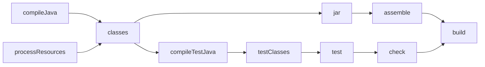

## Hook

You just learned to bake with one recipe book. It lists ingredients in a neat form and the steps in a fixed order. Then a friend hands you their cookbook. Same flour, same oven, same cakes. But it is written as short instructions instead of forms.

That is Theo's problem. The telemetry service from rush hour builds with **Gradle**, not Maven. The libraries come from the same place. The folders look the same. Only the recipe is written differently. Once you can read it, you can build it.

## Concept

```callout jargon
**Gradle** is a build tool, like Maven. It compiles your code, runs your tests and packs a jar. Maven reads an XML file. Gradle reads a short **build script**, which is a small program that describes the build.
```

Most of what you know from Maven carries over:

- Libraries use the same coordinates, `groupId:artifactId:version`.
- They download from the same Maven Central.
- Code lives in `src/main/java`, and tests live in `src/test/java`.

What changes is the file you write, the commands you type, and the folder where output lands.

### Syntax: settings.gradle.kts

Every Gradle project has a settings file in its top folder. For a one-project build, it only names the project.

```kotlin
rootProject.name = "telemetry"
```

That name becomes the start of the jar's file name, like `artifactId` in Maven.

### Syntax: build.gradle.kts

The build script sits next to the settings file. It plays the part of `pom.xml`.

```kotlin
plugins {
    java
}

group = "com.spoke"
version = "1.0.0"

repositories {
    mavenCentral()
}

dependencies {
    implementation("org.slf4j:slf4j-api:2.0.16")
    testImplementation("org.junit.jupiter:junit-jupiter:5.11.4")
    testRuntimeOnly("org.junit.platform:junit-platform-launcher")
}

java {
    toolchain {
        languageVersion = JavaLanguageVersion.of(21)
    }
}

tasks.test {
    useJUnitPlatform()
}
```

Read it block by block:

- `plugins { java }` switches on everything a Java project needs: compiling, testing and making a jar.
- `group` and `version` are two of your coordinates, like `groupId` and `version` in Maven.
- `repositories { mavenCentral() }` says where to download libraries from.
- `dependencies { ... }` lists the libraries. Each line is a configuration name, then the coordinates in quotes.
- `java { toolchain { ... } }` asks for Java 21. Gradle finds a JDK 21 on your machine, or downloads one if a download plugin is set up.
- `tasks.test { useJUnitPlatform() }` tells the test task to run JUnit Jupiter tests. Jupiter is the test engine behind JUnit 5 and 6.

```callout jargon
The **Kotlin DSL** is the language of a `.kts` build script. Kotlin is a language that runs on the JVM. DSL means domain-specific language: a small language for one job. Older projects use a file called `build.gradle` written in Groovy, another JVM language. It does the same job with slightly different punctuation.
```

```callout tip
Byte says: the launcher line, `testRuntimeOnly("org.junit.platform:junit-platform-launcher")`, has no version on purpose. JUnit's own published files tell Gradle which version matches `junit-jupiter`. Gradle 9 needs this line, so always add it.
```

### Syntax: the application plugin

The `java` plugin makes a library jar. Add the `application` plugin when your project has a `main` method you want to run.

```kotlin
plugins {
    java
    application
}

application {
    mainClass = "com.spoke.telemetry.TelemetryParser"
}
```

Now `./gradlew run` compiles the code and runs that class's `main` method.

### Configurations: Gradle's scopes

In Maven, every dependency has a scope. Gradle calls these **configurations**. Each one says when a library is visible.

```callout jargon
A **configuration** is a named bucket of dependencies. `implementation` is the bucket your main code compiles and runs with. `testImplementation` is the bucket only your tests see.
```

| Maven scope | Gradle configuration | Main code compiles with it | In the app at run time |
|---|---|---|---|
| `compile` | `implementation` | yes | yes |
| `test` | `testImplementation` | no, tests only | no |
| `provided` | `compileOnly` | yes | no, the server supplies it |
| `runtime` | `runtimeOnly` | no | yes |

There is a test-only twin of `runtimeOnly` too. `testRuntimeOnly` adds a library only while tests run, like the JUnit launcher above.

Here are the four buckets in one block:

```kotlin
dependencies {
    implementation("org.slf4j:slf4j-api:2.0.16")
    runtimeOnly("ch.qos.logback:logback-classic:1.5.12")
    compileOnly("jakarta.servlet:jakarta.servlet-api:6.1.0")
    testImplementation("org.junit.jupiter:junit-jupiter:5.11.4")
}
```

Your code calls SLF4J, so it goes in `implementation`. Logback only does the printing at run time, so it goes in `runtimeOnly`.

### Tasks instead of phases

Maven runs **phases** in a fixed line. Gradle runs **tasks**.

```callout jargon
A **task** is one piece of build work with a name, such as `compileJava` or `test`. A task can depend on other tasks. Gradle runs those first.
```

### Syntax: running a task

```bash
./gradlew <task>
```

You type the task name after `./gradlew`. The ones you will use most:

| Command | What it does |
|---|---|
| `./gradlew build` | Compiles, tests and packs the jar. Close to `./mvnw verify`. |
| `./gradlew test` | Compiles and runs the tests only. |
| `./gradlew jar` | Compiles and packs the jar, with no tests. |
| `./gradlew run` | Runs `mainClass`, with the `application` plugin. |
| `./gradlew clean` | Deletes the `build/` folder. |
| `./gradlew tasks` | Lists every task this project has. |

### Tasks form a graph

Tasks link up into a **task graph**. Each arrow means "must finish before".



When you ask for one task, Gradle walks the arrows backwards. It runs only the tasks your task needs. `./gradlew jar` compiles and packs, but never touches `test`. `./gradlew build` needs both branches, so it runs everything.

```callout analogy
Maven's phases are a train line: to reach stop 5, the train passes stops 1 to 4. Gradle's tasks are a city map: you plan a route to your stop and skip streets you do not need.
```

### Incremental builds

Gradle remembers each task's **inputs**, such as source files, and its **outputs**, such as class files. If nothing changed since last time, the task is skipped and marked `UP-TO-DATE`.

```text
> Task :compileJava UP-TO-DATE
> Task :test UP-TO-DATE
```

Change one Java file, and only the tasks that depend on it run again.

Two more helpers make builds fast:

- The **build cache** stores task outputs by their inputs. Another branch or a clean build can reuse them. Turn it on with `--build-cache` or `org.gradle.caching=true` in `gradle.properties`. Reused tasks say `FROM-CACHE`.
- The **daemon** is a Gradle process that stays running in the background after a build. The next build starts warm instead of booting a new JVM. `./gradlew --stop` shuts it down.

```callout jargon
An **incremental build** redoes only the work affected by your change. A **daemon** is a program that keeps running quietly in the background, waiting for the next job.
```

### Where output goes

Maven writes to `target/`. Gradle writes to `build/`.

| What | Maven | Gradle |
|---|---|---|
| Compiled classes | `target/classes` | `build/classes/java/main` |
| The jar | `target/` | `build/libs/` |
| Test report | `target/surefire-reports` | `build/reports/tests/test/index.html` |
| Downloaded libraries | `~/.m2/repository` | `~/.gradle/caches` |

The jar name is the project name plus the version: `build/libs/telemetry-1.0.0.jar`.

### The wrapper

Like Maven's `./mvnw`, Gradle has a **wrapper**: a small script checked into the repository. It downloads the exact Gradle version the project needs, then runs it.

The wrapper is four files:

```text
gradlew                               the script for macOS and Linux
gradlew.bat                           the script for Windows
gradle/wrapper/gradle-wrapper.jar     the small program that downloads Gradle
gradle/wrapper/gradle-wrapper.properties    which version to download
```

The properties file pins the version with one line:

```text
distributionUrl=https\://services.gradle.org/distributions/gradle-8.14.3-bin.zip
```

Every teammate and every CI robot gets Gradle 8.14.3, whatever is installed on their laptop. To move the project to a new version, run `./gradlew wrapper --gradle-version <version>` and commit the changed files.

### Maven or Gradle?

Both are good, and both are common. Teams usually pick by habit and by the kind of project.

- **Maven** has one fixed way of doing things. Many company Java projects use it. Any Java developer can read a `pom.xml`.
- **Gradle** is the standard for Android apps. Its scripts are shorter and can hold real logic. Big projects with many modules often build faster thanks to caching.
- Spring Boot's project generator offers both. Libraries do not care which one you use.

```callout tip
Byte says: you do not need to love one tool. You need to read both, because you will meet both in the same company.
```

## Worked example

Here is the telemetry service Theo is stuck on, after you add the logging library. The folders look like a Maven project, with a Gradle file instead of `pom.xml`.

```text
telemetry/
├── settings.gradle.kts
├── build.gradle.kts
├── gradlew
├── gradlew.bat
├── gradle/
│   └── wrapper/
│       ├── gradle-wrapper.jar
│       └── gradle-wrapper.properties
└── src/
    ├── main/java/com/spoke/telemetry/TelemetryParser.java
    └── test/java/com/spoke/telemetry/TelemetryParserTest.java
```

The full build script:

```kotlin
plugins {
    java
    application
}

group = "com.spoke"
version = "1.0.0"

repositories {
    mavenCentral()
}

dependencies {
    implementation("org.slf4j:slf4j-api:2.0.16")
    runtimeOnly("ch.qos.logback:logback-classic:1.5.12")
    testImplementation("org.junit.jupiter:junit-jupiter:5.11.4")
    testRuntimeOnly("org.junit.platform:junit-platform-launcher")
}

java {
    toolchain {
        languageVersion = JavaLanguageVersion.of(21)
    }
}

tasks.test {
    useJUnitPlatform()
}

application {
    mainClass = "com.spoke.telemetry.TelemetryParser"
}
```

Line by line:

1. `java` and `application` give you the compile, test, jar and run tasks.
2. `slf4j-api` is in `implementation`, because `TelemetryParser` imports it.
3. `logback-classic` is in `runtimeOnly`. It prints the log lines, but no code imports it.
4. JUnit is in `testImplementation`, so only the test folder can see it.
5. `useJUnitPlatform()` makes the `test` task find the JUnit Jupiter tests.
6. `mainClass` tells `./gradlew run` which `main` to start.

The main class reads one telemetry line, such as `B-1042|BATTERY|80`, and returns the battery level.

```java
package com.spoke.telemetry;

import org.slf4j.Logger;
import org.slf4j.LoggerFactory;

public class TelemetryParser {
    private static final Logger log = LoggerFactory.getLogger(TelemetryParser.class);

    public static int batteryPercent(String line) {
        String[] parts = line.split("\\|");
        if (parts.length != 3 || !parts[1].equals("BATTERY")) {
            log.warn("Not a battery line: {}", line);
            throw new IllegalArgumentException("Not a battery line: " + line);
        }
        return Integer.parseInt(parts[2]);
    }

    public static void main(String[] args) {
        System.out.println("B-1042 battery: " + batteryPercent("B-1042|BATTERY|80") + "%");
    }
}
```

Its test lives in `src/test/java`, in the same package:

```java nocompile
package com.spoke.telemetry;

import static org.junit.jupiter.api.Assertions.assertEquals;
import static org.junit.jupiter.api.Assertions.assertThrows;

import org.junit.jupiter.api.DisplayName;
import org.junit.jupiter.api.Test;

class TelemetryParserTest {

    @Test
    @DisplayName("Reads the battery level from a battery line")
    void readsBattery() {
        assertEquals(80, TelemetryParser.batteryPercent("B-1042|BATTERY|80"));
    }

    @Test
    @DisplayName("Rejects a GPS line")
    void rejectsGps() {
        assertThrows(IllegalArgumentException.class,
                () -> TelemetryParser.batteryPercent("B-1042|GPS|51.51,-0.12"));
    }
}
```

Now build it. `--console=plain` makes Gradle print one line per task instead of a moving progress bar.

```bash
./gradlew build --console=plain
```

```text
> Task :compileJava
> Task :processResources NO-SOURCE
> Task :classes
> Task :jar
> Task :startScripts
> Task :distTar
> Task :distZip
> Task :assemble
> Task :compileTestJava
> Task :processTestResources NO-SOURCE
> Task :testClasses
> Task :test
> Task :check
> Task :build

BUILD SUCCESSFUL in 6s
7 actionable tasks: 7 executed
```

What the lines tell you:

- Each `> Task` line is one task from the graph, in the order Gradle ran it.
- `NO-SOURCE` means there was nothing to do. This project has no `src/main/resources` folder.
- `startScripts`, `distTar` and `distZip` come from the `application` plugin. They pack the app with launch scripts into `build/distributions`.
- `7 actionable tasks: 7 executed` counts the tasks that did real work. On a second run with no changes, it says `7 up-to-date`.

The jar is now at `build/libs/telemetry-1.0.0.jar`. The test report is at `build/reports/tests/test/index.html`.

You can try the parsing logic on its own right here, without Gradle:

```java run
public class Main {
    public static void main(String[] args) {
        String[] lines = { "B-1042|BATTERY|80", "B-2001|BATTERY|15", "B-3001|GPS|51.51,-0.12" };
        for (String line : lines) {
            try {
                System.out.println(line + " -> " + TelemetryParser.batteryPercent(line) + "%");
            } catch (IllegalArgumentException e) {
                System.out.println(line + " -> skipped, not a battery line");
            }
        }
    }
}

class TelemetryParser {
    static int batteryPercent(String line) {
        String[] parts = line.split("\\|");
        if (parts.length != 3 || !parts[1].equals("BATTERY")) {
            throw new IllegalArgumentException("Not a battery line: " + line);
        }
        return Integer.parseInt(parts[2]);
    }
}
```

## Try it

**On paper.** The Depot station's dock service still builds with Maven. Here is its dependency block:

```xml
<dependencies>
  <dependency>
    <groupId>org.slf4j</groupId>
    <artifactId>slf4j-api</artifactId>
    <version>2.0.16</version>
  </dependency>
  <dependency>
    <groupId>jakarta.servlet</groupId>
    <artifactId>jakarta.servlet-api</artifactId>
    <version>6.1.0</version>
    <scope>provided</scope>
  </dependency>
  <dependency>
    <groupId>org.junit.jupiter</groupId>
    <artifactId>junit-jupiter</artifactId>
    <version>5.11.4</version>
    <scope>test</scope>
  </dependency>
</dependencies>
```

Write the matching `dependencies { }` block in the Kotlin DSL. Join each group, artifact and version with colons. Pick the configuration from the scope table. Remember that no `<scope>` means `compile`. Then add the JUnit launcher line.

**At a terminal.** If you have a Gradle project, run `./gradlew test --console=plain` twice. The second time, `test` says `UP-TO-DATE`. Now run `./gradlew test --rerun-tasks --console=plain`. Every task runs again, because `--rerun-tasks` ignores the saved results.

## Recap

- Gradle is a build tool like Maven. It reads a build script, `build.gradle.kts`, instead of `pom.xml`, with the same coordinates and Maven Central.
- Gradle runs tasks such as `build`, `test`, `jar`, `run` and `clean`. Tasks form a graph, and Gradle runs only what your task needs.
- Configurations replace scopes: `implementation`, `testImplementation`, `compileOnly` and `runtimeOnly`.
- Unchanged tasks are skipped as `UP-TO-DATE`. The build cache and the daemon save more time.
- Always use `./gradlew`. Output goes to `build/`, and jars land in `build/libs`.

## Common mistakes

**1. Putting a library your main code needs in testImplementation.**

```kotlin
dependencies {
    testImplementation("org.slf4j:slf4j-api:2.0.16")
}
```

What you see: `TelemetryParser` imports SLF4J, so compiling the main code fails.

```text
> Task :compileJava FAILED
TelemetryParser.java:3: error: package org.slf4j does not exist
import org.slf4j.Logger;
                ^
```

Fix: main code only sees `implementation` and `compileOnly`. Move the line to `implementation("org.slf4j:slf4j-api:2.0.16")`.

**2. Running an installed gradle instead of ./gradlew.**

```bash
gradle build
```

What you see: `gradle --version` prints a different version from the one in `gradle-wrapper.properties`. The build may fail with script errors that nobody else on the team gets.

Fix: run `./gradlew build` from the project's top folder. The wrapper downloads and uses the pinned version.

**3. Forgetting useJUnitPlatform().**

```kotlin
tasks.test {
}
```

What you see: on Gradle 8, `BUILD SUCCESSFUL`, but the test report shows 0 tests. Gradle looked for old-style JUnit 4 tests and found none. Gradle 9 is stricter and stops the build with an error about the test setup.

Fix: add `useJUnitPlatform()` inside `tasks.test { }`, then check that the report lists your tests.

**4. Looking for the jar in target/.**

```bash
ls target/
```

What you see: `ls: target/: No such file or directory`. Gradle never creates `target/`.

Fix: look in `build/libs/`. Run `ls build/libs/` and you see `telemetry-1.0.0.jar`.
