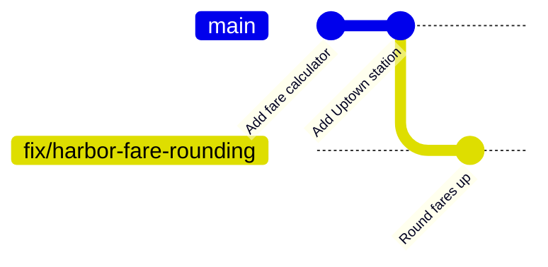
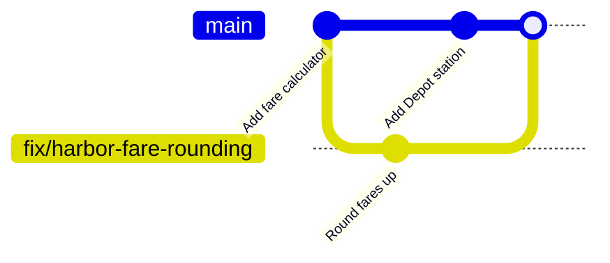
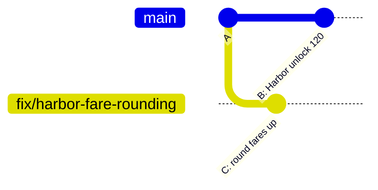
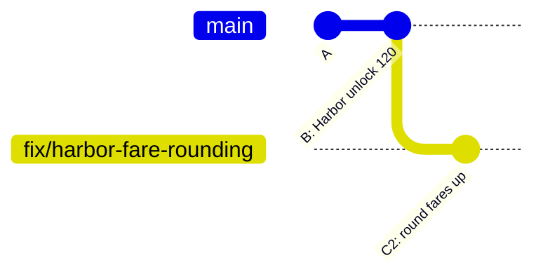
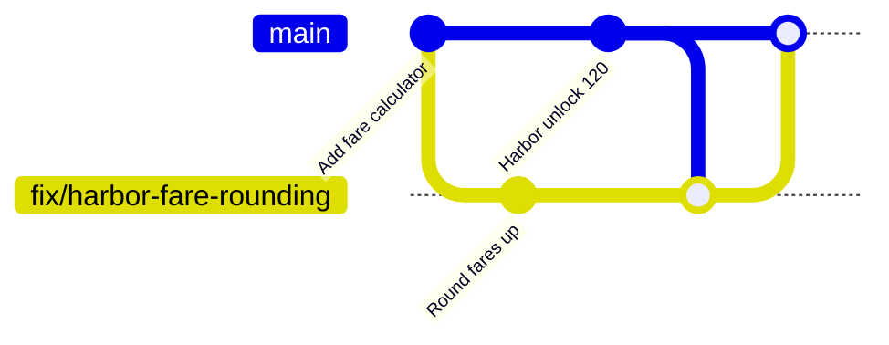

## Hook

Picture one shared station logbook, and two mechanics writing in it at once. One writes "new brake pad on B-1042". The other scribbles over that same line with "chain oiled". The brake pad note is gone. Nobody knows it ever existed.

That is what happened at Spoke last week. Two interns edited `FareCalculator` on `main` on the same afternoon. One change vanished, and `main` would not compile for an hour.

The fix is not "be more careful". The fix is to give everyone their own page to write on. A teammate checks the page. Only then is it copied into the shared logbook. In Git, that private page is a **branch**, and the check is a **pull request**.

## Concept

```callout jargon
A **branch** is a movable label that points at one commit. When you commit on a branch, the label slides forward to your new commit. **HEAD** is Git's marker for "where you are now". It usually points at a branch.
```

You already know `main`. It is just a branch, the one the whole team shares. Making a new branch does not copy any files. Git only writes a new label, so it takes a split second.

### Syntax: make a branch and move between branches

```bash
git branch
git switch -c fix/harbor-fare-rounding
git switch main
```

- `git branch` lists your branches. A `*` marks the one HEAD points at.
- `git switch -c fix/harbor-fare-rounding` creates a new branch at your current commit and moves you onto it. `-c` means create.
- `git switch main` moves you back to `main`. Git swaps the files in your folder to match.

Here is what the history looks like after one commit on a new branch.



The `main` label stayed where it was. Only your branch moved forward. Your teammates still see the old, working `main`.

```callout tip
Name branches by kind and topic: `fix/harbor-fare-rounding`, `feat/depot-dock-count`, `docs/readme-setup`. Some teams add the ticket key, like `fix/SPK-0703-harbor-rounding`. The name tells reviewers what to expect.
```

### Syntax: merging

**Merging** brings the commits from one branch into another. You switch to the branch that should receive the work, then name the branch to bring in.

```bash
git switch main
git merge fix/harbor-fare-rounding
```

A merge happens in one of two ways.

**Fast-forward.** If `main` got no new commits since you branched, Git just slides the `main` label forward. No new commit is made.

```text
before   A---B                <- main
              \
               C---D          <- fix/harbor-fare-rounding

after    A---B---C---D        <- main, fix/harbor-fare-rounding
```

**Merge commit.** If both branches got new commits, Git makes a **merge commit**. That is a commit with two parents that joins the two lines of history.



`git merge --no-ff fix/harbor-fare-rounding` always makes a merge commit, even when a fast-forward was possible. Some teams like that, because it records "a branch was merged here".

### Merge conflicts

Git merges line by line. If two branches change different lines, Git combines them by itself. If both branches change the same lines, Git cannot guess which one is right. That is a **merge conflict**.

Say you are on `fix/harbor-fare-rounding` and run `git merge main`. Both branches changed the same fare line, so Git stops:

```text
Auto-merging FareCalculator.java
CONFLICT (content): Merge conflict in FareCalculator.java
Automatic merge failed; fix conflicts and then commit the result.
```

Git pauses the merge and writes both versions into the file, fenced by **conflict markers**:

```text
<<<<<<< HEAD
        long fare = roundUpToTen(100 + minutes * 15L);
=======
        long fare = 120 + minutes * 15L;
>>>>>>> main
```

- Between `<<<<<<< HEAD` and `=======` is your version, from the branch you are on.
- Between `=======` and `>>>>>>>` is the incoming version, from the branch you are merging in.

To resolve it:

1. Open the file. Edit the lines into the final code you want. Often that combines both changes.
2. Delete all three marker lines.
3. Compile and run the tests.
4. Run `git add FareCalculator.java` to tell Git this file is fixed.
5. Run `git commit` to finish the merge.

```callout tip
Panicking mid-merge? `git merge --abort` puts everything back the way it was before you typed `git merge`. Nothing is lost.
```

### Syntax: rebasing

**Rebasing** is the other way to catch up with `main`. Instead of a merge commit, Git lifts your commits off and replays them, one by one, on top of the newest `main`.

```bash
git switch fix/harbor-fare-rounding
git rebase main
```

Before the rebase, your branch starts from an old commit:



After the rebase, your commit sits on top of `B`. The history is one straight line.



The replayed commit is a brand-new commit with a new ID. It has the same change, but it is not the same commit. That detail matters a lot, as you will see below.

A rebase can hit conflicts too, once per replayed commit. Fix the file, `git add` it, then run `git rebase --continue`. Git may open an editor showing the commit message. Save and close it. To give up, run `git rebase --abort`.

```callout warning
In a rebase, the sides swap. `HEAD` is the new `main`, and the bottom half is your commit being replayed. Read both halves before you delete anything.
```

### Remotes: fetch, pull and push

```callout jargon
A **remote** is a copy of the repository on a server, such as GitHub. Its usual name is **origin**. `origin/main` is your laptop's snapshot of the server's `main`, from the last time you fetched.
```

- `git fetch` downloads new commits from origin. It updates `origin/main` but never touches your files.
- `git pull` is `git fetch`, then it brings those new commits into your current branch.
- If both sides have new commits, Git stops and asks you to choose. `git pull --no-rebase` merges, and `git pull --rebase` rebases.
- `git push -u origin fix/harbor-fare-rounding` uploads your branch. `-u` links it to the server copy, so later you can type just `git push`.

### History safety: the golden rule of rebasing

Rebasing makes new commits and drops the old ones. If you already pushed the old ones, a normal `git push` is refused, because it would drop commits on the server. If a teammate already pulled them, their copy and yours now disagree.

People "fix" the refusal with `git push --force`. That overwrites the server's branch with yours. Anything a teammate pushed there is gone.

```callout warning
The golden rule: never rebase commits that other people already have. Rebase only your own branch, before or while only you work on it. If you must push a rebased branch, use `git push --force-with-lease`, never plain `--force`.
```

`--force-with-lease` only overwrites the branch if it still matches what you last fetched. If a teammate pushed in the meantime, Git refuses:

```text
 ! [rejected]        fix/harbor-fare-rounding -> fix/harbor-fare-rounding (stale info)
```

### Pull requests

A **pull request**, or PR, is a web page on GitHub that asks "please merge my branch into `main`". GitLab calls it a merge request. It is the same idea. A PR shows:

- the **diff**, meaning every line you added or removed;
- **review comments**, where teammates ask questions on any line;
- **checks**, run by **CI** (continuous integration). CI is a robot that builds and tests every push. You will set one up in the next topic.

When the checks are green and a reviewer approves, someone clicks merge. GitHub offers three buttons:

| Button | What lands on `main` |
|---|---|
| Create a merge commit | All your commits, plus one merge commit |
| Squash and merge | All your commits squashed into one new commit |
| Rebase and merge | Your commits replayed on top of `main`, no merge commit |

After the merge, delete the branch. Its work now lives in `main`, and old branches only cause confusion.

```callout tip
Keep PRs small: one ticket, one branch, one PR. A reviewer can read 100 lines carefully. Faced with 3,000 lines, they skim and click approve.
```

## Worked example

Ticket SPK-0703. Harbor's coin kiosk runs its own `FareCalculator`, and it only takes 10-cent coins. A 3-minute ride costs 145 cents, which nobody can pay. Maya agrees that Harbor fares round up to the next 10 cents. Here is the code on `main` today:

```java
public class FareCalculator {
    public long fareCents(int minutes) {
        long fare = 100 + minutes * 15L;
        return fare;
    }
}
```

**Step 1: start from a fresh main, then branch.**

```bash
git switch main
git pull
git switch -c fix/harbor-fare-rounding
```

`git pull` first, so your branch starts from the newest `main`. Then `git switch -c` makes your private page.

**Step 2: make the change and commit it.**

```java
public class FareCalculator {
    public long fareCents(int minutes) {
        long fare = roundUpToTen(100 + minutes * 15L);
        return fare;
    }

    private long roundUpToTen(long cents) {
        return (cents + 9) / 10 * 10;
    }
}
```

Adding 9 and then doing whole-number division by 10 rounds up. 145 becomes 154, then 15, then 150.

```bash
git add FareCalculator.java
git commit -m "SPK-0703: round fares up to the next 10 cents"
git push -u origin fix/harbor-fare-rounding
```

**Step 3: open the pull request.** GitHub offers a button for your freshly pushed branch. You write a title and say what changed and why. Then you wait for the checks.

But while you worked, another intern's pricing change merged into `main`. It raised Harbor's own unlock fee from 100 to 120 cents, on the exact line you edited. The PR page warns that your branch has conflicts with `main`.

**Step 4: bring the new main into your branch.**

```bash
git fetch origin
git merge origin/main
```

```text
Auto-merging FareCalculator.java
CONFLICT (content): Merge conflict in FareCalculator.java
Automatic merge failed; fix conflicts and then commit the result.
```

The file now looks like this:

```text
public class FareCalculator {
    public long fareCents(int minutes) {
<<<<<<< HEAD
        long fare = roundUpToTen(100 + minutes * 15L);
=======
        long fare = 120 + minutes * 15L;
>>>>>>> origin/main
        return fare;
    }

    private long roundUpToTen(long cents) {
        return (cents + 9) / 10 * 10;
    }
}
```

Neither half is right on its own. Harbor riders need the new 120-cent unlock fee and the rounding. So you keep both changes on one line and delete the markers:

```java
public class FareCalculator {
    public long fareCents(int minutes) {
        long fare = roundUpToTen(120 + minutes * 15L);
        return fare;
    }

    private long roundUpToTen(long cents) {
        return (cents + 9) / 10 * 10;
    }
}
```

**Step 5: check, finish the merge, push.** Run the resolved code before you commit it.

```java run
public class Main {
    public static void main(String[] args) {
        FareCalculator calc = new FareCalculator();
        System.out.println("3 minutes from Harbor: " + calc.fareCents(3) + " cents");
        System.out.println("7 minutes from Harbor: " + calc.fareCents(7) + " cents");
    }
}

class FareCalculator {
    long fareCents(int minutes) {
        long fare = roundUpToTen(120 + minutes * 15L);
        return fare;
    }

    private long roundUpToTen(long cents) {
        return (cents + 9) / 10 * 10;
    }
}
```

```bash
git add FareCalculator.java
git commit -m "Merge main into fix/harbor-fare-rounding"
git push
```

**Step 6: review and merge.** The checks go green. Maya leaves one comment, you answer it, and she approves. She clicks "Create a merge commit" and deletes the branch on GitHub. You tidy up your laptop:

```bash
git switch main
git pull
git branch -d fix/harbor-fare-rounding
```

`git branch -d` deletes the local label. It refuses if the branch still has commits that are not merged, so it is safe.



You could have run `git rebase origin/main` in step 4 instead. Nobody else had pulled your branch, so that is allowed. You would then push with `git push --force-with-lease`.

## Try it

Make a conflict on purpose in a throwaway folder, then fix it. Nothing here touches the Spoke project.

```bash
mkdir /tmp/git-practice
cd /tmp/git-practice
git init -b main
echo "Harbor fare: 145" > fares.txt
git add fares.txt
git commit -m "Add Harbor fare"
```

`-b main` names the first branch `main`, whatever your Git's default is. Now change the same line on two branches:

```bash
git switch -c round-up
echo "Harbor fare: 150" > fares.txt
git add fares.txt
git commit -m "Round Harbor fare up"

git switch main
echo "Harbor fare: 165" > fares.txt
git add fares.txt
git commit -m "Raise Harbor unlock fee"

git merge round-up
```

You should see `CONFLICT (content): Merge conflict in fares.txt`. Then:

1. Run `cat fares.txt` and find the three marker lines.
2. Run `git merge --abort`, then `git status`. The merge is gone. Run `git merge round-up` again.
3. Open `fares.txt` and make it one line: `Harbor fare: 170`. That is the new 165-cent fare, rounded up.
4. Run `git add fares.txt`, then `git commit -m "Merge round-up into main"`.
5. Run `git log --oneline --graph`. You will see the two lines of history joining at your merge commit.
6. Bonus: start again in a new folder, and use `git rebase main` on `round-up` instead of merging. Compare the two graphs.

## Recap

- A branch is a movable label on a commit. `git switch -c name` makes one and moves you onto it.
- `git merge` fast-forwards when it can, and makes a merge commit when both sides changed.
- A conflict means both sides changed the same lines. Edit, delete the markers, `git add`, then `git commit`, or back out with `git merge --abort`.
- `git rebase main` replays your commits on top of `main` as new commits. Never rebase commits others have, and push with `--force-with-lease`.
- A pull request asks to merge your branch, with review and CI checks. Keep it small and delete the branch after the merge.

## Common mistakes

**1. Committing straight on main.**

```bash
git switch main
git add FareCalculator.java
git commit -m "Round fares"
git push
```

What you see: if `main` is protected, the server rejects your push. If it is not, your unreviewed change lands on everyone's `main`. That is how last week's broken hour happened.

Fix: check the first line of `git status`, which says `On branch ...`. Before you commit, run `git switch -c fix/harbor-fare-rounding`. Your uncommitted edits come along to the new branch.

**2. Leaving conflict markers in the file.**

```text
public class FareCalculator {
    public long fareCents(int minutes) {
<<<<<<< HEAD
        long fare = roundUpToTen(100 + minutes * 15L);
=======
        long fare = 120 + minutes * 15L;
>>>>>>> origin/main
        return fare;
    }
}
```

What you see: javac stops at the first marker line, followed by a pile of confusing errors.

```text
FareCalculator.java:3: error: illegal start of expression
<<<<<<< HEAD
^
```

Fix: delete every `<<<<<<<`, `=======` and `>>>>>>>` line. Search the file for `<<<<<<<` before you run `git add`. Always compile before you finish a merge.

**3. Rebasing a shared branch, then force-pushing.**

```bash
git switch fix/harbor-fare-rounding
git rebase main
git push --force
```

What you see: the push works. But another intern had pushed a commit to that branch, and now it is gone from the server. Their next `git pull` stops with this:

```text
fatal: Need to specify how to reconcile divergent branches.
```

Fix: on a branch other people use, run `git merge main` instead of rebasing. On your own branch, rebasing is fine, but push with `git push --force-with-lease`. It refuses with `(stale info)` when someone else has pushed.

**4. One giant pull request.**

A PR named "fare stuff" changes 41 files. It rounds fares, renames the Old Mill station, adds logging and reformats every class.

What you see: the review sits untouched for days. When it is finally read, the reviewer skims, and bugs slip through. Meanwhile `main` moves on, so the conflicts grow.

Fix: one ticket, one branch, one small PR. Split unrelated changes, like the station rename, into their own branches.
