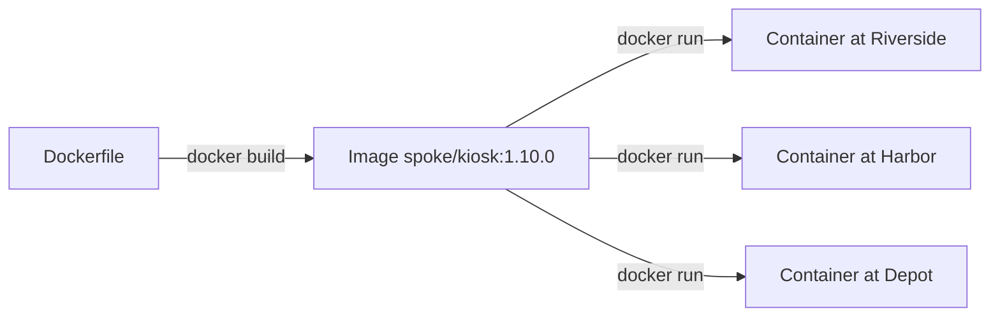
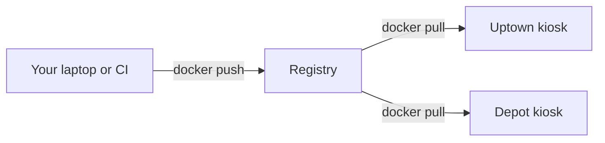

## Hook

Two new kiosk computers arrive, one for Depot and one for Uptown. Somebody installs Java on each by hand. Uptown gets one version, Depot gets another. The same `kiosk.jar` starts at Uptown and crashes at Depot.

Your CI pipeline already proves the code works on a clean machine. But the kiosk still depends on whatever Java each computer happens to have. You need to ship the jar together with the exact Java it needs, sealed in one box. That box is a container.

## Concept

```callout jargon
**Docker** is a tool that packs a program and everything it needs into one bundle. That bundle is an **image**. A running copy of an image is a **container**.
```

### Why containers

A container holds your jar, the exact Java version, and the files they need. You run the same image on your laptop, in CI and on every kiosk. So "works on my machine" becomes "works on every machine".

A container is lighter than a **virtual machine** (VM), a whole pretend computer with its own operating system inside. A container skips that. It shares the **kernel** of the computer it runs on, the core of the operating system that talks to the hardware. It only isolates your program's files, network and processes. So a container starts in about a second and uses little memory.

```callout tip
The Linux containers you will use need a Linux kernel. On Mac and Windows, Docker Desktop runs one small hidden Linux VM, and all your containers share its kernel.
```

```callout analogy
A shipping container fits on any ship, train or truck, whatever is inside. A Docker container runs on any computer with Docker, whatever Java is installed there.
```

### Images and containers

An **image** is a read-only package: a base system, Java, your jar, and the command to start it. A **container** is one running copy made from an image. You can start many containers from one image, and each has its own state.

You know this pattern from Java. An image is like a class. A container is like an object made with `new`. Or think of a recipe and a cooked meal: one recipe, many meals.



A **Dockerfile** is a text file of instructions that tells Docker how to build an image. Each line starts with an instruction word in capitals.

### Syntax: FROM and WORKDIR

```dockerfile
FROM eclipse-temurin:21-jre
WORKDIR /app
```

- `FROM` picks the **base image** you build on top of. `eclipse-temurin:21-jre` is a small Linux with a Java 21 runtime already installed.
- `WORKDIR` sets the folder inside the image where later instructions run. Docker creates it if it is missing.

### Syntax: COPY and RUN

```dockerfile
COPY target/kiosk.jar app.jar
RUN mkdir -p /app/data
```

- `COPY` copies files from your project into the image. Here the jar becomes `/app/app.jar`.
- `RUN` runs a command while the image is being **built**, not when the container starts.

### Syntax: ENV and EXPOSE

```dockerfile
ENV KIOSK_STATION=Riverside
EXPOSE 8080
```

- `ENV` sets an **environment variable**, a named text setting the program can read. This one is a default you can override later.
- `EXPOSE` notes that the program listens on port 8080. It is documentation only. It does not open the port to anyone.

### Syntax: ENTRYPOINT

```dockerfile
ENTRYPOINT ["java", "-jar", "app.jar"]
```

`ENTRYPOINT` is the command that runs when a container starts. Write it in **exec form**, a list of words in square brackets and double quotes. Then Java runs directly and hears `docker stop` politely asking it to shut down.

### Syntax: build and run

```bash
docker build -t spoke/kiosk:1.10.0 .
docker run --rm -p 8080:8080 spoke/kiosk:1.10.0
```

- `docker build` reads the Dockerfile and makes an image. The final `.` is the **build context**, the folder whose files `COPY` can see.
- `-t spoke/kiosk:1.10.0` gives the image a name, `spoke/kiosk`, and a **tag**, `1.10.0`. A tag is a version label.
- `docker run` starts a container. `--rm` deletes the container when it stops, so old ones don't pile up.
- `-p 8080:8080` connects a port on your computer to a port in the container. More on that below.

A few more flags and commands you will use every day:

| Command or flag | What it does |
|---|---|
| `-d` | Runs the container in the background ("detached") and gives your terminal back |
| `--name kiosk-harbor` | Gives the container a name you can type later |
| `-e KIOSK_STATION=Harbor` | Sets an environment variable inside the container |
| `docker ps` | Lists running containers |
| `docker logs kiosk-harbor` | Shows what the container printed. Add `-f` to keep watching |
| `docker stop kiosk-harbor` | Asks the container to stop |
| `docker exec -it kiosk-harbor sh` | Opens a shell inside a running container, so you can look around |
| `docker images` | Lists the images on your computer |

### Layers and the build cache

Every instruction that changes files, like `COPY` or `RUN`, adds a **layer** to the image. A layer is a saved snapshot of what that step changed. Docker stacks the layers to make the image.

Docker also keeps a **build cache**. If a step and everything it reads are unchanged since the last build, Docker reuses the saved layer. Once one step changes, that step and every step after it rebuild.

So order your instructions from least often changed to most often changed. Dependencies change rarely. Your Java code changes all the time.

```dockerfile
COPY pom.xml .
RUN mvn -q dependency:go-offline
COPY src ./src
RUN mvn -q package -DskipTests
```

Change a Java file and only the last two steps rebuild. The slow dependency download stays cached. `dependency:go-offline` asks Maven to download the libraries and plugins the build needs. It misses a few jars that plugins fetch only while they run, such as the one Surefire uses to start JUnit. So `package` may still download a little.

### Syntax: a cache mount

```dockerfile
RUN --mount=type=cache,target=/root/.m2 mvn -q package -DskipTests
```

**BuildKit**, Docker's builder, can keep a folder from one build to the next. `--mount=type=cache,target=/root/.m2` lends this `RUN` step Maven's download folder from the last build. The folder is not saved into the image, so the image stays small.

```dockerfile
COPY pom.xml .
COPY src ./src
RUN --mount=type=cache,target=/root/.m2 mvn -q package -DskipTests
```

Now even a change to `pom.xml` only downloads the new jars, not all of them. Many teams use this instead of the `go-offline` step. On a fresh CI runner the cache starts empty, unless the pipeline saves and restores it between runs.

### Syntax: multi-stage build

Building the jar needs Maven and a full JDK. Running it only needs a Java runtime. A **multi-stage build** uses one image to build and a second, smaller image to run.

```dockerfile
FROM maven:3.9-eclipse-temurin-21 AS build
WORKDIR /src
COPY pom.xml .
RUN mvn -q dependency:go-offline
COPY src ./src
RUN mvn -q package -DskipTests

FROM eclipse-temurin:21-jre
WORKDIR /app
COPY --from=build /src/target/kiosk.jar app.jar
ENTRYPOINT ["java", "-jar", "app.jar"]
```

- `AS build` names the first stage.
- `COPY --from=build` copies only the finished jar out of that stage.
- The final image is built from the last `FROM`. Maven, the JDK and your source code stay behind.

Inside the build stage you run `mvn`, not `./mvnw`. The `maven:3.9` image already has the right Maven installed. On your laptop, keep using `./mvnw`.

```callout jargon
A **JDK** (Java Development Kit) has the compiler plus the runtime. A **JRE** (Java Runtime Environment) only runs compiled code. A JRE image is roughly half the size of a JDK image.
```

### Syntax: .dockerignore

A `.dockerignore` file sits next to the Dockerfile. It lists files Docker should leave out of the build context.

```text
target/
.git
```

Without it, Docker sends your old build output and your whole Git history with every build. That is slow, and a stray file change can break the cache.

```callout warning
Ignore `target/` only when Docker builds the jar itself, as in the multi-stage build. A single-stage Dockerfile that runs `COPY target/kiosk.jar` needs that folder, so the build fails if you ignore it.
```

### Ports

A container has its own network, with its own `localhost`. A server inside listens on a **port**, a numbered door for network traffic. Nothing outside can reach that door until you publish it.

### Syntax: publishing a port

```bash
docker run --rm -p 9090:8080 spoke/kiosk:1.10.0
```

`-p host:container` reads "your computer's port 9090 goes to the container's port 8080". Now `http://localhost:9090` on your laptop reaches the kiosk.

```callout jargon
An **IP address** is the number other computers use to reach a computer on a network, like `192.168.1.20`. `127.0.0.1` is special: it always means "this same computer". Module 8 covers networks properly.
```

The server inside must listen on `0.0.0.0`, which means "every network address". If it listens on `127.0.0.1`, it only accepts traffic from inside the container itself.

```java
import com.sun.net.httpserver.HttpServer;
import java.net.InetSocketAddress;

public class KioskServer {
    public static void main(String[] args) throws Exception {
        HttpServer server = HttpServer.create(new InetSocketAddress("0.0.0.0", 8080), 0);
        server.createContext("/", exchange -> {
            byte[] body = "Spoke kiosk".getBytes();
            exchange.sendResponseHeaders(200, body.length);
            exchange.getResponseBody().write(body);
            exchange.close();
        });
        server.start();
    }
}
```

### Configuration with environment variables

The same image runs at Riverside and at Harbor. Only the station name differs. You don't build one image per station. You pass settings in with `-e`, and the program reads them.

```bash
docker run --rm -e KIOSK_STATION=Harbor spoke/kiosk:1.10.0
```

In Java, `System.getenv("NAME")` returns the variable's text, or `null` when it is not set. Always plan for `null`. Run this snippet.

```java run
public class Main {
    public static void main(String[] args) {
        String station = System.getenv("KIOSK_STATION");
        if (station == null) {
            station = "Riverside";
        }
        System.out.println("Spoke kiosk ready at " + station);
    }
}
```

The sandbox does not set `KIOSK_STATION`, so it prints `Spoke kiosk ready at Riverside`. Inside a container started with `-e KIOSK_STATION=Harbor`, it would say Harbor.

### Config from the environment, secrets from a vault

Build one image, and run that same image everywhere: on your laptop, on the test servers and at every kiosk. Whatever differs between those places comes in from outside, when the container starts. That way, the image you tested is the image you ship.

```callout jargon
The **twelve-factor app** is a well-known list of twelve rules for apps that run on servers. Rule three says: keep **config**, everything that changes between places, in the environment, never in the code or the image.
```

Passwords and keys are config too, but they need more care. Never put a secret in the Dockerfile with `ENV` or `ARG`. It is saved in the image, and anyone who can pull the image can read it. Here is a tiny test image that tried:

```bash
docker history --format "{{.CreatedBy}}" kiosk-test
```

```text
COPY app.txt /app/app.txt # buildkit
ENV DB_PASSWORD=spoke-db-7f3a9c
```

If the build itself needs a secret, say to download from a private repository, use `RUN --mount=type=secret`. It lends the secret to that one step and never saves it in a layer.

Real teams keep secrets in a **secret manager**. It is a locked service that stores them and gives each one only to the apps allowed to see it. It also logs every read. HashiCorp Vault and AWS Secrets Manager are two examples. When the container starts, the platform hands the secret in as an environment variable or a file.

```callout warning
If a secret leaks, **rotate** it: make a new one, switch the app to it, then turn the old one off. Deleting the line is not enough, because old images and the Git history still hold it.
```

### Syntax: volumes

Containers are throwaway. A file written inside a container disappears when the container is removed. A **volume** is storage that Docker keeps outside the container, so its files survive.

```bash
docker run -d --name kiosk-depot -v kiosk-data:/app/data spoke/kiosk:1.10.0
```

`-v kiosk-data:/app/data` reads "keep the volume named `kiosk-data` at `/app/data` inside the container". Docker creates the volume if it is new. Start a fresh container with the same `-v`, and the ride log is still there.

### Several containers: docker compose

Real apps rarely run alone. In module 8 the Spoke API stores rentals in a database. **Docker Compose** starts several containers together, from one file called `compose.yaml`.

```yaml
services:
  kiosk:
    image: spoke/kiosk:1.10.0
    ports:
      - "8080:8080"
    environment:
      KIOSK_STATION: Harbor
      DB_URL: jdbc:postgresql://db:5432/spoke
      DB_USER: spoke
      DB_PASSWORD: ${DB_PASSWORD}
    depends_on:
      db:
        condition: service_healthy

  db:
    image: postgres:16-alpine
    environment:
      POSTGRES_DB: spoke
      POSTGRES_USER: spoke
      POSTGRES_PASSWORD: ${DB_PASSWORD}
    volumes:
      - db-data:/var/lib/postgresql/data
    healthcheck:
      test: ["CMD-SHELL", "pg_isready -U spoke -d spoke"]
      interval: 5s
      retries: 10

volumes:
  db-data:
```

- Each entry under `services` is one container. `db` runs the PostgreSQL database.
- Compose puts both on one private network, where each **service name is also its address**. So the kiosk reaches the database at `db:5432`, not `localhost`.
- `depends_on` with `service_healthy` starts the kiosk only after the database's health check passes.
- `${DB_PASSWORD}` is read from your shell, or from a `.env` file next to `compose.yaml`. List `.env` in `.gitignore`.

```bash
docker compose up -d
docker compose logs -f kiosk
docker compose down
```

`up -d` starts everything in the background, `logs -f` follows one service, and `down` stops and removes the containers. The volume survives `down`. Add `-v` only when you really want the data gone.

```animate
title: Compose starts the kiosk and its database
kind: scene
nodes:
  - { id: you, label: docker compose up, emoji: "💻", row: 0, col: 0 }
  - { id: db, label: db container, emoji: "🐘", value: stopped, row: 0, col: 1 }
  - { id: kiosk, label: kiosk container, emoji: "🚲", value: waiting, row: 0, col: 2 }
  - { id: vol, label: db-data volume, emoji: "💾", row: 1, col: 1 }
steps:
  - say: Compose reads compose.yaml. The kiosk depends on db, so db starts first.
    send: { from: you, to: db, label: start }
    set: { db: starting }
  - say: The database keeps its files in the db-data volume, so they survive a restart.
    send: { from: db, to: vol, label: files }
  - say: Every five seconds, pg_isready asks the database if it is ready. Then it reports healthy.
    set: { db: healthy }
  - say: Only now does Compose start the kiosk.
    send: { from: you, to: kiosk, label: start }
    set: { kiosk: running }
  - say: The kiosk connects to db:5432. On Compose's network, the service name works as an address.
    send: { from: kiosk, to: db, label: "db:5432" }
```

If `DB_PASSWORD` is not set, Compose does not stop. It warns once for each place the variable is used, then uses an empty password:

```text
WARN[0000] The "DB_PASSWORD" variable is not set. Defaulting to a blank string.
WARN[0000] The "DB_PASSWORD" variable is not set. Defaulting to a blank string.
```

Write `${DB_PASSWORD:?set DB_PASSWORD first}` instead, and Compose refuses to start until you set it.

### Registries and tags

A **registry** is an online store for images. Docker Hub is the public one. Companies often run their own private registry. You `push` an image up once, and every kiosk can `pull` it down.

### Syntax: push and pull

```bash
docker push spoke/kiosk:1.10.0
docker pull spoke/kiosk:1.10.0
```

To use a company registry, put its address at the front of the name, for example `registry.example.com/spoke/kiosk:1.10.0`. You may need `docker login` first.

If you leave the tag off, Docker uses the tag `latest`. That name does not mean newest. It is just whatever someone last pushed under that tag, so it can change under your feet. In production, always use a version tag, and make the tag match the version you released.

### Production-ready images

The images so far work. Before one runs at every kiosk, three more lines make it safer to run and easier to watch.

```dockerfile
FROM eclipse-temurin:21-jre
WORKDIR /app
RUN useradd --system --uid 10001 kiosk \
 && mkdir -p /app/data \
 && chown kiosk /app/data
COPY --from=build /src/target/kiosk.jar app.jar
USER kiosk
EXPOSE 8080
HEALTHCHECK --interval=30s --timeout=3s CMD curl -fs http://localhost:8080/health || exit 1
ENTRYPOINT ["java", "-XX:MaxRAMPercentage=75", "-jar", "app.jar"]
```

- **`USER kiosk`.** Most images, Temurin's included, run your program as `root`, the all-powerful user, unless you say otherwise. If an attacker breaks into the kiosk, a plain user gives them far less power. The `RUN` line makes that user and lets it write to `/app/data`.
- **`HEALTHCHECK`.** Docker runs this command every 30 seconds. If `/health` stops answering, `docker ps` shows the container as `unhealthy`, and tools that watch it can restart it. The Temurin image includes `curl`; check that yours does.
- **`-XX:MaxRAMPercentage=75`.** It tells Java how much of the container's memory to use for the heap. The next card explains why.

When something looks wrong in a running container, `docker exec -it kiosk-harbor sh` opens a shell inside it. You can read its files and check its environment, without stopping it.

### Java inside a memory limit

Each kiosk runs its container with a memory limit, such as `docker run -m 512m`. Java notices that limit. But by default it gives the heap only 25% of it: 128 MB out of 512 MB.

`-XX:MaxRAMPercentage=75` raises the heap to 75%, here 384 MB. Leave the rest free, because Java also needs memory outside the heap: thread stacks, loaded classes and the JVM itself. You met the heap and the stack in [JVM memory](/t/module-05-advanced-java/topic-07-jvm-memory).

If the whole container goes over its limit, the operating system kills it on the spot. Java gets no `OutOfMemoryError`, and there is no stack trace. The container just stops with **exit code 137**. Here a small test container, limited to 16 MB, runs a command that keeps eating memory. It uses `redis:7-alpine` only because that small image with a shell was already on the test machine; any small image with `sh` works.

```bash
docker run --name oom-demo -m 16m --memory-swap 16m redis:7-alpine sh -c 'tail /dev/zero'
docker inspect --format '{{.State.OOMKilled}} {{.State.ExitCode}}' oom-demo
```

```text
true 137
```

`OOMKilled` is `true`: the kernel's out-of-memory killer stopped it. 137 is 128 plus 9, and 9 is the signal number for "kill now".

| What you see | What happened | Fix |
|---|---|---|
| `OutOfMemoryError: Java heap space`, with a stack trace | The heap is full, but the container is fine | Find the leak, or raise `MaxRAMPercentage` |
| Exit code 137, `OOMKilled` true, no Java error | The whole container went over its limit | Lower `MaxRAMPercentage`, or raise the container's limit |

## Worked example

Kakashi's ticket: one image that carries its own Java, for every kiosk. Here is the kiosk project.

```text
kiosk/
  .dockerignore
  Dockerfile
  pom.xml          (sets <finalName>kiosk</finalName>, so the jar is target/kiosk.jar)
  src/
    main/java/spoke/kiosk/KioskApp.java
```

The full Dockerfile:

```dockerfile
# Stage 1: build the jar with Maven and a full JDK
FROM maven:3.9-eclipse-temurin-21 AS build
WORKDIR /src
COPY pom.xml .
RUN mvn -q dependency:go-offline
COPY src ./src
RUN mvn -q package -DskipTests

# Stage 2: run the jar on a small Java 21 runtime
FROM eclipse-temurin:21-jre
WORKDIR /app
COPY --from=build /src/target/kiosk.jar app.jar
ENV KIOSK_STATION=Riverside
EXPOSE 8080
ENTRYPOINT ["java", "-jar", "app.jar"]
```

Line by line:

1. Lines starting with `#` are comments.
2. The build stage starts from an image that already has Maven and JDK 21.
3. `pom.xml` is copied alone, then dependencies download. This layer stays cached until the pom changes.
4. The source is copied last, then `mvn package` builds the jar. `-DskipTests` skips the tests, because CI already ran them.
5. The runtime stage starts fresh from the JRE image. It copies in only the jar.
6. `ENV` gives a default station. `EXPOSE` documents port 8080. `ENTRYPOINT` starts the kiosk.

Build it and look at the result. The output is shortened.

```bash
docker build -t spoke/kiosk:1.10.0 .
docker images spoke/kiosk
```

```text
[+] Building 61.4s (15/15) FINISHED
 => [build 1/6] FROM docker.io/library/maven:3.9-eclipse-temurin-21
 => [build 4/6] RUN mvn -q dependency:go-offline
 => [build 6/6] RUN mvn -q package -DskipTests
 => [stage-1 3/3] COPY --from=build /src/target/kiosk.jar app.jar
 => naming to docker.io/spoke/kiosk:1.10.0

REPOSITORY    TAG     IMAGE ID       CREATED          SIZE
spoke/kiosk   1.10.0   9b1e7c3a2f10   10 seconds ago   290MB
```

Change one Java file and build again. Notice `CACHED` on the dependency step.

```text
[+] Building 9.8s (15/15) FINISHED
 => CACHED [build 3/6] COPY pom.xml .
 => CACHED [build 4/6] RUN mvn -q dependency:go-offline
 => [build 5/6] COPY src ./src
 => [build 6/6] RUN mvn -q package -DskipTests
```

Now run it as the Harbor kiosk, in the background, and check on it.

```bash
docker run -d --rm --name kiosk-harbor -p 8080:8080 -e KIOSK_STATION=Harbor spoke/kiosk:1.10.0
docker ps
docker logs kiosk-harbor
docker stop kiosk-harbor
```

```text
CONTAINER ID   IMAGE               COMMAND               STATUS         PORTS                    NAMES
3f9c2a1b7d4e   spoke/kiosk:1.10.0   "java -jar app.jar"   Up 5 seconds   0.0.0.0:8080->8080/tcp   kiosk-harbor

Spoke kiosk ready at Harbor
Listening on 0.0.0.0:8080
```

Finally, push it so Depot and Uptown pull the very same image.

```bash
docker push spoke/kiosk:1.10.0
```



## Try it

First, the configuration side. Run this, then change the default port to `9090` and run it again.

```java run
public class Main {
    public static void main(String[] args) {
        String text = System.getenv("KIOSK_PORT");
        int port = Integer.parseInt(text == null ? "8080" : text);
        System.out.println("Kiosk will listen on 0.0.0.0:" + port);
    }
}
```

Environment variables are always text, so a number needs `Integer.parseInt`.

If Docker is installed, build a jar with `./mvnw package` first. Then put this single-stage Dockerfile next to `pom.xml`. It copies your ready-made jar, so leave `target/` out of any `.dockerignore`.

```dockerfile
FROM eclipse-temurin:21-jre
WORKDIR /app
COPY target/kiosk.jar app.jar
ENV KIOSK_STATION=Riverside
EXPOSE 8080
ENTRYPOINT ["java", "-jar", "app.jar"]
```

Build it with `docker build -t spoke/kiosk:1.10.0 .`. Run it twice with different `-e KIOSK_STATION` values, and read each one's `docker logs`.

No Docker? Do it on paper. Reorder these lines so a code change does not download dependencies again:

```dockerfile
FROM maven:3.9-eclipse-temurin-21 AS build
WORKDIR /src
COPY src ./src
RUN mvn -q package -DskipTests
COPY pom.xml .
RUN mvn -q dependency:go-offline
```

The answer: `pom.xml` and the dependency step move up, right after `WORKDIR`.

## Recap

- An image is a read-only package, like a class. A container is a running copy, like an object.
- A Dockerfile builds an image: `FROM`, `WORKDIR`, `COPY`, `RUN`, `ENV`, `EXPOSE` and `ENTRYPOINT`. Production images add `USER`, a `HEALTHCHECK` and a Java memory share. Exit code 137 with `OOMKilled` true means the container went over its memory limit.
- Each step makes a cached layer. Put rarely changed steps first, and use a multi-stage build for a small JRE image.
- `-p host:container` publishes a port, and the server inside must listen on `0.0.0.0`. `docker compose` starts several containers that reach each other by service name.
- One image runs everywhere: settings come in with `-e`, secrets come from a secret manager and never sit in the image. Keep data in volumes with `-v`, and push version tags, not `latest`.

## Common mistakes

**1. Forgetting -p, so the port is unreachable.**

```bash
docker run --rm spoke/kiosk:1.10.0
curl http://localhost:8080
```

`curl` is a command that sends a web request from the terminal, like a browser without the window.

What you see: the logs say the kiosk is listening, but your computer can't connect.

```text
curl: (7) Failed to connect to localhost port 8080 after 3 ms: Couldn't connect to server
```

Fix: publish the port. `EXPOSE` alone does not do it. Run `docker run --rm -p 8080:8080 spoke/kiosk:1.10.0`.

**2. The server inside listens on 127.0.0.1.**

```java nocompile
HttpServer server = HttpServer.create(new InetSocketAddress("127.0.0.1", 8080), 0);
```

What you see: you used `-p 8080:8080`, but the connection is reset or the reply is empty.

```text
curl: (56) Recv failure: Connection reset by peer
```

Fix: inside a container, `127.0.0.1` means "only this container". Listen on `0.0.0.0` so published traffic can reach the server.

**3. Using latest and getting a different image later.**

```bash
docker pull spoke/kiosk
```

What you see: Uptown pulled on Monday and Depot pulled on Friday, after a new push. The two kiosks show different fares for the same ride.

Fix: pull an exact version, `docker pull spoke/kiosk:1.10.0`. Pin base images too. `eclipse-temurin:21-jre` moves to each new Java 21 update. For fully repeatable builds, use an exact tag shaped like `eclipse-temurin:21.0.x_y-jre`, or a **digest**, a unique fingerprint that names one exact image.

**4. Copying the whole project before downloading dependencies.**

```dockerfile
FROM maven:3.9-eclipse-temurin-21 AS build
WORKDIR /src
COPY . .
RUN mvn dependency:go-offline
RUN mvn package -DskipTests
```

What you see: every one-line code change downloads all dependencies again, and each build takes minutes.

```text
Downloading from central: https://repo.maven.apache.org/maven2/...
```

Fix: copy `pom.xml` first, download dependencies, then copy `src`. Because Docker builds the jar here, add a `.dockerignore` with `target/` and `.git`.

**5. Data that lived only inside the container.**

```bash
docker run -d --rm --name kiosk-depot spoke/kiosk:1.10.0
```

What you see: the kiosk writes rides to `/app/data/rides.log`. After a restart, the log is empty, and the day's rides at Depot are gone.

Fix: keep that folder in a volume, `docker run -d --rm --name kiosk-depot -v kiosk-data:/app/data spoke/kiosk:1.10.0`.
