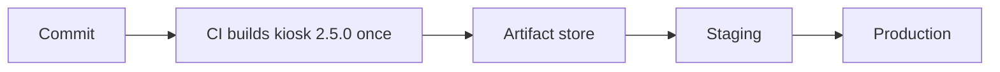

## Hook

Spoke is trying a new kind of bike seat. Nobody swaps the seats on all 200 bikes overnight. Instead, ten bikes at Harbor get the new seat for a week. If riders complain, ten seats go back. If riders love it, the rest follow, one station at a time.

Last Friday, Spoke did the opposite with software. The new kiosk version went to all five stations at once. It crashed on every one. Getting the old version back took 40 minutes, because someone had to rebuild it first.

Shipping software safely is the bike-seat plan, done with code. Try it small, watch closely, and always keep the old version one step away.

## Concept

### Deploy is not release

```callout jargon
**Production** is the real system that riders use. To **deploy** is to put a new version of the code onto the machines. To **release** a feature is to let riders actually use it. A **rollback** puts the previous version back.
```

Most people think deploying and releasing are the same moment. Good teams pull them apart. They deploy new code switched off, then release it later, on purpose, to a few riders at a time. You will see how with feature flags below.

### Environments: dev, staging, production

An **environment** is one complete place where the software runs, with its own servers, database and settings.

| Environment | Who uses it | What it is for |
|---|---|---|
| dev | you, on your laptop or a shared test server | building and trying things |
| staging | the team | a copy of production with fake riders, for the last checks |
| production | real riders | the real thing |

Staging should look like production as closely as possible: the same Java, the same container setup, a database of the same kind. Every difference is a place where "it worked in staging" can still fail in production.

### Build once, deploy many

```callout jargon
An **artifact** is the file a build produces, such as the kiosk jar or its container image. **Promoting** an artifact means sending the exact same file on to the next environment.
```

The pipeline builds the artifact once. That same file goes to staging, gets checked, and then goes to production. Nobody rebuilds it on the way.



Why not just build again for production? A second build can pick up a newer library, a different JDK or one more commit. Then production runs a file nobody tested. Build once means "what you tested is exactly what you ship".

Every artifact gets a **version** that never changes meaning:

- A **semantic version** has three numbers, `MAJOR.MINOR.PATCH`, such as `2.5.0`. Bump PATCH for a bug fix, MINOR for a new feature that breaks nothing, MAJOR for a breaking change.
- Many teams also add the Git commit ID, as in `2.5.0-a41c9e2`. Then anyone can find the exact code behind a running version.

```callout warning
Never reuse a version for different code, and never deploy the `latest` tag. With `latest`, nobody can say what is running, and "roll back to the previous `latest`" means nothing.
```

### Deploy strategies

A **deploy strategy** is the plan for swapping the old version for the new one. There are four you must know.

```callout jargon
A **load balancer** is a program that spreads incoming requests across several servers. Changing its settings decides which version riders reach. **Downtime** is time when riders cannot use the service at all.
```

| Strategy | How it works | Downtime | Rolling back | Cost and risk |
|---|---|---|---|---|
| Recreate | stop every old server, then start the new ones | yes | redeploy the old version: slow | cheap, but a bug hits everyone at once |
| Rolling | replace servers a few at a time | none | roll the old version back out, a few at a time | old and new run side by side for a while |
| Blue-green | run a full second copy ("green") next to the live one ("blue"), then switch all traffic | none | switch traffic back: seconds | double the servers during the switch; everyone moves at once |
| Canary | send a small share of riders to the new version first, then more | none | send that share back: seconds | needs good monitoring and automation; rollout takes longer |

Recreate is fine on your own dev server. In production, most teams use rolling deploys by default and canaries for risky changes. Friday's release was a recreate on all five stations. That is why every rider saw the crash.

### Canary releases

A **canary** release gives the new version to a small share of traffic first, such as 5%. Old miners carried a canary into the mine: it fell ill before the miners did. Your canary warns you before most riders feel a problem.

```animate
title: A canary that goes wrong, safely
kind: scene
nodes:
  - { id: riders, label: Riders, emoji: "🚲", row: 0, col: 0 }
  - { id: lb, label: Load balancer, emoji: "🔀", value: "100% → 2.4.1", row: 0, col: 2 }
  - { id: old, label: "Kiosk 2.4.1", emoji: "🟦", row: 1, col: 1 }
  - { id: canary, label: "Kiosk 2.5.0", emoji: "🟩", row: 1, col: 3 }
  - { id: dash, label: Dashboard, emoji: "📈", value: "errors 0.1%", row: 0, col: 4 }
steps:
  - say: Every rider request goes through the load balancer to version 2.4.1.
    send: [{ from: riders, to: lb, label: requests }, { from: lb, to: old, label: "100%" }]
  - say: Version 2.5.0 is deployed next to it. The load balancer sends it 5% of riders.
    show: [canary]
    send: { from: lb, to: canary, label: "5%" }
    set: { lb: "95% / 5%" }
  - say: The dashboard compares the two. The new version's error rate jumps to 8%, while the old stays at 0.1%.
    focus: [dash, canary]
    set: { dash: "old 0.1%, new 8%" }
  - say: That breaks the rule set before the deploy. The automation sends all traffic back to 2.4.1 in seconds.
    send: { from: dash, to: lb, label: roll back }
    set: { lb: "100% → 2.4.1" }
  - say: Only 5% of riders saw errors, for two minutes. Without the canary, it would have been everyone.
    hide: [canary]
    set: { dash: "errors 0.1%" }
  - say: Had the numbers stayed healthy, the share would grow, to 25%, then 50%, then 100%.
    focus: [lb]
```

### Health checks and automatic rollback

How does the automation know a version is sick? It asks.

```callout jargon
A **health check** is a small request, such as `GET /health`, that a server answers with "OK" when it can do its job. A **smoke test** is a quick check of the most important paths, like "can a rider unlock B-1042?", right after a deploy.
```

- A new server only gets traffic once its health check passes. Kubernetes, a popular system for running containers, calls this the **readiness** check. A separate **liveness** check restarts a server that has frozen.
- During the rollout, the pipeline also watches numbers: error rate, response time, failed payments.
- If a number crosses a line set in advance, the pipeline rolls back by itself. Nobody has to wake up and decide.

Spring Boot gives you a health endpoint for free, at `/actuator/health`, once you add its Actuator library.

### Rolling back: redeploy first, revert second

When production breaks, you have two ways back.

| | Redeploy the previous artifact | Revert the commit |
|---|---|---|
| What you do | point production at version 2.4.1 again | `git revert` the bad commit, then build a new version |
| How fast | seconds to minutes: the file already exists | as long as your whole pipeline, often 20 minutes or more |
| What it fixes | production, right now | `main`, so the bug does not come back next release |

Do both, in that order. Redeploy first, because riders are hurting now. Then revert or fix on `main`. Friday took 40 minutes because the team had only the slow road: the old version had to be rebuilt.

### Database changes: expand, then contract

A rollback swaps the code, but it does not swap the database. If version 2.5.0 deletes a column that 2.4.1 reads, rolling back to 2.4.1 crashes too. So every database change must work with both the old and the new code.

Say the `rentals` table has a column `bike_type`, and you want to rename it `bike_kind`. Never rename it in one step. Use **expand and contract**:

1. **Expand.** Add the new column `bike_kind`. Old code ignores it.
2. Deploy code that writes both columns, and copy the old values across.
3. Deploy code that reads `bike_kind` and stops using `bike_type`.
4. **Contract.** Once no running version reads or writes `bike_type`, drop it in a later release.

At every step, the previous version still works, so you can always roll back one step. Module 8 shows how to do this with real SQL.

### Feature flags

```callout jargon
A **feature flag** is a switch the code checks at runtime: "is night-discount on?". Flipping it changes behaviour without a deploy. A **kill switch** is a flag used to turn a feature off fast in an emergency.
```

Flags are how you deploy without releasing. The night-discount code goes to production switched off. Later you turn it on, maybe for 10% of riders first. If it misbehaves, you turn it off in seconds.

```java run
import java.util.HashMap;
import java.util.Map;

public class Main {
    public static void main(String[] args) {
        Flags flags = new Flags();
        FareCalculator calc = new FareCalculator(flags);

        System.out.println("flag off: " + calc.fareCents(20, true) + " cents");
        flags.set("night-discount", true);
        System.out.println("flag on:  " + calc.fareCents(20, true) + " cents");
        System.out.println("daytime:  " + calc.fareCents(20, false) + " cents");
        flags.set("night-discount", false);
        System.out.println("kill switch: " + calc.fareCents(20, true) + " cents");
    }
}

class Flags {
    private final Map<String, Boolean> values = new HashMap<>();

    boolean isOn(String name) {
        return values.getOrDefault(name, false);
    }

    void set(String name, boolean on) {
        values.put(name, on);
    }
}

class FareCalculator {
    private final Flags flags;

    FareCalculator(Flags flags) {
        this.flags = flags;
    }

    long fareCents(int minutes, boolean night) {
        long fare = 100 + minutes * 15L;
        if (flags.isOn("night-discount") && night) {
            fare -= 50;
        }
        return fare;
    }
}
```

In a real system, `Flags` reads from a flag service or a settings table. Then the team can flip a flag without touching the servers. Notice `getOrDefault(name, false)`: a flag nobody has set is off. That is the safe default.

```callout warning
Every flag is a fork in the code, and old forks pile up. Give each flag an owner and a removal date. Once a feature is fully on, delete the flag and the old path. In 2012, the trading firm Knight Capital lost about $440 million in 45 minutes. Part of the cause was an old flag reused for new code, on a server still running old code.
```

### Trunk-based development

```callout jargon
**Trunk-based development** means everyone merges small changes into `main` (the "trunk") at least once a day. A **long-lived branch** is one that lives for weeks before it merges.
```

Long-lived branches drift away from `main`. The merge at the end is huge, full of conflicts, and hard to test. Trunk-based teams merge small pull requests all day. Unfinished features hide behind flags, so `main` can ship at any moment.

Short release branches, like `release/2.4` from the last ticket, still fit. They are cut from `main` for one version and only take cherry-picked fixes.

### Checklists and freezes

A **release checklist** is a short list someone ticks before a risky release. Typical items: CI green, rollback plan written, database change backward compatible, dashboards open, and an engineer ready to respond if it breaks. A **change freeze** is a period, such as a city festival weekend, when only urgent fixes ship.

### DORA metrics: is the team shipping well?

DORA, a long-running research program on software teams, found four numbers that separate strong teams from weak ones:

- **Deployment frequency**: how often you deploy to production.
- **Lead time for changes**: how long from a commit to that commit running in production.
- **Change failure rate**: the share of deploys that cause a problem in production.
- **Time to restore service**: how long it takes to recover when production breaks. Newer reports call it failed deployment recovery time.

The 2024 report added a fifth measure, **rework rate**: the share of deploys that were unplanned fixes for problems riders hit.

The surprise in the research: speed and safety go together. Top teams deploy small changes many times a day, and they also break things less and recover faster.

### In an interview

In system design interviews, "how do you roll this out safely?" is a common follow-up. A strong answer names: build once and promote, a canary or blue-green deploy, health checks with automatic rollback, backward-compatible database changes, and feature flags.

Classic questions:

- "What is the difference between deploying and releasing?"
- "How would you roll out a risky change to 1% of users?"
- "How do you rename a database column with zero downtime?" Expand, then contract.
- "Production broke after a deploy. What do you do first?" Roll back, then find the cause.
- "How do you know your team ships well?" The four DORA metrics.

## Worked example

Ticket SPK-0707: ship kiosk 2.5.0, with the new night discount, without a repeat of Friday. Here is the plan, step by step.

**Step 1: build once.** CI builds commit `a41c9e2` and stores one artifact, `spoke/kiosk:2.5.0-a41c9e2`. Every later step uses this exact image. The night-discount code is inside it, but behind the `night-discount` flag, which is off.

**Step 2: expand the database.** The discount needs a new column, `night_discount_cents`, in `rentals`, with a default of 0. Version 2.4.1 never reads it, so 2.4.1 keeps working beside it. A rollback stays safe.

**Step 3: staging.** The same image goes to staging. Smoke tests unlock B-1042 at Riverside and end a 20-minute ride at Harbor. The e-bike fare checks out: 100 + 20 × 30 = 700 cents. All green.

**Step 4: canary at one station.** The kiosk at Harbor gets 2.5.0 first. The pipeline waits for its health check, then watches its error rate for 30 minutes against the other four stations. The rule, set in advance: more than 1% errors means automatic rollback to 2.4.1.

**Step 5: roll out.** Harbor stays healthy. The pipeline updates the other stations one at a time: Riverside, Old Mill, Uptown, Depot. That is a rolling deploy. Every station runs 2.5.0, and no rider has seen the discount yet.

**Step 6: release, a few riders at a time.** Now the flag goes on for 10% of riders. Each rider must land in the same group every time, or their fare would flip between rides. So the code turns the rider id into a fixed number from 0 to 99, called a **bucket**:

```java run
public class Main {
    static boolean inRollout(String riderId, int percent) {
        int bucket = Math.floorMod(riderId.hashCode(), 100);
        return bucket < percent;
    }

    public static void main(String[] args) {
        String[] riders = {"rider-7", "rider-20", "rider-24", "rider-31", "rider-53"};
        for (String rider : riders) {
            System.out.println(rider + ": 10% " + inRollout(rider, 10)
                    + ", 50% " + inRollout(rider, 50)
                    + ", 100% " + inRollout(rider, 100));
        }
    }
}
```

`String.hashCode()` gives the same number for the same text on every machine. `Math.floorMod` keeps the bucket between 0 and 99, even when the hash is negative. Raising the percent only adds riders. Nobody who already has the discount loses it. Real flag systems hash the flag name with the rider id, as in `(flagName + ":" + riderId).hashCode()`, so each feature's first 10% is a different group of riders.

**Step 7: the kill switch.** At 50%, Itachi forwards a complaint: a cargo-bike rider got the discount twice. The flag goes off in seconds, with no deploy. The fix ships as 2.5.1, through the same pipeline, and the flag goes back on.

**Step 8: clean up.** Two weeks at 100% with no problems. A small pull request deletes the flag check and the old path. The flag's owner closes the cleanup ticket.

Friday's release reached every rider at once and took 40 minutes to undo. This one never put more than one station, or half the riders, at risk. Each step back took seconds.

## Try it

Practise a blue-green switch with a fake kiosk. A **symbolic link**, or symlink, is a tiny file that points at another file or folder, like a signpost. Production servers often run whatever `live` points at, so switching versions means moving the signpost.

```bash
mkdir -p ~/spoke-practice/deploy-lab
cd ~/spoke-practice/deploy-lab
mkdir -p releases/2.4.1 releases/2.5.0 releases/2.5.1
echo 'echo "kiosk 2.4.1: fares OK"' > releases/2.4.1/kiosk.sh
echo 'echo "kiosk 2.5.0: night discount ready"' > releases/2.5.0/kiosk.sh
echo 'echo "kiosk 2.5.1: ERROR fare table missing"; exit 1' > releases/2.5.1/kiosk.sh
```

Each folder is one release. `sh` runs a shell script, and `exit 1` makes the broken 2.5.1 report failure.

1. Make `live` point at 2.4.1 and run it. `ln -s` makes a symlink, and `readlink` shows where one points.

```text
% ln -s releases/2.4.1 live
% readlink live
releases/2.4.1
% sh live/kiosk.sh
kiosk 2.4.1: fares OK
```

2. Switch to 2.5.0. `-f` replaces the old link, and `-n` stops `ln` from making a link inside the folder instead.

```text
% ln -sfn releases/2.5.0 live
% sh live/kiosk.sh
kiosk 2.5.0: night discount ready
```

3. Roll back in one step: `ln -sfn releases/2.4.1 live`, then `sh live/kiosk.sh`. You are on 2.4.1 again, and nothing was rebuilt.

4. Automate it. Create `deploy.sh` in the same folder with your editor:

```bash
previous=$(readlink live)
ln -sfn "releases/$1" live
echo "deployed $1"
if sh live/kiosk.sh; then
  echo "health check passed: $1 is live"
else
  ln -sfn "$previous" live
  echo "health check FAILED: rolled back to $previous"
fi
```

`$1` is the first word after the script's name. `$(readlink live)` saves where `live` pointed before the switch. The `if` runs the kiosk as a health check.

5. Deploy a good version, then a broken one:

```text
% sh deploy.sh 2.5.0
deployed 2.5.0
kiosk 2.5.0: night discount ready
health check passed: 2.5.0 is live
% sh deploy.sh 2.5.1
deployed 2.5.1
kiosk 2.5.1: ERROR fare table missing
health check FAILED: rolled back to releases/2.5.0
% readlink live
releases/2.5.0
```

The broken release never stayed live. Every old release is still on disk, so any rollback is one link away. Real blue-green deploys switch a load balancer instead of a symlink, but the idea is the same.

## Recap

- Deploying puts code on the machines, and releasing lets riders use it. Feature flags let you do them at different times.
- Build the artifact once, give it a version that never changes, and promote that same file from staging to production.
- Recreate causes downtime, rolling swaps a few servers at a time, blue-green flips all traffic, and canary tries a small share first.
- Health checks and preset limits trigger automatic rollback. Redeploy the previous artifact first, then revert or fix on `main`.
- Database changes expand, then contract, so the old version still works. Trunk-based teams merge small changes daily, and DORA's four metrics show how well a team ships.

## Common mistakes

**1. Rebuilding for production.**

```bash
git pull
./mvnw package
```

What you see: run on the production server, this builds a jar nobody tested. Staging passed, yet production breaks, because the new build picked up a newer library or an extra commit. Fix: build once in CI, store the artifact with its version, and deploy that exact file everywhere.

**2. Shipping to everyone at once.**

What you see: Friday's release. One bug, five stations down, every rider affected. Fix: start with a canary, such as one station or 5% of traffic. Widen only while health checks and error rates stay healthy.

**3. Rolling back by reverting and waiting for the pipeline.**

What you see: `git revert`, push, then 25 minutes of CI and deploy while riders keep seeing errors. Fix: keep previous artifacts, and redeploy the last good version first. That takes seconds or minutes. Revert on `main` afterwards.

**4. Dropping a column in the same release that stops using it.**

What you see: version 2.5.0 deletes `bike_type`. The release goes wrong, you roll back to 2.4.1, and 2.4.1 fails too, because it still reads `bike_type`. Now there is no way back. Fix: expand, then contract. Drop the old column only in a later release, once no running version reads or writes it.

**5. Deploying the latest tag.**

```bash
docker run spoke/kiosk:latest
```

What you see: two stations both run `latest`, but different code, because `latest` moved between their deploys. Nobody can say which version broke. Fix: deploy exact versions, such as `spoke/kiosk:2.5.0-a41c9e2`, and record which version runs where.

**6. Flags that never die.**

What you see: the code is full of `if (flags.isOn(...))` checks for features that shipped a year ago. Nobody knows which are safe to remove, and someone reuses an old flag name for something new. Fix: give every flag an owner and a removal date, and delete it once the feature is fully on.
