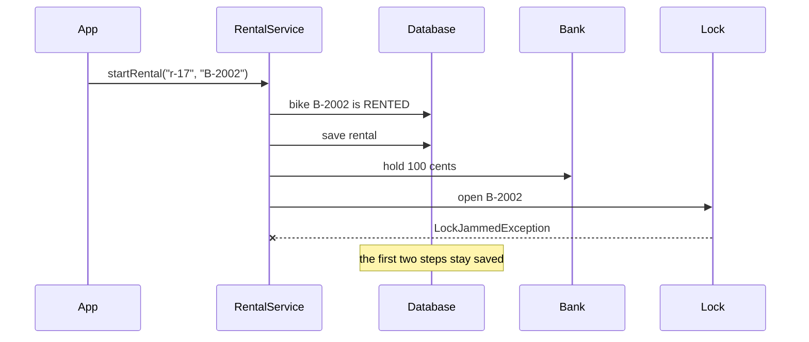

## What happened

Unlocking a bike takes four steps. `RentalService.startRental` reserves the bike, saves a rental, holds 100 cents on the rider's card, then opens the dock's lock.

Last night, Harbor's docks lost power halfway through. The lock step failed, but the first steps were already saved. Six bikes now say RENTED, and nobody is riding them.



Two more problems arrived with the same ticket. Declined cards leave bikes blocked. A family's group unlock left a ghost rental too.

## What you need

This builds on topic 10 (transactions) and topic 09 (JPA).

### Syntax: one transaction for a whole method

```java nocompile
@Transactional
public Rental startRental(String riderId, String bikeId) throws PaymentDeclinedException {
```

Spring starts a transaction before the method and commits when it returns. If an unchecked exception escapes, Spring rolls back every change instead.

### Syntax: rolling back for a checked exception

```java nocompile
@Transactional(rollbackFor = PaymentDeclinedException.class)
```

By default, a checked exception still commits. Spring assumes you planned for it. `rollbackFor` says this one must undo the work too.

### Syntax: calling through the bean, not through this

```java nocompile
rentals.startRental(riderId, bikeId);   // goes through Spring's proxy
unlockOne(riderId, bikeId);             // same as this.unlockOne: no proxy, no transaction
```

```callout jargon
A **proxy** is a stand-in object. Spring gives other beans a proxy instead of your real `RentalService`. The proxy starts and ends the transaction, then calls your method. A call through `this` skips the stand-in.
```

The checks swap the real bank and the real lock for Mockito fakes. The fake bank declines rider `r-broke`. The fake lock jams on `B-2002`.

## The tiers

1. **Bronze** resolves the incident. A jammed lock rolls back the whole unlock: the bike is AVAILABLE again, still docked at its station, and has no rental. The `LockJammedException` still reaches the caller.
2. **Silver**: a declined payment rolls back the same way, and `PaymentDeclinedException` still reaches the caller. Another rider can then take the bike.
3. **Gold**: `GroupRentals.unlockAll` treats each bike on its own. A jam on one bike undoes only that bike. A declined card undoes every bike, because each one fails at the payment step.

Change only `RentalService` and `GroupRentals`.

## Recap

- A transaction makes several database changes succeed or fail as one.
- `@Transactional` rolls back on unchecked exceptions. Name checked ones with `rollbackFor`.
- Spring's transactions live in a proxy. A call through `this` skips it, so call another bean instead.
- A rollback only undoes the database. The 100 cents held at the bank need their own undo, a "release hold" call. Real payment code adds that step.

## Common mistakes

**Catching the exception inside the method.** If `startRental` catches `LockJammedException` and returns normally, Spring sees a happy method and commits. Let the exception escape, or roll back yourself.

**Making unlockOne private.** Spring still cannot see the call. A private method is never proxied, and the call still goes through `this`.

**Adding `@Transactional` to unlockAll.** Then the whole family ride is one transaction. One jammed bike marks it for rollback, and the end of `unlockAll` fails:

```text
org.springframework.transaction.UnexpectedRollbackException: Transaction silently rolled back because it has been marked as rollback-only
```

All three bikes are undone, and the gold check fails. Keep `unlockAll` without a transaction, so each bike gets its own.

**Keeping the copied code.** Two copies of the unlock steps drift apart. Call the one in `RentalService`.
