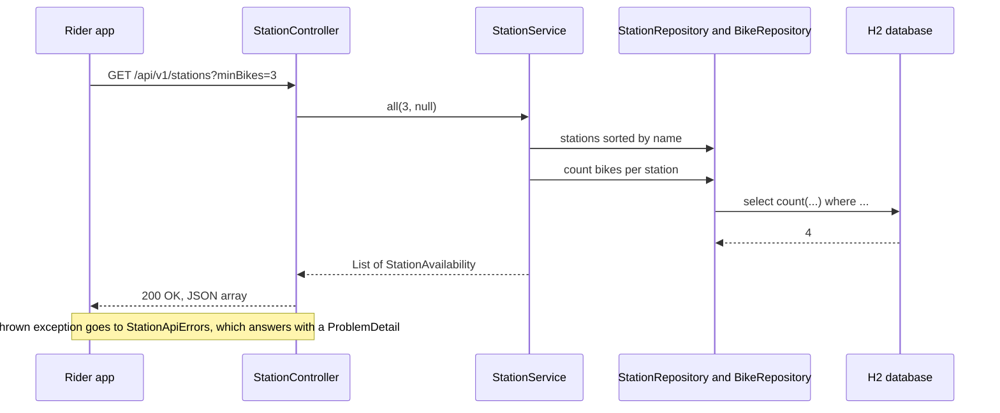

## The design

The rider app's map, and Riverton Transit's screens, ask one question: what is free at each station right now? You answer it with a small, read-only API under `/api/v1/stations`.

```callout jargon
**Availability** means what a rider can use at a station right now: bikes to take, and empty docks to return one to.
```

Every request counts again in the database, so the numbers are always live. Nothing is stored or cached.



### The three numbers

| Field | What it counts |
|---|---|
| `bikesAvailable` | bikes at the station with status `AVAILABLE`, of any type |
| `ebikesAvailable` | bikes at the station with status `AVAILABLE` and type `EBIKE` |
| `docksFree` | the station's `docks`, minus every bike docked there |

The docking rule is the one to get right. A bike with a station is in a dock. That is every `AVAILABLE` bike and every `MAINTENANCE` bike. A `RENTED` bike is out on the street, so its `station` is `null`. It takes no dock anywhere.

```callout warning
Count in the database, with Spring Data count queries. Do not load every bike into Java and filter a list. The checks use only 15 bikes. But Riverton Transit's screens will ask every few seconds, and a real city has thousands of bikes.
```

### The list

```http
GET /api/v1/stations HTTP/1.1
```

```http
HTTP/1.1 200 OK
Content-Type: application/json
```

```json
[
  {"id": "depot", "name": "Depot", "docks": 12, "bikesAvailable": 0, "ebikesAvailable": 0, "docksFree": 12},
  {"id": "harbor", "name": "Harbor", "docks": 12, "bikesAvailable": 3, "ebikesAvailable": 0, "docksFree": 9},
  {"id": "old-mill", "name": "Old Mill", "docks": 12, "bikesAvailable": 2, "ebikesAvailable": 2, "docksFree": 9},
  {"id": "riverside", "name": "Riverside", "docks": 12, "bikesAvailable": 4, "ebikesAvailable": 1, "docksFree": 7},
  {"id": "uptown", "name": "Uptown", "docks": 12, "bikesAvailable": 0, "ebikesAvailable": 0, "docksFree": 11}
]
```

The array is always sorted by `name`, from A to Z.

Two optional query parameters filter it:

| Parameter | Allowed values | Default | Meaning |
|---|---|---|---|
| `minBikes` | a whole number from 0 to 12 | 0 | keep stations with at least this many `AVAILABLE` bikes |
| `type` | `CLASSIC`, `EBIKE` or `CARGO` | none | count only `AVAILABLE` bikes of this type for `minBikes` |

So `?minBikes=3` gives Harbor and Riverside. `?minBikes=2&type=EBIKE` gives only Old Mill. The type changes only which bikes `minBikes` counts. Each station in the answer still has all six fields.

### One station

`GET /api/v1/stations/old-mill` answers `200 OK` with one object, the same shape as an item in the list:

```json
{"id": "old-mill", "name": "Old Mill", "docks": 12, "bikesAvailable": 2, "ebikesAvailable": 2, "docksFree": 9}
```

### The two problems

An unknown station id:

```http
GET /api/v1/stations/moon HTTP/1.1
```

```http
HTTP/1.1 404 Not Found
Content-Type: application/problem+json
```

```json
{
  "type": "https://api.spoke.example/problems/station-not-found",
  "title": "Station not found",
  "status": 404,
  "detail": "No station with id moon",
  "instance": "/api/v1/stations/moon",
  "stationId": "moon"
}
```

A bad query parameter, such as `?minBikes=13`, `?minBikes=abc` or `?type=SCOOTER`:

```http
HTTP/1.1 400 Bad Request
Content-Type: application/problem+json
```

```json
{
  "type": "https://api.spoke.example/problems/invalid-request",
  "title": "Invalid request",
  "status": 400,
  "detail": "minBikes must be less than or equal to 12",
  "instance": "/api/v1/stations",
  "parameter": "minBikes"
}
```

`parameter` names the query parameter that was wrong, so an app can show the right message. The `detail` can be any helpful sentence. You never set `instance` yourself: when a handler returns a `ProblemDetail` without one, Spring fills it in with the request's path.

### Syntax: a rule on a query parameter

You already know `@Min` and `@Max` on the fields of a request body. They also work right on a controller method's parameter:

```java nocompile
@GetMapping
public List<StationAvailability> list(
        @RequestParam(defaultValue = "0") @Min(0) @Max(12) int minBikes,
        @RequestParam(required = false) BikeType type) {
```

Spring checks the rules before your method runs. A bad query parameter can fail in two different ways, and each has its own exception:

| Request | What goes wrong | Spring throws |
|---|---|---|
| `?minBikes=abc` | the text is not an `int` | `MethodArgumentTypeMismatchException` |
| `?type=SCOOTER` | the text is not a `BikeType` | `MethodArgumentTypeMismatchException` |
| `?minBikes=13` | an `int`, but it breaks `@Max(12)` | `HandlerMethodValidationException` |

Both live in `org.springframework.web.method.annotation`. Your `@RestControllerAdvice` needs one `@ExceptionHandler` for each.

```callout tip
Enum names must match exactly. `?type=ebike` is a type mismatch too, because the constant is `EBIKE`.
```

### Syntax: which parameter broke the rule?

For a type mismatch, the exception knows the name:

```java nocompile
String name = e.getName();   // "minBikes" or "type"
```

For a broken `@Min` or `@Max`, ask the first validation result for its parameter, then for the parameter's name:

```java
import org.springframework.http.HttpStatus;
import org.springframework.http.ProblemDetail;
import org.springframework.validation.method.ParameterValidationResult;
import org.springframework.web.bind.annotation.ExceptionHandler;
import org.springframework.web.bind.annotation.RestControllerAdvice;
import org.springframework.web.method.annotation.HandlerMethodValidationException;

@RestControllerAdvice
class RangeErrors {

    @ExceptionHandler(HandlerMethodValidationException.class)
    ProblemDetail outOfRange(HandlerMethodValidationException e) {
        ParameterValidationResult result = e.getParameterValidationResults().get(0);
        String name = result.getMethodParameter().getParameterName();   // "minBikes"
        String why = result.getResolvableErrors().get(0).getDefaultMessage();   // "must be less than or equal to 12"
        ProblemDetail problem = ProblemDetail.forStatusAndDetail(HttpStatus.BAD_REQUEST, name + " " + why);
        problem.setProperty("parameter", name);
        return problem;
    }
}
```

## What you build

Everything is in package `jq.m08.feature`. The application class, the two entities `Station` and `Bike`, the enums, the record `StationAvailability` and `StationNotFoundException` are ready. Follow the numbered TODOs.

1. **Queries** (TODOs 1 to 4):
   - `StationRepository`: a derived query that returns every station sorted by name, for example `List<Station> findAllByOrderByNameAsc()`. `By` with no condition after it means "every row", then `OrderBy` sorts.
   - `BikeRepository`: three derived count queries. One counts bikes at a station with a status. One also matches a type. One counts every bike docked at a station.
2. **Service** (TODOs 5 to 7), `StationService`:
   - `availabilityOf(station)` builds one `StationAvailability` from your three counts.
   - `all(minBikes, type)` keeps the stations, sorted by name, whose `AVAILABLE` count reaches `minBikes`. With a type, it counts only that type.
   - `one(id)` returns one station, or throws `StationNotFoundException(id)`.
3. **Controller** (TODOs 8 and 9), `StationController`: map `GET /api/v1/stations` and `GET /api/v1/stations/{id}`.
4. **Errors** (TODOs 10 to 12), `StationApiErrors`: one `@ExceptionHandler` each for `StationNotFoundException`, `MethodArgumentTypeMismatchException` and `HandlerMethodValidationException`, with the shapes above. The helper `invalid(parameter, detail)` already builds the 400 problem.

The checks fill the database before every test, then call the API with MockMvc:

| Station | Docked and `AVAILABLE` | Docked in `MAINTENANCE` |
|---|---|---|
| Riverside | 2 CLASSIC, 1 EBIKE, 1 CARGO | 1 EBIKE |
| Old Mill | 2 EBIKE | 1 CLASSIC |
| Harbor | 3 CLASSIC | none |
| Uptown | none | 1 CARGO |
| Depot | none | none |

Three more bikes are `RENTED`, with no station. One check also rents a Riverside e-bike in the middle of the test, then expects the numbers to change on the next request.

## Recap

- A read-only endpoint is still layered: the controller reads the request, the service applies the rules, the repositories ask the database.
- Spring Data count queries let the database do the counting, so the numbers are live and cheap.
- `@Min` and `@Max` work on a `@RequestParam`. A broken rule throws `HandlerMethodValidationException`. Text of the wrong type throws `MethodArgumentTypeMismatchException`.
- Every error is a `ProblemDetail` with a stable `type` URI, so the rider app and Riverton Transit can react to it in code.

## Common mistakes

**Putting `@Validated` on the controller class.** Then a different part of Spring checks the rules, and `?minBikes=13` throws another exception:

```text
jakarta.validation.ConstraintViolationException: list.minBikes: must be less than or equal to 12
```

Your handler never sees it, and the rider gets a 500. Remove `@Validated`. Spring checks `@Min` and `@Max` on controller parameters without it.

**Forgetting `required = false` on `type`.** Then `GET /api/v1/stations` with no type answers 400, and the log says:

```text
Required request parameter 'type' for method parameter type BikeType is not present
```

Mark `type` as optional.

**Counting only `AVAILABLE` bikes for `docksFree`.** A bike in `MAINTENANCE` still sits in a dock. Riverside then shows 8 free docks instead of 7. Subtract every docked bike: those with a station.

**Leaving out `By` in the sorting query.** `findAllOrderByNameAsc()` looks right, but Spring Data reads `NameAsc` as a property path, and the app does not start:

```text
PropertyReferenceException: No property 'asc' found for type 'String'; Did you mean 'hash'; Traversed path: Station.name
```

Write `findAllByOrderByNameAsc()`: `By` with no condition, then `OrderBy`.

**Returning the list in the order the database gives it.** The stations come back in the order they were saved, Riverside first. Use a query that sorts by name.
