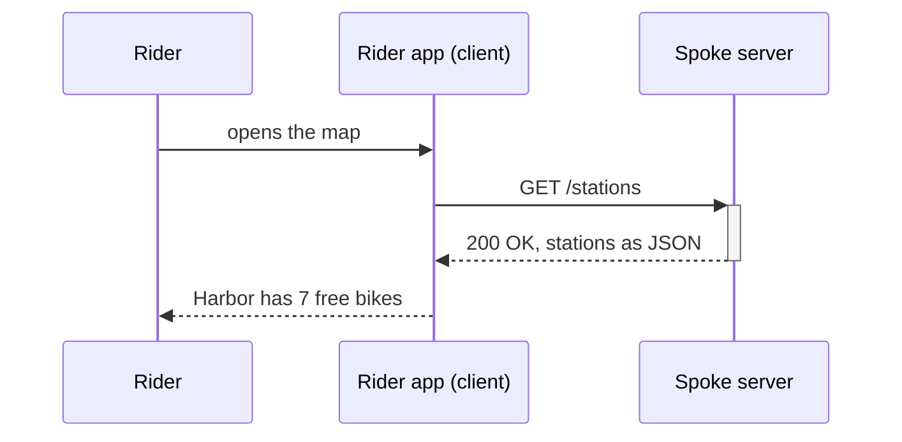

## Hook

Today the Harbor kiosk reads its station list from a file on its own disk. Next month riders get a phone app. A phone cannot open a file on the kiosk. It has to ask a computer somewhere else, over the internet, and wait for an answer.

That asking and answering follows rules. Your web browser follows them every time it opens a page. The rider app will follow the same rules to ask Spoke for stations. The rules are called HTTP.

## Concept

```callout jargon
**HTTP** (HyperText Transfer Protocol) is the set of rules computers use to ask for things and answer over the web. A **protocol** is an agreed way of talking, like the rules of a phone call: say hello, talk, say goodbye.
```

### Client and server

A **client** is the program that asks. A **server** is the program that answers. The rider app is a client. The Spoke server is, of course, the server. One server answers many clients at once.

One question is called a **request**. The answer is called a **response**. The client always speaks first. The server never contacts the app out of nowhere.



Read the diagram top to bottom. The rider opens the map. The app sends one request. The server sends one response. Then the app draws the map.

```callout analogy
HTTP is like ordering at a café counter. You ask for one thing. The barista hands it over or says "sold out". The barista never walks to your table to offer you something you did not ask for.
```

### Syntax: the parts of a URL

A **URL** (Uniform Resource Locator) is the address of the thing you want. It has up to five parts.

```text
https://api.spoke.example:8443/stations?city=riverton&open=true
\___/   \_______________/ \__/\_______/ \___________________/
scheme        host        port   path          query
```

| Part | Example | What it means |
|---|---|---|
| scheme | `https` | which rules to use. `https` is HTTP with the data scrambled on the way. |
| host | `api.spoke.example` | which computer to ask |
| port | `8443` | which door on that computer. Left out, it means 443 for `https` and 80 for `http`. |
| path | `/stations` | which thing on that computer |
| query | `city=riverton&open=true` | extra options, as `name=value` pairs joined by `&` |

The query starts after the `?`. It is optional, and so is the port.

Java has a class that splits an address into these parts: `java.net.URI`. Run it.

```java run
import java.net.URI;

public class Main {
    public static void main(String[] args) {
        URI uri = URI.create("https://api.spoke.example:8443/stations?city=riverton&open=true");
        System.out.println("scheme: " + uri.getScheme());
        System.out.println("host:   " + uri.getHost());
        System.out.println("port:   " + uri.getPort());
        System.out.println("path:   " + uri.getPath());
        System.out.println("query:  " + uri.getQuery());
    }
}
```

```callout jargon
A **URI** (Uniform Resource Identifier) is any name for a thing. A **URL** is a URI that also says where to find it. Every URL is a URI, which is why Java's class is called `URI`.
```

### Syntax: a raw request

Under the hood, a request is plain text. It has four parts, always in this order.

```http
GET /stations?city=riverton HTTP/1.1
Host: api.spoke.example
Accept: application/json

```

1. The **request line**: the method (`GET`), the path with its query, and the HTTP version.
2. The **headers**: one `Name: value` pair per line. They are notes about the request.
3. A **blank line**. It tells the server that the headers are over.
4. The **body**: the data being sent. A GET has no body, so nothing follows the blank line.

Here is a request that does carry a body. It asks Spoke to start a rental.

```http
POST /rentals HTTP/1.1
Host: api.spoke.example
Content-Type: application/json
Content-Length: 39

{"riderId": "r-17", "bikeId": "B-1042"}
```

`Content-Length` says how many bytes the body has, so the server knows where it ends. You can build the same text in Java. Real HTTP ends each line with two characters, a carriage return and a newline, written `\r\n`.

```java run
public class Main {
    public static void main(String[] args) {
        String body = "{\"riderId\": \"r-17\", \"bikeId\": \"B-1042\"}";
        String request = "POST /rentals HTTP/1.1\r\n"
                + "Host: api.spoke.example\r\n"
                + "Content-Type: application/json\r\n"
                + "Content-Length: " + body.length() + "\r\n"
                + "\r\n"
                + body;
        System.out.println(request);
    }
}
```

### Syntax: a raw response

A response has the same shape. Only the first line is different.

```http
HTTP/1.1 200 OK
Content-Type: application/json
Cache-Control: max-age=30

[{"id": "harbor", "name": "Harbor", "freeBikes": 7}, {"id": "uptown", "name": "Uptown", "freeBikes": 3}]
```

1. The **status line**: the HTTP version, a **status code** (`200`) and a short reason (`OK`).
2. The headers.
3. A blank line.
4. The body: here, the stations.

### Methods: the verb of a request

The **method** is the first word of the request line. It says what the client wants done.

| Method | Asks the server to | Spoke example | Safe | Idempotent |
|---|---|---|---|---|
| `GET` | read something | `GET /stations/harbor` | yes | yes |
| `POST` | create something new, or run an action | `POST /rentals` | no | no |
| `PUT` | replace something completely | `PUT /stations/harbor` | no | yes |
| `PATCH` | change some fields | `PATCH /rentals/rental-17` | no | not promised |
| `DELETE` | remove something | `DELETE /bikes/B-1042` | no | yes |

```callout jargon
**Safe** means the request only reads. It changes nothing on the server. **Idempotent** (say "eye-dem-POH-tent") means sending the same request twice leaves the server just as sending it once would.
```

Why care? Phones lose signal in tunnels. When the app hears no answer, it may send the request again. Repeating a GET, PUT or DELETE leaves the server in the same state. Repeating a POST may start a second rental.

Idempotent means the same *state*, not the same *answer*. The first `DELETE /bikes/B-1042` gets 204. A repeat gets 404, because the bike is already gone. Nothing more was deleted, so that is fine.

It also does not mean "always safe to retry". Say your PUT is lost, and a teammate saves a change before your retry arrives. Your retry overwrites their change. Topic 02 shows how to guard against that.

PATCH depends on what it changes. "Set the end station to Uptown" gives the same result every time. "Add 5 minutes to the ride" does not. Here is the difference between PUT and POST, using a map and a list.

```java run
import java.util.ArrayList;
import java.util.HashMap;
import java.util.List;
import java.util.Map;

public class Main {
    public static void main(String[] args) {
        Map<String, String> stationNames = new HashMap<>();
        List<String> rentals = new ArrayList<>();

        for (int attempt = 1; attempt <= 2; attempt++) {
            stationNames.put("harbor", "Harbor Pier");   // like PUT /stations/harbor
            rentals.add("B-1042 for r-17");              // like POST /rentals
        }
        System.out.println("stations: " + stationNames);
        System.out.println("rentals:  " + rentals);
    }
}
```

The map still holds one station after two tries. The list now holds two rentals for the same bike. That is the danger of repeating a POST.

### Status codes

A status code is a three-digit number. Its first digit tells you the **family**, so you can understand any code roughly, even one you have never seen.

| Family | Meaning |
|---|---|
| `1xx` | information, still working (rare) |
| `2xx` | success |
| `3xx` | redirection: look somewhere else |
| `4xx` | client error: the request was wrong |
| `5xx` | server error: the server failed |

These are the codes you will meet most.

| Code | Name | Spoke example |
|---|---|---|
| 200 | OK | Here are the stations. |
| 201 | Created | Your rental exists now. |
| 204 | No Content | Done, and there is nothing to send back. |
| 301 | Moved Permanently | The stations list moved to a new address. |
| 304 | Not Modified | Nothing changed since you last asked. Use your copy. |
| 400 | Bad Request | The JSON you sent is broken. |
| 401 | Unauthorized | I don't know who you are. Log in. |
| 403 | Forbidden | I know who you are, but you may not do this. |
| 404 | Not Found | There is no station called `harbour`. |
| 409 | Conflict | Bike B-1042 is already rented. |
| 429 | Too Many Requests | You asked too often. Slow down. |
| 500 | Internal Server Error | The server's code crashed. |
| 503 | Service Unavailable | The server is overloaded or down for upkeep. Try again later. |

A 429 or 503 often carries a `Retry-After` header, such as `Retry-After: 30`. It says how many seconds to wait before trying again, or gives a date and time to wait until. A polite client waits that long.

```callout warning
401 is named "Unauthorized", but it really means "not logged in". 403 means "logged in, but not allowed". Mixing them up sends riders to the login screen when logging in will not help.
```

The family is easy to compute in Java: divide by 100.

```java run
public class Main {
    static String family(int status) {
        return switch (status / 100) {
            case 1 -> "information";
            case 2 -> "success";
            case 3 -> "redirection";
            case 4 -> "client error";
            case 5 -> "server error";
            default -> "not an HTTP status";
        };
    }

    public static void main(String[] args) {
        int[] codes = {200, 201, 304, 404, 409, 503};
        for (int code : codes) {
            System.out.println(code + ": " + family(code));
        }
    }
}
```

### Syntax: headers

A header is a `Name: value` line. Names ignore upper and lower case, so `content-type` and `Content-Type` are the same header. These five come up all the time.

| Header | Sent in | Example | Means |
|---|---|---|---|
| `Content-Type` | request or response | `Content-Type: application/json` | The body I am sending is JSON. |
| `Accept` | request | `Accept: application/json` | Please answer in JSON. |
| `Authorization` | request | `Authorization: Bearer 7f3a9c` | Here is my token, proof of who I am. |
| `Location` | response | `Location: /rentals/rental-17` | The new thing lives at this address. |
| `Cache-Control` | response | `Cache-Control: max-age=30` | You may reuse this answer for 30 seconds. |

A **token** is a string the server gives the app at login. The word `Bearer` means "whoever holds this token". The token after it is the proof.

```callout jargon
A **media type** is a name for a data format, such as `application/json` or `text/html`. `Content-Type` and `Accept` both hold media types. A **cache** is a saved copy of an answer, kept so you need not ask again.
```

### JSON bodies

```callout jargon
**JSON** (JavaScript Object Notation, say "JAY-son") is a text format for data. Objects go in `{ }`, lists in `[ ]`, and text in double quotes. Numbers, `true`, `false` and `null` are written bare.
```

Most APIs send JSON bodies. Here is one station.

```json
{
  "id": "harbor",
  "name": "Harbor",
  "docks": 12,
  "freeBikes": 7,
  "open": true,
  "bikes": ["B-1042", "B-1043"]
}
```

Each `"name": value` pair is like a field of a Java record. Topic 03 shows Spring turning records into JSON.

### Building JSON safely

It is tempting to glue JSON together with `+`. That breaks as soon as a value holds a quote. Here a rider types a sneaky name into the app.

```java run
import tools.jackson.databind.json.JsonMapper;

public class Main {
    record StartRental(String riderId, String bikeId) {}

    public static void main(String[] args) {
        String riderId = "r-17\", \"bikeId\": \"B-9999";   // text a user typed
        String glued = "{\"riderId\": \"" + riderId + "\", \"bikeId\": \"B-1042\"}";
        System.out.println("glued:   " + glued);

        JsonMapper json = JsonMapper.builder().build();
        String safe = json.writeValueAsString(new StartRental(riderId, "B-1042"));
        System.out.println("jackson: " + safe);
    }
}
```

The glued text now has two `bikeId` fields. Which one the server reads depends on its parser, and the rider may get a bike they never paid for. This trick is called **injection**.

Jackson, the JSON library Spring uses, puts a backslash before each quote inside a value. That is called **escaping**. The whole typed text stays inside `riderId`, where it belongs. So turn a record into JSON with a library, never with `+`.

```callout jargon
**Injection** is when text from a user is read as part of a command or format, instead of as plain data. **Escaping** marks special characters, like `"`, so they count as plain text.
```

### Stateless: every request stands alone

HTTP is **stateless**. The server keeps no memory of your earlier requests. Each request must carry everything the server needs to answer it.

So "who is asking?" must travel with every request. Two common ways:

- A **token**, as you saw with headers, travels in the `Authorization` header on every request.
- A **cookie** is a small value the server asks a browser to store. The browser sends it back on every request to that server.

```http
GET /rentals/rental-17 HTTP/1.1
Host: api.spoke.example
Authorization: Bearer 7f3a9c
```

Here is a tiny pretend server. It looks only at the request in front of it.

```java run
import java.util.Map;

public class Main {
    static int handle(String path, Map<String, String> headers) {
        if (!headers.containsKey("Authorization")) {
            return 401;
        }
        return 200;
    }

    public static void main(String[] args) {
        System.out.println("first:  " + handle("/rentals/rental-17", Map.of("Authorization", "Bearer 7f3a9c")));
        System.out.println("second: " + handle("/rentals/rental-17", Map.of()));
    }
}
```

The second request asks for the same rental. It gets 401, because it forgot the token. The server does not remember the first request.

```callout analogy
A stateless server is a ticket inspector who forgets every face. You show your ticket on every train, even if you showed it a minute ago.
```

Stateless servers are easy to copy. At rush hour Spoke can run three servers, and any of them can answer any request.

### HTTPS

HTTPS is HTTP sent through an encrypted connection, using rules called TLS (Transport Layer Security). **Encrypted** means scrambled so that only the two ends can read it. On café Wi-Fi, a snooper sees random bytes, not the rider's token or location. A **certificate** proves the server really belongs to Spoke. Inside the tunnel, the requests and responses are the same HTTP text you saw above. Spoke uses `https` for every request.

You saw what sits under all this in [Networking under HTTP](/t/module-08-backend/topic-13-networking): DNS turns `api.spoke.example` into an address, then TCP and TLS set up the connection and its encryption.

### Timeouts: never wait forever

A network call can hang. The server may be stuck, or a cable may be cut halfway. Without a limit, the app waits forever, and the rider stares at a spinner.

A **timeout** is the longest you agree to wait. Java's `HttpClient` has two kinds:

- `connectTimeout` on the client: how long to wait to reach the server at all.
- `timeout` on each request: how long to wait for the answer to start arriving, meaning the status and headers. The body after that has no limit unless your code adds one.

```java
import java.net.URI;
import java.net.http.HttpClient;
import java.net.http.HttpRequest;
import java.time.Duration;

class Timeouts {
    static final HttpClient CLIENT = HttpClient.newBuilder()
            .connectTimeout(Duration.ofSeconds(2))
            .build();

    static HttpRequest stations() {
        return HttpRequest.newBuilder()
                .uri(URI.create("https://api.spoke.example/stations"))
                .timeout(Duration.ofSeconds(5))
                .GET()
                .build();
    }
}
```

When the time runs out, `send` throws `java.net.http.HttpTimeoutException: request timed out`. The app can then show "Try again" instead of freezing.

```callout warning
`HttpClient.newHttpClient()` and a request built with no `.timeout(...)` set no limit of their own. In production, one slow server can then freeze every caller that waits on it. Give every network call a timeout.
```

## Worked example

The rider app opens the map, then Ada starts a ride on B-1042. Here is the Java the app could use. It needs a real Spoke server, so it is shown here, not run.

```java
import java.net.URI;
import java.net.http.HttpClient;
import java.net.http.HttpRequest;
import java.net.http.HttpResponse;
import java.time.Duration;
import tools.jackson.databind.json.JsonMapper;

class SpokeClient {
    record StartRental(String riderId, String bikeId) {}

    private final HttpClient client = HttpClient.newBuilder()
            .connectTimeout(Duration.ofSeconds(2))
            .build();
    private final JsonMapper json = JsonMapper.builder().build();

    String fetchStations() throws Exception {
        HttpRequest request = HttpRequest.newBuilder()
                .uri(URI.create("https://api.spoke.example/stations?city=riverton"))
                .timeout(Duration.ofSeconds(5))
                .header("Accept", "application/json")
                .GET()
                .build();
        HttpResponse<String> response = client.send(request, HttpResponse.BodyHandlers.ofString());
        if (response.statusCode() / 100 != 2) {
            throw new IllegalStateException("Spoke answered " + response.statusCode());
        }
        return response.body();
    }

    String startRental(String riderId, String bikeId, String token) throws Exception {
        String body = json.writeValueAsString(new StartRental(riderId, bikeId));
        HttpRequest request = HttpRequest.newBuilder()
                .uri(URI.create("https://api.spoke.example/rentals"))
                .timeout(Duration.ofSeconds(5))
                .header("Content-Type", "application/json")
                .header("Authorization", "Bearer " + token)
                .POST(HttpRequest.BodyPublishers.ofString(body))
                .build();
        HttpResponse<String> response = client.send(request, HttpResponse.BodyHandlers.ofString());
        return response.headers().firstValue("Location").orElse("no Location header");
    }
}
```

Line by line:

1. `HttpClient.newBuilder()...build()` makes the object that talks to servers. One client can send many requests. `connectTimeout` stops it waiting forever to connect.
2. `HttpRequest.newBuilder()` starts a request. `.uri(...)`, `.header(...)` and `.GET()` fill in the request line and headers. `.timeout(...)` caps the wait for the answer.
3. `.build()` finishes the request. Nothing has been sent yet.
4. `client.send(...)` sends it and waits for the response. `BodyHandlers.ofString()` reads the body as a `String`.
5. `statusCode() / 100 != 2` checks the family, so 200, 201 and 204 all count as success.
6. In `startRental`, Jackson's `writeValueAsString` turns the `StartRental` record into JSON, with any quotes escaped. `.POST(BodyPublishers.ofString(body))` attaches it. The `Content-Type` header tells the server it is JSON.
7. `firstValue("Location")` reads the header that says where the new rental lives.

Here is the exchange for `fetchStations`, written as HTTP/1.1 text. Java adds the `Host` header by itself.

```http
GET /stations?city=riverton HTTP/1.1
Host: api.spoke.example
Accept: application/json

```

```http
HTTP/1.1 200 OK
Content-Type: application/json
Cache-Control: max-age=30

[{"id": "harbor", "name": "Harbor", "freeBikes": 7}, {"id": "uptown", "name": "Uptown", "freeBikes": 3}]
```

And here is `startRental` for Ada, who is rider `r-17`.

```http
POST /rentals HTTP/1.1
Host: api.spoke.example
Content-Type: application/json
Authorization: Bearer 7f3a9c

{"riderId":"r-17","bikeId":"B-1042"}
```

```http
HTTP/1.1 201 Created
Location: /rentals/rental-17
Content-Type: application/json

{"id": "rental-17", "riderId": "r-17", "bikeId": "B-1042", "startStation": "harbor"}
```

```callout tip
Newer versions keep the same method, path, headers, status and body. HTTP/2 sends many requests at once over one connection, called **multiplexing**, and squeezes repeated headers. HTTP/3 does the same over QUIC, a newer way to carry data built on UDP, so one lost packet does not hold up the others.
```

The 201 says a new rental exists. `Location` says where to find it. A later `GET /rentals/rental-17` will need the token again, because the server is stateless.

## Try it

Building a request does not send it, so you can inspect one safely. Run this, then try the changes below.

```java run
import java.net.URI;
import java.net.http.HttpRequest;

public class Main {
    public static void main(String[] args) {
        HttpRequest request = HttpRequest.newBuilder()
                .uri(URI.create("https://api.spoke.example/stations?city=riverton"))
                .header("Accept", "application/json")
                .GET()
                .build();
        System.out.println(request.method() + " " + request.uri());
        System.out.println("Host: " + request.uri().getHost());
        System.out.println("Accept: " + request.headers().firstValue("Accept").orElse("(none)"));
    }
}
```

1. Change `.GET()` to `.DELETE()` and the address to `https://api.spoke.example/bikes/B-1042`. What does the first line print now?
2. Add `.header("Authorization", "Bearer 7f3a9c")` and print it with `firstValue("Authorization")`.
3. Remove the `Accept` header. What does `orElse` print?

## Recap

- HTTP is a request from a client, then a response from a server. The client always speaks first.
- A URL has a scheme, host, port, path and query. `java.net.URI` splits one into its parts.
- GET reads and is safe. PUT and DELETE are idempotent: a repeat leaves the same state. POST is neither, so a repeated POST can create twice.
- The first digit of a status code gives its family: 2 success, 3 redirection, 4 client error, 5 server error.
- HTTP is stateless: every request carries its own headers, such as `Authorization`, because the server remembers nothing.

## Common mistakes

**1. Putting a space in a URL.**

```java run crash
import java.net.URI;

public class Main {
    public static void main(String[] args) {
        URI uri = URI.create("https://api.spoke.example/stations?name=Old Mill");
        System.out.println(uri.getQuery());
    }
}
```

What you see:

```text
Exception in thread "main" java.lang.IllegalArgumentException: Illegal character in query at index 43: https://api.spoke.example/stations?name=Old Mill
```

Fix: a URL cannot hold a space. Send the station's id instead, `?station=old-mill`. If you must send free text, encode it first with `URLEncoder.encode("Old Mill", StandardCharsets.UTF_8)`, which gives `Old+Mill`.

**2. Expecting `getPort()` to give the default port.**

```java run
import java.net.URI;

public class Main {
    public static void main(String[] args) {
        URI uri = URI.create("https://api.spoke.example/stations");
        System.out.println("port: " + uri.getPort());
    }
}
```

What you see: `port: -1`. The URL has no port written in it, so `URI` reports -1 for "none".

Fix: fill in the default yourself: `int port = uri.getPort() == -1 ? 443 : uri.getPort();` for an `https` address.

**3. Treating only 200 as success.**

```java run
public class Main {
    public static void main(String[] args) {
        int status = 201;   // the server created the rental
        if (status == 200) {
            System.out.println("Ride started");
        } else {
            System.out.println("Something went wrong");
        }
    }
}
```

What you see: `Something went wrong`, even though the rental was created. Ada tries again and starts a second rental.

Fix: check the family, `status / 100 == 2`. Then 200, 201 and 204 all count as success.

**4. Sending JSON without a `Content-Type` header.**

```java
import java.net.URI;
import java.net.http.HttpRequest;

class Requests {
    static HttpRequest startRental() {
        return HttpRequest.newBuilder()
                .uri(URI.create("https://api.spoke.example/rentals"))
                .POST(HttpRequest.BodyPublishers.ofString("{\"riderId\": \"r-17\", \"bikeId\": \"B-1042\"}"))
                .build();
    }
}
```

What you see: the server answers `HTTP/1.1 415 Unsupported Media Type`. It cannot tell what format the body is in.

Fix: add `.header("Content-Type", "application/json")` to every request that sends a JSON body.
