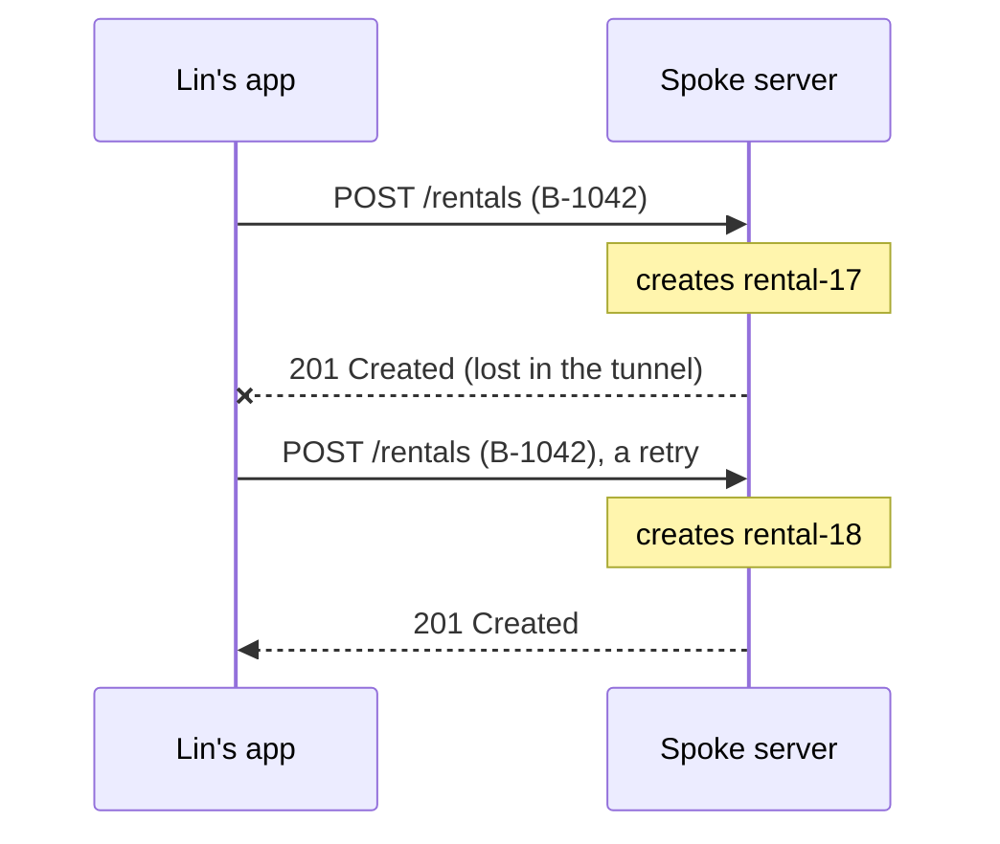

## Hook

Last spring the app team wrote `POST /trips/start`. The server team built `POST /rides`. The billing sheet called it a "rental". All three meant the same thing, and nothing worked together until someone rewrote two of them.

This time Priya wants the design on paper first. One page that lists every request, every answer and every error. Both teams sign it before anyone codes. An hour of design saves a week of untangling.

```callout jargon
An **API** (Application Programming Interface) is the list of requests a program accepts and the answers it gives back. Think of it as a contract between two teams. **REST** (REpresentational State Transfer) is a popular style for HTTP APIs. It is built around things, called resources, and the standard HTTP methods.
```

## Concept

### Syntax: resources are nouns

A **resource** is a thing the API lets you work with: a station, a bike, a rental. A **collection** is the list of all of them. Each gets a path.

```text
/stations                  all stations (a collection)
/stations/harbor           one station, picked by its id
/bikes/B-1042              one bike
/rentals                   all rentals
/rentals/rental-17         one rental
/stations/harbor/bikes     the bikes docked at Harbor
```

The naming rules are short:

- Use nouns, never verbs: `/rentals`, not `/startRental`. The method is the verb.
- Use plural names for collections: `/stations`, not `/station`.
- Use lowercase, with hyphens between words: `/stations/old-mill`.
- Put the id in the path, right after its collection: `/rentals/rental-17`.

```callout jargon
In a design document, `{id}` means "put a real id here". So `/stations/{id}` stands for `/stations/harbor`, `/stations/uptown` and so on. The `{id}` part is called a **path variable**.
```

### Syntax: when to nest

A **nested** path puts one resource inside another, like `/stations/{id}/bikes`. Nest when the child is best read through its parent: "the bikes at Harbor".

Do not nest a thing that moves or has a life of its own. A bike rides from Harbor to Uptown. If its address were `/stations/harbor/bikes/B-1042`, that link would break the moment it docked somewhere else. So each bike lives at `/bikes/{id}`, and the nested path is only a handy list.

The same goes for rentals. A rental starts at one station and ends at another. It belongs at the top, `/rentals`, and you filter it with a query when you need "rentals from Harbor".

```callout tip
Keep nesting to one level. `/stations/harbor/bikes` reads well. `/stations/harbor/bikes/B-1042/rentals/rental-17` is a maze.
```

### Syntax: map actions to methods

Each action becomes a method on a resource.

| Action | Request |
|---|---|
| List the stations | `GET /stations` |
| Read one station | `GET /stations/harbor` |
| List the bikes at Harbor | `GET /stations/harbor/bikes` |
| Start a rental | `POST /rentals` |
| Read a rental | `GET /rentals/rental-17` |
| End a rental | `POST /rentals/rental-17/end` or `PATCH /rentals/rental-17` |
| Cancel a rental started by mistake | `DELETE /rentals/rental-17` |

"Start a rental" becomes `POST /rentals`, because starting one creates a new rental resource. The verb "start" turns into "create a rental".

Ending a rental has two good designs. Here is the trade-off.

| | `PATCH /rentals/{id}` | `POST /rentals/{id}/end` |
|---|---|---|
| Body | `{"endStation": "uptown"}` | `{"endStation": "uptown"}` |
| Good | Pure REST: you change a field of the rental. No new paths. | Says exactly what happens. One place for the rules: lock the bike, work out the fare, charge the card. |
| Weak | Looks like a simple edit, but it charges money. Clients may also try to PATCH `fareCents`, which the server must refuse. | Puts a verb, `end`, in the path. Use this for real business actions only. |

Spoke picks `POST /rentals/{id}/end`, because ending a ride does much more than edit a field. Either choice is fine if the whole API follows it. Mixing both is the mistake.

### Status choices

Each action gets a status code for success and one for each way it can fail. Here are the choices.

| Situation | Status | Extra |
|---|---|---|
| Created a rental | `201 Created` | a `Location` header plus the new rental in the body |
| Read something, or ended a rental | `200 OK` | the resource in the body |
| Deleted something | `204 No Content` | no body at all |
| JSON is broken or a field is missing | `400 Bad Request` | an error body saying what is wrong |
| The id does not exist | `404 Not Found` | an error body |
| The request clashes with the current state | `409 Conflict` | for example, the bike is already rented |

You will also meet `422 Unprocessable Content`. Some teams split the client errors in two. 400 means "I cannot read this at all". 422 means "I can read it, but a value breaks a rule", like a bike id `B-12`. Spoke keeps it simple and uses 400 for both, which is also what Spring does by default. Pick one style and use it everywhere.

### Idempotency and retries

Lin taps "Start ride" just as her train enters a tunnel. The request reaches Spoke, and Spoke creates a rental. The answer is lost in the tunnel. The app sees no answer, so it sends the same POST again.



POST is not idempotent, so Lin now has two rentals and pays the unlock fee twice. The common fix is an **idempotency key**.

```callout jargon
An **idempotency key** is a random id the app makes once for each tap. It sends that id with the request and with every retry of it. The server remembers which keys it has seen. A repeat of a known key gets the first answer again, and nothing new is created.
```

### Syntax: the Idempotency-Key header

```http
POST /rentals HTTP/1.1
Host: api.spoke.example
Content-Type: application/json
Idempotency-Key: 6f1c2a90-3b7e-4d1a-9c55-0e8b2f4a7d13

{"riderId": "r-12", "bikeId": "B-1042"}
```

In Java, `UUID.randomUUID().toString()` makes a key like the one above. A **UUID** (Universally Unique Identifier) is a random 36-character id that never repeats in practice. `Idempotency-Key` is a widely used convention, not part of HTTP itself, so write it into the design. Here is a tiny pretend server that honours it.

```java run
import java.util.ArrayList;
import java.util.HashMap;
import java.util.List;
import java.util.Map;

public class Main {
    static final List<String> rentals = new ArrayList<>();
    static final Map<String, String> answersByKey = new HashMap<>();

    static String startRental(String idempotencyKey, String bikeId) {
        String earlier = answersByKey.get(idempotencyKey);
        if (earlier != null) {
            return earlier;   // a retry: answer the same, create nothing
        }
        String id = "rental-" + (17 + rentals.size());
        rentals.add(id + " " + bikeId);
        String answer = "201 Created, Location: /rentals/" + id;
        answersByKey.put(idempotencyKey, answer);
        return answer;
    }

    public static void main(String[] args) {
        System.out.println(startRental("tap-7c1e", "B-1042"));
        System.out.println(startRental("tap-7c1e", "B-1042"));   // the app retries
        System.out.println("rentals: " + rentals);
    }
}
```

Both calls print the same answer, and there is only one rental. A new tap would make a new key, and so a new rental.

### Syntax: filter, sort and page with the query

Lists can grow huge. Spoke will store millions of rentals one day. So list requests take options in the query.

```http
GET /bikes?station=harbor&status=AVAILABLE&sort=id,asc&page=0&size=20 HTTP/1.1
Host: api.spoke.example
Accept: application/json
```

| Option | Example | Means |
|---|---|---|
| filter | `station=harbor&status=AVAILABLE` | only bikes that match every filter |
| sort | `sort=id,asc` | order by a field, `asc` (A to Z) or `desc` (Z to A) |
| page | `page=0` | which page you want. The first page is 0. |
| size | `size=20` | how many items per page. Set a maximum, such as 100. |

```callout jargon
**Paging** means sending a long list in fixed-size slices, called pages, instead of all at once. A **filter** keeps only the items that match. Both keep each response small and fast.
```

A paged response wraps the items with facts about the pages.

```json
{
  "items": [
    {"id": "B-1042", "type": "EBIKE", "status": "AVAILABLE"},
    {"id": "B-1043", "type": "CLASSIC", "status": "AVAILABLE"}
  ],
  "page": 0,
  "size": 2,
  "totalItems": 7,
  "totalPages": 4
}
```

Here is the slicing in Java. Forty-five bikes, 20 per page.

```java run
import java.util.List;
import java.util.stream.IntStream;

public class Main {
    public static void main(String[] args) {
        List<String> bikes = IntStream.rangeClosed(1001, 1045).mapToObj(n -> "B-" + n).toList();
        int page = 2;
        int size = 20;
        List<String> items = bikes.stream().skip((long) page * size).limit(size).toList();
        int totalPages = (bikes.size() + size - 1) / size;
        System.out.println("page=" + page + " totalPages=" + totalPages);
        System.out.println("items=" + items);
    }
}
```

There are 3 pages: 0, 1 and 2. Page 2 is the last one, and it holds only 5 bikes.

### JSON design rules

The body's shape is part of the contract too. Spoke follows six rules.

| Rule | Good | Bad |
|---|---|---|
| Field names in camelCase, like Java | `"startStation"` | `"start_station"`, `"StartStation"` |
| Money as whole cents | `"fareCents": 460` | `"fare": 2.8` |
| Times in ISO-8601, in UTC | `"startedAt": "2026-11-16T08:30:00Z"` | `"startedAt": "16/11/26 8:30"` |
| Ids as strings | `"id": "rental-17"` | `"id": 17` |
| Fixed choices as UPPERCASE strings | `"status": "AVAILABLE"` | `"status": 1` |
| Empty fields as `null`, always sent | `"endedAt": null` | the field left out |

```callout jargon
**ISO-8601** is the world standard way to write dates and times, biggest unit first: `2026-11-16T08:30:00Z`. The `T` separates date and time. The `Z` means UTC, the time zone with no offset, so every reader agrees on the moment.
```

Why ids as strings? JavaScript, which many apps use, loses accuracy on whole numbers above 9007199254740991. A string id also lets you change the id format later without breaking anyone.

**Null versus missing** matters most for changes. `"endedAt": null` says "this is known to be empty: the ride has not ended". A missing field says "I did not send this", which usually means "leave it as it is". Write the rule down, and follow it in every response.

Spring turns records into this JSON for you (topic 03).

### A consistent error shape

Errors need a contract as well. If every endpoint invents its own error JSON, the app needs a different parser for each one. A standard called RFC 9457 defines one shape, called a **problem detail**.

```http
HTTP/1.1 409 Conflict
Content-Type: application/problem+json

{
  "type": "https://api.spoke.example/problems/bike-unavailable",
  "title": "Bike unavailable",
  "status": 409,
  "detail": "Bike B-1042 is already rented.",
  "instance": "/rentals"
}
```

| Field | Means |
|---|---|
| `type` | an address that names this kind of problem |
| `title` | a short summary that is the same every time |
| `status` | the HTTP status again, handy when logging |
| `detail` | what went wrong this time, in plain words |
| `instance` | which request it happened on |

Spring builds this shape for you, as topic 06 shows. Topic 12 goes deeper.

### Versioning

When a change would break apps already on phones, publish a new API version beside the old one, like `/api/v2/rentals` (topic 12).

## Worked example

Here is the design sheet Priya asked for. It is the whole Spoke rentals API on one page.

| Method | Path | Body sent | Success | Errors |
|---|---|---|---|---|
| `GET` | `/stations` | none | `200`, list of stations | none |
| `GET` | `/stations/{id}` | none | `200`, one station | `404` unknown station |
| `GET` | `/stations/{id}/bikes?status=AVAILABLE` | none | `200`, bikes docked there | `404` unknown station |
| `GET` | `/bikes?station=harbor&status=AVAILABLE&page=0&size=20` | none | `200`, one page of bikes | `400` bad page or size |
| `GET` | `/bikes/{id}` | none | `200`, one bike | `404` unknown bike |
| `POST` | `/rentals` | `{"riderId", "bikeId"}` and an `Idempotency-Key` header | `201`, `Location` and the new rental | `400` missing field, `404` unknown bike, `409` bike unavailable |
| `GET` | `/rentals/{id}` | none | `200`, one rental | `404` unknown rental |
| `GET` | `/rentals?riderId=r-17&sort=startedAt,desc&page=0&size=20` | none | `200`, one page of rentals | `400` bad page or size |
| `POST` | `/rentals/{id}/end` | `{"endStation"}` | `200`, the ended rental with its fare | `404` unknown rental, `409` already ended |
| `DELETE` | `/rentals/{id}` | none | `204`, cancelled with no charge | `404` unknown rental, `409` older than 1 minute |

Every error body uses the problem detail shape. Every time is ISO-8601 in UTC, and every amount is whole cents.

Now follow Ada, rider `r-17`, through one ride. She unlocks e-bike B-1042 at Harbor.

```http
POST /rentals HTTP/1.1
Host: api.spoke.example
Content-Type: application/json
Idempotency-Key: 0b5e7d3c-91a4-4f2e-8d6b-3c2a1f9e7b40

{"riderId": "r-17", "bikeId": "B-1042"}
```

```http
HTTP/1.1 201 Created
Location: /rentals/rental-17
Content-Type: application/json

{
  "id": "rental-17",
  "riderId": "r-17",
  "bikeId": "B-1042",
  "startStation": "harbor",
  "endStation": null,
  "startedAt": "2026-11-16T08:30:00Z",
  "endedAt": null,
  "fareCents": 0
}
```

1. `POST /rentals` creates a rental. The path is a noun, and the method is the verb.
2. The idempotency key protects Ada if her signal drops.
3. `201 Created` and `Location` tell the app where the new rental lives.
4. `endStation` and `endedAt` are `null`, sent on purpose: the ride has not ended.

Twelve minutes later she docks at Uptown.

```http
POST /rentals/rental-17/end HTTP/1.1
Host: api.spoke.example
Content-Type: application/json

{"endStation": "uptown"}
```

```http
HTTP/1.1 200 OK
Content-Type: application/json

{
  "id": "rental-17",
  "riderId": "r-17",
  "bikeId": "B-1042",
  "startStation": "harbor",
  "endStation": "uptown",
  "startedAt": "2026-11-16T08:30:00Z",
  "endedAt": "2026-11-16T08:42:00Z",
  "fareCents": 460
}
```

5. The server, not the app, works out the fare: 100 cents to unlock plus 12 minutes at 30 cents is 460.
6. `200 OK` returns the finished rental, so the app can show a receipt at once.

If the app sends the same end request again, the rental has already ended. The server answers `409 Conflict` with a problem detail, and charges nothing twice.

## Try it

Here is the pretend server from the idempotency section, with one more tap. Run it, then try the changes below.

```java run
import java.util.ArrayList;
import java.util.HashMap;
import java.util.List;
import java.util.Map;

public class Main {
    static final List<String> rentals = new ArrayList<>();
    static final Map<String, String> answersByKey = new HashMap<>();

    static String startRental(String idempotencyKey, String bikeId) {
        String earlier = answersByKey.get(idempotencyKey);
        if (earlier != null) {
            return earlier;
        }
        String id = "rental-" + (17 + rentals.size());
        rentals.add(id + " " + bikeId);
        String answer = "201 Created, Location: /rentals/" + id;
        answersByKey.put(idempotencyKey, answer);
        return answer;
    }

    public static void main(String[] args) {
        System.out.println(startRental("tap-7c1e", "B-1042"));
        System.out.println(startRental("tap-7c1e", "B-1042"));   // a retry of the same tap
        System.out.println(startRental("tap-9a24", "B-1043"));   // a new tap, a new key
        System.out.println("rentals: " + rentals);
    }
}
```

1. Delete the `if (earlier != null)` block and run again. How many rentals does Ada have now?
2. Put it back, then give the third call the key `"tap-7c1e"`. Why is B-1043 never rented? Real servers also check that a repeated key comes with the same body.
3. On paper, design the request for "Ada's past rentals, newest first, 10 per page". Then compare with the worked example table. (Answer: `GET /rentals?riderId=r-17&sort=startedAt,desc&page=0&size=10`.)

## Recap

- Paths name resources with plural nouns: `/stations`, `/rentals/{id}`. Nest only for a handy list, never for a thing that moves.
- The method is the verb. Starting a rental is `POST /rentals`. Ending one is a named action or a PATCH, chosen once for the whole API.
- Choose statuses on purpose: 201 with `Location`, 200, 204, 400, 404 and 409, with one error shape for all failures.
- A retried POST can create twice. An `Idempotency-Key` header lets the server spot the repeat.
- Lists take `filter`, `sort`, `page` and `size` in the query. JSON uses camelCase, whole cents, ISO-8601 times, string ids and explicit `null`.

## Common mistakes

**1. Putting verbs in the path.**

```http
POST /startRental HTTP/1.1
GET /getRentalById?id=rental-17 HTTP/1.1
POST /rides/new HTTP/1.1
```

What you see: every team invents its own verbs, and the API grows a new path for every action. Nobody can guess the next one.

Fix: name the resource and let the method be the verb: `POST /rentals` and `GET /rentals/rental-17`.

**2. Answering 200 with an error inside.**

```http
HTTP/1.1 200 OK
Content-Type: application/json

{"error": "Bike B-1042 is already rented"}
```

What you see: the app checks for a 2xx status, shows "Ride started", and the rider stands at a locked bike.

Fix: send the status that matches what happened, `409 Conflict`, with a problem detail body.

**3. Sending money as a decimal number.**

Here Jackson, the library Spring uses for JSON, writes a fare that was added up in a `double`.

```java run
import tools.jackson.databind.json.JsonMapper;

public class Main {
    record Fare(double euros) { }

    public static void main(String[] args) {
        Fare fare = new Fare(0.1 + 0.2);
        System.out.println(JsonMapper.builder().build().writeValueAsString(fare));
    }
}
```

What you see: `{"euros":0.30000000000000004}`. A `double` cannot hold most decimal fractions exactly, and the error leaks into the API.

Fix: use whole cents in a `long`, like `"fareCents": 30`. Whole numbers are always exact.

**4. Nesting a bike under its station.**

```http
GET /stations/harbor/bikes/B-1042 HTTP/1.1
Host: api.spoke.example
```

What you see: the app saved this link while B-1042 was at Harbor. After the bike docks at Uptown, the same link answers `404 Not Found`.

Fix: give each bike one address that never changes, `/bikes/B-1042`. Keep `/stations/harbor/bikes` as a list only.
