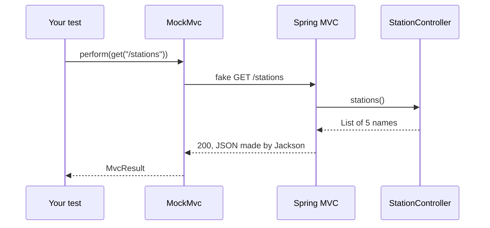

## Hook

Imagine opening a café. You could build the kitchen yourself: wire the ovens, plumb the sinks, install the till. Or you could rent a kitchen that already works, walk in, and start cooking.

The rider app needs a server to talk to. You could write one from scratch: open a network port, read raw HTTP text, turn Java objects into JSON. Or you could use Spring Boot, which already does all of that. You only write the recipes: what the API answers when the app asks for `/stations`.

## Concept

### Libraries and frameworks

You have used libraries already, such as JUnit's `assertEquals` or Mockito's `mock`. Your code calls the library when it wants help.

A **framework** flips that around. The framework runs the program, and it calls your code at the right moments.

```callout jargon
A **framework** is code that runs the show and calls your code when it needs it. A **library** is code that your code calls. The flip is called **inversion of control**: control moves from your code to the framework. Topic 04 looks at it in depth.
```

```callout analogy
A library is a toolbox: you pick up the hammer when you choose. A framework is a theatre: the stage, lights and audience are ready, and the theatre calls your act on stage when it is your turn.
```

### Spring and Spring Boot

**Spring** is the most used Java framework for servers. It is big and flexible, and it used to need a lot of setup.

**Spring Boot** is Spring with sensible defaults already chosen. It also ships a web server inside your program. You run one `main` method and the server is up.

### Starting a project at start.spring.io

The website **start.spring.io** (called the Spring Initializr) builds an empty project for you. You choose:

- Project: Maven. Language: Java. Spring Boot: the newest 4.x version.
- Group `dev.spoke`, Artifact `spoke-api`, Java 21.
- Dependencies: **Spring Web**.

It gives you a zip with `pom.xml`, the Maven wrapper `mvnw`, and one Java class. You met all of these in module 7.

### Syntax: a starter in the pom

```xml
<parent>
    <groupId>org.springframework.boot</groupId>
    <artifactId>spring-boot-starter-parent</artifactId>
    <version>4.1.2</version>
</parent>

<dependencies>
    <dependency>
        <groupId>org.springframework.boot</groupId>
        <artifactId>spring-boot-starter-webmvc</artifactId>
    </dependency>
    <dependency>
        <groupId>org.springframework.boot</groupId>
        <artifactId>spring-boot-starter-webmvc-test</artifactId>
        <scope>test</scope>
    </dependency>
</dependencies>
```

- The **parent** fixes the version of every Spring library, so they always match each other.
- `spring-boot-starter-webmvc` brings Spring MVC (the part of Spring that answers web requests), the Tomcat web server and Jackson for JSON.
- `spring-boot-starter-webmvc-test` brings JUnit, AssertJ, Mockito and Spring's test tools.

```callout jargon
A **starter** is one dependency that pulls in a whole set of libraries that work together. You ask for "web", and you get the server, the web framework and the JSON tools.
```

```callout warning
Guides written for Spring Boot 3 and older use `spring-boot-starter-web`. Spring Boot 4 renamed it `spring-boot-starter-webmvc`. Same idea, new name.
```

### Syntax: the application class

```java nocompile
package dev.spoke.api;

import org.springframework.boot.SpringApplication;
import org.springframework.boot.autoconfigure.SpringBootApplication;

@SpringBootApplication
public class SpokeApiApplication {

    public static void main(String[] args) {
        SpringApplication.run(SpokeApiApplication.class, args);
    }
}
```

- `@SpringBootApplication` marks the starting point of the app.
- `SpringApplication.run(...)` starts Spring, which starts the web server and waits for requests.
- Spring looks for your other classes in this class's package and every package below it. A controller in `dev.spoke.api.stations` is found. One in `dev.spoke.web` is not.

```callout jargon
An **annotation** is a label that starts with `@`, like `@Test` from JUnit. It changes nothing by itself. A framework reads the label and acts on it.
```

### Auto-configuration

How does Spring Boot know you want a web server? It looks at the jars on your **classpath** (the list of libraries your program can use). It sees Tomcat and Spring MVC, so it sets up a server. It sees Jackson, so it sets up JSON.

```callout jargon
**Auto-configuration** means Spring Boot looks at what is on the classpath and sets things up for you with sensible defaults. You change a default only when you need something different.
```

### Running the server: embedded Tomcat on port 8080

**Tomcat** is the web server. It is **embedded**, which means it lives inside your program, not installed separately. Start the app from the project folder:

```bash
./mvnw spring-boot:run
```

Among the log lines, look for these two:

```text
o.s.boot.tomcat.TomcatWebServer     : Tomcat started on port 8080 (http) with context path '/'
dev.spoke.api.SpokeApiApplication   : Started SpokeApiApplication in 1.356 seconds (process running for 1.503)
```

The server now listens on **port 8080**, a numbered door on your laptop. In a second terminal, ask it for the stations with `curl`:

```bash
curl -i localhost:8080/stations
```

```text
HTTP/1.1 200
Content-Type: application/json
Content-Length: 50

["Riverside","Old Mill","Harbor","Uptown","Depot"]
```

The server keeps running until you press Ctrl+C in its terminal.

### Syntax: @RestController and @GetMapping

```java
import java.util.List;

import org.springframework.web.bind.annotation.GetMapping;
import org.springframework.web.bind.annotation.RestController;

@RestController
class StationController {

    @GetMapping("/stations")
    List<String> stations() {
        return List.of("Riverside", "Old Mill", "Harbor", "Uptown", "Depot");
    }
}
```

- `@RestController` tells Spring: create one of these, and send whatever its methods return as the response body.
- `@GetMapping("/stations")` says: call this method for every `GET /stations` request.
- You never call `stations()` yourself. Spring calls it. That is the framework calling your code.

```callout jargon
A **controller** is a class that answers HTTP requests. An **endpoint** is one method and path pair, such as `GET /stations`.
```

### From a record to JSON

Return a record, and Spring hands it to **Jackson**, a library that turns Java objects into JSON text. Each record field becomes a JSON field with the same name.

```java nocompile
record Health(String status, int stations) {}

@GetMapping("/health")
Health health() {
    return new Health("UP", 5);
}
```

```json
{"status":"UP","stations":5}
```

You can watch Jackson do this without any server. In Jackson 3, the main class is `JsonMapper` in package `tools.jackson.databind.json`.

```java run
import java.util.List;

import tools.jackson.databind.json.JsonMapper;

public class Main {
    record Health(String status, int stations) {}

    public static void main(String[] args) {
        JsonMapper mapper = JsonMapper.builder().build();
        System.out.println(mapper.writeValueAsString(new Health("UP", 5)));
        System.out.println(mapper.writeValueAsString(List.of("Riverside", "Old Mill")));
    }
}
```

### Testing with MockMvc

Starting a real server in a test is slow and needs a free port. Spring offers **MockMvc** instead: a pretend browser that hands requests straight to your controllers. No port is opened.



### Syntax: @SpringBootTest and @AutoConfigureMockMvc

```java
import static org.junit.jupiter.api.Assertions.assertEquals;
import static org.springframework.test.web.servlet.request.MockMvcRequestBuilders.get;

import org.junit.jupiter.api.Test;
import org.springframework.beans.factory.annotation.Autowired;
import org.springframework.boot.test.context.SpringBootTest;
import org.springframework.boot.webmvc.test.autoconfigure.AutoConfigureMockMvc;
import org.springframework.test.web.servlet.MockMvc;
import org.springframework.test.web.servlet.MvcResult;

@SpringBootTest
@AutoConfigureMockMvc
class StationControllerTest {

    @Autowired MockMvc mvc;

    @Test
    void stationsAnswersOk() throws Exception {
        MvcResult result = mvc.perform(get("/stations")).andReturn();
        assertEquals(200, result.getResponse().getStatus(), "GET /stations should answer 200 OK");
    }
}
```

- `@SpringBootTest` starts your whole Spring app inside the test, without a real port.
- `@AutoConfigureMockMvc` adds a ready-made `MockMvc`.
- `@Autowired` asks Spring to fill the field. Topic 04 explains how.
- `perform(get(...))` sends the fake request. `andReturn()` gives back the result to check.

## Worked example

Here is the Spoke API's health check and one test for it, the same shape as your practice task.

```java
import java.util.List;

import org.springframework.web.bind.annotation.GetMapping;
import org.springframework.web.bind.annotation.RestController;

record Health(String status, int stations) {}

@RestController
class StationController {

    static final List<String> STATIONS = List.of("Riverside", "Old Mill", "Harbor", "Uptown", "Depot");

    @GetMapping("/health")
    Health health() {
        return new Health("UP", STATIONS.size());
    }
}
```

- Line 6: the record decides the JSON fields, `status` and `stations`.
- Line 8: `@RestController` makes Spring create the controller when the app starts.
- Line 13: `@GetMapping("/health")` links `GET /health` to the method below.
- Line 15: the method returns a record. Jackson turns it into `{"status":"UP","stations":5}`.

Now the test. **JsonPath** reads one value out of JSON text: `$` is the whole document, and `$.status` is its `status` field.

```java nocompile
@Test
@DisplayName("GET /health says the status is UP")
void healthSaysUp() throws Exception {
    MvcResult result = mvc.perform(get("/health")).andReturn();
    assertEquals(200, result.getResponse().getStatus(), "GET /health should answer 200 OK");

    String body = result.getResponse().getContentAsString();
    String status = JsonPath.read(body, "$.status");
    assertEquals("UP", status, "the health check should say UP");
}
```

- Line 4: send `GET /health` through MockMvc.
- Line 5: check the status code first. A 404 here means Spring found no method for the path.
- Line 7: read the body as text, for example `{"status":"UP","stations":5}`.
- Lines 8 and 9: pull out `status` and compare it.

## Try it

This program builds JSON from a record, then reads it back with JsonPath, just like a test does. Run it. Then add a field `int docks` to the record, pass `60`, and read `$.docks` too.

```java run
import com.jayway.jsonpath.JsonPath;
import tools.jackson.databind.json.JsonMapper;

public class Main {
    record Health(String status, int stations) {}

    public static void main(String[] args) {
        JsonMapper mapper = JsonMapper.builder().build();
        String json = mapper.writeValueAsString(new Health("UP", 5));
        System.out.println(json);

        String status = JsonPath.read(json, "$.status");
        int stations = JsonPath.read(json, "$.stations");
        System.out.println(status + " with " + stations + " stations");
    }
}
```

## Recap

- A framework calls your code. A library is called by your code. That flip is inversion of control.
- Spring Boot is Spring with defaults. Make a project at start.spring.io and add the `spring-boot-starter-webmvc` starter.
- `@SpringBootApplication` plus `SpringApplication.run` starts the app. Auto-configuration sets up embedded Tomcat on port 8080 because Tomcat is on the classpath.
- `@RestController` with `@GetMapping("/path")` answers requests. Returned records and lists become JSON through Jackson.
- `@SpringBootTest` with `@AutoConfigureMockMvc` tests endpoints through MockMvc, with no real port.

## Common mistakes

**1. Writing @Controller instead of @RestController.**

```java nocompile
@Controller
public class StationController {
    @GetMapping("/stations")
    public List<String> stations() { return STATIONS; }
}
```

```text
jakarta.servlet.ServletException: Circular view path [stations]: would dispatch back to the current handler URL [/stations] again. Check your ViewResolver setup! (Hint: This may be the result of an unspecified view, due to default view name generation.)
```

A plain `@Controller` thinks you want a web page named after the path. Fix: use `@RestController`, which sends the returned value as the body.

**2. Putting the controller outside the application's package.**

```java nocompile
package dev.spoke.web;          // the app class is in dev.spoke.api

@RestController
public class StationController { ... }
```

```text
HTTP/1.1 404
{"timestamp":"2026-11-16T05:53:29.193Z","status":404,"error":"Not Found","path":"/stations"}
```

Spring only looks in the application class's package and below, so it never sees this controller. Fix: move it to `dev.spoke.api` or a package under it, such as `dev.spoke.api.stations`.

**3. Returning a class with private fields and no getters.**

```java nocompile
class Station { private String name = "Harbor"; }

@GetMapping("/station")
public Station station() { return new Station(); }
```

```text
HTTP/1.1 200
{}
```

Jackson only sees fields it can read through a getter, so the JSON is empty. Fix: use a record, `record Station(String name) {}`, which gives Jackson an accessor for every field.

**4. Starting the app twice.**

```text
***************************
APPLICATION FAILED TO START
***************************

Description:

Web server failed to start. Port 8080 was already in use.
```

An older copy of the app is still running and holds port 8080. Fix: press Ctrl+C in the terminal running the old copy, then start again.
