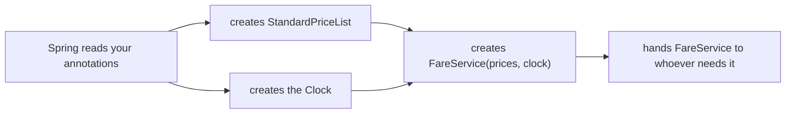

## Hook

Picture a chef who grows her own tomatoes, mills her own flour and builds her own oven before every dinner. The food might be good, but she can never switch to a cheaper supplier. A food inspector can never swap in a test tomato either.

`FareService` cooks like that. It builds its own price list and its own clock with `new`. So the tests cannot pretend it is Sunday, and Shizune's Sunday promo needs a code change. In this topic, Spring delivers the ingredients instead.

## Concept

### The problem with new inside a class

Here is the fare code today.

```java nocompile
class FareService {
    private final PriceList prices = new StandardPriceList();
    private final Clock clock = Clock.systemUTC();

    long fareCents(BikeType type, int minutes) {
        return prices.unlockCents() + prices.perMinuteCents(type) * minutes;
    }
}
```

The two `new` lines weld `FareService` to one price list and the real clock. A test cannot hand it a Sunday clock. Nobody can hand it Sunday prices without editing this class.

In module 6 you met the **dependency inversion principle**, the D in SOLID: depend on an interface, not on a concrete class. `FareService` already uses the `PriceList` interface. The `new StandardPriceList()` line still ties it to one concrete class.

```callout jargon
A **dependency** is an object another object needs to do its job. `PriceList` and `Clock` are dependencies of `FareService`. **Dependency injection** means handing those objects in from outside, usually through the constructor, instead of the class building them itself.
```

### Dependency injection by hand

Move the `new` calls out. The constructor asks for what the class needs, and whoever builds `FareService` decides what to pass.

```java run
import java.time.Clock;
import java.time.DayOfWeek;
import java.time.Instant;
import java.time.LocalDate;
import java.time.ZoneOffset;

public class Main {
    public static void main(String[] args) {
        Clock sunday = Clock.fixed(Instant.parse("2026-03-01T09:00:00Z"), ZoneOffset.UTC);
        FareService fares = new FareService(new StandardPriceList(), sunday);
        System.out.println(LocalDate.now(sunday).getDayOfWeek() == DayOfWeek.SUNDAY);
        System.out.println(fares.fareCents(10));
    }
}

interface PriceList { long unlockCents(); long perMinuteCents(); }

class StandardPriceList implements PriceList {
    public long unlockCents() { return 100; }
    public long perMinuteCents() { return 15; }
}

class FareService {
    private final PriceList prices;
    private final Clock clock;

    FareService(PriceList prices, Clock clock) {
        this.prices = prices;
        this.clock = clock;
    }

    long fareCents(int minutes) {
        return prices.unlockCents() + prices.perMinuteCents() * minutes;
    }
}
```

Now a test can pass a fixed Sunday clock, like the one above. But in a real app, someone still has to call all those constructors in the right order. Spring can do that job.

### Inversion of control and the container

In topic 03 you saw that a framework calls your code. Spring goes further: it also **creates** your objects and plugs them together. You no longer write `new FareService(...)`. You describe what you need, and Spring builds it.

```callout jargon
**Inversion of control (IoC)** means the framework, not your code, is in charge of creating objects and calling them. The part of Spring that does this is the **IoC container**. In code, the container is an object of type **ApplicationContext**.
```



### Beans

```callout jargon
A **bean** is an object that Spring creates and looks after inside the ApplicationContext. Your controllers, services and price lists become beans. A plain object you make with `new` is not a bean.
```

### Syntax: @Component, @Service and @Repository

```java nocompile
@Component    // "Spring, make a bean of this class"
class StandardPriceList implements PriceList { ... }

@Service      // a @Component that holds business rules
class FareService { ... }

@Repository   // a @Component that talks to a database (topic 09)
class RentalRepository { ... }
```

All three do the same job: they mark the class as a bean. The different names tell human readers what kind of class it is. `@RestController` from topic 03 is a component too, which is why Spring created your controller.

### Component scanning

When the app starts, Spring searches for these annotations. This search is called **component scanning**. It starts at the package of your `@SpringBootApplication` class and goes into every package below it.

```text
dev.spoke.api                      <- SpokeApiApplication lives here
dev.spoke.api.fares                <- scanned: FareService is found
dev.spoke.api.fares.prices         <- scanned: StandardPriceList is found
dev.spoke.billing                  <- NOT scanned: not below dev.spoke.api
```

The small programs on this page do not use Spring Boot. They build an `AnnotationConfigApplicationContext` and list their classes by hand. Spring Boot does that listing for you by scanning.

### Syntax: constructor injection

```java nocompile
@Service
class FareService {
    private final PriceList prices;
    private final Clock clock;

    FareService(PriceList prices, Clock clock) {   // Spring calls this and passes the beans
        this.prices = prices;
        this.clock = clock;
    }
}
```

- When a class has **one** constructor, Spring uses it. You do not need `@Autowired` on it.
- For each parameter, Spring finds the bean of that type and passes it in.
- The fields can be `final`, so nobody can swap them later by accident.

Here Spring builds the beans and wires them. Notice there is no `new FareService` anywhere.

```java run
import org.springframework.context.annotation.AnnotationConfigApplicationContext;
import org.springframework.stereotype.Component;
import org.springframework.stereotype.Service;

public class Main {
    public static void main(String[] args) {
        try (var context = new AnnotationConfigApplicationContext(StandardPriceList.class, FareService.class)) {
            FareService fares = context.getBean(FareService.class);
            System.out.println(fares.fareCents(10));
        }
    }
}

interface PriceList { long unlockCents(); long perMinuteCents(); }

@Component
class StandardPriceList implements PriceList {
    public long unlockCents() { return 100; }
    public long perMinuteCents() { return 15; }
}

@Service
class FareService {
    private final PriceList prices;

    FareService(PriceList prices) {
        this.prices = prices;
    }

    long fareCents(int minutes) {
        return prices.unlockCents() + prices.perMinuteCents() * minutes;
    }
}
```

### Why not field injection

You may see older code that puts `@Autowired` straight on a field.

```java nocompile
@Service
class FareService {
    @Autowired
    private PriceList prices;   // Spring sets this after building the object
}
```

It is shorter, but it has three problems:

- The field cannot be `final`, so it could be changed later.
- The class hides what it needs. The constructor no longer tells you.
- A plain unit test that writes `new FareService()` gets a `null` field and crashes. See Common mistakes.

Use constructor injection. It works with Spring and without it.

### Syntax: @Configuration and @Bean

You cannot put `@Component` on `java.time.Clock`. It is a JDK class, and you cannot edit its source. For classes you do not own, write a method that builds the object and mark it `@Bean`.

```java nocompile
@Configuration
class ClockConfig {

    @Bean
    Clock clock() {
        return Clock.systemUTC();
    }
}
```

- `@Configuration` marks a class that holds bean recipes.
- Spring calls each `@Bean` method once and keeps what it returns as a bean.
- The bean's name is the method's name, here `clock`.

### Singleton scope

By default, Spring makes **one** object per bean and hands that same object to everyone. This is called **singleton scope**.

```java run
import org.springframework.context.annotation.AnnotationConfigApplicationContext;
import org.springframework.stereotype.Service;

public class Main {
    public static void main(String[] args) {
        try (var context = new AnnotationConfigApplicationContext(FareService.class)) {
            FareService first = context.getBean(FareService.class);
            FareService second = context.getBean(FareService.class);
            System.out.println(first == second);
        }
    }
}

@Service
class FareService { }
```

```callout warning
Every request in the app shares the same singleton. So do not keep one rider's data in a bean's fields. Keep beans **stateless**: they hold helpers, not the details of one ride.
```

### Two beans of one type

Shizune's promo adds a second `PriceList` bean, `SundayPriceList`. Now "give me a PriceList" has two answers, and Spring refuses to guess.

```java run
import org.springframework.beans.factory.NoUniqueBeanDefinitionException;
import org.springframework.context.annotation.AnnotationConfigApplicationContext;
import org.springframework.stereotype.Component;

public class Main {
    public static void main(String[] args) {
        try (var context = new AnnotationConfigApplicationContext(StandardPriceList.class, SundayPriceList.class)) {
            context.getBean(PriceList.class);
        } catch (NoUniqueBeanDefinitionException e) {
            System.out.println(e.getClass().getSimpleName());
            System.out.println(e.getMessage());
        }
    }
}

interface PriceList { long unlockCents(); }

@Component
class StandardPriceList implements PriceList { public long unlockCents() { return 100; } }

@Component
class SundayPriceList implements PriceList { public long unlockCents() { return 50; } }
```

```callout jargon
A **NoUniqueBeanDefinitionException** means Spring found more than one bean that fits and does not know which one you want. The message lists the bean names it found.
```

There are two ways to choose.

### Syntax: @Primary

```java nocompile
@Component
@Primary
class StandardPriceList implements PriceList { ... }
```

`@Primary` makes this bean the default. Anyone who asks for "a PriceList" without saying more gets `StandardPriceList`.

### Syntax: @Qualifier

```java nocompile
@Component
@Qualifier("sunday")
class SundayPriceList implements PriceList { ... }

FareService(PriceList standard, @Qualifier("sunday") PriceList sunday, Clock clock) { ... }
```

`@Qualifier("sunday")` puts a label on the bean. The same label on a constructor parameter asks for exactly that bean. `@Primary` sets the default, and `@Qualifier` picks a specific one.

## Worked example

Here is the whole fix, run with a fixed Sunday clock so the output never changes.

```java run
import java.time.Clock;
import java.time.DayOfWeek;
import java.time.Instant;
import java.time.LocalDate;
import java.time.ZoneOffset;

import org.springframework.beans.factory.annotation.Qualifier;
import org.springframework.context.annotation.AnnotationConfigApplicationContext;
import org.springframework.context.annotation.Bean;
import org.springframework.context.annotation.Configuration;
import org.springframework.context.annotation.Primary;
import org.springframework.stereotype.Component;
import org.springframework.stereotype.Service;

public class Main {
    public static void main(String[] args) {
        try (var context = new AnnotationConfigApplicationContext(
                ClockConfig.class, StandardPriceList.class, SundayPriceList.class, FareService.class)) {
            FareService fares = context.getBean(FareService.class);
            System.out.println("10 minutes: " + fares.fareCents(10) + " cents");
        }
    }
}

interface PriceList { long unlockCents(); long perMinuteCents(); }

@Component
@Primary
class StandardPriceList implements PriceList {
    public long unlockCents() { return 100; }
    public long perMinuteCents() { return 15; }
}

@Component
@Qualifier("sunday")
class SundayPriceList implements PriceList {
    public long unlockCents() { return 50; }
    public long perMinuteCents() { return 7; }
}

@Configuration
class ClockConfig {
    @Bean
    Clock clock() {
        return Clock.fixed(Instant.parse("2026-03-01T09:00:00Z"), ZoneOffset.UTC);
    }
}

@Service
class FareService {
    private final PriceList standard;
    private final PriceList sunday;
    private final Clock clock;

    FareService(PriceList standard, @Qualifier("sunday") PriceList sunday, Clock clock) {
        this.standard = standard;
        this.sunday = sunday;
        this.clock = clock;
    }

    long fareCents(int minutes) {
        boolean isSunday = LocalDate.now(clock).getDayOfWeek() == DayOfWeek.SUNDAY;
        PriceList prices = isSunday ? sunday : standard;
        return prices.unlockCents() + prices.perMinuteCents() * minutes;
    }
}
```

Read it from the bottom up, the way Spring builds it:

- `ClockConfig` is a `@Configuration`. Its `@Bean` method gives Spring a `Clock`, fixed to Sunday 1 March 2026.
- `StandardPriceList` is `@Primary`, so it is the default `PriceList`.
- `SundayPriceList` carries the label `@Qualifier("sunday")`.
- `FareService` has one constructor. Spring passes the primary price list, the `sunday` one, and the clock.
- `fareCents` asks the clock what day it is. It is Sunday, so 10 minutes cost 50 + 7 × 10 = 120 cents.

In the real app, `ClockConfig` returns `Clock.systemUTC()`. A test then swaps in its own fixed clock bean, marked `@Primary`. `FareService` never changes.

## Try it

Run the worked example above first. Then change it in three steps and run after each one:

1. Change the date in `ClockConfig` to `2026-03-02`, a Monday. The fare becomes 250 cents.
2. Delete `@Primary` from `StandardPriceList`. Spring now fails, because two beans fit the first parameter.
3. Put `@Primary` back, and change `@Qualifier("sunday")` in the constructor to `@Qualifier("sundy")`. Read which bean Spring says it cannot find.

## Recap

- A class that builds its own helpers with `new` cannot be tested with fakes or changed without editing it. Ask for them in the constructor instead.
- Inversion of control: Spring's container, the `ApplicationContext`, creates the beans and wires them together.
- `@Component`, `@Service` and `@Repository` mark beans. Component scanning finds them in the application class's package and below.
- Prefer constructor injection: one constructor needs no `@Autowired`, and fields stay `final`. Use `@Configuration` with `@Bean` methods for classes you do not own, like `Clock`.
- Beans are singletons by default. When two beans share a type, choose with `@Primary` for the default and `@Qualifier` for a specific one.

## Common mistakes

**1. Two beans of one type, and no choice made.**

```java nocompile
@Component class StandardPriceList implements PriceList { ... }
@Component class SundayPriceList implements PriceList { ... }

@Service
class FareService {
    FareService(PriceList prices) { ... }
}
```

```text
***************************
APPLICATION FAILED TO START
***************************

Description:

Parameter 0 of constructor in dev.spoke.api.FareService required a single bean, but 2 were found:
	- standardPriceList: defined in file [.../StandardPriceList.class]
	- sundayPriceList: defined in file [.../SundayPriceList.class]
...
Action:

Consider marking one of the beans as @Primary, updating the consumer to accept multiple beans, or using @Qualifier to identify the bean that should be consumed
```

Fix: mark the everyday one `@Primary`, and use `@Qualifier("sunday")` where you want the other.

**2. Asking for a bean that nobody made.**

```java nocompile
@Service
class FareService {
    FareService(Clock clock) { ... }    // but no @Bean method returns a Clock
}
```

```text
Description:

Parameter 0 of constructor in dev.spoke.api.FareService required a bean of type 'java.time.Clock' that could not be found.

Action:

Consider defining a bean of type 'java.time.Clock' in your configuration.
```

Fix: add a `@Configuration` class with a `@Bean` method that returns a `Clock`. For your own classes, check the `@Component` or `@Service` annotation, and check the package is below the application class.

**3. Field injection, then new in a test.**

```java nocompile
class FareService {
    @Autowired
    private PriceList prices;
    long fareCents(int minutes) { return prices.unlockCents() + prices.perMinuteCents() * minutes; }
}

FareService fares = new FareService();
fares.fareCents(10);
```

```text
Exception in thread "main" java.lang.NullPointerException: Cannot invoke "dev.spoke.api.PriceList.unlockCents()" because "this.prices" is null
```

`@Autowired` only works when Spring builds the object. With `new`, nobody fills the field. Fix: use constructor injection, so the test must pass a `PriceList` in.

**4. A typo in the qualifier.**

```java nocompile
FareService(@Qualifier("sundy") PriceList sunday) { ... }
```

```text
No qualifying bean of type 'dev.spoke.api.PriceList' available: expected at least 1 bean which qualifies as autowire candidate. Dependency annotations: {@org.springframework.beans.factory.annotation.Qualifier("sundy")}
```

Fix: the label on the parameter must match the label on the bean exactly, `"sunday"`.
