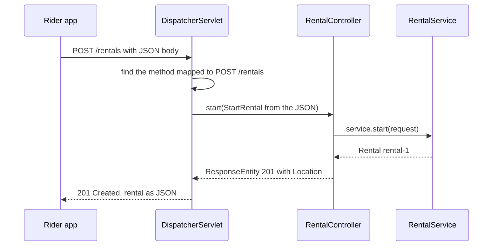

## Hook

Think of a busy restaurant. Diners never walk into the kitchen. They give their order to one host at the door. The host reads the order, walks it to the right cook, and brings the plate back.

Jiraiya's app team has agreed how the rentals screens talk to the server. The app will send "start a rental", "show me rental 7", "list my rentals" and "end this rental". Right now the server has a working `RentalService` and nobody at the door. In this topic you build the door: a **controller** that takes each request, hands it to the service, and sends back an answer. For now the app also sends the start station, and ending a rental takes no body. End stations and fares come later.

## Concept

### Where a request goes

Spring Boot runs a small web server called Tomcat inside your program. Every request enters through one front door, the **DispatcherServlet**. It looks at the request's method and path, such as `POST /rentals`. It finds the controller method whose mapping matches. It turns the JSON body into a Java object, calls your method, and turns the return value back into JSON. Your method never sees raw HTTP text.

```callout jargon
A **servlet** is a Java class that answers web requests. The **DispatcherServlet** is Spring's one servlet that hands every request to the right controller method. An **endpoint** is one method plus one path, such as GET /rentals/{id}.
```



Each request runs on its own thread, from start to finish. Tomcat keeps a pool of them, 200 at most by default. If every thread is stuck waiting on a slow database, request 201 waits in line.

On Java 21, one setting gives each request a cheap virtual thread instead (module 5): `spring.threads.virtual.enabled=true` in `application.properties`. Waiting then costs almost nothing, though a slow database is still slow.

### Syntax: @RestController and @RequestMapping

```java nocompile
@RestController
@RequestMapping("/rentals")
public class RentalController {
    // every method in here answers a path that starts with /rentals
}
```

- `@RestController` marks the class as a controller. Whatever its methods return is written into the response body as JSON.
- `@RequestMapping("/rentals")` on the class sets the start of every path inside it. Write the shared part once.

```callout jargon
**JSON** is the text format apps use to send data, like {"riderId": "r-17"}. **Jackson** is the library Spring uses to turn Java objects into JSON and back. Spring Boot 4 uses Jackson 3.
```

### Syntax: @GetMapping, @PostMapping, @PatchMapping, @DeleteMapping

Each HTTP method has its own annotation. The path inside is added to the class path.

```java nocompile
@GetMapping                 // GET    /rentals
@GetMapping("/{id}")        // GET    /rentals/rental-1
@PostMapping                // POST   /rentals
@PostMapping("/{id}/end")   // POST   /rentals/rental-1/end
@PatchMapping("/{id}")      // PATCH  /rentals/rental-1
@DeleteMapping("/{id}")     // DELETE /rentals/rental-1
```

Ending a rental is an action, not an edit of a few fields, so Spoke's design uses `POST /rentals/{id}/end`. A `@PatchMapping` fits when the app changes some fields of a thing, as you saw when designing the API.

A request with no matching mapping never reaches your code. Spring answers 404 Not Found for an unknown path. It answers 405 Method Not Allowed when the path exists but not with that method.

### Syntax: @PathVariable

Curly braces in a path mark a **path variable**: a part of the address that changes from request to request.

```java nocompile
@GetMapping("/{id}")
public Rental find(@PathVariable String id) {
    // GET /rentals/rental-7 gives id = "rental-7"
}
```

Spring matches the parameter name `id` to the `{id}` in the path. If you want a different Java name, put the path name in the annotation.

```java nocompile
@GetMapping("/{id}")
public Rental find(@PathVariable("id") String rentalId) { ... }
```

### Syntax: @RequestParam

A **query parameter** comes after a `?` in the address, like `/rentals?riderId=r-17`. It is usually optional and filters or tunes the answer.

```java nocompile
@GetMapping
public List<Rental> list(@RequestParam(required = false) String riderId) {
    // GET /rentals?riderId=r-17 gives "r-17"; GET /rentals gives null
}

@GetMapping
public List<Rental> list(@RequestParam(defaultValue = "20") int size) {
    // GET /rentals gives 20; GET /rentals?size=5 gives 5
}
```

- Without `required = false`, a missing parameter makes Spring answer 400 Bad Request.
- `defaultValue` fills in a value when the parameter is missing. It also makes the parameter optional.
- Spring converts the text to your type. `?size=ten` for an `int` answers 400.

```callout tip
Gojo says: use the path for which thing (rental-7) and query parameters for how to filter or sort a list.
```

### Syntax: @RequestBody

A POST or PATCH request can carry a **body**: data in JSON. `@RequestBody` tells Spring to turn that JSON into a Java object. A record is a perfect fit.

```java nocompile
public record StartRental(String riderId, String bikeId, String station) {}

@PostMapping
public ResponseEntity<Rental> start(@RequestBody StartRental request) { ... }
```

Jackson matches JSON keys to record component names. You can try that conversion by hand, with no web server at all.

```java run
import tools.jackson.databind.json.JsonMapper;

public class Main {
    public static void main(String[] args) {
        JsonMapper mapper = JsonMapper.builder().build();

        String json = "{\"riderId\": \"r-17\", \"bikeId\": \"B-1042\", \"station\": \"harbor\"}";
        StartRental request = mapper.readValue(json, StartRental.class);
        System.out.println(request.bikeId());

        String back = mapper.writeValueAsString(new StartRental("r-22", "B-2001", "uptown"));
        System.out.println(back);
    }
}

record StartRental(String riderId, String bikeId, String station) {}
```

The client must also say the body is JSON, with the header `Content-Type: application/json`. Without it, Spring answers 415 Unsupported Media Type.

### HTTP status codes you will send

A **status code** is the three-digit number at the top of every answer. The app reads it before anything else.

| Code | Name | When a controller sends it |
|---|---|---|
| 200 | OK | A normal answer with a body |
| 201 | Created | A POST made something new |
| 204 | No Content | Done, and there is nothing to send back |
| 400 | Bad Request | The request itself is broken |
| 404 | Not Found | There is no thing with that id |
| 409 | Conflict | The request clashes with the current state, like ending a rental twice |

This first version answers 409 to any second end. Topic 02 showed a kinder design, a 200 replay for a retry of the same end. That needs the end station, which comes later.

### Syntax: ResponseEntity

Returning a plain object gives 200 OK. To pick the status or add **headers**, return a `ResponseEntity`.

```callout jargon
A **header** is a named line of extra information sent with a request or an answer, like Content-Type. The **Location** header tells the client the address of a thing that was just created.
```

```java nocompile
return ResponseEntity.ok(rental);                              // 200 with a body
return ResponseEntity.created(location).body(rental);          // 201 with Location and a body
return ResponseEntity.noContent().build();                     // 204, no body
return ResponseEntity.notFound().build();                      // 404, no body
return ResponseEntity.status(HttpStatus.CONFLICT).build();     // any status you like
return ResponseEntity.ok().header("Cache-Control", "no-store").body(rental);  // extra header
```

There are two common ways to build the Location address.

```java nocompile
URI location = URI.create("/rentals/" + rental.id());           // gives /rentals/rental-1

URI location = ServletUriComponentsBuilder.fromCurrentRequest()  // in tests, gives http://localhost/rentals/rental-1
        .path("/{id}")
        .buildAndExpand(rental.id())
        .toUri();
```

The second one starts from the address the request came in on, so it includes the server name. A real server adds its port too.

### Syntax: ResponseStatusException

Sometimes you find out deep in a method that the answer is "not found". Throw a `ResponseStatusException` and Spring turns it into that status.

```java nocompile
return service.find(id)
        .orElseThrow(() -> new ResponseStatusException(HttpStatus.NOT_FOUND, "No rental with id " + id));
```

Riders do not see this text yet. The next topic sends a proper error body, and this text becomes its detail, so keep it safe to show.

### Keep the controller thin

A controller's job is translation. It turns HTTP into a method call, and the result back into HTTP. The rules, like "a rental can only end once", live in the service. A thin controller is easy to read, and the rules can be tested without any web code.

### Syntax: @WebMvcTest and @MockitoBean

You test a controller with **MockMvc**. It sends pretend requests straight into the DispatcherServlet, with no network and no port.

```callout jargon
A **slice test** starts only one layer of the app. **@WebMvcTest** starts the web layer: controllers, JSON conversion and MockMvc. It skips services, databases and everything else, so it starts fast.
```

```java nocompile
@WebMvcTest(StationController.class)
class StationControllerTest {

    @Autowired MockMvc mvc;
    @MockitoBean StationService stations;   // a Mockito mock, put into Spring in place of the real service

    @Test
    @DisplayName("GET /stations/harbor answers 200 with the station as JSON")
    void findsHarbor() throws Exception {
        when(stations.find("harbor")).thenReturn(Optional.of(new Station("harbor", "Harbor", 5)));

        MvcResult r = mvc.perform(get("/stations/harbor")).andReturn();

        assertEquals(200, r.getResponse().getStatus(), "GET /stations/harbor should answer 200 OK");
        String name = JsonPath.read(r.getResponse().getContentAsString(), "$.name");
        assertEquals("Harbor", name, "the body should be the Harbor station");
    }
}
```

- `@WebMvcTest(StationController.class)` starts only that controller.
- `@MockitoBean` puts a mock where the service would be. You script it with `when`, exactly as in the Mockito topic.
- `JsonPath.read` pulls one value out of the JSON, using `$.name` for "the name field".

A short form chains checks with `andExpect`:

```java nocompile
mvc.perform(get("/stations/moon")).andExpect(status().isNotFound());
```

`andExpect` cannot carry a message, so the practice checks read the status and assert with a message instead.

To start the whole app instead, write `@SpringBootTest` with `@AutoConfigureMockMvc`. It is slower, because every bean starts, including the database.

## Worked example

Riders can report a broken dock. Here is a station controller with four endpoints. It shows every piece from this page.

```java
import java.net.URI;
import java.util.List;
import java.util.Optional;

import org.springframework.http.HttpStatus;
import org.springframework.http.ResponseEntity;
import org.springframework.web.bind.annotation.DeleteMapping;
import org.springframework.web.bind.annotation.GetMapping;
import org.springframework.web.bind.annotation.PathVariable;
import org.springframework.web.bind.annotation.PostMapping;
import org.springframework.web.bind.annotation.RequestBody;
import org.springframework.web.bind.annotation.RequestMapping;
import org.springframework.web.bind.annotation.RequestParam;
import org.springframework.web.bind.annotation.RestController;
import org.springframework.web.server.ResponseStatusException;

@RestController
@RequestMapping("/stations")
class StationController {

    private final StationService stations;

    StationController(StationService stations) {
        this.stations = stations;
    }

    @GetMapping
    List<Station> list(@RequestParam(defaultValue = "0") int minFree) {
        return stations.withFreeDocks(minFree);
    }

    @GetMapping("/{id}")
    Station find(@PathVariable String id) {
        return stations.find(id)
                .orElseThrow(() -> new ResponseStatusException(HttpStatus.NOT_FOUND, "No station " + id));
    }

    @PostMapping("/{id}/reports")
    ResponseEntity<DockReport> report(@PathVariable String id, @RequestBody NewReport body) {
        DockReport saved = stations.report(id, body);
        URI location = URI.create("/stations/" + id + "/reports/" + saved.id());
        return ResponseEntity.created(location).body(saved);
    }

    @DeleteMapping("/{id}/reports/{reportId}")
    ResponseEntity<Void> fixed(@PathVariable String id, @PathVariable String reportId) {
        if (!stations.closeReport(id, reportId)) {
            return ResponseEntity.notFound().build();
        }
        return ResponseEntity.noContent().build();
    }
}

record Station(String id, String name, int freeDocks) {}
record NewReport(int dock, String problem) {}
record DockReport(String id, String stationId, int dock, String problem) {}

interface StationService {
    List<Station> withFreeDocks(int atLeast);
    Optional<Station> find(String id);
    DockReport report(String stationId, NewReport report);
    boolean closeReport(String stationId, String reportId);
}
```

- `@RequestMapping("/stations")` sets the shared start, so the four mappings stay short.
- `list` reads `?minFree=3`. With no parameter, `defaultValue = "0"` lists every station.
- `find` reads the id from the path. An empty `Optional` becomes 404 through `ResponseStatusException`.
- `report` reads both a path variable and a JSON body. It answers 201 with a Location header that points at the new report.
- `fixed` answers 204 No Content when the report is closed, and 404 when there was no such report.
- No method holds a business rule. Each one reads, calls the service, and picks a status.

Here is what the app and the server say to each other for the POST:

```http
POST /stations/harbor/reports HTTP/1.1
Content-Type: application/json

{"dock": 4, "problem": "lock stuck"}
```

```http
HTTP/1.1 201 Created
Location: /stations/harbor/reports/report-7
Content-Type: application/json

{"id":"report-7","stationId":"harbor","dock":4,"problem":"lock stuck"}
```

## Try it

This program builds a tiny controller and sends it three requests through MockMvc. `standaloneSetup` wires up one controller without starting Spring Boot, so it runs in under a second. Run it and read the three status codes.

Then try these, one at a time:

- Change `report-9` to `report-1`. The last line becomes 200.
- Remove `@RequestBody`. The POST answers 400, because Spring stops reading the JSON and has no number for `dock`.
- Put `@RequestBody` back, then remove `.contentType(MediaType.APPLICATION_JSON)`. The POST answers 415.

```java run
import static org.springframework.test.web.servlet.request.MockMvcRequestBuilders.get;
import static org.springframework.test.web.servlet.request.MockMvcRequestBuilders.post;

import java.net.URI;
import java.util.LinkedHashMap;
import java.util.Map;

import ch.qos.logback.classic.Level;
import ch.qos.logback.classic.Logger;
import org.slf4j.LoggerFactory;
import org.springframework.http.MediaType;
import org.springframework.http.ResponseEntity;
import org.springframework.test.web.servlet.MockMvc;
import org.springframework.test.web.servlet.MvcResult;
import org.springframework.test.web.servlet.request.MockHttpServletRequestBuilder;
import org.springframework.test.web.servlet.setup.MockMvcBuilders;
import org.springframework.web.bind.annotation.GetMapping;
import org.springframework.web.bind.annotation.PathVariable;
import org.springframework.web.bind.annotation.PostMapping;
import org.springframework.web.bind.annotation.RequestBody;
import org.springframework.web.bind.annotation.RequestMapping;
import org.springframework.web.bind.annotation.RestController;

public class Main {
    public static void main(String[] args) throws Exception {
        // Hide Spring's start-up log lines, so you only see the answers.
        ((Logger) LoggerFactory.getLogger(Logger.ROOT_LOGGER_NAME)).setLevel(Level.WARN);
        MockMvc mvc = MockMvcBuilders.standaloneSetup(new ReportController()).build();

        show(mvc, post("/reports").contentType(MediaType.APPLICATION_JSON)
                .content("{\"station\": \"harbor\", \"dock\": 4, \"problem\": \"lock stuck\"}"));
        show(mvc, get("/reports/report-1"));
        show(mvc, get("/reports/report-9"));
    }

    static void show(MockMvc mvc, MockHttpServletRequestBuilder request) throws Exception {
        MvcResult r = mvc.perform(request).andReturn();
        System.out.println(r.getResponse().getStatus() + " " + r.getResponse().getContentAsString());
    }
}

record DockReport(String station, int dock, String problem) {}

@RestController
@RequestMapping("/reports")
class ReportController {
    private final Map<String, DockReport> reports = new LinkedHashMap<>();

    @PostMapping
    ResponseEntity<DockReport> create(@RequestBody DockReport report) {
        String id = "report-" + (reports.size() + 1);
        reports.put(id, report);
        return ResponseEntity.created(URI.create("/reports/" + id)).body(report);
    }

    @GetMapping("/{id}")
    ResponseEntity<DockReport> find(@PathVariable String id) {
        DockReport report = reports.get(id);
        if (report == null) {
            return ResponseEntity.notFound().build();
        }
        return ResponseEntity.ok(report);
    }
}
```

## Recap

- Every request enters through the DispatcherServlet, which calls the controller method whose mapping matches the method and path.
- `@RestController` plus `@RequestMapping` on the class, then `@GetMapping`, `@PostMapping`, `@PatchMapping` and `@DeleteMapping` on methods. Ending a rental is an action, so it is a POST.
- `@PathVariable` reads part of the path. `@RequestParam` reads `?name=value`, with `required = false` or a `defaultValue`. `@RequestBody` turns JSON into a record.
- `ResponseEntity` picks the status and headers: 201 with Location for a create. `ResponseStatusException` turns "not found" into 404.
- Keep controllers thin. Test them with `@WebMvcTest`, `@MockitoBean` and MockMvc.

## Common mistakes

**1. Forgetting @RequestBody.**

```java nocompile
@PostMapping
public ResponseEntity<Rental> start(StartRental request) { ... }
```

```text
201 {"id":"rental-1","riderId":null,"bikeId":null,"startStation":null,"startedAt":"2026-11-16T08:00:00Z","endedAt":null}
```

There is no error at all. Spring looks for the values in query parameters, finds none, and fills the record with nulls. The service then starts a rental with no rider and no bike. Fix: write `@RequestBody StartRental request`.

**2. A path variable whose name does not match the braces.**

```java nocompile
@GetMapping("/{id}")
public Rental find(@PathVariable String rentalId) { ... }
```

```text
500
Resolved [org.springframework.web.bind.MissingPathVariableException: Required URI template variable 'rentalId' for method parameter type String is not present]
```

Spring looks for `{rentalId}` in the path and finds only `{id}`. Fix: rename the parameter to `id`, or write `@PathVariable("id") String rentalId`.

**3. Making an optional query parameter required.**

```java nocompile
@GetMapping
public List<Rental> list(@RequestParam String riderId) { ... }
```

```text
GET /rentals  ->  400 Bad Request
```

`@RequestParam` is required unless you say otherwise. Fix: add `required = false` and handle `null`, or give a `defaultValue`.

**4. Answering 200 to a create.**

```java nocompile
@PostMapping
public Rental start(@RequestBody StartRental request) {
    return service.start(request);
}
```

```text
expected: <201> but was: <200>
```

A plain return value means 200 OK, with no Location header. Fix: return `ResponseEntity.created(location).body(rental)`.
