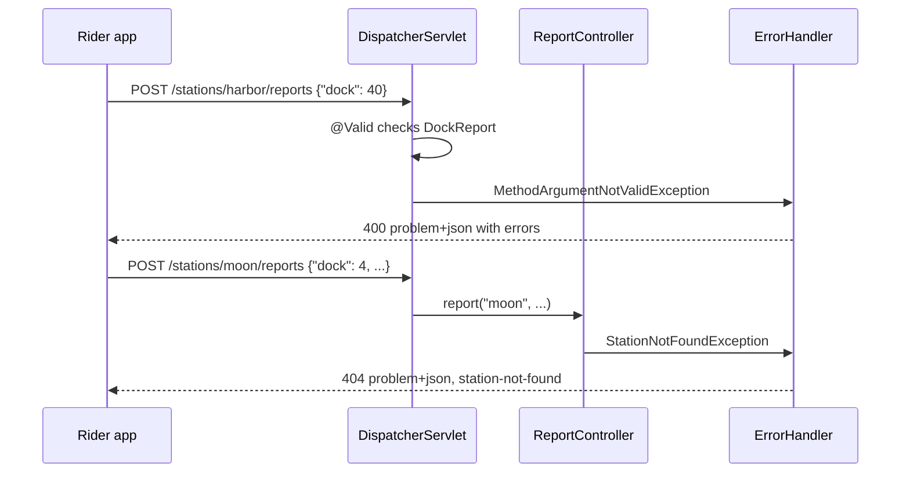

## Hook

A post office clerk checks every parcel at the counter. No address? The clerk hands it back and says "you forgot the street". The parcel never reaches the van, and the customer knows exactly what to fix.

Spoke's server has no clerk. A rider types `b1042` instead of `B-1042`, and the request goes all the way in. Something deep inside throws, and the app shows "500 Internal Server Error" with Java class names. Sam's ticket even has a screenshot of our package names. In this topic you check every request at the door, and you turn every error into a short, clear answer.

## Concept

### Never trust input

Anything that arrives over HTTP can be wrong. A rider can mistype. An old app version can send a missing field. Someone can send rubbish on purpose. So the server checks every request before it does any work.

```callout jargon
**Validation** means checking that input follows the rules before you use it. A **constraint** is one rule, such as "must not be blank" or "must look like B-1042".
```

### Syntax: constraint annotations

**Jakarta Bean Validation** is the standard Java way to write rules as annotations. Spring Boot includes Hibernate Validator, which checks them. You put the annotations on record components.

```java nocompile
public record StartRentalRequest(
        @NotBlank String riderId,
        @NotNull @Pattern(regexp = "B-\\d{4}", message = "must look like B-1042") String bikeId,
        @NotBlank String station) {}
```

| Annotation | The rule |
|---|---|
| `@NotNull` | The value must be there |
| `@NotBlank` | Text must be there and contain more than spaces |
| `@Pattern(regexp = "...")` | Text must match the regular expression, a pattern for text. `null` counts as valid, so pair it with `@NotNull` |
| `@Size(min = 1, max = 200)` | Text or a list must have a length in that range |
| `@Min(1)` and `@Max(12)` | A number must be at least 1 and at most 12 |
| `@Positive` | A number must be greater than 0 |

Every annotation has a default message, such as "must not be blank". Pass `message = "..."` to write your own.

You can run the checks by hand, with no web server at all:

```java run
import java.util.Set;

import ch.qos.logback.classic.Level;
import ch.qos.logback.classic.Logger;
import jakarta.validation.ConstraintViolation;
import jakarta.validation.Validation;
import jakarta.validation.Validator;
import jakarta.validation.constraints.Max;
import jakarta.validation.constraints.Min;
import jakarta.validation.constraints.NotBlank;
import jakarta.validation.constraints.Size;
import org.slf4j.LoggerFactory;

public class Main {
    public static void main(String[] args) {
        // Hide the validator's start-up log line, so you only see the results.
        ((Logger) LoggerFactory.getLogger(Logger.ROOT_LOGGER_NAME)).setLevel(Level.WARN);
        Validator validator = Validation.buildDefaultValidatorFactory().getValidator();

        check(validator, new DockReport(4, "lock stuck"));
        check(validator, new DockReport(40, "lock stuck"));
        check(validator, new DockReport(0, " "));
    }

    static void check(Validator validator, DockReport report) {
        Set<ConstraintViolation<DockReport>> problems = validator.validate(report);
        System.out.println(report + " has " + problems.size() + " problem(s)");
        problems.stream()
                .map(p -> "  " + p.getPropertyPath() + ": " + p.getMessage())
                .sorted()
                .forEach(System.out::println);
    }
}

record DockReport(@Min(1) @Max(12) int dock, @NotBlank @Size(max = 200) String problem) {}
```

### Syntax: @Valid

The annotations alone do nothing. `@Valid` in front of `@RequestBody` tells Spring to check the body before your method runs.

```java nocompile
@PostMapping
public ResponseEntity<Rental> start(@Valid @RequestBody StartRentalRequest request) { ... }
```

When a rule fails, your method is never called. Spring throws `MethodArgumentNotValidException`, and the answer is 400 Bad Request. Every failed rule is inside the exception, with its field name and message.

```callout tip
Byte says: @Valid is the clerk at the counter. The annotations are the clerk's checklist.
```

### Syntax: @RestControllerAdvice and @ExceptionHandler

An **exception handler** is a method that turns one kind of exception into an answer. You collect them in one class marked `@RestControllerAdvice`. Spring then uses them for every controller.

```java nocompile
@RestControllerAdvice
public class SpokeErrorHandler {

    @ExceptionHandler(BikeNotFoundException.class)
    public ProblemDetail bikeNotFound(BikeNotFoundException e) {
        return ProblemDetail.forStatusAndDetail(HttpStatus.NOT_FOUND, e.getMessage());
    }
}
```

- `@ExceptionHandler(BikeNotFoundException.class)` says which exception this method answers.
- The exception travels out of the controller and the service. Neither of them needs a try and catch.
- When several handlers could match, Spring picks the most specific exception type.

```callout jargon
**Advice**, in Spring, is code that is added around many classes at once. A controller advice adds the same error handling to every controller.
```

### Syntax: ProblemDetail

Errors need a body the app can read. **RFC 9457** is the web standard for that body. It calls it "problem details", and Spring has a class for it: `ProblemDetail`.

| Field | What it holds |
|---|---|
| `type` | A web address that names the kind of problem. Apps compare it to decide what to show |
| `title` | A short, fixed summary of that kind of problem |
| `status` | The HTTP status code again, inside the body |
| `detail` | A sentence about this one case, written for people |
| `instance` | The path of the request that failed |

```java nocompile
ProblemDetail problem = ProblemDetail.forStatusAndDetail(HttpStatus.NOT_FOUND, "No bike has the id B-9999.");
problem.setType(URI.create("https://api.spoke.example/problems/bike-not-found"));
problem.setTitle("Bike not found");
problem.setProperty("hint", "Check the number on the bike's frame");   // any extra field you like
```

Return the `ProblemDetail` from a handler. Spring sets the status from it, fills in `instance`, and sends the Content-Type `application/problem+json`. This is the real answer from the practice solution:

```http
HTTP/1.1 404 Not Found
Content-Type: application/problem+json

{"detail":"No bike has the id B-9999. Check the number on the bike's frame.","instance":"/rentals","status":404,"title":"Bike not found","type":"https://api.spoke.example/problems/bike-not-found"}
```

When you leave out `type`, it means "about:blank", and Spring leaves it out of the JSON.

### Picking the status for an error

The first digit tells the app whose fault it is. A 4xx code means "your request has a problem, change it". A 5xx code means "our server has a problem, try later".

| Situation | Exception | Status |
|---|---|---|
| A field breaks a rule | `MethodArgumentNotValidException` | 400 Bad Request |
| The JSON is broken | `HttpMessageNotReadableException` | 400 Bad Request |
| No bike has that id | `BikeNotFoundException` | 404 Not Found |
| The bike is rented or in maintenance | `BikeUnavailableException` | 409 Conflict |
| Anything you did not expect | any other exception | 500 Internal Server Error |

Exceptions like `BikeNotFoundException` are **domain exceptions**: your own classes that name a business problem. The service throws them, and only the advice knows about HTTP.

### Syntax: setProperty for field errors

For a 400, the app wants to know which field to highlight. Read the failed rules from the exception and add them as an extra property.

```java nocompile
problem.setType(URI.create("https://api.spoke.example/problems/invalid-request"));
problem.setTitle("Invalid request");
problem.setDetail("Some fields are missing or wrong. See errors for each one.");

Map<String, String> errors = new TreeMap<>();
for (FieldError error : e.getBindingResult().getFieldErrors()) {
    errors.putIfAbsent(error.getField(), error.getDefaultMessage());
}
problem.setProperty("errors", errors);
```

`putIfAbsent` keeps the first message when one field breaks two rules. A `TreeMap` keeps the fields in alphabetical order. The answer looks like this:

```json
{"detail":"Some fields are missing or wrong. See errors for each one.","instance":"/rentals","status":400,"title":"Invalid request","type":"https://api.spoke.example/problems/invalid-request","errors":{"riderId":"must not be blank","station":"must not be blank"}}
```

### Syntax: a catch-all handler that hides internals

Some exceptions are real bugs that nobody planned for. A **catch-all** handler answers all of them. It logs everything for the team and tells the rider almost nothing.

```java nocompile
private static final Logger log = LoggerFactory.getLogger(SpokeErrorHandler.class);

@ExceptionHandler(Exception.class)
public ProblemDetail unexpected(Exception e) {
    log.error("Unexpected error while handling a request", e);
    return ProblemDetail.forStatusAndDetail(HttpStatus.INTERNAL_SERVER_ERROR, "Something went wrong on our side");
}
```

```http
HTTP/1.1 500 Internal Server Error
Content-Type: application/problem+json

{"detail":"Something went wrong on our side","instance":"/rentals","status":500,"title":"Internal Server Error"}
```

```callout warning
Never put e.getMessage(), a class name or a stack trace in an answer. Riders cannot use them, and an attacker learns how your server is built. The full story goes to the log, where only the team can read it.
```

### Syntax: ResponseEntityExceptionHandler

A catch-all has a trap. Spring reports its own problems as exceptions too: broken JSON, an unknown path, a wrong HTTP method. A plain `@ExceptionHandler(Exception.class)` catches those as well and turns a correct 400, 404 or 405 into 500.

Spring's base class `ResponseEntityExceptionHandler` already answers Spring MVC's own exceptions with the right status and a `ProblemDetail`. Extend it, and your catch-all only sees the real surprises. To change the validation answer, override its method instead of writing a new handler.

```java nocompile
@RestControllerAdvice
public class SpokeErrorHandler extends ResponseEntityExceptionHandler {

    @Override
    protected ResponseEntity<Object> handleMethodArgumentNotValid(
            MethodArgumentNotValidException e, HttpHeaders headers, HttpStatusCode status, WebRequest request) {
        ProblemDetail problem = e.getBody();       // Spring's 400 problem, ready to change
        // set the type, title, detail and errors as shown above
        return ResponseEntity.status(status).body(problem);
    }
}
```

### Checking a path variable or query parameter

You can also put constraints straight on a `@PathVariable` or `@RequestParam`.

```java nocompile
@GetMapping("/bikes/{id}")
public Bike bike(@PathVariable @Pattern(regexp = "B-\\d{4}") String id) { ... }

@GetMapping("/stations")
public List<Station> stations(@RequestParam(defaultValue = "1") @Min(1) @Max(12) int minFree) { ... }
```

Spring 7 checks these by itself. A broken rule throws `HandlerMethodValidationException`, and `ResponseEntityExceptionHandler` answers 400 with the detail "Validation failure". To change that answer, override `handleHandlerMethodValidationException` in your advice, just like `handleMethodArgumentNotValid`. Do not add an `@ExceptionHandler` for it. You do not need `@Validated` on the controller. In fact, adding it switches to an older check that throws a different exception, and your catch-all turns it into 500.

## Worked example

Riders report broken docks with `POST /stations/{id}/reports`. Here is the whole path from bad input to a clear answer.



The full code is the program in **Try it** below. Here is what each part does.

- `DockReport` carries the rules: a dock from 1 to 12, and a problem that is not blank.
- `@Valid` checks the body before `report` runs. The controller holds no `if` for bad input.
- The override keeps Spring's 400 problem and sets the type, title, detail and `errors` map.
- `StationNotFoundException` is a domain exception. The handler gives it a status, a type and a title.
- The catch-all logs the real exception and says only "Something went wrong on our side".
- Extending `ResponseEntityExceptionHandler` keeps broken JSON at 400, instead of letting the catch-all grab it.

These are the real answers to the five requests in Try it, one per line: status, then body.

```text
201 {"dock":4,"problem":"lock stuck"}
400 {"detail":"Some fields are missing or wrong. See errors for each one.","instance":"/stations/harbor/reports","status":400,"title":"Invalid request","type":"https://api.spoke.example/problems/invalid-request","errors":{"dock":"must be less than or equal to 12","problem":"must not be blank"}}
404 {"detail":"No station has the id moon","instance":"/stations/moon/reports","status":404,"title":"Station not found","type":"https://api.spoke.example/problems/station-not-found"}
400 {"detail":"Failed to read request","instance":"/stations/harbor/reports","status":400,"title":"Bad Request"}
500 {"detail":"Something went wrong on our side","instance":"/stations/depot/reports","status":500,"title":"Internal Server Error"}
```

The fourth request sent broken JSON, and the base class answered it. The fifth hit a surprise bug, and the body says nothing about `SensorBus` or `demo.DockSensors`.

## Try it

This program wires the controller and the error handler together with MockMvc, without starting Spring Boot. Run it and read the five answers.

Then try these, one at a time:

- Remove `@Valid`. The second request now answers 201 with dock 40, because nobody checked it.
- Put `@Valid` back and change `@Max(12)` to `@Max(50)`. Now `errors` lists only `problem`.
- Change `"moon"` to `"uptown"`. The detail names the new station.
- In the catch-all, change the detail to `e.toString()`. The last answer now leaks the class name, which is exactly what Sam's rider saw.

```java run
import static org.springframework.test.web.servlet.request.MockMvcRequestBuilders.post;

import java.net.URI;
import java.util.Map;
import java.util.TreeMap;

import ch.qos.logback.classic.Level;
import ch.qos.logback.classic.Logger;
import jakarta.validation.Valid;
import jakarta.validation.constraints.Max;
import jakarta.validation.constraints.Min;
import jakarta.validation.constraints.NotBlank;
import org.slf4j.LoggerFactory;
import org.springframework.http.HttpHeaders;
import org.springframework.http.HttpStatus;
import org.springframework.http.HttpStatusCode;
import org.springframework.http.MediaType;
import org.springframework.http.ProblemDetail;
import org.springframework.http.ResponseEntity;
import org.springframework.test.web.servlet.MockMvc;
import org.springframework.test.web.servlet.MvcResult;
import org.springframework.test.web.servlet.setup.MockMvcBuilders;
import org.springframework.validation.FieldError;
import org.springframework.web.bind.MethodArgumentNotValidException;
import org.springframework.web.bind.annotation.ExceptionHandler;
import org.springframework.web.bind.annotation.PathVariable;
import org.springframework.web.bind.annotation.PostMapping;
import org.springframework.web.bind.annotation.RequestBody;
import org.springframework.web.bind.annotation.RestController;
import org.springframework.web.bind.annotation.RestControllerAdvice;
import org.springframework.web.context.request.WebRequest;
import org.springframework.web.servlet.mvc.method.annotation.ResponseEntityExceptionHandler;

public class Main {
    public static void main(String[] args) throws Exception {
        // Hide Spring's log lines, so you only see the answers.
        ((Logger) LoggerFactory.getLogger(Logger.ROOT_LOGGER_NAME)).setLevel(Level.OFF);
        MockMvc mvc = MockMvcBuilders.standaloneSetup(new ReportController())
                .setControllerAdvice(new ErrorHandler())
                .build();

        report(mvc, "harbor", "{\"dock\": 4, \"problem\": \"lock stuck\"}");
        report(mvc, "harbor", "{\"dock\": 40, \"problem\": \"\"}");
        report(mvc, "moon", "{\"dock\": 4, \"problem\": \"lock stuck\"}");
        report(mvc, "harbor", "{\"dock\": 4, ");
        report(mvc, "depot", "{\"dock\": 4, \"problem\": \"lock stuck\"}");
    }

    static void report(MockMvc mvc, String station, String json) throws Exception {
        MvcResult r = mvc.perform(post("/stations/" + station + "/reports")
                .contentType(MediaType.APPLICATION_JSON).content(json)).andReturn();
        System.out.println(r.getResponse().getStatus() + " " + r.getResponse().getContentAsString());
    }
}

record DockReport(@Min(1) @Max(12) int dock, @NotBlank String problem) {}

class StationNotFoundException extends RuntimeException {
    StationNotFoundException(String id) {
        super("No station has the id " + id);
    }
}

@RestController
class ReportController {
    @PostMapping("/stations/{id}/reports")
    ResponseEntity<DockReport> report(@PathVariable String id, @Valid @RequestBody DockReport report) {
        if (id.equals("depot")) {
            throw new IllegalStateException("SensorBus offline in demo.DockSensors");   // a surprise bug
        }
        if (!id.equals("harbor")) {
            throw new StationNotFoundException(id);
        }
        return ResponseEntity.created(URI.create("/stations/harbor/reports/report-1")).body(report);
    }
}

@RestControllerAdvice
class ErrorHandler extends ResponseEntityExceptionHandler {

    private static final org.slf4j.Logger log = LoggerFactory.getLogger(ErrorHandler.class);

    @Override
    protected ResponseEntity<Object> handleMethodArgumentNotValid(
            MethodArgumentNotValidException e, HttpHeaders headers, HttpStatusCode status, WebRequest request) {
        Map<String, String> errors = new TreeMap<>();
        for (FieldError error : e.getBindingResult().getFieldErrors()) {
            errors.putIfAbsent(error.getField(), error.getDefaultMessage());
        }
        ProblemDetail problem = e.getBody();
        problem.setType(URI.create("https://api.spoke.example/problems/invalid-request"));
        problem.setTitle("Invalid request");
        problem.setDetail("Some fields are missing or wrong. See errors for each one.");
        problem.setProperty("errors", errors);
        return ResponseEntity.status(status).body(problem);
    }

    @ExceptionHandler(StationNotFoundException.class)
    ProblemDetail stationNotFound(StationNotFoundException e) {
        ProblemDetail problem = ProblemDetail.forStatusAndDetail(HttpStatus.NOT_FOUND, e.getMessage());
        problem.setType(URI.create("https://api.spoke.example/problems/station-not-found"));
        problem.setTitle("Station not found");
        return problem;
    }

    @ExceptionHandler(Exception.class)
    ProblemDetail unexpected(Exception e) {
        log.error("Unexpected error while handling a request", e);
        return ProblemDetail.forStatusAndDetail(HttpStatus.INTERNAL_SERVER_ERROR, "Something went wrong on our side");
    }
}
```

## Recap

- Never trust input. Put rules on record components with `@NotBlank`, `@NotNull`, `@Pattern`, `@Size`, `@Min`, `@Max` and `@Positive`.
- `@Valid` before `@RequestBody` runs the rules. A broken rule throws `MethodArgumentNotValidException`, which means 400.
- A `@RestControllerAdvice` class holds `@ExceptionHandler` methods that turn exceptions into `ProblemDetail` answers with `type`, `title`, `status`, `detail` and `instance`.
- Pick the status by whose fault it is. Use 400 for bad input, 404 for a missing thing, 409 for a clash and 500 for our bugs.
- A catch-all logs the real exception and returns a plain 500. Extend `ResponseEntityExceptionHandler` so Spring's own errors keep their 4xx status.

## Common mistakes

**1. Writing the rules but forgetting @Valid.**

```java nocompile
@PostMapping
public ResponseEntity<DockReport> report(@PathVariable String id, @RequestBody DockReport report) { ... }
```

```text
201 {"dock":40,"problem":""}
```

No error at all. The annotations are only a checklist until `@Valid` asks Spring to use it. Fix: write `@Valid @RequestBody`.

**2. A catch-all without the base class.**

```java nocompile
@RestControllerAdvice
public class SpokeErrorHandler {
    @ExceptionHandler(Exception.class)
    public ProblemDetail unexpected(Exception e) { ... }
}
```

```text
POST /rentals with broken JSON
500 {"detail":"Something went wrong on our side","instance":"/rentals","status":500,"title":"Internal Server Error"}
```

The catch-all grabbed Spring's `HttpMessageNotReadableException`. Unknown paths and wrong methods become 500 too. Fix: `extends ResponseEntityExceptionHandler`.

**3. Sending the exception text to the rider.**

```java nocompile
return ProblemDetail.forStatusAndDetail(HttpStatus.INTERNAL_SERVER_ERROR, e.toString());
```

```text
{"detail":"java.lang.IllegalStateException: DockLink timeout in jq.m08.validation.BikeCatalog for B-0000","instance":"/rentals","status":500,"title":"Internal Server Error"}
```

This is exactly the leak in Sam's screenshot. Fix: log the exception with `log.error(..., e)` and send a fixed sentence.

**4. A second handler for MethodArgumentNotValidException.**

```java nocompile
public class SpokeErrorHandler extends ResponseEntityExceptionHandler {
    @ExceptionHandler(MethodArgumentNotValidException.class)
    public ProblemDetail invalid(MethodArgumentNotValidException e) { ... }
}
```

```text
java.lang.IllegalStateException: Ambiguous @ExceptionHandler method mapped for
[ExceptionHandler{exceptionType=org.springframework.web.bind.MethodArgumentNotValidException, mediaType=*/*}]
```

The base class already handles that exception, so Spring finds two handlers and refuses to start. Fix: override `handleMethodArgumentNotValid` instead.

**5. Adding @Validated to a controller.**

```java nocompile
@Validated
@RestController
public class StationController { ... @RequestParam @Min(1) @Max(12) int minFree ... }
```

```text
GET /stations?minFree=40
500, resolved exception jakarta.validation.ConstraintViolationException
```

`@Validated` switches to an older check that throws `ConstraintViolationException`, and the catch-all answers 500. Fix: remove `@Validated`. Spring 7 checks the parameter by itself and answers 400.
