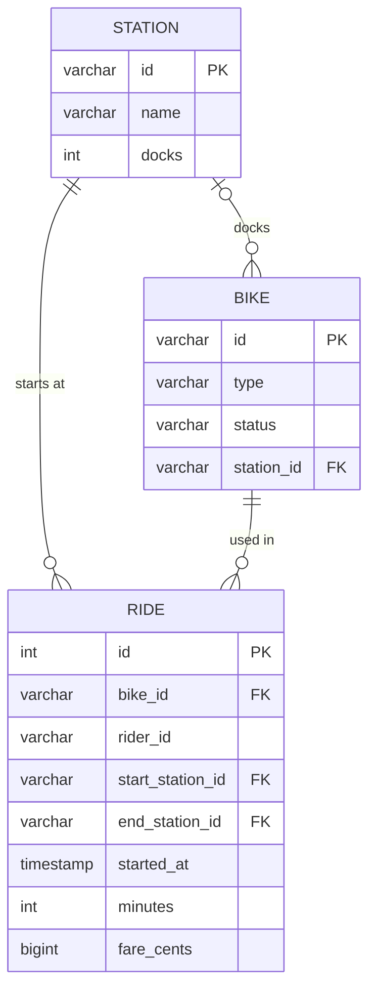

## Hook

Picture a library with a very fast librarian. You never walk the shelves. You hand over a slip that says "every book about bikes, newest first", and the right books come back.

Spoke's rides now live in a real database, and the slips you hand over are written in a language called SQL. Kakashi keeps asking engineers the same questions. Which Harbor bikes are free? How many rides did each station start this week? In this topic you learn to write those slips yourself.

## Concept

### Databases, tables, rows and columns

```callout jargon
A **database** is a program that stores data safely and answers questions about it. **SQL** (Structured Query Language, often said "sequel") is the language you use to ask it things.
```

A database keeps data in **tables**. A table looks like a spreadsheet tab with a strict layout.

- A **column** is one named field, such as `status`. Every column has a type.
- A **row** is one record, such as one bike. Each row fills in every column.
- The **schema** is the list of tables and their columns. It is the plan of the database.

Here is Spoke's `bike` table with six rows.

```text
id     | type    | status      | station_id
-------+---------+-------------+-----------
B-1042 | EBIKE   | AVAILABLE   | harbor
B-1088 | CLASSIC | AVAILABLE   | harbor
B-1017 | CARGO   | RENTED      | null
B-1023 | EBIKE   | MAINTENANCE | riverside
B-1031 | CLASSIC | AVAILABLE   | uptown
B-1076 | EBIKE   | AVAILABLE   | old-mill
```

Bike `B-1017` is out on a ride, so it sits at no station. Its `station_id` is **NULL**, which means "no value here". NULL is not zero and not empty text. It means unknown or missing.

### Types and keys

Each column has a type, like a Java field. These are the common ones:

| SQL type | Holds | Java cousin |
|---|---|---|
| `INT` | whole numbers | `int` |
| `BIGINT` | big whole numbers | `long` |
| `VARCHAR(20)` | text, up to 20 characters | `String` |
| `BOOLEAN` | true or false | `boolean` |
| `TIMESTAMP` | a date and a time, with no time zone | `LocalDateTime` |
| `TIMESTAMP WITH TIME ZONE` | an exact moment on the world clock | `OffsetDateTime` or `Instant` |

A plain `TIMESTAMP` like `08:30` does not say *where* it was 08:30. The examples here use it, and treat every value as UTC. In a real app, store moments as `TIMESTAMP WITH TIME ZONE`, so every server and every reader agrees on the moment.

```callout jargon
A **primary key** is a column whose value is unique in its table, so it names exactly one row. A bike's `id` is its primary key. A **foreign key** is a column that holds another table's primary key. `bike.station_id` points at a row in `station`.
```

Spoke has three tables. A station docks many bikes. A ride uses one bike and starts at one station.



The lines show how many rows can match. `||` means exactly one. `|o` means zero or one: a bike is at one station or none. `o{` means zero or more. So one station has zero or more rides starting there.

### Syntax: CREATE TABLE

```sql
CREATE TABLE station (
    id    VARCHAR(20) PRIMARY KEY,
    name  VARCHAR(40) NOT NULL,
    docks INT NOT NULL
);

CREATE TABLE bike (
    id         VARCHAR(10) PRIMARY KEY,
    type       VARCHAR(10) NOT NULL,
    status     VARCHAR(12) NOT NULL,
    station_id VARCHAR(20) REFERENCES station(id)
);
```

- Each line inside the brackets is one column: a name, then a type.
- `PRIMARY KEY` makes the column the unique id.
- `NOT NULL` forbids missing values. `station_id` has no `NOT NULL`, because a rented bike has no station.
- `REFERENCES station(id)` makes a foreign key. The database refuses a `station_id` that no station has.

SQL keywords are not case sensitive. Writing them in capitals is a habit that makes queries easy to scan.

### Syntax: INSERT

To add rows, use `INSERT INTO`.

```sql
INSERT INTO bike (id, type, status, station_id)
VALUES ('B-1042', 'EBIKE', 'AVAILABLE', 'harbor'),
       ('B-1017', 'CARGO', 'RENTED', NULL);
```

Text values go in single quotes. Numbers and `NULL` need no quotes.

### Running SQL from Java

Spoke uses **H2**, a small database written in Java. It can live entirely in memory, so it starts in a blink and vanishes when the program ends. The program below makes a table, fills it, and asks one question. The JDBC ticket, two tickets on, explains this Java line by line. For now, read the SQL inside the strings.

```java run
import java.sql.*;

public class Main {
    public static void main(String[] args) throws SQLException {
        try (Connection db = DriverManager.getConnection("jdbc:h2:mem:lesson");
             Statement sql = db.createStatement()) {
            sql.execute("""
                CREATE TABLE bike (id VARCHAR(10) PRIMARY KEY, type VARCHAR(10), status VARCHAR(12));
                INSERT INTO bike VALUES ('B-1042', 'EBIKE', 'AVAILABLE'),
                                        ('B-1088', 'CLASSIC', 'AVAILABLE'),
                                        ('B-1017', 'CARGO', 'RENTED');
                """);
            ResultSet rows = sql.executeQuery("SELECT id, type FROM bike WHERE status = 'AVAILABLE'");
            while (rows.next()) {
                System.out.println(rows.getString("id") + " | " + rows.getString("type"));
            }
        }
    }
}
```

It prints:

```text
B-1042 | EBIKE
B-1088 | CLASSIC
```

The rest of this page uses the full Spoke data: five stations, six bikes and six rides. Here is the `ride` table.

```text
id | bike_id | rider_id | start_station_id | end_station_id | started_at          | minutes | fare_cents
---+---------+----------+------------------+----------------+---------------------+---------+-----------
1  | B-1042  | r-17     | harbor           | riverside      | 2026-11-09 08:05:00 | 12      | 460
2  | B-1088  | r-23     | harbor           | uptown         | 2026-11-09 09:10:00 | 20      | 400
3  | B-1076  | r-17     | old-mill         | harbor         | 2026-11-10 17:30:00 | 8       | 340
4  | B-1017  | r-42     | riverside        | harbor         | 2026-11-11 12:00:00 | 30      | 850
5  | B-1031  | r-23     | uptown           | old-mill       | 2026-11-12 07:45:00 | 15      | 325
6  | B-1031  | r-42     | riverside        | uptown         | 2026-11-02 18:00:00 | 10      | 250
```

### Syntax: SELECT ... FROM ... WHERE

```sql
SELECT id, type FROM bike WHERE status = 'AVAILABLE';
```

```text
id     | type
-------+--------
B-1042 | EBIKE
B-1088 | CLASSIC
B-1031 | CLASSIC
B-1076 | EBIKE
```

- `SELECT id, type` picks the columns you want back. `SELECT *` means every column.
- `FROM bike` names the table.
- `WHERE status = 'AVAILABLE'` keeps only the rows where the test is true. SQL uses one `=` to compare, not `==`.

The answer to a query is itself a small table, called a **result set**.

### AND, OR and brackets

`AND` needs both tests to be true. `OR` needs at least one.

```sql
SELECT id FROM bike WHERE type = 'EBIKE' AND status = 'AVAILABLE';
```

```text
id
------
B-1042
B-1076
```

`AND` binds tighter than `OR`, just like `&&` and `||` in Java. Use brackets to say what you mean.

```sql
SELECT id FROM bike WHERE status = 'AVAILABLE' AND (station_id = 'harbor' OR station_id = 'uptown');
```

```text
id
------
B-1042
B-1088
B-1031
```

You can also compare with `<>` (not equal), `<`, `>`, `<=` and `>=`.

### LIKE, IN and IS NULL

`LIKE` matches a text pattern. `%` stands for any run of characters, and `_` stands for exactly one.

```sql
SELECT name FROM station WHERE name LIKE '%r%' ORDER BY name;
```

```text
name
---------
Harbor
Riverside
```

`IN` checks against a list, which is shorter than many `OR`s.

```sql
SELECT id FROM bike WHERE station_id IN ('harbor', 'old-mill');
```

```text
id
------
B-1042
B-1088
B-1076
```

`IS NULL` finds missing values. `IS NOT NULL` finds present ones.

```sql
SELECT id, status FROM bike WHERE station_id IS NULL;
```

```text
id     | status
-------+-------
B-1017 | RENTED
```

```callout warning
Never write station_id = NULL. Any comparison with NULL gives "unknown", never true, so that query quietly returns no rows at all. Always use IS NULL.
```

### Syntax: ORDER BY and LIMIT

Without `ORDER BY`, a database may hand rows back in any order. If the order matters, say so.

```sql
SELECT id, minutes FROM ride ORDER BY minutes DESC LIMIT 3;
```

```text
id | minutes
---+--------
4  | 30
2  | 20
5  | 15
```

- `ORDER BY minutes` sorts smallest first. That is `ASC`, the default.
- `DESC` sorts biggest first.
- `ORDER BY type, id` sorts by type, then breaks ties by id.
- `LIMIT 3` keeps only the first three rows after sorting.

```callout tip
LIMIT works in H2, MySQL and PostgreSQL. The SQL standard spells it FETCH FIRST 3 ROWS ONLY, which H2 also accepts. Both give the same three rides here.
```

### Syntax: COUNT, SUM, AVG, MIN, MAX

An **aggregate function** squashes many rows into one value.

```sql
SELECT COUNT(*) AS rides, SUM(fare_cents) AS total_cents, MIN(minutes) AS shortest, MAX(minutes) AS longest FROM ride;
```

```text
rides | total_cents | shortest | longest
------+-------------+----------+--------
6     | 2625        | 8        | 30
```

- `COUNT(*)` counts rows. `COUNT(station_id)` counts only rows where `station_id` is not NULL.
- `SUM`, `AVG`, `MIN` and `MAX` work on one column.
- `AS rides` gives the result column a friendly name, called an **alias**.

`WHERE` runs first, so the aggregate only sees the rows that passed.

```sql
SELECT AVG(minutes) AS avg_minutes FROM ride WHERE rider_id = 'r-17';
```

```text
avg_minutes
-----------
10.0
```

### Syntax: GROUP BY and HAVING

`GROUP BY` sorts rows into piles that share a value, then runs the aggregate once per pile.

```text
rider_id  fare_cents          pile    SUM(fare_cents)
r-17      460, 340       ->   r-17    800
r-23      400, 325       ->   r-23    725
r-42      850, 250       ->   r-42    1100
```

```sql
SELECT rider_id, COUNT(*) AS rides, SUM(fare_cents) AS total_cents FROM ride GROUP BY rider_id ORDER BY rider_id;
```

```text
rider_id | rides | total_cents
---------+-------+------------
r-17     | 2     | 800
r-23     | 2     | 725
r-42     | 2     | 1100
```

`HAVING` filters the piles after they are counted. `WHERE` cannot do this, because it runs before any pile exists.

```sql
SELECT rider_id, SUM(fare_cents) AS total_cents FROM ride GROUP BY rider_id HAVING SUM(fare_cents) > 750 ORDER BY rider_id;
```

```text
rider_id | total_cents
---------+------------
r-17     | 800
r-42     | 1100
```

```callout analogy
WHERE is the bouncer at the door who checks each person. HAVING is the judge at the end who looks at each finished team.
```

The clauses always come in this order: `SELECT`, `FROM`, `WHERE`, `GROUP BY`, `HAVING`, `ORDER BY`, `LIMIT`.

### Syntax: INNER JOIN

A ride only stores `start_station_id`. To show the station's name, you **join** the two tables. A join pairs each row of one table with the matching rows of another.

```sql
SELECT r.id, s.name FROM ride r INNER JOIN station s ON s.id = r.start_station_id ORDER BY r.id;
```

```text
id | name
---+----------
1  | Harbor
2  | Harbor
3  | Old Mill
4  | Riverside
5  | Uptown
6  | Riverside
```

- `ride r` gives the table a short nickname, `r`. Then `r.id` means the ride's id.
- `ON s.id = r.start_station_id` is the matching rule.
- `JOIN` on its own means `INNER JOIN`.

### Syntax: LEFT JOIN

An inner join keeps only rows that found a partner. A **LEFT JOIN** keeps every row of the left table, partner or not. Where there is no partner, the right side's columns are NULL.

```text
station        rides starting there     INNER JOIN keeps    LEFT JOIN keeps
Harbor    <--  1, 2                     yes                 yes
Old Mill  <--  3                        yes                 yes
Riverside <--  4, 6                     yes                 yes
Uptown    <--  5                        yes                 yes
Depot          (none)                   no                  yes, with NULL ride
```

```sql
SELECT s.name, r.id AS ride_id FROM station s LEFT JOIN ride r ON r.start_station_id = s.id ORDER BY s.name, r.id;
```

```text
name      | ride_id
----------+--------
Depot     | null
Harbor    | 1
Harbor    | 2
Old Mill  | 3
Riverside | 4
Riverside | 6
Uptown    | 5
```

Depot appears once, with a NULL ride. That NULL is useful: adding `WHERE r.id IS NULL` keeps only the stations with no partner at all.

### Syntax: UPDATE and DELETE

`UPDATE` changes rows that already exist. `DELETE` removes them.

```sql
UPDATE bike SET status = 'MAINTENANCE' WHERE id = 'B-1042';
SELECT id, status FROM bike WHERE station_id = 'harbor';
```

```text
id     | status
-------+------------
B-1042 | MAINTENANCE
B-1088 | AVAILABLE
```

```sql
DELETE FROM ride WHERE id = 5;
SELECT COUNT(*) FROM ride;
```

```text
count(*)
--------
5
```

The `WHERE` picks which rows change. Leave it out, and the change hits every row in the table.

```callout warning
UPDATE bike SET status = 'MAINTENANCE'; with no WHERE sends all six bikes to the workshop. There is no undo button. Write the WHERE first, and test it as a SELECT before you run the UPDATE.
```

## Worked example

Kakashi's question: "How many rides did each station start this week, busiest first?" Build the answer one clause at a time.

**Step 1: join, so each ride carries its station name.** This is the inner join from above.

**Step 2: count per station, busiest first.**

```sql
SELECT s.name, COUNT(*) AS rides
FROM ride r JOIN station s ON s.id = r.start_station_id
GROUP BY s.name
ORDER BY rides DESC, s.name;
```

```text
name      | rides
----------+------
Harbor    | 2
Riverside | 2
Old Mill  | 1
Uptown    | 1
```

- `GROUP BY s.name` makes one pile per station.
- `ORDER BY rides DESC` puts the busiest first. `s.name` breaks the tie between Harbor and Riverside.

**Step 3: keep only this week.** Ride 6 started on 2 November, so it must go. The week runs from Monday 9 November up to, but not including, Monday 16 November.

```sql
SELECT s.name, COUNT(*) AS rides
FROM ride r JOIN station s ON s.id = r.start_station_id
WHERE r.started_at >= TIMESTAMP '2026-11-09 00:00:00' AND r.started_at < TIMESTAMP '2026-11-16 00:00:00'
GROUP BY s.name
ORDER BY rides DESC, s.name;
```

```text
name      | rides
----------+------
Harbor    | 2
Old Mill  | 1
Riverside | 1
Uptown    | 1
```

Riverside drops to 1. Depot is missing because no ride started there, and an inner join drops rows with no partner.

Here is step 3 running for real, with a smaller ride table that has only the columns this query needs.

```java run
import java.sql.*;

public class Main {
    public static void main(String[] args) throws SQLException {
        try (Connection db = DriverManager.getConnection("jdbc:h2:mem:lesson");
             Statement sql = db.createStatement()) {
            sql.execute("""
                CREATE TABLE station (id VARCHAR(20) PRIMARY KEY, name VARCHAR(40));
                CREATE TABLE ride (id INT PRIMARY KEY, start_station_id VARCHAR(20), started_at TIMESTAMP);
                INSERT INTO station VALUES ('harbor', 'Harbor'), ('old-mill', 'Old Mill'),
                    ('riverside', 'Riverside'), ('uptown', 'Uptown'), ('depot', 'Depot');
                INSERT INTO ride VALUES (1, 'harbor', '2026-11-09 08:05'), (2, 'harbor', '2026-11-09 09:10'),
                    (3, 'old-mill', '2026-11-10 17:30'), (4, 'riverside', '2026-11-11 12:00'),
                    (5, 'uptown', '2026-11-12 07:45'), (6, 'riverside', '2026-11-02 18:00');
                """);
            ResultSet rows = sql.executeQuery("""
                SELECT s.name, COUNT(*) AS rides
                FROM ride r JOIN station s ON s.id = r.start_station_id
                WHERE r.started_at >= TIMESTAMP '2026-11-09 00:00:00'
                  AND r.started_at < TIMESTAMP '2026-11-16 00:00:00'
                GROUP BY s.name
                ORDER BY rides DESC, s.name
                """);
            while (rows.next()) {
                System.out.println(rows.getString("name") + ": " + rows.getInt("rides"));
            }
        }
    }
}
```

It prints:

```text
Harbor: 2
Old Mill: 1
Riverside: 1
Uptown: 1
```

## Try it

Run the program. Then change the query string and run it again after each change. Keep two columns in the `SELECT`, because the loop prints two.

1. Show only e-bikes: change the `WHERE` to `type = 'EBIKE'`.
2. Show bikes that are not available: use `status <> 'AVAILABLE'`.
3. Show the bike with no station: use `station_id IS NULL`.
4. Sort by type, then id, and keep the first two: `ORDER BY type, id LIMIT 2`.

```java run
import java.sql.*;

public class Main {
    public static void main(String[] args) throws SQLException {
        try (Connection db = DriverManager.getConnection("jdbc:h2:mem:lesson");
             Statement sql = db.createStatement()) {
            sql.execute("""
                CREATE TABLE bike (id VARCHAR(10) PRIMARY KEY, type VARCHAR(10), status VARCHAR(12), station_id VARCHAR(20));
                INSERT INTO bike VALUES ('B-1042', 'EBIKE', 'AVAILABLE', 'harbor'),
                    ('B-1088', 'CLASSIC', 'AVAILABLE', 'harbor'), ('B-1017', 'CARGO', 'RENTED', NULL),
                    ('B-1023', 'EBIKE', 'MAINTENANCE', 'riverside'), ('B-1031', 'CLASSIC', 'AVAILABLE', 'uptown'),
                    ('B-1076', 'EBIKE', 'AVAILABLE', 'old-mill');
                """);
            String query = "SELECT id, status FROM bike WHERE station_id = 'harbor' ORDER BY id";
            ResultSet rows = sql.executeQuery(query);
            while (rows.next()) {
                System.out.println(rows.getString(1) + " | " + rows.getString(2));
            }
        }
    }
}
```

## Recap

- A database stores tables. A table has typed columns and one row per record. A primary key names one row, and a foreign key points at another table's row.
- `SELECT ... FROM ... WHERE` picks columns and rows. Combine tests with `AND`, `OR` and brackets, and match with `LIKE`, `IN` and `IS NULL`.
- `ORDER BY` sorts, `DESC` flips it, and `LIMIT` (or `FETCH FIRST n ROWS ONLY`) keeps the first rows.
- `COUNT`, `SUM`, `AVG`, `MIN` and `MAX` squash rows into one value. `GROUP BY` makes one answer per pile, and `HAVING` filters the piles.
- `INNER JOIN` keeps matched pairs. `LEFT JOIN` keeps every left row, with NULLs where nothing matched. `INSERT`, `UPDATE` and `DELETE` change data, so always give `UPDATE` and `DELETE` a `WHERE`.

## Common mistakes

**1. Comparing with NULL using =.**

```sql
SELECT COUNT(*) FROM bike WHERE station_id = NULL;
```

```text
count(*)
--------
0
```

There is no error, just a wrong answer. A comparison with NULL is never true. Fix: `WHERE station_id IS NULL`, which counts 1.

**2. Putting text in double quotes.**

```sql
SELECT id FROM bike WHERE status = "AVAILABLE";
```

```text
Column "AVAILABLE" not found; SQL statement:
SELECT id FROM bike WHERE status = "AVAILABLE" [42122-240]
```

In SQL, double quotes name a column, so H2 looks for a column called AVAILABLE. Fix: text values use single quotes, `'AVAILABLE'`.

**3. Selecting a column that is not grouped.**

```sql
SELECT rider_id, minutes, COUNT(*) FROM ride GROUP BY rider_id;
```

```text
Column "MINUTES" must be in the GROUP BY list; SQL statement:
SELECT rider_id, minutes, COUNT(*) FROM ride GROUP BY rider_id [90016-240]
```

Each rider's pile has many `minutes` values, so there is no single one to show. Fix: group by it too, or squash it with an aggregate such as `SUM(minutes)`.

**4. Filtering a count with WHERE.**

```sql
SELECT rider_id FROM ride WHERE COUNT(*) > 1 GROUP BY rider_id;
```

```text
Invalid use of aggregate function "COUNT(*)"; SQL statement:
SELECT rider_id FROM ride WHERE COUNT(*) > 1 GROUP BY rider_id [90054-240]
```

`WHERE` runs before the piles exist, so there is nothing to count yet. Fix: `GROUP BY rider_id HAVING COUNT(*) > 1`.

**5. An UPDATE with no WHERE.**

```sql
UPDATE bike SET status = 'MAINTENANCE';
SELECT id, status FROM bike;
```

```text
id     | status
-------+------------
B-1042 | MAINTENANCE
B-1088 | MAINTENANCE
B-1017 | MAINTENANCE
B-1023 | MAINTENANCE
B-1031 | MAINTENANCE
B-1076 | MAINTENANCE
```

No error, and every bike in the fleet is now in the workshop. Fix: `UPDATE bike SET status = 'MAINTENANCE' WHERE id = 'B-1042';`, and check that one row changed.
