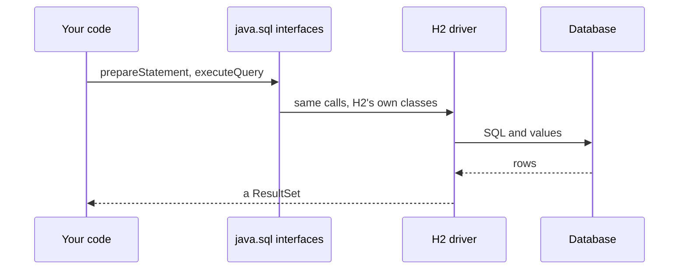

## Hook

When you travel abroad, your charger does not fit the wall. You carry an adapter. Your charger stays the same, and the adapter speaks to the local socket.

Java talks to databases the same way. Your code speaks one standard language, and a small adapter called a driver speaks to the database. In this topic the rentals service learns to save and read rides itself. You also fix the scary bug Sam forwarded: typing `' OR '1'='1` into the rider search showed everybody's rides.

## Concept

### What JDBC is

```callout jargon
**JDBC** (Java Database Connectivity) is a set of interfaces in the `java.sql` package, such as `Connection`, `PreparedStatement` and `ResultSet`. A **driver** is a library that implements those interfaces for one database. H2's driver comes inside the H2 jar.
```

Your code only uses the `java.sql` interfaces. Swap H2 for PostgreSQL, and you change the driver and the address, not your code.



A **JDBC URL** says which driver to use and where the database is.

```text
jdbc:h2:mem:spoke
 |    |   |   |
 |    |   |   +-- the database name
 |    |   +------ keep it in memory, not in a file
 |    +---------- use the H2 driver
 +--------------- this is a JDBC address
```

A **connection** is an open line to the database, like a phone call. You send SQL down it and get answers back. When you are done, you hang up.

### Syntax: DriverManager.getConnection

```java nocompile
Connection connection = DriverManager.getConnection("jdbc:h2:mem:spoke");
```

`DriverManager` finds the driver that understands the URL and opens a connection.

```java run
import java.sql.Connection;
import java.sql.DriverManager;
import java.sql.SQLException;

public class Main {
    public static void main(String[] args) throws SQLException {
        try (Connection connection = DriverManager.getConnection("jdbc:h2:mem:spoke")) {
            System.out.println("Connected to " + connection.getMetaData().getDatabaseProductName());
        }
    }
}
```

It prints `Connected to H2`.

### Syntax: a DataSource

Real services rarely call `DriverManager`. They use a **DataSource**, an interface from `javax.sql` with one main job: `getConnection()`.

```java nocompile
JdbcDataSource h2 = new JdbcDataSource();          // H2's DataSource class, from org.h2.jdbcx
h2.setURL("jdbc:h2:mem:spoke;DB_CLOSE_DELAY=-1");
DataSource dataSource = h2;
Connection connection = dataSource.getConnection();
```

- The app sets up the DataSource once, with the URL and any password.
- Your repository just receives a `DataSource` in its constructor and asks it for connections. It never sees the URL.
- In production, the DataSource is usually a **connection pool**. It keeps a few connections open and lends them out, because opening a fresh one is slow.

```callout warning
An in-memory H2 database disappears when its last connection closes. Your table vanishes between two calls. Adding ;DB_CLOSE_DELAY=-1 to the URL keeps it alive until the program ends.
```

### Syntax: Statement, executeUpdate and executeQuery

A **Statement** carries SQL to the database.

```java nocompile
int changed = statement.executeUpdate("INSERT INTO ride (rider_id, minutes) VALUES ('r-17', 12)");
ResultSet rows = statement.executeQuery("SELECT id, rider_id, minutes FROM ride");
```

- `executeUpdate` runs `INSERT`, `UPDATE`, `DELETE` or `CREATE`. It returns how many rows changed.
- `executeQuery` runs a `SELECT`. It returns a `ResultSet`, the rows of the answer.

### Syntax: reading a ResultSet

A **ResultSet** is a cursor, like a finger pointing at one row. It starts just above the first row.

```java nocompile
while (rows.next()) {
    long id = rows.getLong("id");
    String riderId = rows.getString("rider_id");
    int minutes = rows.getInt("minutes");
}
```

- `next()` moves the finger down one row. It returns `false` when there are no rows left.
- `getLong`, `getInt`, `getString` and `getBoolean` read a column of the current row. Pick the getter that matches the column type.
- You can name the column, `getString("rider_id")`, or give its position, `getString(2)`. Positions start at 1, not 0.
- For a NULL value, `getLong` and `getInt` return 0. Call `rows.wasNull()` right after if you must tell 0 and NULL apart.

Here are a DataSource, both kinds of statement and a ResultSet together.

```java run
import java.sql.*;
import javax.sql.DataSource;
import org.h2.jdbcx.JdbcDataSource;

public class Main {
    public static void main(String[] args) throws SQLException {
        JdbcDataSource h2 = new JdbcDataSource();
        h2.setURL("jdbc:h2:mem:spoke;DB_CLOSE_DELAY=-1");
        DataSource dataSource = h2;

        try (Connection connection = dataSource.getConnection();
             Statement statement = connection.createStatement()) {
            statement.executeUpdate("CREATE TABLE ride (id INT PRIMARY KEY, rider_id VARCHAR(20), minutes INT)");
            int added = statement.executeUpdate("INSERT INTO ride VALUES (1, 'r-17', 12), (2, 'r-23', 20)");
            System.out.println(added + " rows added");
        }

        try (Connection connection = dataSource.getConnection();
             Statement statement = connection.createStatement();
             ResultSet rows = statement.executeQuery("SELECT id, rider_id, minutes FROM ride ORDER BY id")) {
            while (rows.next()) {
                System.out.println(rows.getInt("id") + " " + rows.getString("rider_id") + " " + rows.getInt("minutes"));
            }
        }
    }
}
```

```text
2 rows added
1 r-17 12
2 r-23 20
```

### Mapping rows to records

The rest of your code should not handle `ResultSet`s. Turn each row into a record straight away, in one small method.

```java nocompile
record Ride(long id, String riderId, int minutes) {}

static Ride toRide(ResultSet rows) throws SQLException {
    return new Ride(rows.getLong("id"), rows.getString("rider_id"), rows.getInt("minutes"));
}
```

`toRide` reads the current row only. The `while (rows.next())` loop around it moves to each row in turn.

### Syntax: PreparedStatement and ? parameters

A **PreparedStatement** is SQL with holes, written as `?`. You fill each hole with a setter.

```java nocompile
PreparedStatement statement = connection.prepareStatement("SELECT id, minutes FROM ride WHERE rider_id = ? AND minutes > ?");
statement.setString(1, "r-17");   // the first ?
statement.setInt(2, 10);          // the second ?
ResultSet rows = statement.executeQuery();
```

- Holes are numbered from 1, left to right.
- Use the setter that matches the type: `setString`, `setInt`, `setLong`.
- Never put quotes around a `?`. The driver handles quoting for you.
- `executeQuery()` and `executeUpdate()` take no SQL here, because the statement already has it.

### SQL injection

Here is how the old rider search was written. It glues the rider's typing straight into the SQL text.

```java nocompile
String sql = "SELECT id, rider_id FROM ride WHERE rider_id = '" + input + "' ORDER BY id";
```

```callout jargon
**SQL injection** is an attack where typed input changes the meaning of your SQL. The database cannot tell which part you wrote and which part the user typed.
```

Watch what happens with the input from Sam's report.

```java run
import java.sql.*;

public class Main {
    public static void main(String[] args) throws SQLException {
        try (Connection connection = DriverManager.getConnection("jdbc:h2:mem:spoke");
             Statement setup = connection.createStatement()) {
            setup.executeUpdate("CREATE TABLE ride (id INT PRIMARY KEY, rider_id VARCHAR(20))");
            setup.executeUpdate("INSERT INTO ride VALUES (1, 'r-17'), (2, 'r-23'), (3, 'r-42')");

            String input = "r-17' OR '1'='1";
            String sql = "SELECT id, rider_id FROM ride WHERE rider_id = '" + input + "' ORDER BY id";
            System.out.println(sql);
            try (ResultSet rows = setup.executeQuery(sql)) {
                while (rows.next()) {
                    System.out.println("  found ride " + rows.getInt("id") + " of " + rows.getString("rider_id"));
                }
            }
        }
    }
}
```

```text
SELECT id, rider_id FROM ride WHERE rider_id = 'r-17' OR '1'='1' ORDER BY id
  found ride 1 of r-17
  found ride 2 of r-23
  found ride 3 of r-42
```

The quote in the input closed the text early. Then `OR '1'='1'` became real SQL, and `'1'='1'` is true for every row. A cleverer input could read other tables or change data.

The fix is a `?` parameter. The SQL text goes to the database first, and the value travels separately, so it can never become SQL.

```java run
import java.sql.*;

public class Main {
    public static void main(String[] args) throws SQLException {
        try (Connection connection = DriverManager.getConnection("jdbc:h2:mem:spoke");
             Statement setup = connection.createStatement()) {
            setup.executeUpdate("CREATE TABLE ride (id INT PRIMARY KEY, rider_id VARCHAR(20))");
            setup.executeUpdate("INSERT INTO ride VALUES (1, 'r-17'), (2, 'r-23'), (3, 'r-42')");

            String input = "r-17' OR '1'='1";
            try (PreparedStatement search = connection.prepareStatement(
                    "SELECT id, rider_id FROM ride WHERE rider_id = ? ORDER BY id")) {
                search.setString(1, input);
                try (ResultSet rows = search.executeQuery()) {
                    int found = 0;
                    while (rows.next()) {
                        found++;
                    }
                    System.out.println("rides found: " + found);
                }
            }
        }
    }
}
```

```text
rides found: 0
```

The database looked for a rider whose id is literally `r-17' OR '1'='1`. There is none, so it found nothing.

```callout tip
Byte says: if you ever type + between SQL and a value, stop. Write a ? and a setter instead.
```

### Syntax: try-with-resources for JDBC

A `Connection`, a `PreparedStatement` and a `ResultSet` all hold resources inside the database. Close every one. The simplest way is try-with-resources, which you met with files.

```java nocompile
try (Connection connection = dataSource.getConnection();
     PreparedStatement statement = connection.prepareStatement("SELECT * FROM ride WHERE id = ?")) {
    statement.setLong(1, id);
    try (ResultSet rows = statement.executeQuery()) {
        // read the rows
    }
}
```

- Resources close in reverse order: rows, then statement, then connection.
- They close even when an exception is thrown.
- The `ResultSet` gets its own inner `try`, because the `?` must be filled before the query runs.

What leaks without it? Each open connection is a **session** in the database, with its own memory. A real database server allows only so many, often around 100. A pool lends out a fixed few. Leak them one request at a time, and the service soon hangs, waiting for a connection that never comes back.

```java run
import java.sql.*;
import org.h2.jdbcx.JdbcDataSource;

public class Main {
    public static void main(String[] args) throws SQLException {
        JdbcDataSource dataSource = new JdbcDataSource();
        dataSource.setURL("jdbc:h2:mem:leaky;DB_CLOSE_DELAY=-1");

        for (int request = 0; request < 3; request++) {
            Connection forgotten = dataSource.getConnection();   // never closed
        }
        for (int request = 0; request < 3; request++) {
            try (Connection borrowed = dataSource.getConnection()) {
                // closed at the end of the try
            }
        }

        try (Connection checker = dataSource.getConnection();
             Statement statement = checker.createStatement();
             ResultSet rows = statement.executeQuery("SELECT COUNT(*) FROM INFORMATION_SCHEMA.SESSIONS")) {
            rows.next();
            System.out.println("sessions left open, not counting this one: " + (rows.getInt(1) - 1));
        }
    }
}
```

```text
sessions left open, not counting this one: 3
```

The three forgotten connections are still open. The three borrowed in try-with-resources are gone.

### Syntax: RETURN_GENERATED_KEYS

When the database picks the id, you need to ask for it back.

```java nocompile
PreparedStatement statement = connection.prepareStatement(
        "INSERT INTO ride (rider_id, minutes) VALUES (?, ?)", Statement.RETURN_GENERATED_KEYS);
statement.setString(1, "r-17");
statement.setInt(2, 12);
statement.executeUpdate();
try (ResultSet keys = statement.getGeneratedKeys()) {
    keys.next();
    long id = keys.getLong(1);
}
```

- The table declares `id BIGINT GENERATED ALWAYS AS IDENTITY PRIMARY KEY`. The database then hands out 1, 2, 3 and so on.
- `RETURN_GENERATED_KEYS` asks the driver to keep the new id.
- `getGeneratedKeys()` is a small `ResultSet` with one row per inserted row.

### Handling SQLException

Almost every JDBC method throws `SQLException`, a checked exception. Callers of a ride repository should not have to know about JDBC. Catch it, and throw an unchecked exception that says what you were doing.

```java nocompile
} catch (SQLException e) {
    throw new RideRepositoryException("Could not find ride " + id, e);
}
```

Passing `e` as the **cause** keeps H2's original message and stack trace inside the new exception. The log then shows both your context and the real reason.

### Auto-commit

By default a connection is in **auto-commit** mode. Each statement is saved for good the moment it finishes. Grouping several statements so they succeed or fail together is called a transaction, and it has its own topic later in this module.

## Worked example

Here is a small repository for stations. Your practice task builds the same shape for rides.

```java run
import java.sql.*;
import java.util.Optional;
import javax.sql.DataSource;
import org.h2.jdbcx.JdbcDataSource;

public class Main {
    public static void main(String[] args) {
        JdbcDataSource h2 = new JdbcDataSource();
        h2.setURL("jdbc:h2:mem:stations;DB_CLOSE_DELAY=-1");
        StationRepository stations = new StationRepository(h2);
        stations.createTable();

        Station harbor = stations.add("Harbor", 12);
        Station depot = stations.add("Depot", 12);
        System.out.println("saved " + harbor + " and " + depot);
        System.out.println("find 2: " + stations.findById(2));
        System.out.println("find 9: " + stations.findById(9));
    }
}

record Station(long id, String name, int docks) {}

class StationStoreException extends RuntimeException {
    StationStoreException(String message, Throwable cause) {
        super(message, cause);
    }
}

class StationRepository {
    private final DataSource dataSource;

    StationRepository(DataSource dataSource) {
        this.dataSource = dataSource;
    }

    void createTable() {
        try (Connection connection = dataSource.getConnection();
             Statement statement = connection.createStatement()) {
            statement.executeUpdate("CREATE TABLE station (id BIGINT GENERATED ALWAYS AS IDENTITY PRIMARY KEY, "
                    + "name VARCHAR(40) NOT NULL, docks INT NOT NULL)");
        } catch (SQLException e) {
            throw new StationStoreException("Could not create the station table", e);
        }
    }

    Station add(String name, int docks) {
        try (Connection connection = dataSource.getConnection();
             PreparedStatement statement = connection.prepareStatement(
                     "INSERT INTO station (name, docks) VALUES (?, ?)", Statement.RETURN_GENERATED_KEYS)) {
            statement.setString(1, name);
            statement.setInt(2, docks);
            statement.executeUpdate();
            try (ResultSet keys = statement.getGeneratedKeys()) {
                keys.next();
                return new Station(keys.getLong(1), name, docks);
            }
        } catch (SQLException e) {
            throw new StationStoreException("Could not add station " + name, e);
        }
    }

    Optional<Station> findById(long id) {
        try (Connection connection = dataSource.getConnection();
             PreparedStatement statement = connection.prepareStatement(
                     "SELECT id, name, docks FROM station WHERE id = ?")) {
            statement.setLong(1, id);
            try (ResultSet rows = statement.executeQuery()) {
                if (!rows.next()) {
                    return Optional.empty();
                }
                return Optional.of(new Station(rows.getLong("id"), rows.getString("name"), rows.getInt("docks")));
            }
        } catch (SQLException e) {
            throw new StationStoreException("Could not find station " + id, e);
        }
    }
}
```

```text
saved Station[id=1, name=Harbor, docks=12] and Station[id=2, name=Depot, docks=12]
find 2: Optional[Station[id=2, name=Depot, docks=12]]
find 9: Optional.empty
```

- `StationRepository` gets a `DataSource` in its constructor. It never knows the URL.
- Each method opens its own connection in try-with-resources, so nothing leaks between calls.
- `add` sends the SQL with two `?` holes, fills them, and asks for the generated id. It returns a record with that id.
- `findById` returns `Optional.empty()` when `next()` finds no row, instead of `null`.
- Every `SQLException` becomes a `StationStoreException` with a message that names the station.

## Try it

Run the program. It searches for rides with a PreparedStatement. Then try these one at a time:

1. Change `input` to `"r-23"`. You should find one ride.
2. Change `input` back to the attack, `"r-17' OR '1'='1"`. You should find none.
3. Change the SQL to `"SELECT id FROM ride WHERE rider_id = '?'"`, with quotes around the `?`. Read the error, then take the quotes away.

```java run
import java.sql.*;

public class Main {
    public static void main(String[] args) throws SQLException {
        try (Connection connection = DriverManager.getConnection("jdbc:h2:mem:spoke");
             Statement setup = connection.createStatement()) {
            setup.executeUpdate("CREATE TABLE ride (id INT PRIMARY KEY, rider_id VARCHAR(20))");
            setup.executeUpdate("INSERT INTO ride VALUES (1, 'r-17'), (2, 'r-23'), (3, 'r-17')");

            String input = "r-17";
            try (PreparedStatement search = connection.prepareStatement("SELECT id FROM ride WHERE rider_id = ?")) {
                search.setString(1, input);
                try (ResultSet rows = search.executeQuery()) {
                    while (rows.next()) {
                        System.out.println("ride " + rows.getInt("id"));
                    }
                }
            }
        }
    }
}
```

## Recap

- JDBC is a set of `java.sql` interfaces. A driver implements them for one database, and a JDBC URL says which driver and where.
- Get connections from a `DataSource` that the app configures once. Close every `Connection`, `PreparedStatement` and `ResultSet` with try-with-resources, or sessions leak until the service hangs.
- `executeUpdate` returns the rows changed. `executeQuery` returns a `ResultSet`: loop with `next()`, read with `getLong`, `getString` and friends, and map each row to a record.
- Always pass values through `?` parameters. Gluing input into SQL with `+` lets typed text like `' OR '1'='1` rewrite your query.
- Ask for `RETURN_GENERATED_KEYS` to learn the new id, and wrap `SQLException` in an unchecked exception with context and the cause.

## Common mistakes

**1. Numbering parameters from 0.**

```java nocompile
statement.setString(0, "r-17");
```

```text
org.h2.jdbc.JdbcSQLDataException: Invalid value "0" for parameter "parameterIndex" [90008-240]
```

JDBC counts from 1, unlike Java arrays. Fix: `statement.setString(1, "r-17");`.

**2. Putting quotes around the ?.**

```java nocompile
PreparedStatement statement = connection.prepareStatement("SELECT * FROM ride WHERE rider_id = '?'");
statement.setString(1, "r-17");
```

```text
org.h2.jdbc.JdbcSQLDataException: Invalid value "1" for parameter "parameterIndex" [90008-240]
```

Inside quotes, `'?'` is just a text value, so the statement has no holes at all. Fix: `WHERE rider_id = ?` with no quotes.

**3. Reading a column before calling next().**

```java nocompile
ResultSet rows = statement.executeQuery();
String riderId = rows.getString("rider_id");
```

```text
org.h2.jdbc.JdbcSQLNonTransientException: No data is available [2000-240]
```

The cursor starts above the first row, so there is nothing to read yet. Fix: `if (rows.next()) { ... }` or `while (rows.next()) { ... }`.

**4. Losing an in-memory database between connections.**

```java nocompile
dataSource.setURL("jdbc:h2:mem:spoke");
// one connection creates the ride table and closes; the next one reads it
```

```text
org.h2.jdbc.JdbcSQLSyntaxErrorException: Table "RIDE" not found (this database is empty); SQL statement:
SELECT * FROM ride [42104-240]
```

The database died when the first connection closed. Fix: `jdbc:h2:mem:spoke;DB_CLOSE_DELAY=-1`.

**5. Using executeQuery for an INSERT.**

```java nocompile
PreparedStatement statement = connection.prepareStatement("INSERT INTO ride (rider_id, fare_cents) VALUES (?, ?)");
statement.setString(1, "r-17");
statement.setLong(2, 460);
statement.executeQuery();
```

```text
org.h2.jdbc.JdbcSQLNonTransientException: Method is only allowed for a query. Use execute or executeUpdate instead of executeQuery; SQL statement:
INSERT INTO ride (rider_id, fare_cents) VALUES (?, ?) [90002-240]
```

An `INSERT` returns no rows. Fix: `statement.executeUpdate()`, which returns how many rows were added.
