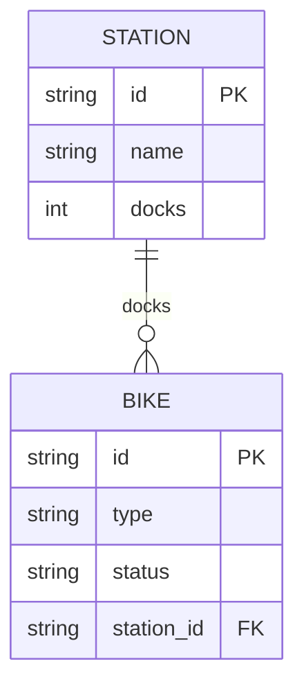

## Hook

Picture two friends who speak different languages. One thinks in objects: a `Bike` with a `Station`. The other thinks in tables: rows, columns and ids. Until now you have been the interpreter, writing every SQL string and copying every column into a field by hand.

That is why Tsunade's ticket hurts. One new bike field means five SQL strings and a row mapper to edit. In this topic you hire a full-time interpreter. You describe your classes once, and it writes the SQL for you.

## Concept

### Object-relational mapping

```callout jargon
**Object-relational mapping (ORM)** means a library that copies data between Java objects and database tables for you. A class maps to a table, an object maps to a row, and a field maps to a column.
```

| Java side | Database side |
|---|---|
| class `Bike` | table `bike` |
| one `Bike` object | one row |
| field `status` | column `status` |
| field `station` (another object) | column `station_id` (a foreign key) |

You call `repository.save(bike)`. The ORM writes the `INSERT`. You call `findById("B-1042")`. The ORM writes the `SELECT` and builds the object.

```callout warning
An ORM still runs SQL underneath. It only writes it for you. If you never look at that SQL, you can send 100 queries where one would do. Always check what it sends.
```

To see the SQL in a Spring Boot app, switch on the setting `spring.jpa.show-sql=true`. `@DataJpaTest`, which you meet below, switches it on for you. Every query then appears in the console:

```text
Hibernate: select b1_0.id,b1_0.station_id,b1_0.status from bike b1_0 where b1_0.status=?
```

### JPA, Hibernate and Spring Data JPA

Three names show up together. They are three layers, not three rivals.

| Name | What it is | You touch it as |
|---|---|---|
| **JPA** (Jakarta Persistence) | A rulebook: annotations and interfaces in `jakarta.persistence` | `@Entity`, `@Id`, `EntityManager` |
| **Hibernate** | The engine that follows the rulebook and writes the SQL | Mostly invisible. Its name appears in logs and errors |
| **Spring Data JPA** | A Spring layer that writes repository classes for you | `JpaRepository`, query method names, `@Query` |

```callout analogy
JPA is like the USB standard. Hibernate is one brand of USB stick that follows it. Spring Data is the friendly app that copies your files onto the stick.
```

### Syntax: @Entity and @Id

```java
import jakarta.persistence.Column;
import jakarta.persistence.Entity;
import jakarta.persistence.Id;

@Entity
public class Station {

    @Id
    private String id;          // "harbor"

    @Column(nullable = false)
    private String name;        // "Harbor"

    private int docks;          // 12

    protected Station() {
    }

    public Station(String id, String name, int docks) {
        this.id = id;
        this.name = name;
        this.docks = docks;
    }

    public String getName() {
        return name;
    }
}
```

- `@Entity` says "this class is stored in a table". The table takes the class name: `station`.
- `@Id` marks the **primary key**, the column that tells rows apart.
- Every other field becomes a column on its own. `@Column` is only needed to change the details, such as the name or `nullable = false`.

When the database should pick the id for you, add `@GeneratedValue` to a number id:

```java nocompile
@Id
@GeneratedValue
private Long id;    // null before the first save, then 1, 2, 3...
```

### The protected no-argument constructor

When Hibernate reads a row, it first makes an empty object. Then it fills each field from a column. To make the empty object, it needs a constructor with no arguments.

Make that constructor `protected`. Hibernate can still use it, but your own code will not call it by mistake and build a bike with no id.

### Why a record cannot be an entity

A record looks perfect for data, but it breaks all three things Hibernate needs:

- A record has no no-argument constructor, so Hibernate cannot make the empty object.
- A record's fields are `final`, so Hibernate cannot fill them in or change them later.
- A record class is `final`, so Hibernate cannot make the stand-in subclass it uses for lazy loading (you meet that below).

Use a normal class for entities. Records stay great for the plain results you hand back to callers.

### Syntax: @Enumerated(EnumType.STRING)

```java nocompile
@Enumerated(EnumType.STRING)
private BikeStatus status;    // stored as 'AVAILABLE', 'RENTED' or 'MAINTENANCE'
```

Without the annotation, JPA stores an enum by its **ordinal**, its position in the list: 0, 1, 2. That is a trap.

| Day | `enum BikeStatus` | Row for a rented bike |
|---|---|---|
| Monday | `AVAILABLE, RENTED, MAINTENANCE` | `1` means RENTED |
| Tuesday, someone adds `RESERVED` second | `AVAILABLE, RESERVED, RENTED, MAINTENANCE` | `1` now means RESERVED |

Every old row silently changed its meaning. With `EnumType.STRING` the column holds the word `RENTED`, which never moves.

### Relationships: @ManyToOne and @OneToMany

Many bikes sit at one station. In the database, each bike row keeps the station's id in a `station_id` foreign key column.



In Java, the bike simply holds a `Station` object:

```java nocompile
@Entity
public class Bike {
    @Id
    private String id;

    @ManyToOne(fetch = FetchType.LAZY)
    private Station station;     // becomes the station_id column
}
```

If the station also wants a list of its bikes, add the other side:

```java nocompile
@OneToMany(mappedBy = "station")
private List<Bike> bikes = new ArrayList<>();
```

`mappedBy = "station"` says: "the `station` field in `Bike` owns this link, I am only another view of it". Without `mappedBy`, Hibernate thinks there are two separate links and creates an extra table.

### Lazy loading and the N+1 problem

`FetchType.LAZY` means Hibernate does not load the station when it loads the bike. It puts a stand-in object there, and runs the `SELECT` only when you first touch the station. That keeps simple reads small. The catch is called the **N+1 problem**. You run 1 query to load N bikes. Then you touch each bike's station in a loop, and Hibernate runs one more query per station. Fifty bikes at different stations can mean 51 queries for one screen.

```sql
select b1_0.id,b1_0.station_id,b1_0.status from bike b1_0          -- 1: the list of bikes
select s1_0.id,s1_0.docks,s1_0.name from station s1_0 where s1_0.id=?   -- harbor
select s1_0.id,s1_0.docks,s1_0.name from station s1_0 where s1_0.id=?   -- uptown
select s1_0.id,s1_0.docks,s1_0.name from station s1_0 where s1_0.id=?   -- riverside
```

The fix is to ask for both in one query with `join fetch`, which you will try at the end of this page.

### Syntax: JpaRepository<T, ID>

A **repository** is an object whose only job is to load and save one kind of entity. With Spring Data you write just the interface:

```java nocompile
public interface StationRepository extends JpaRepository<Station, String> {
}
```

`Station` is the entity type and `String` is the type of its `@Id`. When the app starts, Spring Data writes a class that implements it. You get these methods for free:

```java nocompile
stations.save(new Station("depot", "Depot", 12));       // INSERT, or UPDATE if the row exists
Optional<Station> harbor = stations.findById("harbor");  // empty Optional when there is no row
List<Station> all = stations.findAll();
long howMany = stations.count();
stations.deleteById("depot");
```

`save` must decide: is this a new row or an old one? It looks at the id. A `null` id, as with `@GeneratedValue`, means new, so it runs one `INSERT`.

`Station` has an id you pick yourself, like `"depot"`. That id is never `null`, so `save` cannot tell. It calls JPA's `merge`, which first runs a `SELECT` to look for the row, then an `INSERT` or `UPDATE`. That extra `SELECT` is normal for assigned ids. Do not be surprised by it in the log.

### The persistence context and dirty checking

An `EntityManager` remembers every entity it has loaded or saved. That memory is called the **persistence context**. Spring Data's repositories use one behind the scenes, one per transaction.

```callout jargon
The **persistence context** is the set of entity objects an `EntityManager` is tracking right now. It is also called the **first-level cache**. **Dirty checking** means Hibernate spots changed fields on its own and writes them back.
```

Each entity object is in one of four states:

| State | Means | Example |
|---|---|---|
| new (transient) | made with `new`, not known to JPA yet | `new Bike("B-1042", ...)` before `persist` |
| managed | tracked by the persistence context | after `persist`, or anything `find` or a query returns |
| detached | was managed, but its `EntityManager` closed or cleared | after `em.close()` or `em.clear()` |
| removed | will be deleted at commit | after `em.remove(bike)` |

Watch what a managed entity does. There is no `save` call after `setStatus`.

```java run
import jakarta.persistence.Entity;
import jakarta.persistence.EntityManager;
import jakarta.persistence.EntityManagerFactory;
import jakarta.persistence.EnumType;
import jakarta.persistence.Enumerated;
import jakarta.persistence.Id;
import jakarta.persistence.PersistenceConfiguration;

public class Main {
    public static void main(String[] args) {
        ((ch.qos.logback.classic.Logger) org.slf4j.LoggerFactory.getLogger("ROOT"))
                .setLevel(ch.qos.logback.classic.Level.OFF);
        EntityManagerFactory factory = new PersistenceConfiguration("spoke")
                .managedClass(Bike.class)
                .property(PersistenceConfiguration.JDBC_URL, "jdbc:h2:mem:spoke")
                .property(PersistenceConfiguration.SCHEMAGEN_DATABASE_ACTION, "create")
                .property("hibernate.show_sql", "true")
                .createEntityManagerFactory();

        EntityManager em = factory.createEntityManager();
        em.getTransaction().begin();
        em.persist(new Bike("B-1042", BikeStatus.AVAILABLE));
        em.getTransaction().commit();
        em.clear();                                    // start with an empty persistence context

        em.getTransaction().begin();
        Bike first = em.find(Bike.class, "B-1042");    // SELECT, then remembered
        Bike again = em.find(Bike.class, "B-1042");    // no SQL: the remembered object
        System.out.println("same object? " + (first == again));
        System.out.println("managed? " + em.contains(first));

        first.setStatus(BikeStatus.RENTED);            // no save() or persist() call
        System.out.println("--- commit ---");
        em.getTransaction().commit();                  // Hibernate spots the change: UPDATE
        factory.close();
    }
}

enum BikeStatus { AVAILABLE, RENTED }

@Entity
class Bike {
    @Id
    private String id;

    @Enumerated(EnumType.STRING)
    private BikeStatus status;

    protected Bike() {
    }

    Bike(String id, BikeStatus status) {
        this.id = id;
        this.status = status;
    }

    void setStatus(BikeStatus status) {
        this.status = status;
    }
}
```

The second `find` runs no SQL: it returns the same object from the persistence context. And `commit` runs an `UPDATE` all by itself. Hibernate kept a copy of each managed entity when it loaded it. At commit, it compares, sees `status` changed, and writes it.

Sending the waiting SQL to the database is called a **flush**. It happens at commit, before a query that might read the changed table, or when you call `em.flush()`. That explains the `@DataJpaTest` example below: `em.flush()` sends the `INSERT`s now. In the worked example, `em.clear()` empties the persistence context, so the next read really goes to the database.

```callout warning
Dirty checking works in both directions. If a service changes a managed entity "just to try something", the change is saved at commit, even with no `save` call. Copy the values into a new object if you only want to play with them.
```

### LazyInitializationException and open-in-view

A lazy link is a stand-in that loads on first touch. It can only load while its persistence context is still open. Touch it after that, and Hibernate cannot reach the database any more.

```java run crash
import jakarta.persistence.Entity;
import jakarta.persistence.EntityManager;
import jakarta.persistence.EntityManagerFactory;
import jakarta.persistence.FetchType;
import jakarta.persistence.Id;
import jakarta.persistence.ManyToOne;
import jakarta.persistence.PersistenceConfiguration;

public class Main {
    public static void main(String[] args) {
        ((ch.qos.logback.classic.Logger) org.slf4j.LoggerFactory.getLogger("ROOT"))
                .setLevel(ch.qos.logback.classic.Level.OFF);
        EntityManagerFactory factory = new PersistenceConfiguration("spoke")
                .managedClass(Station.class)
                .managedClass(Bike.class)
                .property(PersistenceConfiguration.JDBC_URL, "jdbc:h2:mem:spoke")
                .property(PersistenceConfiguration.SCHEMAGEN_DATABASE_ACTION, "create")
                .createEntityManagerFactory();

        EntityManager setup = factory.createEntityManager();
        setup.getTransaction().begin();
        Station harbor = new Station("harbor", "Harbor");
        setup.persist(harbor);
        setup.persist(new Bike("B-1042", harbor));
        setup.getTransaction().commit();
        setup.close();

        EntityManager em = factory.createEntityManager();
        Bike bike = em.find(Bike.class, "B-1042");   // the station is a stand-in, not loaded yet
        em.close();                                  // the persistence context is gone

        System.out.println("bike " + bike.getId() + " loaded");
        System.out.println(bike.getStation().getName());   // too late to load the station
    }
}

@Entity
class Station {
    @Id
    private String id;
    private String name;

    protected Station() {
    }

    Station(String id, String name) {
        this.id = id;
        this.name = name;
    }

    String getName() {
        return name;
    }
}

@Entity
class Bike {
    @Id
    private String id;

    @ManyToOne(fetch = FetchType.LAZY)
    private Station station;

    protected Bike() {
    }

    Bike(String id, Station station) {
        this.id = id;
        this.station = station;
    }

    String getId() {
        return id;
    }

    Station getStation() {
        return station;
    }
}
```

```text
Exception in thread "main" org.hibernate.LazyInitializationException: Could not initialize proxy [Station#harbor] - no session
```

In a Spring app, this happens when a service loads a bike inside its transaction, and the controller touches `bike.getStation()` after the transaction has ended.

There are two good fixes. Both load what you need inside the transaction, in one query:

```java nocompile
@Query("select b from Bike b join fetch b.station where b.status = :status")
List<Bike> withStationByStatus(@Param("status") BikeStatus status);

@EntityGraph(attributePaths = "station")        // same idea, on a derived query
List<Bike> findByStatus(BikeStatus status);
```

**Open-in-view.** Spring Boot hides this exception by default. Its setting `spring.jpa.open-in-view=true` keeps the persistence context open for the whole web request, even while the JSON is written. Boot even warns about it at startup:

```text
spring.jpa.open-in-view is enabled by default. Therefore, database queries may be performed during view rendering. Explicitly configure spring.jpa.open-in-view to disable this warning
```

Many teams set `spring.jpa.open-in-view=false`. With it on, lazy loads run quietly while the JSON is built, so N+1 queries go unnoticed. And each request holds a database connection until the response is sent, which drains the pool under load. With it off, a missing `join fetch` fails loudly in your tests instead.

```callout jargon
**Open-in-view** (also called Open Session in View) keeps the persistence context open until the HTTP response is finished. Lazy links can then still load in the controller and while the JSON is written.
```

### Syntax: derived query methods

A **derived query** is a method whose name is the query. Spring Data reads the name when the app starts and writes the query for you.

```java nocompile
public interface BikeRepository extends JpaRepository<Bike, String> {
    List<Bike> findByStatus(BikeStatus status);
    List<Bike> findByStationNameAndStatus(String stationName, BikeStatus status);
    long countByStatus(BikeStatus status);
    boolean existsByStationIdAndStatus(String stationId, BikeStatus status);
    List<Bike> findTop3ByStatusOrderByIdDesc(BikeStatus status);
}
```

| Piece of the name | Meaning |
|---|---|
| `findBy`, `countBy`, `existsBy` | Return the rows, how many there are, or whether any exist |
| `Status` | `where b.status = ?` |
| `StationName` | Walks into the link: `where b.station.name = ?` |
| `And`, `Or` | Combine conditions, in the same order as the parameters |
| `OrderByIdDesc` | `order by b.id desc` (or `Asc`) |
| `Top3` | Only the first 3 results |

Every word after `By` must be a real field name. A typo stops the app at startup, which is good: you find out at once, not in production.

### Syntax: @Query with JPQL

When a name gets too long, write the query yourself.

```callout jargon
**JPQL** (Jakarta Persistence Query Language) looks like SQL, but it talks about entity classes and fields, not tables and columns. You write `Bike` and `b.station.name`, never `bike` or `station_id`.
```

```java nocompile
@Query("select b from Bike b where b.station.id = :stationId and b.status = :status order by b.id")
List<Bike> atStation(@Param("stationId") String stationId, @Param("status") BikeStatus status);
```

- `:stationId` is a **named parameter**, a placeholder filled in safely, like `?` in JDBC.
- `@Param("stationId")` ties the Java parameter to that name. Spring Boot projects compile with the `-parameters` flag, so a parameter that already has the same name also works without it. `@Param` just says it out loud.

JPQL also groups and counts, like SQL. This one finds the stations holding more than `:min` bikes of one type, whatever their status:

```java nocompile
@Query("""
        select b.station.id from Bike b
        where b.type = :type
        group by b.station.id
        having count(b) > :min""")
List<String> stationsWithManyOfType(@Param("type") BikeType type, @Param("min") long min);
```

### Syntax: @DataJpaTest

`@DataJpaTest` is a **test slice**: it starts only the JPA part of Spring, with an empty in-memory database. Every test runs in a transaction that is undone at the end, so tests never see each other's rows. It also prints every SQL statement by default.

```java nocompile
@DataJpaTest
@Import(StationReport.class)            // your own services are not in the slice, so add them
class StationReportTest {
    @Autowired TestEntityManager em;    // saves test rows directly
    @Autowired StationReport report;

    @Test
    void freeBikes() {
        Station harbor = em.persist(new Station("harbor", "Harbor", 12));
        em.persist(new Bike("B-1042", BikeType.EBIKE, BikeStatus.AVAILABLE, harbor));
        em.flush();   // send the INSERTs now
        assertEquals(List.of("B-1042"), report.freeBikeIds("harbor"));
    }
}
```

### Entities stay inside: return DTOs

A controller should never return an `@Entity`, or take one as its `@RequestBody`. Give it a plain record instead, called a **DTO**.

```callout jargon
A **DTO** (Data Transfer Object) is a simple object, usually a record, that holds exactly the fields one request or response needs.
```

Three things go wrong when an entity crosses the API:

- **Mass assignment.** If `@RequestBody Bike bike` is bound straight to the entity, a client can send `"status": "AVAILABLE"` or a new `id`, and the server saves it.
- **Lazy-load leaks.** Jackson calls every getter, so it touches lazy links. That means hidden extra queries, a `LazyInitializationException`, or endless JSON when `Station` lists its bikes and each bike points back to its station.
- **Coupling.** Rename a column, and the API changes with it. Every app on every phone breaks.

```java nocompile
record BikeView(String id, String status, String stationName) {
    static BikeView from(Bike bike) {
        return new BikeView(bike.getId(), bike.getStatus().name(), bike.getStation().getName());
    }
}
```

The service builds the `BikeView` inside its transaction, with `join fetch` for the station. The controller only ever sees records. The API and the tables can now change separately.

### Testing on the real database: Testcontainers

`@DataJpaTest` uses H2 by default, an in-memory database. It is fast, but production runs PostgreSQL, and the two differ. H2 accepts some SQL that PostgreSQL rejects, and the reverse. Their types, sorting and locking differ too. So tests can pass on H2 while the real app fails.

**Testcontainers** is a test library that starts a real database in a Docker container (module 7) for your tests, then throws it away.

```java nocompile
@DataJpaTest
@Testcontainers
class StationReportPostgresTest {

    @Container
    @ServiceConnection                     // Spring Boot points the DataSource at this container
    static PostgreSQLContainer postgres = new PostgreSQLContainer("postgres:17");

    @Autowired BikeRepository bikes;

    // the same tests as before, now on real PostgreSQL
}
```

It needs Docker on the machine, and the first run downloads the database image. Many teams keep fast H2 tests for quick checks, and run Testcontainers tests in CI (module 7) before every merge. JavaQuest's practice tests use H2, because they must run on any machine without Docker.

## Worked example

This program uses plain JPA and Hibernate with no Spring at all, so it runs in about a second. Spring Boot does the start-up part for you in a real app. Here you do it by hand, so you can see every step and every SQL line.

```java run
import jakarta.persistence.Entity;
import jakarta.persistence.EntityManager;
import jakarta.persistence.EntityManagerFactory;
import jakarta.persistence.EnumType;
import jakarta.persistence.Enumerated;
import jakarta.persistence.FetchType;
import jakarta.persistence.Id;
import jakarta.persistence.ManyToOne;
import jakarta.persistence.PersistenceConfiguration;
import java.util.List;

public class Main {
    public static void main(String[] args) {
        quietLogs();
        EntityManagerFactory factory = new PersistenceConfiguration("spoke")
                .managedClass(Station.class)
                .managedClass(Bike.class)
                .property(PersistenceConfiguration.JDBC_URL, "jdbc:h2:mem:spoke")
                .property(PersistenceConfiguration.SCHEMAGEN_DATABASE_ACTION, "create")
                .property("hibernate.show_sql", "true")
                .createEntityManagerFactory();

        EntityManager em = factory.createEntityManager();
        em.getTransaction().begin();
        Station harbor = new Station("harbor", "Harbor", 12);
        em.persist(harbor);
        em.persist(new Bike("B-1042", BikeStatus.AVAILABLE, harbor));
        em.persist(new Bike("B-1047", BikeStatus.RENTED, harbor));
        em.getTransaction().commit();
        em.clear();

        List<Bike> free = em.createQuery("select b from Bike b where b.status = :status", Bike.class)
                .setParameter("status", BikeStatus.AVAILABLE)
                .getResultList();
        for (Bike bike : free) {
            System.out.println(bike.getId() + " is free at " + bike.getStation().getName());
        }
        factory.close();
    }

    static void quietLogs() {   // hides Hibernate's start-up chatter, so you see only the SQL
        ((ch.qos.logback.classic.Logger) org.slf4j.LoggerFactory.getLogger("ROOT"))
                .setLevel(ch.qos.logback.classic.Level.OFF);
    }
}

enum BikeStatus { AVAILABLE, RENTED, MAINTENANCE }

@Entity
class Station {
    @Id
    private String id;
    private String name;
    private int docks;

    protected Station() {
    }

    Station(String id, String name, int docks) {
        this.id = id;
        this.name = name;
        this.docks = docks;
    }

    String getName() {
        return name;
    }
}

@Entity
class Bike {
    @Id
    private String id;

    @Enumerated(EnumType.STRING)
    private BikeStatus status;

    @ManyToOne(fetch = FetchType.LAZY)
    private Station station;

    protected Bike() {
    }

    Bike(String id, BikeStatus status, Station station) {
        this.id = id;
        this.status = status;
        this.station = station;
    }

    String getId() {
        return id;
    }

    Station getStation() {
        return station;
    }
}
```

Read it from the top:

- `PersistenceConfiguration` lists the entity classes and the database URL. `SCHEMAGEN_DATABASE_ACTION, "create"` tells Hibernate to write the `CREATE TABLE` statements itself.
- `hibernate.show_sql` prints every SQL statement. It is the same switch as `spring.jpa.show-sql`.
- An `EntityManager` is JPA's main tool. `persist` saves a new object. Spring Data's `save` calls it for you.
- The three `persist` calls sit inside `begin()` and `commit()`, so the rows are written together. You learn more about that in the next topic.
- `em.clear()` empties the persistence context, so the query below really reads from the database.
- The JPQL says `Bike` and `b.status`, never a table name. Look at the output: Hibernate turned it into SQL with aliases like `b1_0`.
- The station is lazy, so its `SELECT` only runs when the loop calls `getStation().getName()`.

Notice the `status enum ('AVAILABLE',...)` column type in the output. That is `@Enumerated(EnumType.STRING)` at work. Plain Hibernate names the tables `Bike` and `Station`, exactly like the classes. Spring Boot turns them into lower case, `bike` and `station`.

## Try it

This program loads three bikes at three stations, then prints each bike's station. Run it and count the `select ... from Station` lines. That is the N+1 problem: 1 query for the bikes, plus 3 for the stations.

Then change the query to `select b from Bike b join fetch b.station order by b.id` and run it again. Now one query loads bikes and stations together. Last, remove `@Enumerated(EnumType.STRING)` and look at the `create table` line: the status column turns into a number.

```java run
import jakarta.persistence.Entity;
import jakarta.persistence.EntityManager;
import jakarta.persistence.EntityManagerFactory;
import jakarta.persistence.EnumType;
import jakarta.persistence.Enumerated;
import jakarta.persistence.FetchType;
import jakarta.persistence.Id;
import jakarta.persistence.ManyToOne;
import jakarta.persistence.PersistenceConfiguration;

public class Main {
    public static void main(String[] args) {
        ((ch.qos.logback.classic.Logger) org.slf4j.LoggerFactory.getLogger("ROOT"))
                .setLevel(ch.qos.logback.classic.Level.OFF);
        EntityManagerFactory factory = new PersistenceConfiguration("spoke")
                .managedClass(Station.class)
                .managedClass(Bike.class)
                .property(PersistenceConfiguration.JDBC_URL, "jdbc:h2:mem:spoke")
                .property(PersistenceConfiguration.SCHEMAGEN_DATABASE_ACTION, "create")
                .property("hibernate.show_sql", "true")
                .createEntityManagerFactory();

        EntityManager em = factory.createEntityManager();
        em.getTransaction().begin();
        String[][] fleet = {{"harbor", "Harbor", "B-1042"}, {"uptown", "Uptown", "B-2001"}, {"riverside", "Riverside", "B-3001"}};
        for (String[] row : fleet) {
            Station station = new Station(row[0], row[1]);
            em.persist(station);
            em.persist(new Bike(row[2], BikeStatus.AVAILABLE, station));
        }
        em.getTransaction().commit();
        em.clear();

        System.out.println("--- loading bikes ---");
        for (Bike bike : em.createQuery("select b from Bike b order by b.id", Bike.class).getResultList()) {
            System.out.println(bike.getId() + " -> " + bike.getStation().getName());
        }
        factory.close();
    }
}

enum BikeStatus { AVAILABLE, RENTED, MAINTENANCE }

@Entity
class Station {
    @Id
    private String id;
    private String name;

    protected Station() {
    }

    Station(String id, String name) {
        this.id = id;
        this.name = name;
    }

    String getName() {
        return name;
    }
}

@Entity
class Bike {
    @Id
    private String id;

    @Enumerated(EnumType.STRING)
    private BikeStatus status;

    @ManyToOne(fetch = FetchType.LAZY)
    private Station station;

    protected Bike() {
    }

    Bike(String id, BikeStatus status, Station station) {
        this.id = id;
        this.status = status;
        this.station = station;
    }

    String getId() {
        return id;
    }

    Station getStation() {
        return station;
    }
}
```

## Recap

- An ORM maps classes to tables, objects to rows and fields to columns. JPA is the rulebook, Hibernate the engine, and Spring Data JPA writes your repositories. Switch on `show-sql` and read the SQL.
- An entity needs `@Entity`, an `@Id`, a protected no-argument constructor and non-final fields, which is why a record cannot be one. Store enums with `EnumType.STRING`.
- `@ManyToOne` owns the foreign key, and `@OneToMany(mappedBy = ...)` is the other view. Lazy links can cause N+1 queries or a `LazyInitializationException`, and `join fetch` fixes both.
- The persistence context tracks managed entities, and dirty checking saves their changes at commit with no `save` call. Controllers return DTO records, never entities.
- `JpaRepository<T, ID>` gives `save`, `findById` and `findAll`. Derived method names and JPQL `@Query` with `@Param` add your own queries. `@DataJpaTest` tests them on an in-memory database.

## Common mistakes

**1. A typo in a derived query name.**

```java nocompile
long countByStatuss(BikeStatus status);
```

```text
org.springframework.data.repository.query.QueryCreationException:
No property 'statuss' found for type 'Bike'; Did you mean 'status'
```

The app does not even start. Fix: every word after `By` must match a field name in the entity exactly, here `countByStatus`.

**2. Writing a table name in JPQL.**

```java nocompile
@Query("select b from bike b")
List<Bike> everything();
```

```text
org.hibernate.query.sqm.UnknownEntityException: Could not resolve root entity 'bike'
```

JPQL talks about classes, and the class is `Bike` with a capital B. Fix: `select b from Bike b`.

**3. A named parameter that matches no Java parameter.**

```java nocompile
@Query("select b from Bike b where b.status = :status")
List<Bike> withStatus(BikeStatus wanted);
```

```text
org.hibernate.QueryParameterException: No argument for named parameter ':status'
```

The query asks for `:status`, but the method only has a parameter called `wanted`. Fix: rename the parameter to `status`, or write `withStatus(@Param("status") BikeStatus wanted)`.

**4. An entity with no no-argument constructor, or a record.**

```java nocompile
@Entity
public record Bike(@Id String id, BikeStatus status) { }
```

```text
org.hibernate.InstantiationException: No default constructor for entity 'jq.m08.jpa.Bike'
```

The app starts, then fails the first time Hibernate must build a `Bike`, often already on `save`. Fix: use a normal class with private fields and a `protected Bike() {}` constructor.

**5. Star imports from both JPA and Spring Data.**

```java nocompile
import jakarta.persistence.*;
import org.springframework.data.jpa.repository.*;
```

```text
error: reference to Query is ambiguous
  both class org.springframework.data.jpa.repository.Query in org.springframework.data.jpa.repository
  and interface jakarta.persistence.Query in jakarta.persistence match
```

Both packages have a `Query`. Fix: import exactly what you use, such as `import org.springframework.data.jpa.repository.Query;`.
