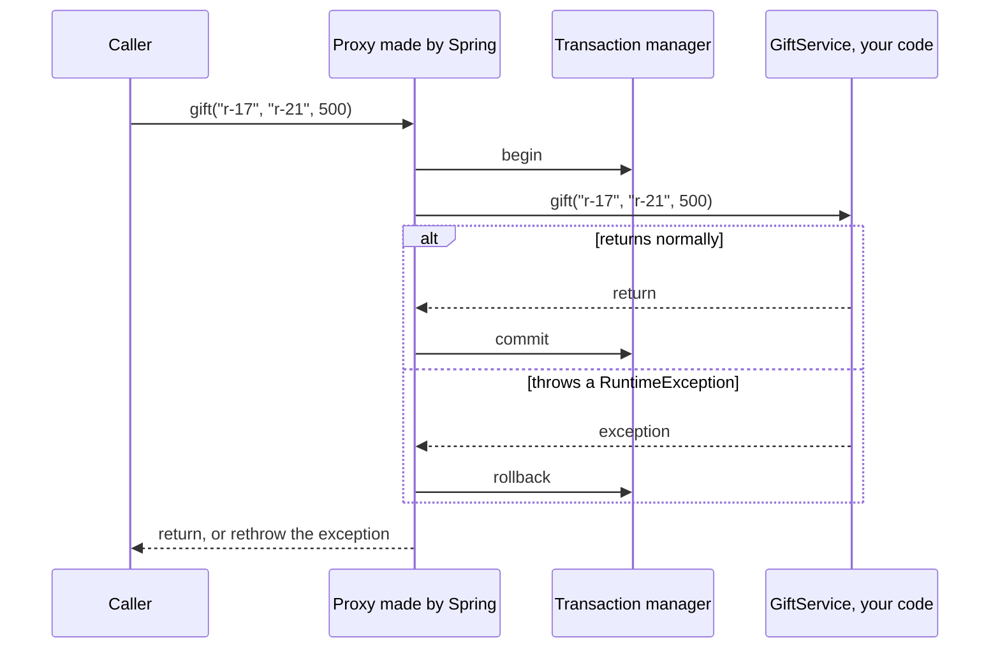

## Hook

At a shop till, the cashier scans your whole basket. Then your card is declined. The cashier does not hand you half the items and keep half your money. The whole sale is voided, and everything goes back to how it was.

Jiraiya's gift feature has no such rule. A gift takes 500 cents from one wallet, then adds 500 cents to another. A timeout struck between the two steps. The first step stayed, the second never happened, and 500 cents vanished. In this topic you learn to make a group of steps behave like one sale: all of it, or none of it.

## Concept

### ACID in plain words

```callout jargon
A **transaction** is a group of database changes that succeed or fail as one unit. To **commit** means to make the changes final. To **roll back** means to undo every change in the group.
```

Databases promise four things about transactions, known by the letters **ACID**:

| Letter | Word | In plain words |
|---|---|---|
| A | Atomicity | All or nothing. Either every step is kept, or none is. |
| C | Consistency | The rules hold afterwards, such as "a balance is never negative". |
| I | Isolation | Others do not see your half-finished work. |
| D | Durability | Once committed, the change survives a crash or a power cut. |

This topic is mostly about the A. "Atomic" comes from the Greek for "cannot be cut". A gift is atomic when nobody can ever see it half done.

### Without a transaction, each statement commits alone

By default a database connection is in **auto-commit** mode. Every statement is its own tiny transaction and is kept the moment it finishes. Run this program and compare the two halves.

```java run
import java.sql.Connection;
import java.sql.DriverManager;
import java.sql.SQLException;
import java.sql.Statement;

public class Main {
    public static void main(String[] args) throws SQLException {
        try (Connection db = DriverManager.getConnection("jdbc:h2:mem:credit")) {
            Statement sql = db.createStatement();
            sql.execute("create table wallet (rider_id varchar(10) primary key, balance_cents bigint)");
            sql.execute("insert into wallet values ('r-17', 2000), ('r-21', 100)");

            System.out.println("1) auto-commit on, each statement commits alone");
            try {
                sql.executeUpdate("update wallet set balance_cents = balance_cents - 500 where rider_id = 'r-17'");
                timeout();
                sql.executeUpdate("update wallet set balance_cents = balance_cents + 500 where rider_id = 'r-21'");
            } catch (IllegalStateException e) {
                System.out.println("   failed: " + e.getMessage());
            }
            printBalances(sql);

            System.out.println("2) one transaction: commit at the end, roll back on failure");
            db.setAutoCommit(false);
            try {
                sql.executeUpdate("update wallet set balance_cents = balance_cents - 500 where rider_id = 'r-17'");
                timeout();
                sql.executeUpdate("update wallet set balance_cents = balance_cents + 500 where rider_id = 'r-21'");
                db.commit();
            } catch (IllegalStateException e) {
                db.rollback();
                System.out.println("   failed: " + e.getMessage() + ", rolled back");
            }
            printBalances(sql);
        }
    }

    static void timeout() {
        throw new IllegalStateException("timeout talking to the wallet server");
    }

    static void printBalances(Statement sql) throws SQLException {
        var rows = sql.executeQuery("select rider_id, balance_cents from wallet order by rider_id");
        while (rows.next()) {
            System.out.println("   " + rows.getString(1) + ": " + rows.getLong(2) + " cents");
        }
    }
}
```

In part 1, rider `r-17` drops from 2000 to 1500 cents and `r-21` gets nothing. That is Jiraiya's bug. In part 2, `r-17` stays at 1500: the second withdrawal was rolled back with the failure. Writing `setAutoCommit`, `commit` and `rollback` by hand in every method is tiring and easy to forget. Spring does it for you.

### Syntax: @Transactional

```java nocompile
@Service
public class GiftService {

    @Transactional
    public void gift(String fromRider, String toRider, long cents) {
        // step 1: withdraw
        // step 2: deposit
        // step 3: write a log row
    }
}
```

- Put `@Transactional` (from `org.springframework.transaction.annotation`) on a **public** method of a Spring bean. Package-private and protected methods work too, but never private ones.
- Spring begins a transaction before the method runs.
- If the method returns normally, Spring **commits**.
- If it throws a `RuntimeException` or an `Error`, Spring **rolls back**, and the exception still reaches the caller.

Every repository call inside the method joins the same transaction. So all three steps are kept together, or undone together.

### Rollback rules: checked exceptions commit

Here is the surprise. By default, a **checked** exception does **not** roll back.

| The method ends with | Default `@Transactional` does |
|---|---|
| A normal return | Commit |
| A `RuntimeException`, such as `IllegalArgumentException` | Roll back |
| An `Error`, such as `OutOfMemoryError` | Roll back |
| A checked exception, such as `IOException` or your own `extends Exception` | **Commit** whatever already ran |

The old idea was that a checked exception is a normal business outcome the caller will handle. For money, that idea is usually wrong. Tell Spring which checked exceptions must also roll back:

### Syntax: rollbackFor

```java nocompile
@Transactional(rollbackFor = InsufficientCreditException.class)
public void gift(String fromRider, String toRider, long cents) throws InsufficientCreditException {
    ...
}
```

`rollbackFor` takes one class or a list, such as `{WalletFullException.class, InsufficientCreditException.class}`. Its opposite, `noRollbackFor`, keeps the work even when a certain runtime exception is thrown.

### How Spring adds the transaction: proxies

```callout jargon
A **proxy** is a stand-in object that looks exactly like your bean. It sits in front of the real object, does extra work before and after each call, and passes the call through.
```

When a bean has `@Transactional` methods, Spring does not hand out your object. It makes a subclass of your class at runtime, wraps your object in it, and hands out that proxy. Every caller that gets the bean injected actually talks to the proxy.



The transaction lives in the proxy, not in your method. That one fact explains three traps:

- **Self-invocation.** Inside your class, `this` is the real object, not the proxy. When one method calls another with `this.addCredit(...)`, or just `addCredit(...)`, the call never passes the proxy. The `@Transactional` on `addCredit` is ignored.
- **Private and final methods.** The proxy is a subclass. It cannot override a `private` or `final` method, so `@Transactional` on one does nothing, with no warning.
- **Objects you build with new.** `new GiftService(...)` is a plain object with no proxy around it. Only beans that Spring creates get one.

The program below asks Spring for a bean and prints its real class name. Then it checks whether a transaction is active, once through the proxy and once through `this`.

```java run
import javax.sql.DataSource;
import org.springframework.context.annotation.AnnotationConfigApplicationContext;
import org.springframework.context.annotation.Bean;
import org.springframework.context.annotation.Configuration;
import org.springframework.jdbc.datasource.DataSourceTransactionManager;
import org.springframework.jdbc.datasource.DriverManagerDataSource;
import org.springframework.transaction.PlatformTransactionManager;
import org.springframework.transaction.annotation.EnableTransactionManagement;
import org.springframework.transaction.annotation.Transactional;
import org.springframework.transaction.support.TransactionSynchronizationManager;

public class Main {
    public static void main(String[] args) {
        ((ch.qos.logback.classic.Logger) org.slf4j.LoggerFactory.getLogger("ROOT"))
                .setLevel(ch.qos.logback.classic.Level.OFF);
        try (var spring = new AnnotationConfigApplicationContext(Config.class)) {
            CreditService credit = spring.getBean(CreditService.class);
            System.out.println("the bean's class: " + credit.getClass().getSimpleName());
            credit.addCredit();
            credit.monthlyBonus();
        }
    }
}

@Configuration
@EnableTransactionManagement
class Config {
    @Bean
    DataSource dataSource() {
        return new DriverManagerDataSource("jdbc:h2:mem:proxy");
    }

    @Bean
    PlatformTransactionManager transactionManager(DataSource dataSource) {
        return new DataSourceTransactionManager(dataSource);
    }

    @Bean
    CreditService creditService() {
        return new CreditService();
    }
}

class CreditService {
    @Transactional
    public void addCredit() {
        System.out.println("addCredit: in a transaction? " + TransactionSynchronizationManager.isActualTransactionActive());
    }

    public void monthlyBonus() {
        System.out.println("monthlyBonus calls this.addCredit()");
        this.addCredit();
    }
}
```

The class name ends in `$$SpringCGLIB$$0`: that is the proxy. The first call goes through it, so the answer is `true`. The second call goes through `this`, so the answer is `false`.

There are two ways to fix self-invocation:

1. Put `@Transactional` on the outer public method that callers use, here `monthlyBonus`. The inner call then simply runs inside the outer transaction.
2. Move the inner method into a different bean and inject that bean. Calls to another bean always pass its proxy.

### Syntax: readOnly = true

```java nocompile
@Transactional(readOnly = true)
public long balanceOf(String riderId) {
    return wallets.findById(riderId).orElseThrow().getBalanceCents();
}
```

`readOnly = true` tells Hibernate and the database that this method only reads. Hibernate then skips checking the loaded objects for changes, which saves work. Use it on methods that only look things up.

### Propagation: REQUIRED and REQUIRES_NEW

**Propagation** decides what happens when a transactional method calls another transactional method on a different bean.

| Propagation | When a transaction is already running | When none is running |
|---|---|---|
| `REQUIRED` (the default) | Join it. Both commit or roll back together. | Start a new one |
| `REQUIRES_NEW` | Pause it, and start a separate one that commits on its own | Start a new one |

`REQUIRED` is right almost always. Here is one case for `REQUIRES_NEW`. Finance wants a row for every gift **attempt**, including the failed ones, to spot fraud. If that row joined the gift's transaction, a failed gift would roll the audit row back too.

```java nocompile
@Service
public class GiftAudit {

    private final GiftAttemptRepository attempts;

    public GiftAudit(GiftAttemptRepository attempts) {
        this.attempts = attempts;
    }

    @Transactional(propagation = Propagation.REQUIRES_NEW)
    public void record(String fromRider, String toRider, long cents) {
        attempts.save(new GiftAttempt(fromRider, toRider, cents));
    }
}
```

`GiftService.gift` calls `audit.record(...)` first, then does the risky steps. The audit row is committed in its own transaction straight away, so it survives even when the gift rolls back. `GiftAudit` is a separate bean on purpose: through `this`, the `REQUIRES_NEW` would be skipped, like any other `@Transactional`.

### Isolation levels

**Isolation** decides how much one transaction can see of another one that is still running. The worst case is a **dirty read**: reading a change that another transaction has not committed yet, and may still roll back. You could show a rider credit that never really arrived.

| Level | Dirty reads? | Where you meet it |
|---|---|---|
| `READ_UNCOMMITTED` | Possible | Almost never used |
| `READ_COMMITTED` | No | The default in PostgreSQL, Oracle, SQL Server and H2 |
| `REPEATABLE_READ` | No, and a row you read twice will not change in between | The default in MySQL |
| `SERIALIZABLE` | No, transactions act as if they ran one after another | The safest and the slowest |

```java nocompile
@Transactional(isolation = Isolation.SERIALIZABLE)
```

Most apps keep the database default, which is what `Isolation.DEFAULT` means. Change it only when you have a clear reason.

## Worked example

This program wires a tiny Spring context by hand: an in-memory database, a transaction manager and a `GiftService` bean. No web server starts. Rider `r-99` has no wallet, so the deposit fails after the withdrawal already ran.

```java run
import javax.sql.DataSource;
import org.springframework.context.annotation.AnnotationConfigApplicationContext;
import org.springframework.context.annotation.Bean;
import org.springframework.context.annotation.Configuration;
import org.springframework.jdbc.core.simple.JdbcClient;
import org.springframework.jdbc.datasource.DataSourceTransactionManager;
import org.springframework.jdbc.datasource.DriverManagerDataSource;
import org.springframework.transaction.PlatformTransactionManager;
import org.springframework.transaction.annotation.EnableTransactionManagement;
import org.springframework.transaction.annotation.Transactional;

public class Main {
    public static void main(String[] args) {
        quietLogs();
        try (var spring = new AnnotationConfigApplicationContext(Config.class)) {
            GiftService gifts = spring.getBean(GiftService.class);
            gifts.setUp();
            try {
                gifts.gift("r-17", "r-99", 500);   // r-99 has no wallet
            } catch (UnknownRiderException e) {
                System.out.println("gift failed: " + e.getMessage());
            }
            System.out.println("r-17 has " + gifts.balance("r-17") + " cents");
        }
    }

    static void quietLogs() {   // hides Spring's start-up chatter
        ((ch.qos.logback.classic.Logger) org.slf4j.LoggerFactory.getLogger("ROOT"))
                .setLevel(ch.qos.logback.classic.Level.OFF);
    }
}

@Configuration
@EnableTransactionManagement
class Config {
    @Bean
    DataSource dataSource() {
        return new DriverManagerDataSource("jdbc:h2:mem:gifts;DB_CLOSE_DELAY=-1");
    }

    @Bean
    PlatformTransactionManager transactionManager(DataSource dataSource) {
        return new DataSourceTransactionManager(dataSource);
    }

    @Bean
    GiftService giftService(DataSource dataSource) {
        return new GiftService(JdbcClient.create(dataSource));
    }
}

class UnknownRiderException extends RuntimeException {
    UnknownRiderException(String riderId) {
        super("no wallet for " + riderId);
    }
}

class GiftService {
    private final JdbcClient db;

    GiftService(JdbcClient db) {
        this.db = db;
    }

    @Transactional
    public void gift(String from, String to, long cents) {
        db.sql("update wallet set balance_cents = balance_cents - ? where rider_id = ?").params(cents, from).update();
        int found = db.sql("update wallet set balance_cents = balance_cents + ? where rider_id = ?").params(cents, to).update();
        if (found == 0) {
            throw new UnknownRiderException(to);
        }
    }

    public long balance(String riderId) {
        return db.sql("select balance_cents from wallet where rider_id = ?").param(riderId).query(Long.class).single();
    }

    public void setUp() {
        db.sql("create table wallet (rider_id varchar(10) primary key, balance_cents bigint)").update();
        db.sql("insert into wallet values ('r-17', 2000), ('r-21', 100)").update();
    }
}
```

Read it step by step:

- `@EnableTransactionManagement` switches on the proxies. Spring Boot does this for you, so in the practice task you never write it.
- The `DataSourceTransactionManager` is the part that really calls begin, commit and rollback on the connection.
- `spring.getBean(GiftService.class)` returns the proxy, so the call to `gift` passes through it.
- Inside `gift`, the withdrawal runs first. The deposit then changes 0 rows, because `r-99` has no wallet.
- `UnknownRiderException` is a `RuntimeException`, so the proxy rolls back the withdrawal and rethrows.
- The output says `r-17` still has 2000 cents. Delete the `@Transactional` line and run it again: now `r-17` has 1500.

## Try it

This version has a limit: a wallet may hold at most 5000 cents. Rider `r-21` already has 4800, so a gift of 500 is too much. The limit throws `WalletFullException`, a **checked** exception, after the withdrawal ran.

Run it first. `r-17` has lost 500 cents, even though the method has `@Transactional`. Then change the annotation to `@Transactional(rollbackFor = WalletFullException.class)` and run it again. Now `r-17` keeps all 2000 cents.

```java run
import javax.sql.DataSource;
import org.springframework.context.annotation.AnnotationConfigApplicationContext;
import org.springframework.context.annotation.Bean;
import org.springframework.context.annotation.Configuration;
import org.springframework.jdbc.core.simple.JdbcClient;
import org.springframework.jdbc.datasource.DataSourceTransactionManager;
import org.springframework.jdbc.datasource.DriverManagerDataSource;
import org.springframework.transaction.PlatformTransactionManager;
import org.springframework.transaction.annotation.EnableTransactionManagement;
import org.springframework.transaction.annotation.Transactional;

public class Main {
    public static void main(String[] args) {
        ((ch.qos.logback.classic.Logger) org.slf4j.LoggerFactory.getLogger("ROOT"))
                .setLevel(ch.qos.logback.classic.Level.OFF);
        try (var spring = new AnnotationConfigApplicationContext(Config.class)) {
            GiftService gifts = spring.getBean(GiftService.class);
            gifts.setUp();
            try {
                gifts.gift("r-17", "r-21", 500);   // r-21's wallet is nearly full
            } catch (WalletFullException e) {
                System.out.println("gift failed: " + e.getMessage());
            }
            System.out.println("r-17 has " + gifts.balance("r-17") + " cents");
            System.out.println("r-21 has " + gifts.balance("r-21") + " cents");
        }
    }
}

@Configuration
@EnableTransactionManagement
class Config {
    @Bean
    DataSource dataSource() {
        return new DriverManagerDataSource("jdbc:h2:mem:full;DB_CLOSE_DELAY=-1");
    }

    @Bean
    PlatformTransactionManager transactionManager(DataSource dataSource) {
        return new DataSourceTransactionManager(dataSource);
    }

    @Bean
    GiftService giftService(DataSource dataSource) {
        return new GiftService(JdbcClient.create(dataSource));
    }
}

class WalletFullException extends Exception {   // checked
    WalletFullException(String riderId) {
        super(riderId + " would go over the 5000 cent limit");
    }
}

class GiftService {
    static final long LIMIT_CENTS = 5000;
    private final JdbcClient db;

    GiftService(JdbcClient db) {
        this.db = db;
    }

    @Transactional
    public void gift(String from, String to, long cents) throws WalletFullException {
        db.sql("update wallet set balance_cents = balance_cents - ? where rider_id = ?").params(cents, from).update();
        if (balance(to) + cents > LIMIT_CENTS) {
            throw new WalletFullException(to);
        }
        db.sql("update wallet set balance_cents = balance_cents + ? where rider_id = ?").params(cents, to).update();
    }

    public long balance(String riderId) {
        return db.sql("select balance_cents from wallet where rider_id = ?").param(riderId).query(Long.class).single();
    }

    public void setUp() {
        db.sql("create table wallet (rider_id varchar(10) primary key, balance_cents bigint)").update();
        db.sql("insert into wallet values ('r-17', 2000), ('r-21', 4800)").update();
    }
}
```

## Recap

- A transaction makes several changes atomic: all are committed, or all are rolled back. Without one, each statement commits alone.
- `@Transactional` on a public method of a Spring bean commits on a normal return and rolls back on a `RuntimeException` or `Error`.
- Checked exceptions commit by default. Add `rollbackFor = YourException.class` when they must undo the work.
- The transaction lives in a proxy around the bean. Calls through `this`, private methods and objects made with `new` skip it.
- `readOnly = true` suits lookups. `REQUIRES_NEW` runs a separate transaction, such as an audit row that must survive a rollback. `READ_COMMITTED` is the usual isolation level and prevents dirty reads.

## Common mistakes

**1. A multi-step method with no @Transactional.**

```java nocompile
public void gift(String from, String to, long cents) {
    withdraw(from, cents);
    deposit(to, cents);     // throws for an unknown rider
}
```

```text
gift failed: no wallet for r-99
r-17 has 1500 cents
```

No error tells you anything is wrong. The withdrawal was committed on its own. Fix: add `@Transactional` to the public method that does all the steps.

**2. A checked exception without rollbackFor.**

```java nocompile
@Transactional
public void gift(String from, String to, long cents) throws WalletFullException {
```

```text
gift failed: r-21 would go over the 5000 cent limit
r-17 has 1500 cents
r-21 has 4800 cents
```

The method threw, but Spring committed, because `WalletFullException` is checked. Fix: `@Transactional(rollbackFor = WalletFullException.class)`.

**3. Calling a transactional method through this.**

```java nocompile
public void monthlyBonus() {     // no @Transactional here
    this.addCredit();            // addCredit has @Transactional, but 'this' skips the proxy
}
```

```text
monthlyBonus calls this.addCredit()
addCredit: in a transaction? false
```

Fix: put `@Transactional` on `monthlyBonus`, the method callers actually use, or move `addCredit` into another bean.

**4. Catching an exception that already marked the transaction.**

```java nocompile
@Transactional
public void giftAll() {
    try {
        otherBean.gift(...);          // also @Transactional, joins this transaction, then throws
    } catch (UnknownRiderException e) {
        // ignore it and carry on
    }
}
```

```text
org.springframework.transaction.UnexpectedRollbackException: Transaction silently rolled back because it has been marked as rollback-only
```

That is the wording with JPA, as in a Spring Boot app with Spring Data JPA. With plain JDBC, as in the programs on this page, the message starts `Transaction rolled back because`.

The inner method joined the outer transaction and marked it for rollback when it threw. Catching the exception cannot undo that mark, so the commit at the end fails. Fix: let the exception travel up, or check for the problem before you start writing.
