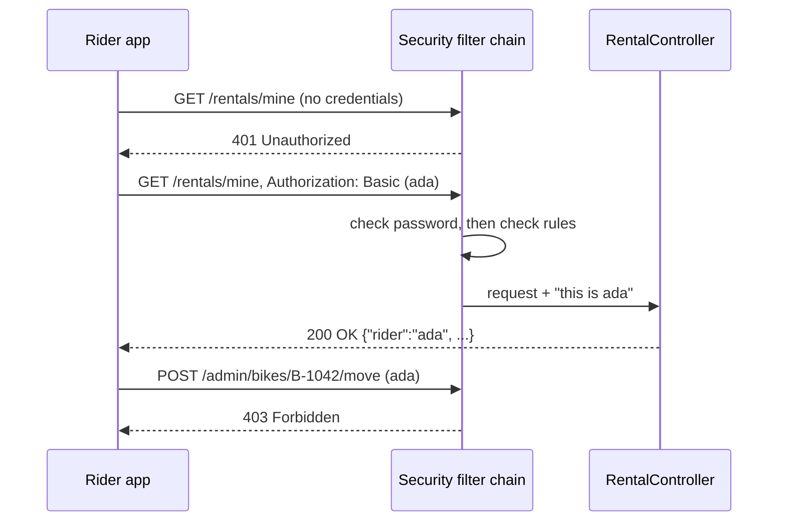

## Hook

Picture Spoke's office building. At the front desk, a guard checks your ID card. That tells the building who you are. Then the colour of your badge decides which floors you may enter. A visitor badge opens the lobby. An ops badge opens the bike workshop too.

Kakashi found that the Spoke API has no front desk at all. Anyone who knows the address `POST /admin/bikes/B-1042/move` can send bikes to the Depot. In this topic you put a guard and a badge check in front of every request.

## Concept

### Authentication and authorization

Two words sound alike but mean different things.

- **Authentication** answers "Who are you?" The caller proves it, usually with a name and a password.
- **Authorization** answers "What may you do?" The server checks the proven person against the rules.

```callout jargon
**Credentials** are whatever proves who you are, such as a username and password. **Principal** is Spring's word for the person (or program) that logged in.
```

Each failure has its own HTTP status code.

| Status | Name | What it really means | Spoke example |
|---|---|---|---|
| 401 | Unauthorized | "I don't know who you are." Missing or wrong credentials. | No password sent to `/rentals/mine` |
| 403 | Forbidden | "I know who you are, and you may not do this." | Ada, a rider, tries to move a bike |

```callout tip
Gojo says: the name 401 Unauthorized is an old mix-up. It really means unauthenticated. Remember it as "log in first".
```

### The security filter chain

A **filter** is a piece of code that sees every request before your controller does. It can pass the request on, change it, or answer straight away.

Spring Security adds a **filter chain**: a line of filters in front of all your controllers. One filter reads the credentials. A later filter checks the rules. A refused request never reaches your controller at all.



### Spring Boot's security starter

In a normal Spring Boot project you add `spring-boot-starter-security`. A **starter** is a dependency that also switches features on by default. With this one, Boot locks every URL. It creates one user called `user` and prints a random password in the log at start-up. It also turns on a login form, and the header-based login you meet below.

That is a safe default, but it hides what is going on. JavaQuest leaves the starter out. Spring Security is on the classpath, yet it does nothing until your own code switches it on. So in this topic you write every rule yourself, the explicit way.

### Syntax: @EnableWebSecurity and a SecurityFilterChain bean

```java nocompile
@Configuration
@EnableWebSecurity
public class SecurityConfig {

    @Bean
    SecurityFilterChain securityFilterChain(HttpSecurity http) throws Exception {
        http.authorizeHttpRequests(auth -> auth.anyRequest().authenticated());
        return http.build();
    }
}
```

- `@EnableWebSecurity` switches Spring Security on. It also gives you an `HttpSecurity` builder to fill in.
- The `@Bean` method describes your rules on `http`, then calls `http.build()` to turn them into a `SecurityFilterChain`.
- You need both. `@EnableWebSecurity` alone locks every URL with Spring's default rules. A `SecurityFilterChain` bean without it stops the app at start-up (see Common mistakes). Together, they give you your own rules.

### Syntax: authorizeHttpRequests rules

```java nocompile
http.authorizeHttpRequests(auth -> auth
        .requestMatchers(HttpMethod.GET, "/stations").permitAll()
        .requestMatchers("/admin/**").hasRole("OPS")
        .anyRequest().authenticated());
```

- `requestMatchers(...)` picks requests by path, and optionally by HTTP method. `/admin/**` means "/admin and everything under it".
- `permitAll()` lets everyone in, even with no login.
- `hasRole("OPS")` lets in only people with the OPS role.
- `authenticated()` lets in anyone who logged in.
- `anyRequest()` catches everything not matched above. It must come last.

Spring checks the rules from top to bottom and uses the first one that matches.

### Syntax: httpBasic

```java nocompile
http.httpBasic(Customizer.withDefaults());
```

**HTTP Basic authentication** is the simplest login for an API. The caller sends a name and password in a header on every request:

```http
GET /rentals/mine HTTP/1.1
Host: api.spoke.example
Authorization: Basic YWRhOnJpZGUtb24=
```

The odd text is `ada:ride-on` in Base64. **Base64** is a way to write any bytes as plain letters. It is not secret: anyone can turn it back. So in real life, Basic auth is only safe over HTTPS, which encrypts the whole request.

When credentials are missing or wrong, `httpBasic` answers like this:

```http
HTTP/1.1 401 Unauthorized
WWW-Authenticate: Basic realm="Realm", charset="UTF-8"
```

### Stateless APIs and CSRF

A website often logs you in once, then remembers you with a **session**. The server keeps a note about you. Your browser gets a cookie with the note's number.

An API like Spoke's is usually **stateless**. The server keeps no notes. Every request carries its own credentials, so any server copy can answer it.

```java nocompile
http.sessionManagement(s -> s.sessionCreationPolicy(SessionCreationPolicy.STATELESS));
http.csrf(csrf -> csrf.disable());
```

```callout jargon
**CSRF** (cross-site request forgery) is an attack on cookie logins. A browser sends your cookies to a site on every request, even when another web page triggers it. A bad page could make your browser POST "move bike" to Spoke while you are logged in.
```

Spring Security blocks that with a secret **CSRF token** that a real Spoke page must send back. It is on by default, so every POST without a token gets 403. Spoke's API is called by the rider app and partner servers, never with a login cookie. So we switch CSRF protection off. If you ever build web pages with a login cookie, keep it on.

### Users: UserDetailsService

Spring Security finds users through a `UserDetailsService`. You give it a username, and it gives back a `UserDetails`: the name, the stored password and the roles.

`InMemoryUserDetailsManager` keeps users in a map in memory. It is perfect for tests and small tools. Real apps load users from a database instead.

Kakashi logs in with his ops account, `theo`. Ada logs in as `ada`.

```java nocompile
@Bean
UserDetailsService users(PasswordEncoder encoder) {
    return new InMemoryUserDetailsManager(
            User.withUsername("ada").password(encoder.encode("ride-on")).roles("RIDER").build(),
            User.withUsername("theo").password(encoder.encode("fix-it")).roles("OPS").build());
}
```

### Password hashing

Never store a password as plain text. If someone copies your user table, they get every password, and riders reuse passwords on other sites.

Store a **hash** instead. A hash function turns text into a scrambled fingerprint that cannot be turned back. To check a login, you hash what the rider typed and compare.

**BCrypt** is a password hash built for this job. It adds a random **salt** (extra random characters) to each password before hashing. So the same password hashes differently every time. It is also slow on purpose, to make guessing millions of passwords expensive.

```java run
import org.springframework.security.crypto.bcrypt.BCryptPasswordEncoder;
import org.springframework.security.crypto.password.PasswordEncoder;

public class Main {
    public static void main(String[] args) {
        PasswordEncoder encoder = new BCryptPasswordEncoder();
        String first = encoder.encode("ride-on");
        String second = encoder.encode("ride-on");

        System.out.println(first.length() + " characters, starts with " + first.substring(0, 7));
        System.out.println("same hash twice? " + first.equals(second));
        System.out.println("ride-on matches first? " + encoder.matches("ride-on", first));
        System.out.println("ride-on matches second? " + encoder.matches("ride-on", second));
        System.out.println("ride-off matches first? " + encoder.matches("ride-off", first));
    }
}
```

- `encode` makes a new hash with a new salt, so `first` and `second` differ.
- `matches(typed, stored)` reads the salt back out of the stored hash, hashes the typed text the same way, and compares.
- The `10` in `$2a$10$` is the **strength**. Each step up doubles the work. 10 is the default and takes a fraction of a second.

```callout tip
Gojo says: hashing gets better over time. `PasswordEncoderFactories.createDelegatingPasswordEncoder()` stores the name of the method in front of each hash, like `{bcrypt}$2a$10$...`. Later you can switch new passwords to a stronger method, such as Argon2, and old hashes still work.
```

```callout tip
Gojo says: you never call matches yourself during a login. Spring Security calls it for you with the PasswordEncoder bean you define.
```

### Roles and authorities

An **authority** is one permission string that a user holds. A **role** is an authority whose name starts with `ROLE_`. Spring adds that prefix for you on both sides:

| You write | Spring stores or checks |
|---|---|
| `.roles("OPS")` on a user | authority `ROLE_OPS` |
| `.hasRole("OPS")` in a rule | needs authority `ROLE_OPS` |
| `.hasAuthority("ROLE_OPS")` in a rule | needs authority `ROLE_OPS` |

```java run
import org.springframework.security.core.userdetails.User;
import org.springframework.security.core.userdetails.UserDetails;
import org.springframework.security.crypto.bcrypt.BCryptPasswordEncoder;
import org.springframework.security.crypto.password.PasswordEncoder;
import org.springframework.security.provisioning.InMemoryUserDetailsManager;

public class Main {
    public static void main(String[] args) {
        PasswordEncoder encoder = new BCryptPasswordEncoder();
        InMemoryUserDetailsManager users = new InMemoryUserDetailsManager(
                User.withUsername("ada").password(encoder.encode("ride-on")).roles("RIDER").build(),
                User.withUsername("theo").password(encoder.encode("fix-it")).roles("OPS").build());

        UserDetails theo = users.loadUserByUsername("theo");
        System.out.println(theo.getUsername() + " has " + theo.getAuthorities());
        System.out.println("ada exists? " + users.userExists("ada"));
        System.out.println("zoe exists? " + users.userExists("zoe"));
    }
}
```

### Syntax: reading the current user

Once a request passes the chain, Spring knows who sent it. A controller can ask for that person in two ways.

```java
import org.springframework.security.core.Authentication;
import org.springframework.security.core.annotation.AuthenticationPrincipal;
import org.springframework.security.core.userdetails.UserDetails;
import org.springframework.web.bind.annotation.GetMapping;
import org.springframework.web.bind.annotation.RestController;

@RestController
class WhoAmIController {

    @GetMapping("/me")
    String me(@AuthenticationPrincipal UserDetails user) {
        return user.getUsername();
    }

    @GetMapping("/me/roles")
    String roles(Authentication auth) {
        return auth.getName() + " " + auth.getAuthorities();
    }
}
```

- `@AuthenticationPrincipal UserDetails user` hands you the logged-in user's details.
- An `Authentication` parameter hands you the whole login: the name, the authorities and more.

Take the rider from the login, never from the URL. A URL like `/rentals?rider=ada` lets Lin read Ada's rentals by typing her name.

### Object-level authorization: only your own rentals

The rules so far check *who* may call a path. They do not check *which object*. Lin is a logged-in rider, so `GET /rentals/rental-17` passes `authenticated()`. But rental-17 is Ada's.

This gap is called **broken object level authorization** (BOLA), or IDOR. It is the most common API security hole. Rental ids follow a pattern, so Lin could try `rental-1`, `rental-2`, and so on, and read everyone's trips.

```callout jargon
**BOLA** (Broken Object Level Authorization) means a user can reach someone else's object just by changing an id in the request. Its older name is **IDOR** (Insecure Direct Object Reference).
```

The fix: every time you load an object by id, check that the caller may see *that* object.

```java nocompile
@GetMapping("/rentals/{id}")
Rental one(@PathVariable String id, Authentication auth) {
    Rental rental = rentals.findById(id).orElseThrow(NotFound::new);
    if (!rental.riderUsername().equals(auth.getName()) && !isOps(auth)) {
        throw new NotFound();   // 404, so Lin cannot even tell that rental-17 exists
    }
    return rental;
}
```

Spring can also check this on a service method, with **method security**. Put `@EnableMethodSecurity` on a configuration class, then:

```java nocompile
@PreAuthorize("hasRole('OPS')")                                  // checked before the method runs
public void moveBike(String bikeId, String station) { ... }

@PostAuthorize("returnObject.riderId() == authentication.name")  // checked on what it returns
public Rental rental(String id) { ... }
```

A refused check answers 403.

### More attacks to know: XSS, CORS, headers and guessing

**XSS** (cross-site scripting): a rider names their profile `<script>...</script>`. If a web page shows that name as raw HTML, the script runs in every visitor's browser. The fix is to **escape** output, so `<` shows as text. Template engines escape by default. A JSON API should send `Content-Type: application/json`, never HTML.

**Same-origin policy and CORS**: browsers stop a web page from one site, like `evil.example`, reading answers from another site, like Spoke's API. That block is the **same-origin policy**. **CORS** (cross-origin resource sharing) is how a server relaxes it for chosen sites, with `http.cors(...)` in Spring. List exact sites, never `*`, for logged-in calls. Both are browser rules only. `curl` and other servers ignore them, so they never replace a login.

**Security headers**: Spring Security adds these to every response by default. They tell browsers to be careful.

```text
X-Content-Type-Options: nosniff
X-Frame-Options: DENY
Cache-Control: no-cache, no-store, max-age=0, must-revalidate
```

`nosniff` stops guessing a file type. `DENY` stops other sites from framing your pages. `no-store` keeps private answers out of caches. Over HTTPS, Spring also sends `Strict-Transport-Security`, which tells browsers to always use HTTPS.

**Password guessing**: an attacker tries thousands of passwords for `ada`. Count failed logins per account and per address. After a few, slow down or answer `429 Too Many Requests` for a while. BCrypt's slowness helps too.

### Keeping secrets out of code

This page writes passwords like `"fix-it"` in code, because they are practice users. Real secrets never go in code, or in any file that goes into git. That includes database passwords, API keys and token signing keys.

Instead, the app reads them when it starts, from an environment variable or a **secret manager**:

```properties
spring.datasource.password=${DB_PASSWORD}
```

`${DB_PASSWORD}` is filled from the environment variable `DB_PASSWORD` (topic 03). In production, a secret manager, such as AWS Secrets Manager or HashiCorp Vault, stores secrets encrypted, controls who can read them, and logs every read.

```callout warning
If a secret is ever committed, treat it as stolen. Deleting it in a later commit does not help: it stays in git history, and bots scan public repositories within minutes. Make a new secret, switch the app to it, and switch the old one off. That is called **rotating** the secret.
```

### Syntax: testing secured endpoints

The `spring-security-test` library adds helpers for MockMvc tests.

```java
import static org.junit.jupiter.api.Assertions.assertEquals;
import static org.springframework.security.test.web.servlet.request.SecurityMockMvcRequestPostProcessors.httpBasic;
import static org.springframework.security.test.web.servlet.request.SecurityMockMvcRequestPostProcessors.testSecurityContext;
import static org.springframework.test.web.servlet.request.MockMvcRequestBuilders.get;

import org.junit.jupiter.api.DisplayName;
import org.junit.jupiter.api.Test;
import org.springframework.beans.factory.annotation.Autowired;
import org.springframework.boot.test.context.SpringBootTest;
import org.springframework.boot.webmvc.test.autoconfigure.AutoConfigureMockMvc;
import org.springframework.security.test.context.support.WithMockUser;
import org.springframework.test.web.servlet.MockMvc;
import org.springframework.test.web.servlet.MvcResult;

@SpringBootTest
@AutoConfigureMockMvc
class RentalSecurityTest {

    @Autowired MockMvc mvc;

    @Test
    @DisplayName("Ada logs in with her real password")
    void adaLogsIn() throws Exception {
        MvcResult r = mvc.perform(get("/rentals/mine").with(httpBasic("ada", "ride-on"))).andReturn();
        assertEquals(200, r.getResponse().getStatus(), "ada should get her rentals");
    }

    @Test
    @WithMockUser(username = "zoe", roles = "RIDER")
    @DisplayName("A pretend rider skips the password check")
    void pretendRider() throws Exception {
        MvcResult r = mvc.perform(get("/rentals/mine").with(testSecurityContext())).andReturn();
        assertEquals(200, r.getResponse().getStatus(), "zoe should get her rentals");
    }
}
```

- `httpBasic("ada", "ride-on")` adds a real Basic header. The full chain runs, password check included.
- `@WithMockUser` pretends someone already logged in, with the roles you choose. It tests your rules without needing real users.
- `testSecurityContext()` carries that pretend user into the MockMvc request. With Boot's security starter, Boot adds this for you. JavaQuest has no starter, so you add it yourself.

### Next steps: OAuth2 and JWT

With **OAuth2**, a rider logs in once at a login server and gets a short-lived **token** to send instead of a password. A **JWT** (JSON Web Token) is a common token format that Spring Security can check, inside the same filter chain. The next cards show how.

### Sessions or tokens? JWT

There are two ways to remember a login.

- **Session**: the server stores "this is Ada" and hands the browser a cookie with a random session id. Every request, the server looks the id up. It is stateful.
- **Token**: the server hands the app a signed note that says "this is Ada, a RIDER, until 10:15". Every request carries the note. The server only checks the signature. It is stateless.

| | Session | Signed token (JWT) |
|---|---|---|
| Server stores | every logged-in user | nothing per user |
| Any server copy can answer | only if they share the session store | yes |
| Log someone out at once | easy: delete the session | hard: the token stays valid until it expires |
| Best for | websites with cookies | APIs, phone apps, service-to-service calls |

A **JWT** has three parts, joined by dots. The **header** names the signing method. The **payload** holds **claims**: facts such as `sub`, the user, and `exp`, the expiry time. Last comes the **signature**.

```java run
import java.nio.charset.StandardCharsets;
import java.security.MessageDigest;
import java.util.Base64;
import javax.crypto.Mac;
import javax.crypto.spec.SecretKeySpec;

public class Main {
    static final byte[] SECRET = "spoke-demo-key-only-the-server-knows!".getBytes(StandardCharsets.UTF_8);

    static String base64(String text) {
        return Base64.getUrlEncoder().withoutPadding().encodeToString(text.getBytes(StandardCharsets.UTF_8));
    }

    static String sign(String headerAndPayload) throws Exception {
        Mac mac = Mac.getInstance("HmacSHA256");
        mac.init(new SecretKeySpec(SECRET, "HmacSHA256"));
        byte[] signature = mac.doFinal(headerAndPayload.getBytes(StandardCharsets.UTF_8));
        return Base64.getUrlEncoder().withoutPadding().encodeToString(signature);
    }

    static boolean valid(String token) throws Exception {
        int lastDot = token.lastIndexOf('.');
        String expected = sign(token.substring(0, lastDot));
        return MessageDigest.isEqual(expected.getBytes(), token.substring(lastDot + 1).getBytes());
    }

    public static void main(String[] args) throws Exception {
        String header = base64("{\"alg\":\"HS256\",\"typ\":\"JWT\"}");
        String payload = base64("{\"sub\":\"ada\",\"roles\":[\"RIDER\"],\"exp\":1795000000}");
        String token = header + "." + payload + "." + sign(header + "." + payload);
        System.out.println(token);
        System.out.println("valid? " + valid(token));

        String forged = base64("{\"sub\":\"ada\",\"roles\":[\"OPS\"],\"exp\":1795000000}");
        String tampered = header + "." + forged + "." + token.substring(token.lastIndexOf('.') + 1);
        System.out.println("tampered valid? " + valid(tampered));

        String middle = token.split("\\.")[1];
        System.out.println("anyone can read: " + new String(Base64.getUrlDecoder().decode(middle), StandardCharsets.UTF_8));
    }
}
```

- The signature is made from the header, the payload and a secret key that only Spoke has.
- Ada changes `RIDER` to `OPS` in her payload. The old signature no longer fits, so the check fails.
- The payload is only Base64, not encrypted. Anyone can read it. Never put a password or a secret in a JWT.

Real code uses a library for this, never hand-made signing. This demo only shows the idea.

```callout jargon
A **claim** is one fact inside a token, such as `"sub": "ada"`. A **signature** is a code computed from the data and a secret key. Change one letter of the data, and the signature no longer matches.
```

### Expiry, revocation and refresh tokens

A JWT is checked without asking a database. That is its strength and its weakness. If Ada's phone is stolen, Spoke cannot easily cancel her token. It stays valid until its `exp` time. Cancelling a token early is called **revocation**.

So real systems use two tokens:

1. An **access token**: a JWT that lives only a few minutes, such as 15. It is sent with every request.
2. A **refresh token**: a long-lived random string that the server *does* store. When the access token expires, the app swaps the refresh token for a new access token.

To log Ada out everywhere, Spoke deletes her refresh token. Within 15 minutes, every access token she holds has expired, and no new one can be made.

```animate
title: An access token expires
kind: scene
nodes:
  - { id: app, label: Ada's app, emoji: "📱", value: "access: valid" }
  - { id: api, label: Spoke API, emoji: "🖥️" }
  - { id: login, label: Login server, emoji: "🔑", value: "refresh: stored" }
steps:
  - say: Ada's app sends her short-lived access token with a request. Spoke checks the signature and the expiry. All good.
    send: [{ from: app, to: api, label: "GET /rentals/mine + JWT" }, { from: api, to: app, label: "200 OK", back: true }]
  - say: Fifteen minutes pass. The access token's exp time is now in the past.
    set: { app: "access: expired" }
  - say: The next request gets 401. Spoke never accepts an expired token.
    send: [{ from: app, to: api, label: "GET /rentals/mine + JWT" }, { from: api, to: app, label: "401", back: true }]
  - say: The app sends its refresh token to the login server. The server finds it in its store, so Ada is still allowed.
    send: { from: app, to: login, label: "refresh token" }
    focus: [login]
  - say: A fresh access token comes back, and the app carries on. Ada never typed her password again.
    send: { from: login, to: app, label: "new access token", back: true }
    set: { app: "access: valid" }
  - say: If her phone is stolen, ops deletes the refresh token. The next refresh fails, and the thief is out within 15 minutes.
    set: { login: "refresh: deleted" }
```

### Syntax: a JWT resource server

Spring Security checks JWTs for you. Add the `spring-boot-starter-oauth2-resource-server` dependency, tell it who issues the tokens, and switch it on in the filter chain instead of `httpBasic`.

```java nocompile
http
        .authorizeHttpRequests(auth -> auth.anyRequest().authenticated())
        .oauth2ResourceServer(oauth -> oauth.jwt(Customizer.withDefaults()))
        .sessionManagement(s -> s.sessionCreationPolicy(SessionCreationPolicy.STATELESS))
        .csrf(csrf -> csrf.disable());
```

```properties
spring.security.oauth2.resourceserver.jwt.issuer-uri=https://login.spoke.example
```

On every request, Spring reads `Authorization: Bearer <token>`, checks the signature with the login server's public keys, and checks `exp`. A bad or expired token gets 401. A good one becomes the `Authentication` your controller sees.

```callout jargon
A **public key** is one half of a key pair. The login server signs tokens with its secret **private key**. Anyone can check those signatures with the matching public key, but cannot make new ones.
```

```callout jargon
A **resource server** is an API that accepts tokens made by a separate login server, called the **authorization server**. Spoke's API checks tokens. It never sees the rider's password.
```

## Worked example

Here is a complete `SecurityConfig` for a small Spoke API. Read it from top to bottom.

```java
import org.springframework.context.annotation.Bean;
import org.springframework.context.annotation.Configuration;
import org.springframework.http.HttpMethod;
import org.springframework.security.config.Customizer;
import org.springframework.security.config.annotation.web.builders.HttpSecurity;
import org.springframework.security.config.annotation.web.configuration.EnableWebSecurity;
import org.springframework.security.config.http.SessionCreationPolicy;
import org.springframework.security.core.userdetails.User;
import org.springframework.security.core.userdetails.UserDetailsService;
import org.springframework.security.crypto.bcrypt.BCryptPasswordEncoder;
import org.springframework.security.crypto.password.PasswordEncoder;
import org.springframework.security.provisioning.InMemoryUserDetailsManager;
import org.springframework.security.web.SecurityFilterChain;

@Configuration
@EnableWebSecurity
public class SecurityConfig {

    @Bean
    SecurityFilterChain securityFilterChain(HttpSecurity http) throws Exception {
        http
                .authorizeHttpRequests(auth -> auth
                        .requestMatchers(HttpMethod.GET, "/stations").permitAll()
                        .requestMatchers("/admin/**").hasRole("OPS")
                        .anyRequest().authenticated())
                .httpBasic(Customizer.withDefaults())
                .sessionManagement(s -> s.sessionCreationPolicy(SessionCreationPolicy.STATELESS))
                .csrf(csrf -> csrf.disable());
        return http.build();
    }

    @Bean
    PasswordEncoder passwordEncoder() {
        return new BCryptPasswordEncoder();
    }

    @Bean
    UserDetailsService users(PasswordEncoder encoder) {
        return new InMemoryUserDetailsManager(
                User.withUsername("lin").password(encoder.encode("bell-ring")).roles("RIDER").build(),
                User.withUsername("omar").password(encoder.encode("wrench")).roles("OPS").build());
    }
}
```

- `@EnableWebSecurity` switches the guard on.
- The first rule lets anyone read the station list with GET.
- The second rule keeps everything under `/admin` for OPS staff.
- `anyRequest().authenticated()` means every other URL needs a login. Riders can reach `/rentals/mine`.
- `httpBasic` reads the `Authorization` header. Without it, nobody could log in, and a stranger would get 403 instead of 401.
- `STATELESS` means no sessions and no cookies. `csrf.disable()` is safe because there are no login cookies to abuse.
- `passwordEncoder()` tells Spring Security to compare passwords with BCrypt.
- `users(...)` stores Lin and Omar with hashed passwords. Spring passes in the encoder bean from just above.

Now trace three requests through it:

| Request | Who | Rule that matches | Answer |
|---|---|---|---|
| `GET /stations` | nobody | `permitAll` | 200 |
| `GET /rentals/mine` | nobody | `authenticated`, but no login | 401 |
| `POST /admin/bikes/B-1042/move` | Lin (RIDER) | `hasRole("OPS")`, wrong role | 403 |

## Try it

This program builds the same kind of security setup in memory, with no real web server, and sends six requests. Run it and read each status code.

Then try these changes, one at a time:

1. Change `hasRole("OPS")` to `hasAnyRole("OPS", "RIDER")`. Ada's move now answers 200.
2. Delete the line `.httpBasic(Customizer.withDefaults())`. The 401 answers turn into 403, and nobody can log in.
3. Delete the line `.csrf(csrf -> csrf.disable());` and put `;` after the `sessionManagement` line. Kakashi's POST (user `theo`) now gets 403, because it has no CSRF token.

```java run
import static org.springframework.security.test.web.servlet.request.SecurityMockMvcRequestPostProcessors.httpBasic;
import static org.springframework.security.test.web.servlet.setup.SecurityMockMvcConfigurers.springSecurity;
import static org.springframework.test.web.servlet.request.MockMvcRequestBuilders.get;
import static org.springframework.test.web.servlet.request.MockMvcRequestBuilders.post;

import ch.qos.logback.classic.Level;
import ch.qos.logback.classic.Logger;
import org.slf4j.LoggerFactory;
import org.springframework.context.annotation.Bean;
import org.springframework.context.annotation.Configuration;
import org.springframework.mock.web.MockServletContext;
import org.springframework.security.config.Customizer;
import org.springframework.security.config.annotation.web.builders.HttpSecurity;
import org.springframework.security.config.annotation.web.configuration.EnableWebSecurity;
import org.springframework.security.config.http.SessionCreationPolicy;
import org.springframework.security.core.Authentication;
import org.springframework.security.core.userdetails.User;
import org.springframework.security.core.userdetails.UserDetailsService;
import org.springframework.security.crypto.bcrypt.BCryptPasswordEncoder;
import org.springframework.security.crypto.password.PasswordEncoder;
import org.springframework.security.provisioning.InMemoryUserDetailsManager;
import org.springframework.security.web.SecurityFilterChain;
import org.springframework.test.web.servlet.MockMvc;
import org.springframework.test.web.servlet.RequestBuilder;
import org.springframework.test.web.servlet.setup.MockMvcBuilders;
import org.springframework.web.bind.annotation.GetMapping;
import org.springframework.web.bind.annotation.PostMapping;
import org.springframework.web.bind.annotation.RestController;
import org.springframework.web.context.support.AnnotationConfigWebApplicationContext;
import org.springframework.web.servlet.config.annotation.EnableWebMvc;

public class Main {
    public static void main(String[] args) throws Exception {
        // Show only warnings from Spring's start-up logs, so the answers below are easy to read
        ((Logger) LoggerFactory.getLogger(Logger.ROOT_LOGGER_NAME)).setLevel(Level.WARN);
        AnnotationConfigWebApplicationContext context = new AnnotationConfigWebApplicationContext();
        context.setServletContext(new MockServletContext());
        context.register(SecurityConfig.class, SpokeApi.class);
        context.refresh();
        MockMvc mvc = MockMvcBuilders.webAppContextSetup(context).apply(springSecurity()).build();

        show(mvc, "GET  /stations, nobody", get("/stations"));
        show(mvc, "GET  /rentals/mine, nobody", get("/rentals/mine"));
        show(mvc, "GET  /rentals/mine, ada", get("/rentals/mine").with(httpBasic("ada", "ride-on")));
        show(mvc, "GET  /rentals/mine, bad password", get("/rentals/mine").with(httpBasic("ada", "oops")));
        show(mvc, "POST /admin/move, ada", post("/admin/move").with(httpBasic("ada", "ride-on")));
        show(mvc, "POST /admin/move, theo", post("/admin/move").with(httpBasic("theo", "fix-it")));
        context.close();
    }

    static void show(MockMvc mvc, String label, RequestBuilder request) throws Exception {
        var response = mvc.perform(request).andReturn().getResponse();
        System.out.println(label + " -> " + response.getStatus() + " " + response.getContentAsString());
    }
}

@Configuration
@EnableWebMvc
@EnableWebSecurity
class SecurityConfig {
    @Bean
    SecurityFilterChain filterChain(HttpSecurity http) throws Exception {
        http
                .authorizeHttpRequests(auth -> auth
                        .requestMatchers("/stations").permitAll()
                        .requestMatchers("/admin/**").hasRole("OPS")
                        .anyRequest().authenticated())
                .httpBasic(Customizer.withDefaults())
                .sessionManagement(s -> s.sessionCreationPolicy(SessionCreationPolicy.STATELESS))
                .csrf(csrf -> csrf.disable());
        return http.build();
    }

    @Bean
    PasswordEncoder passwordEncoder() {
        return new BCryptPasswordEncoder();
    }

    @Bean
    UserDetailsService users(PasswordEncoder encoder) {
        return new InMemoryUserDetailsManager(
                User.withUsername("ada").password(encoder.encode("ride-on")).roles("RIDER").build(),
                User.withUsername("theo").password(encoder.encode("fix-it")).roles("OPS").build());
    }
}

@RestController
class SpokeApi {
    @GetMapping("/stations")
    public String stations() { return "Riverside, Old Mill, Harbor, Uptown, Depot"; }

    @GetMapping("/rentals/mine")
    public String mine(Authentication auth) { return "rentals of " + auth.getName(); }

    @PostMapping("/admin/move")
    public String move(Authentication auth) { return "moved by " + auth.getName(); }
}
```

```callout tip
Gojo says: `MockServletContext` and `MockMvc` act like a web server inside your program. No port opens, so it runs anywhere in a second or two.
```

## Recap

- Authentication proves who you are (401 when it fails). Authorization decides what you may do (403 when it fails), down to which rental is yours.
- Spring Security is a chain of filters in front of your controllers. Here nothing is secured until you add `@EnableWebSecurity`. Your `SecurityFilterChain` bean then sets the rules.
- Rules run top to bottom: `permitAll`, `hasRole`, `authenticated`, with `anyRequest()` last.
- A stateless API uses `httpBasic` (over HTTPS) or short-lived signed JWTs with refresh tokens, `STATELESS` sessions and no CSRF. Cookie logins keep CSRF on.
- Store passwords only as BCrypt hashes. `roles("OPS")` becomes the authority `ROLE_OPS`.

## Common mistakes

**1. A filter chain bean without @EnableWebSecurity.**

```java nocompile
@Configuration
public class SecurityConfig {
    @Bean
    SecurityFilterChain securityFilterChain(HttpSecurity http) throws Exception { ... }
}
```

```text
No qualifying bean of type 'org.springframework.security.config.annotation.web.builders.HttpSecurity' available
```

Fix: add `@EnableWebSecurity` above the class. It is what creates the `HttpSecurity` builder. In JavaQuest there is no starter to do it for you.

**2. Writing the ROLE_ prefix yourself.**

```java nocompile
User.withUsername("theo").password(encoder.encode("fix-it")).roles("ROLE_OPS").build()
.requestMatchers("/admin/**").hasRole("ROLE_OPS")
```

```text
java.lang.IllegalArgumentException: ROLE_OPS cannot start with ROLE_ (it is automatically added)
java.lang.IllegalArgumentException: ROLE_OPS should not start with ROLE_ since ROLE_ is automatically prepended when using hasAnyRole. Consider using hasAnyAuthority instead.
```

Fix: write `roles("OPS")` and `hasRole("OPS")`. Spring adds `ROLE_` on both sides.

**3. Putting anyRequest() before the other rules.**

```java nocompile
auth.anyRequest().authenticated()
    .requestMatchers(HttpMethod.GET, "/stations").permitAll()
```

```text
java.lang.IllegalStateException: Can't configure requestMatchers after anyRequest
```

Fix: list specific rules first and `anyRequest()` last. The first matching rule wins.

**4. Leaving CSRF on for a stateless API.**

```java nocompile
http.authorizeHttpRequests(...).httpBasic(Customizer.withDefaults());   // no csrf(...) line
```

```text
POST /admin/bikes/B-1042/move as theo -> 403 Forbidden
```

Kakashi (user `theo`) has the right role, but his POST carries no CSRF token, so the CSRF filter refuses it before the role check. Fix: add `.csrf(csrf -> csrf.disable())` for an API without login cookies.

**5. Storing the plain password.**

```java nocompile
User.withUsername("ada").password("ride-on").roles("RIDER").build()
```

```text
WARN org.springframework.security.crypto.bcrypt.BCryptPasswordEncoder -- Encoded password does not look like BCrypt
GET /rentals/mine as ada -> 401 Unauthorized
```

BCrypt cannot match against text that is not a BCrypt hash, so Ada can never log in. Fix: store `encoder.encode("ride-on")`.
