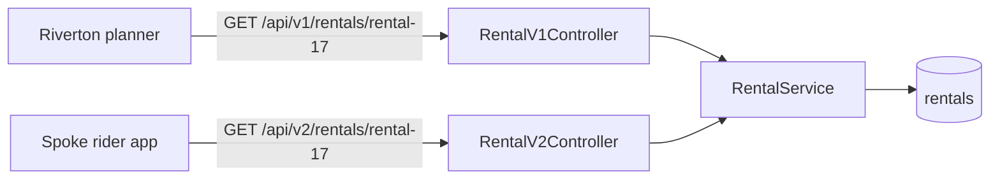

## Hook

Riverton's train station has a big departures board. Dozens of apps read it to tell riders when to leave home. Now imagine the railway renames the "Platform" column to "Track" overnight, without telling anyone. Every one of those apps shows a blank where the platform should be.

Riverton Transit wants to show Spoke bikes in its journey planner. Their code will read your API every few seconds. Meanwhile Spoke's own app team wants a new fare format. In this topic you learn to change an API without pulling the rug out from under the people who use it.

## Concept

### An API is a contract

A **contract** is a promise both sides rely on. Your API promises: "Send this request, and you get JSON of this shape and meaning." A **client** (or **consumer**) is any program that calls your API, such as Riverton's journey planner.

Here is what `GET /api/v1/rentals/rental-17` promises today:

```json
{ "id": "rental-17", "bikeId": "B-1042", "fareCents": 460 }
```

Riverton's developers write code that reads `fareCents` as a whole number of cents. Once that code ships, the field name, its type and its meaning are all part of your promise.

### Breaking and safe changes

A **breaking change** is any change that can make a working client fail.

| Change | Breaking? | Why |
|---|---|---|
| Remove or rename a field (`fareCents` to `fare`) | Yes | Clients look for the old name and find nothing |
| Change a field's type (`460` to `"4.60"`) | Yes | Code expecting a number gets text |
| Change a field's meaning (cents to dollars) | Yes | Nothing crashes, but every fare is now 100 times wrong |
| Add a new required input (`?city=` must be sent) | Yes | Old requests do not send it |
| Add a new optional field (`"minutes": 12`) | No | Clients that do not know it can skip it |
| Add a new endpoint (`GET /api/v1/stations`) | No | Nobody called it before |
| Add a new optional query parameter | No | Old requests still work without it |

```callout warning
A changed meaning is the sneakiest break. The JSON looks the same, the tests on your side pass, and Riverton shows riders a 46,000-cent fare.
```

### The tolerant reader

Adding a field is only safe if clients ignore fields they do not know. That habit is called the **tolerant reader**: read what you need, ignore the rest. Jackson 3, the JSON library Spring uses, reads this way by default.

```java run
import tools.jackson.databind.json.JsonMapper;

public class Main {
    record RentalV1(String id, String bikeId, long fareCents) { }

    public static void main(String[] args) {
        JsonMapper mapper = JsonMapper.builder().build();
        String newerJson = "{\"id\":\"rental-17\",\"bikeId\":\"B-1042\",\"fareCents\":460,\"minutes\":12}";
        RentalV1 rental = mapper.readValue(newerJson, RentalV1.class);
        System.out.println(rental);
    }
}
```

The server added `minutes`. The old client's record has no such field, and Jackson skips it quietly. That is why adding a field counts as safe.

### Versioning: path or header

When you must make a breaking change, you publish a new **version** of the API and keep the old one running. There are two common ways to say which version a request wants.

| Style | Example | Good | Not so good |
|---|---|---|---|
| In the URL path | `GET /api/v2/rentals/rental-17` | Visible in every link, log and browser. Easy to try. | The URL changes between versions |
| In a header | `GET /rentals/rental-17` with `API-Version: 2` | Same URL forever | Hidden: you cannot see it in a link, and it is easy to forget |

Spoke picks the path. Partners can paste a link into a browser and see which version they use. Logs and dashboards show the version for free. Spring Framework 7 can also route by a version header, through a `version` attribute on `@GetMapping`, but this course keeps to paths.

### Syntax: one controller per version

```java nocompile
@RestController
@RequestMapping("/api/v1/rentals")
public class RentalV1Controller { ... }

@RestController
@RequestMapping("/api/v2/rentals")
public class RentalV2Controller { ... }
```

`@RequestMapping` on the class puts a path prefix in front of every method inside it. Both controllers call the same `RentalService`. Only the JSON shape differs.



Running both side by side means Riverton keeps working on v1 while the app team moves to v2 today. The rules (prices, who owns which rental) live once, in the service, so the two versions never disagree.

### Deprecation and sunset

To **deprecate** something is to say: "This still works, but stop using it. It will go away." The day it goes away is its **sunset**. A good deprecation has three parts.

1. **Announce** it to people: email partners, add an entry to the **changelog** (the public list of what changed in each release) and a note in the docs. Say why, and which version to move to.
2. **Mark** every old response with headers, so even a forgotten script can notice.
3. **Wait** until the sunset date before you switch it off, and watch your logs to see who still calls it.

Two standard headers do the marking:

```http
HTTP/1.1 200 OK
Content-Type: application/json
Deprecation: @1793491200
Sunset: Wed, 30 Jun 2027 23:59:59 GMT
Link: <https://api.spoke.example/docs/v1-sunset>; rel="deprecation"

{"id":"rental-17","bikeId":"B-1042","fareCents":460}
```

- `Deprecation` (RFC 9745) says when the endpoint was deprecated. Its value is `@` and then the number of seconds since 1 January 1970 UTC.
- `Sunset` (RFC 8594) says when it will stop working. Its value is an HTTP date, always in GMT. RFC 9745 adds that the sunset must not be earlier than the deprecation date.
- `Link` with `rel="deprecation"` points humans to a page that explains the move.

```callout jargon
An **RFC** ("request for comments") is a numbered document that defines an internet standard, such as HTTP itself. Following one means any client in any language understands your headers.
```

Java can work out both header values for you:

```java run
import java.time.Instant;
import java.time.ZoneOffset;
import java.time.format.DateTimeFormatter;

public class Main {
    public static void main(String[] args) {
        Instant deprecatedAt = Instant.parse("2026-11-01T00:00:00Z");
        Instant sunsetAt = Instant.parse("2027-06-30T23:59:59Z");

        System.out.println("Deprecation: @" + deprecatedAt.getEpochSecond());
        System.out.println("Sunset: " + DateTimeFormatter.RFC_1123_DATE_TIME.format(sunsetAt.atOffset(ZoneOffset.UTC)));
    }
}
```

### Syntax: adding headers with ResponseEntity

```java nocompile
return ResponseEntity.ok()
        .header("Deprecation", "@1793491200")
        .header("Sunset", "Wed, 30 Jun 2027 23:59:59 GMT")
        .body(new RentalV1(rental.id(), rental.bikeId(), rental.fareCents()));
```

`ResponseEntity.ok()` starts a 200 response. Each `.header(name, value)` adds one header. `.body(...)` adds the JSON and finishes it.

### Error design with ProblemDetail

Errors are part of the contract too. Riverton's code must be able to tell "that rental does not exist" from "you sent a broken id", without reading English sentences.

```callout jargon
A **URI** is a name for something, written like a web address. In a problem, the `type` field below is a URI used mainly as an identifier. It is kind to put a help page at that address, but clients must not need to open it.
```

You met `ProblemDetail` earlier in this module. It follows RFC 9457, and each field has a job:

| Field | Job | Example |
|---|---|---|
| `type` | A URI that names the kind of problem. Client code checks this. It never changes. | `https://api.spoke.example/problems/rental-not-found` |
| `title` | A short human summary, the same for every problem of this type | `Rental not found` |
| `status` | The HTTP status code, repeated in the body | `404` |
| `detail` | A human explanation of this one occurrence | `No rental with id rental-99 exists.` |
| `instance` | Which request it happened on, usually the path | `/api/v2/rentals/rental-99` |
| extension fields | Extra data for code to use, named by you | `"rentalId": "rental-99"` |

### Syntax: a problem for each exception

```java nocompile
@RestControllerAdvice
public class ApiErrors {

    @ExceptionHandler(RentalNotFoundException.class)
    public ProblemDetail rentalNotFound(RentalNotFoundException ex, HttpServletRequest request) {
        ProblemDetail problem = ProblemDetail.forStatusAndDetail(HttpStatus.NOT_FOUND,
                "No rental with id " + ex.rentalId() + " exists.");
        problem.setType(URI.create("https://api.spoke.example/problems/rental-not-found"));
        problem.setTitle("Rental not found");
        problem.setInstance(URI.create(request.getRequestURI()));
        problem.setProperty("rentalId", ex.rentalId());
        return problem;
    }
}
```

- `@RestControllerAdvice` makes the handlers work for every controller, v1 and v2 alike.
- `forStatusAndDetail` sets `status` and `detail`.
- `setProperty` adds an extension field.
- Spring sends a returned `ProblemDetail` with `Content-Type: application/problem+json` and uses its status code.

If you leave out the title, Spring fills in the status name, such as `Not Found`. If you leave out the instance, Spring fills in the request path. Setting both yourself makes the contract plain to read.

The response Riverton gets:

```http
HTTP/1.1 404 Not Found
Content-Type: application/problem+json

{"detail":"No rental with id rental-99 exists.","instance":"/api/v2/rentals/rental-99","status":404,"title":"Rental not found","type":"https://api.spoke.example/problems/rental-not-found","rentalId":"rental-99"}
```

### An error catalog

An **error catalog** is a page in your docs that lists every problem type the API can return. Partners write one branch of code per row.

| type (after `/problems/`) | Status | Title | When | Extension fields |
|---|---|---|---|---|
| `rental-not-found` | 404 | Rental not found | The id looks right, but no such rental exists | `rentalId` |
| `invalid-rental-id` | 400 | Invalid rental id | The id does not look like `rental-17` | none |
| `bike-unavailable` | 409 | Bike unavailable | The bike is already rented or in maintenance | `bikeId`, `status` |
| `invalid-request` | 400 | Invalid request | A request body broke a rule, such as a missing field | `errors` |

```callout warning
Once a type URI is published, never rename it and never reuse it for a different problem. Partners match on it exactly. And never put stack traces or database messages in `detail`: they help attackers, not riders.
```

### OpenAPI: the contract written down

**OpenAPI** is a standard format for describing an HTTP API in one YAML or JSON file. It lists every path, its parameters, its responses and the shape of every JSON body.

```yaml
openapi: 3.1.0
info:
  title: Spoke Rentals API
  version: "2.0"
paths:
  /api/v2/rentals/{id}:
    get:
      summary: Get one rental
      parameters:
        - name: id
          in: path
          required: true
          schema: { type: string, pattern: "^rental-\\d+$" }
      responses:
        "200":
          description: The rental
          content:
            application/json:
              schema: { $ref: "#/components/schemas/RentalV2" }
        "404":
          description: No rental with this id
          content:
            application/problem+json:
              schema: { $ref: "#/components/schemas/Problem" }
components:
  schemas:
    RentalV2:
      type: object
      required: [id, bikeId, fare]
      properties:
        id: { type: string, example: rental-17 }
        bikeId: { type: string, example: B-1042 }
        fare:
          type: object
          properties:
            amountCents: { type: integer, example: 460 }
            currency: { type: string, example: USD }
    Problem:
      type: object
      properties:
        type: { type: string, format: uri }
        title: { type: string }
        status: { type: integer }
        detail: { type: string }
        instance: { type: string }
```

You rarely write this file by hand. Tools such as **springdoc-openapi** read your Spring controllers and generate it. **Swagger UI** turns it into a web page where partners can read the docs and try requests. Generators can even write client code for Riverton in their own language. None of these tools are in JavaQuest's setup, so this topic only reads the file.

```callout tip
Gojo says: put the OpenAPI file under version control. A pull request that changes it shows everyone, in one diff, exactly how the contract moved.
```

## Worked example

The app team wants fares to carry a currency, ready for Spoke's second city. Here is the safe way, step by step.

**Step 1. Keep v1 exactly as it is.** Riverton keeps calling it.

```http
GET /api/v1/rentals/rental-17 HTTP/1.1

HTTP/1.1 200 OK
Deprecation: @1793491200
Sunset: Wed, 30 Jun 2027 23:59:59 GMT
Content-Type: application/json

{"id":"rental-17","bikeId":"B-1042","fareCents":460}
```

**Step 2. Add v2 with the new shape.** The fare becomes an object, so v2 uses two records.

```java
record Fare(long amountCents, String currency) { }

record RentalV2(String id, String bikeId, Fare fare) { }
```

```http
GET /api/v2/rentals/rental-17 HTTP/1.1

HTTP/1.1 200 OK
Content-Type: application/json

{"id":"rental-17","bikeId":"B-1042","fare":{"amountCents":460,"currency":"USD"}}
```

**Step 3. Share the rules.** Both controllers call `rentals.find(id)`. The service throws `InvalidRentalIdException` for an id like `B-1042`, and `RentalNotFoundException` for `rental-99`.

**Step 4. Give both versions the same errors.** One `@RestControllerAdvice` turns each exception into its catalog entry, whichever version was called.

```http
GET /api/v1/rentals/B-1042 HTTP/1.1

HTTP/1.1 400 Bad Request
Content-Type: application/problem+json

{"detail":"B-1042 is not a rental id. Rental ids look like rental-17.","instance":"/api/v1/rentals/B-1042","status":400,"title":"Invalid rental id","type":"https://api.spoke.example/problems/invalid-rental-id"}
```

**Step 5. Announce and wait.** Email Riverton with the sunset date. Update the OpenAPI file and the catalog. Watch the logs for v1 calls until 30 June 2027.

## Try it

This program builds both versions and the error handler in memory, with no real web server, then sends four requests. Run it and compare the two JSON shapes.

Then try these changes, one at a time:

1. Add a field `int minutes` to `RentalV2` and pass `12`. That is a safe change: old v2 clients ignore it.
2. Request `/api/v2/rentals/rental-18` and `/api/v1/rentals/oops`.
3. In `Errors`, delete the `setTitle` line. Spring fills in `Not Found` instead.

```java run
import static org.springframework.test.web.servlet.request.MockMvcRequestBuilders.get;

import java.net.URI;
import java.util.Map;

import ch.qos.logback.classic.Level;
import ch.qos.logback.classic.Logger;
import jakarta.servlet.http.HttpServletRequest;
import org.slf4j.LoggerFactory;
import org.springframework.http.HttpStatus;
import org.springframework.http.ProblemDetail;
import org.springframework.http.ResponseEntity;
import org.springframework.test.web.servlet.MockMvc;
import org.springframework.test.web.servlet.setup.MockMvcBuilders;
import org.springframework.web.bind.annotation.ExceptionHandler;
import org.springframework.web.bind.annotation.GetMapping;
import org.springframework.web.bind.annotation.PathVariable;
import org.springframework.web.bind.annotation.RestController;
import org.springframework.web.bind.annotation.RestControllerAdvice;

public class Main {
    public static void main(String[] args) throws Exception {
        // Show only warnings from Spring's logs, so the answers below are easy to read
        ((Logger) LoggerFactory.getLogger(Logger.ROOT_LOGGER_NAME)).setLevel(Level.WARN);
        MockMvc mvc = MockMvcBuilders.standaloneSetup(new RentalsV1(), new RentalsV2())
                .setControllerAdvice(new Errors()).build();

        for (String path : new String[] {"/api/v1/rentals/rental-17", "/api/v2/rentals/rental-17",
                "/api/v2/rentals/rental-99", "/api/v1/rentals/B-1042"}) {
            var response = mvc.perform(get(path)).andReturn().getResponse();
            System.out.println("GET " + path + " -> " + response.getStatus() + " " + response.getContentType());
            if (response.getHeader("Sunset") != null) {
                System.out.println("  Deprecation: " + response.getHeader("Deprecation"));
                System.out.println("  Sunset: " + response.getHeader("Sunset"));
            }
            System.out.println("  " + response.getContentAsString());
        }
    }
}

record Rental(String id, String bikeId, long fareCents) { }

class NotFound extends RuntimeException {
    final String id;
    NotFound(String id) { this.id = id; }
}

class Store {
    static final Map<String, Rental> RENTALS = Map.of(
            "rental-17", new Rental("rental-17", "B-1042", 460),
            "rental-18", new Rental("rental-18", "B-2001", 415));

    static Rental find(String id) {
        Rental rental = RENTALS.get(id);
        if (rental == null) {
            throw new NotFound(id);
        }
        return rental;
    }
}

record RentalV1(String id, String bikeId, long fareCents) { }
record Fare(long amountCents, String currency) { }
record RentalV2(String id, String bikeId, Fare fare) { }

@RestController
class RentalsV1 {
    @GetMapping("/api/v1/rentals/{id}")
    public ResponseEntity<RentalV1> rental(@PathVariable("id") String id) {
        Rental r = Store.find(id);
        return ResponseEntity.ok()
                .header("Deprecation", "@1793491200")
                .header("Sunset", "Wed, 30 Jun 2027 23:59:59 GMT")
                .body(new RentalV1(r.id(), r.bikeId(), r.fareCents()));
    }
}

@RestController
class RentalsV2 {
    @GetMapping("/api/v2/rentals/{id}")
    public RentalV2 rental(@PathVariable("id") String id) {
        Rental r = Store.find(id);
        return new RentalV2(r.id(), r.bikeId(), new Fare(r.fareCents(), "USD"));
    }
}

@RestControllerAdvice
class Errors {
    @ExceptionHandler(NotFound.class)
    public ProblemDetail notFound(NotFound ex, HttpServletRequest request) {
        ProblemDetail problem = ProblemDetail.forStatusAndDetail(HttpStatus.NOT_FOUND,
                "No rental with id " + ex.id + " exists.");
        problem.setType(URI.create("https://api.spoke.example/problems/rental-not-found"));
        problem.setTitle("Rental not found");
        problem.setInstance(URI.create(request.getRequestURI()));
        problem.setProperty("rentalId", ex.id);
        return problem;
    }
}
```

```callout tip
Gojo says: B-1042 gives 404 here, because this small program has no id check. In your practice task, the service rejects it with a 400 invalid-rental-id problem instead.
```

## Recap

- An API is a contract. Removing, renaming or retyping a field, changing its meaning, or adding a required input breaks clients. New optional fields and new endpoints do not.
- Tolerant readers ignore unknown fields, which is what makes adding a field safe.
- Spoke versions in the path, `/api/v1` and `/api/v2`, with one service behind both.
- Deprecate by announcing, then marking responses with `Deprecation: @<seconds>` and `Sunset: <HTTP date>`, then waiting for the sunset.
- Errors are `application/problem+json` with a stable `type` URI per problem, listed in an error catalog. OpenAPI writes the whole contract down.

## Common mistakes

**1. Changing v1 in place.**

```java nocompile
record RentalV1(String id, String bikeId, Fare fare) { }   // was: long fareCents
```

Riverton's client still expects `fareCents`, and it now crashes on every rental:

```text
tools.jackson.databind.exc.MismatchedInputException: Cannot map `null` into type `long` (set `DeserializationFeature.FAIL_ON_NULL_FOR_PRIMITIVES` to 'false' to allow)
```

Fix: leave v1 alone. Put the new shape in v2 and deprecate v1.

**2. Returning a plain map from an error handler.**

```java nocompile
@ExceptionHandler(RentalNotFoundException.class)
public Map<String, String> notFound() {
    return Map.of("error", "Rental not found");
}
```

```text
HTTP/1.1 200 OK
Content-Type: application/json

{"error":"Rental not found"}
```

The status is 200, so clients think it worked, and there is no stable `type` to check. Fix: return a `ProblemDetail` with a status and a type URI.

**3. Putting the occurrence into the type.**

```java nocompile
problem.setType(URI.create(PROBLEMS + "rental-not-found/" + ex.rentalId()));
```

```text
"type": "https://api.spoke.example/problems/rental-not-found/rental-99"
```

Every missing rental now has its own type, so a client's check for `.../rental-not-found` never matches. Fix: keep `type` fixed per kind of problem. Put the id in `detail` and in an extension field.

**4. Writing the Sunset date in the wrong format.**

```java nocompile
.header("Sunset", "2027-06-30")
```

A client that parses HTTP dates, as Java's own parser does, rejects it:

```text
java.time.format.DateTimeParseException: Text '2027-06-30' could not be parsed at index 4
```

Fix: use an HTTP date in GMT, such as `Wed, 30 Jun 2027 23:59:59 GMT`. Build it with `DateTimeFormatter.RFC_1123_DATE_TIME`.
