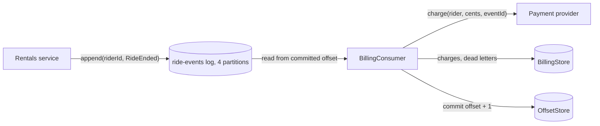

## The design

Today billing calls the rentals service for every ride that ends. When rentals is slow, billing is slow. When rentals is down, billing stops. The two services are tied together in time.

The new design cuts that tie. The rentals service appends one `RideEnded` event to the `ride-events` log when a ride ends. Billing reads the log at its own pace. If billing is busy or down, the events wait in the log, and billing catches up later.

```java nocompile
record RideEnded(String eventId, String rentalId, String riderId, String bikeId,
                 BikeType type, int minutes, long fareCents) { }
```

You met logs, partitions, consumer groups and the outbox in [Messaging and the outbox](/t/module-09-architecture/topic-04-messaging). Here you build a small log yourself, in memory, and the consumer that bills from it.



### Partitions and the key

One long list would be a bottleneck. So the log is split into **partitions**: separate lists that different consumers can read at the same time.

Every event has a **key**, and the key picks the partition. Billing uses the rider id as the key. So all of one rider's rides land in the same partition, in the order they happened. Order is kept inside a partition, never across partitions.

```callout jargon
A **partition** is one ordered part of a log. A **key** decides which partition an event goes to. Events with the same key always go to the same partition, so they stay in order.
```

### Syntax: Math.floorMod

```java nocompile
int partition = Math.floorMod(key.hashCode(), partitionCount);
```

`hashCode` can be negative. The `%` operator then gives a negative remainder, which is not a partition. `Math.floorMod` always gives a number from 0 to `partitionCount - 1` when `partitionCount` is positive.

```animate
title: Which partition does rider-31 go to?
kind: code
code: |
  String rider = "rider-31";
  int hash = rider.hashCode();
  System.out.println(hash);
  System.out.println(hash % 4);
  System.out.println(Math.floorMod(hash, 4));
steps:
  - line: 1
    vars: { rider: '"rider-31"' }
    say: Billing needs the partition for rider-31, in a log with 4 partitions.
  - line: 2
    vars: { hash: -1524846959 }
    say: The rider id's hashCode is a big negative number. That is allowed for a hash.
  - line: 3
    out: "-1524846959"
    say: Here it is, printed.
  - line: 4
    out: "-3"
    say: With %, a negative number gives a negative remainder. There is no partition -3.
  - line: 5
    out: "1"
    say: floorMod always lands from 0 to 3. rider-31 goes to partition 1, every time.
```

### Offsets and consumer groups

Each record in a partition has an **offset**: 0 for the first, then 1, 2, and so on. The log never deletes or changes a record. A consumer remembers how far it got by saving the offset of the next record it should read. Saving it is called a **commit**.

Offsets belong to a **consumer group**. Billing is the group `billing`. A later analytics service could read the same log as its own group, with its own offsets, without disturbing billing.

```callout jargon
**Lag** is how many records a group has not committed yet. It grows while billing is down and shrinks as it catches up. Teams put it on a dashboard.
```

### Commit after handling: at least once

The order of two lines decides what a crash does:

| Order | A crash in between means | Name |
|---|---|---|
| commit, then handle | the event is never handled: a lost charge | at most once |
| handle, then commit | the event is handled again after a restart | at least once |

Losing a rider's charge is a silent bug. Handling it twice can be made safe. So billing commits **after** handling, and makes handling safe to repeat.

```animate
title: Billing crashes before the commit
kind: scene
nodes:
  - { id: log, label: ride-events, emoji: "📜", value: "evt-1001 at offset 0", row: 0, col: 0 }
  - { id: billing, label: BillingConsumer, emoji: "🧾", value: "running", row: 0, col: 2 }
  - { id: bank, label: Payment provider, emoji: "🏦", value: "0 charges", row: 0, col: 4 }
  - { id: store, label: BillingStore, emoji: "🗄️", value: "processed: none", row: 1, col: 2 }
  - { id: offsets, label: OffsetStore, emoji: "🔖", value: "billing: 0", row: 1, col: 4 }
steps:
  - say: Billing's committed offset is 0, so it reads evt-1001.
    send: { from: log, to: billing, label: "evt-1001" }
  - say: It charges rider-7 460 cents and saves the charge. evt-1001 is now marked processed.
    send: [{ from: billing, to: bank, label: "charge 460, key evt-1001" }, { from: billing, to: store, label: "save charge" }]
    set: { bank: "1 charge", store: "processed: evt-1001" }
  - say: The server dies before the commit. The offset is still 0.
    set: { billing: "crashed" }
    focus: [offsets]
  - say: A new billing consumer starts. The committed offset is 0, so evt-1001 comes again.
    send: { from: log, to: billing, label: "evt-1001 again" }
    set: { billing: "restarted" }
  - say: The store says evt-1001 is already processed. Billing skips the charge.
    send: { from: billing, to: store, label: "processed?" }
    focus: [store]
  - say: Now it commits offset 1. Rider-7 paid exactly once.
    send: { from: billing, to: offsets, label: "commit 1" }
    set: { offsets: "billing: 1" }
```

### The idempotent consumer

```callout jargon
An operation is **idempotent** when doing it twice has the same effect as doing it once. An **idempotent consumer** remembers which events it already handled, and skips them when they come again.
```

The memory must outlive the consumer, so it lives in billing's database, `BillingStore`, not in a field of `BillingConsumer`. A real database saves the charge row and the "processed" mark in one transaction, so they never disagree.

There is still one gap: a crash after the bank charged, but before the store saved. So billing also sends the event id to the payment provider as an **idempotency key**. The provider charges at most once per key, as you saw in [REST design](/t/module-08-backend/topic-02-rest-design).

### Poison events and the dead-letter queue

Some events can never succeed. An event whose fare breaks the fare rule is a bug in the rentals service. Retrying it changes nothing. If billing stopped there, every later ride in that partition would wait forever.

```callout jargon
A **poison event** is one that fails every time it is handled. A **dead-letter queue** (DLQ) is a place to park such events, with the reason, so a person can look at them while the rest keeps flowing.
```

The fare rule is the shared one: 100 cents to unlock, plus CLASSIC 15, EBIKE 30 or CARGO 25 cents per minute.

### Retries, then give up

A payment can fail for a moment: a bank timeout. That is worth retrying. Billing tries a charge up to 3 times. If all 3 fail, the ride goes to the dead-letter queue, and billing moves on to the next record.

In production you wait between attempts, with backoff and jitter, as in [Resilience](/t/module-09-architecture/topic-09-resilience). Here the retries happen at once, so the checks stay fast.

```callout warning
Never put a failed event back at the end of the log to "try later". Rider-7's next ride would then be charged before the failed one, and the order inside the partition is broken.
```

## What you build

Everything is in package `jq.m09.feature` and runs on one thread. Follow the numbered TODOs; the README lists every rule the checks test.

1. **`Fares.expectedCents(type, minutes)`** (TODO 1): the shared fare rule.
2. **`EventLog`** (TODOs 2 to 6): `new EventLog(partitionCount)`, `partitionFor(key)`, `append(key, event)` returning the offset, `read(partition, fromOffset, max)` and `endOffset(partition)`. A bad partition number throws `IllegalArgumentException`.
3. **`OffsetStore`** (TODO 7): `committed(group, partition)`, 0 by default, and `commit(group, partition, nextOffset)`.
4. **`BillingConsumer`** (TODOs 8 to 11): `poll(maxPerPartition)` handles, then commits. `handle(ride)` skips processed events, dead-letters a wrong fare, and charges with up to 3 attempts before it dead-letters.
5. **`BillingStore.statement(riderId)`** (TODO 12): the rider's total charged cents and number of charged rides, for the billing page.

The rides in the checks:

| Event | Rider | Ride | Fare in the event | Fare rule |
|---|---|---|---|---|
| evt-1001 | rider-7 | EBIKE, 12 min | 460 | 100 + 30 × 12 = 460 |
| evt-1002 | rider-8 | CLASSIC, 20 min | 400 | 100 + 15 × 20 = 400 |
| evt-1003 | rider-7 | CARGO, 10 min | 350 | 100 + 25 × 10 = 350 |
| evt-1004 | rider-7 | EBIKE, 10 min | 350 | 100 + 30 × 10 = 400, so it is dead-lettered |
| evt-1005 | rider-7 | CLASSIC, 4 min | 160 | 100 + 15 × 4 = 160 |

## Recap

- An event log lets billing react to `RideEnded` at its own pace, so it keeps working when rentals is busy and catches up later.
- The key picks the partition with `Math.floorMod(key.hashCode(), n)`. Keying by rider id keeps each rider's rides in order.
- Commit the offset only after handling the event. That gives at-least-once delivery, so handling must be idempotent, by event id.
- Poison events and payments that keep failing go to a dead-letter queue, so one bad event never blocks the partition.

## Common mistakes

**1. Using `%` to pick the partition.**

```java nocompile
int partition = key.hashCode() % partitions.size();
```

For `rider-31` this gives -3, and the log crashes:

```text
java.lang.IndexOutOfBoundsException: Index -3 out of bounds for length 4
```

Use `Math.floorMod(key.hashCode(), partitions.size())`.

**2. Committing before handling.** A crash between the two lines skips the event for good, and the rider is never charged. Handle first, then commit.

**3. Committing `record.offset()` instead of `record.offset() + 1`.** The committed offset is the next record to read. Commit the record's own offset, and the last event is read again on every poll. The idempotency check hides the double charge, but the lag never reaches 0.

**4. Remembering processed events in a field of `BillingConsumer`.** A crash starts a new consumer with an empty memory, and the redelivered event charges the rider again. Ask the `BillingStore`, which survives the crash.

**5. Retrying forever.** A card that always fails then blocks every later ride in its partition. Stop after `MAX_ATTEMPTS`, dead-letter the ride, and move on.
