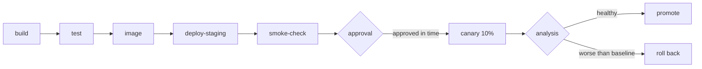

## The design

Today a release of `spoke-api` follows a wiki page with 14 steps. Someone builds, tests, pushes the image and deploys to staging. They click around and ask in chat "OK to ship?". Then they shift some traffic, stare at a dashboard, and decide. Each step is done by hand, so each one can be skipped or done wrong.

Jiraiya wants one button. You build the engine behind it: a small **deployment pipeline** that runs every step the same way, every time.

```callout jargon
A **deployment pipeline** is an ordered list of **stages** that takes a change from code to production. A **gate** is a stage that decides whether the run may go on: a test result, a person's approval, or a health check.
```



You saw the same idea as GitHub Actions jobs in [GitHub Actions](/t/module-09a-platform/topic-03-github-actions). Here you build the engine yourself, so you see every decision a real one makes.

### Pipeline as code

The steps live in a YAML file in the repository, not on a wiki. A change to the pipeline is a pull request, so it is reviewed, versioned and can be rolled back like any other code.

The engine checks the whole file **before** it runs anything. A typo in stage 8 should fail in the first second, not after a 10-minute build. That is the fail-fast idea from [Validation](/t/module-08-backend/topic-06-validation), applied to configuration.

```callout jargon
**Pipeline as code** means the pipeline's steps are written in a file that lives with the code, instead of being clicked together in a tool or written on a wiki.
```

### Syntax: reading YAML with SnakeYAML

```java nocompile
Object root = new Yaml(new SafeConstructor(new LoaderOptions())).load(yaml);
if (!(root instanceof Map<?, ?> top)) { throw new PipelineException("..."); }
if (!(top.get("stages") instanceof List<?> stages) || stages.isEmpty()) { throw new PipelineException("..."); }
```

SnakeYAML turns a YAML map into a `Map` and a list into a `List`. It turns `10` into an `Integer`, `0.5` into a `Double`, and text into a `String`. `SafeConstructor` only ever makes those plain types. In SnakeYAML 1.x, a plain `new Yaml()` could be told by the file to build other Java objects, a real security hole (CVE-2022-1471). Version 2 blocks those tags by default. `SafeConstructor` still states your intent, and stays safe if someone loosens the `LoaderOptions`. Bad YAML throws a `YAMLException`.

### Stages run in order, only after success

The engine is simple at heart. It walks the stages in order. Each one runs only if every stage before it succeeded. One failure stops the run, and every later stage stays `PENDING`.

The engine decides **when** a stage runs. A `StageExecutor` knows **how**: run Maven, push to `ghcr.io/spoke/spoke-api`, call `kubectl`. That split lets the checks hand in a fake executor, as in [Mockito](/t/module-06-craft/topic-09-mockito), and it lets Spoke swap tools without touching the engine.

An executor that throws counts as a failed stage. The engine must never crash half-way, because then nobody knows which stages ran.

### The approval gate

Some changes need a person to say yes before real riders see them. The approval gate pauses the run. The engine writes down when it asked, and the run waits until someone approves.

Approvals **expire**. Kakashi approved at 10:00 because staging looked fine at 10:00. At 14:00 that yes is stale: other changes may have landed, and the on-call person may have gone home. So an approval that comes at or after the deadline fails the run instead.

```callout jargon
An **approval gate** is a pipeline stage that waits for a named person to approve. GitHub calls this a **required reviewer** on an environment.
```

### Canary analysis

The canary gets 10% of real traffic. Then the engine compares it with the **baseline**: the old version, over the same minutes. It compares two numbers, the error rate and the p99 latency, from [Observability](/t/module-09-architecture/topic-08-observability).

Why compare with the baseline, not with a fixed number? If the payment provider is slow for everyone, both versions look bad. Only a canary that is worse than the old version, at the same moment, is the new code's fault.

```animate
title: The canary decides for itself
kind: scene
nodes:
  - { id: lb, label: Load balancer, emoji: "🔀", row: 0, col: 2 }
  - { id: old, label: "2.6.0 baseline", emoji: "🟦", value: "90%", row: 1, col: 1 }
  - { id: can, label: "2.7.0 canary", emoji: "🟩", value: "10%", row: 1, col: 3 }
  - { id: eng, label: Pipeline engine, emoji: "⚙️", value: "analysing", row: 2, col: 2 }
steps:
  - say: After approval, the canary stage sends 10% of riders to 2.7.0. The rest stay on 2.6.0.
    send: [{ from: lb, to: old, label: "90%" }, { from: lb, to: can, label: "10%" }]
  - say: The analysis stage reads both versions' numbers over the same minutes.
    send: [{ from: old, to: eng, label: "1.0% errors, 200 ms" }, { from: can, to: eng, label: "1.75% errors, 210 ms" }]
  - say: The canary's error rate is 0.75 points above the baseline. The limit in the YAML is 0.5.
    set: { eng: "CANARY_FAILED" }
    focus: [eng]
  - say: The engine rolls back on its own. All traffic goes back to 2.6.0, and promote never runs.
    send: { from: eng, to: lb, label: "roll back canary" }
    set: { can: "removed", old: "100%", eng: "ROLLED_BACK" }
  - say: Every step went into the audit log, with the time. Nobody had to watch a dashboard at 18:00.
    focus: [eng]
```

### Comparing numbers at the boundary

The rule says "at most 20% slower". So a canary exactly 20% slower passes, and one millisecond more fails. Decimals make that edge slippery:

```animate
title: Why the p99 check uses whole numbers
kind: code
code: |
  double baseline = 1.0;
  double canary = 1.3;
  double limit = 0.3;
  System.out.println(canary - baseline);
  System.out.println(canary - baseline > limit);
  long p99 = 241;
  System.out.println(p99 * 100 > 200 * (100 + 20));
steps:
  - line: 1
    vars: { baseline: '1.0' }
    say: The baseline's error rate is 1.0%.
  - line: 2
    vars: { canary: '1.3' }
    say: The canary's is 1.3%, exactly 0.3 points more.
  - line: 3
    vars: { limit: '0.3' }
    say: The limit is 0.3 points, so this canary should pass.
  - line: 4
    out: "0.30000000000000004"
    say: A double cannot hold 1.3 exactly, so the difference comes out a tiny bit too big.
  - line: 5
    out: "true"
    say: '"More than the limit" says true. A canary exactly at the limit would be rolled back.'
  - line: 6
    vars: { p99: 241 }
    say: Latency is a whole number of milliseconds, so it can stay exact.
  - line: 7
    out: "true"
    say: Multiply both sides by 100 instead of dividing. 24,100 is more than 24,000, so 241 ms fails, with no rounding at all.
```

The checks use error rates that subtract exactly, such as 1.5 − 1.0. Real tools store error rates as whole counts, or allow a tiny tolerance.

### The audit log

When a release goes wrong, the first questions are: who approved it, when, and why did the canary pass? The engine writes every decision to an **audit log**. Each entry holds the time from the clock, the stage, the decision, and a detail, such as the approver's name.

```callout jargon
An **audit log** is a record of who did what, and when, that is only ever added to. Teams use it to answer "what happened?" after an incident, and auditors use it to check that rules were followed.
```

### Resume, not restart

A run fails at `smoke-check` because staging had a hiccup. Starting again from `build` wastes 10 minutes, and it might build a different image if anything changed. So a failed run can be **resumed**: it runs the failed stage again, and skips every stage that already succeeded.

```callout jargon
An operation is **idempotent** when doing it again changes nothing more. Resume is safe to press twice, because a stage that succeeded is never run again.
```

A run that was **rolled back** cannot be resumed. The canary showed the new code is worse, so running analysis again would not help. The fix ships in a new run.

## What you build

Everything is in package `jq.m11.feature`. Follow the numbered TODOs; the README lists every rule the checks test.

1. **`CanaryAnalysis.evaluate`** (TODO 4): error rate first, then p99, exactly at a limit passes. It needs no other class, so it is a good first step.
2. **`PipelineLoader.load`** (TODOs 1 to 3): parse safely, check every level, and throw a `PipelineException` that names the stage and the key.
3. **`PipelineEngine`**: moving a run forward (TODOs 5 to 8), `approve` with expiry (TODO 9), and `resume` (TODO 10). Write every decision with `run.record(...)`.

| Class | What it is |
|---|---|
| `Stage(name, type, canaryPercent, approvalMinutes, maxErrorRateIncrease, maxP99IncreasePercent)` | one stage; make it with `Stage.of`, `canary`, `approval` or `analysis` |
| `Pipeline(name, stages)` | `stage(name)`, and `canaryBefore(stage)` for the rollback |
| `StageExecutor` | `execute(stage)` returns a `StageResult`; `rollBack(canary)` |
| `MetricsSource` | `baseline()` and `canary()`, each a `Metrics(errorRatePercent, p99Millis)` |
| `PipelineRun` | `status()`, `stageStatus(name)`, `audit()`, `approvalRequestedAt()` |
| `AuditEntry(at, stage, decision, detail)` | one line of the audit log; `Decision` lists every kind |

## Recap

- A pipeline is an ordered list of stages kept as code. Check the whole file before anything runs, so a typo fails in a second, not after the build.
- Each stage runs only if every stage before it succeeded. An executor that throws is a failed stage, not a crashed engine.
- An approval gate pauses the run, and an approval expires: at or after the deadline it fails the run.
- Canary analysis compares the canary with the baseline over the same minutes, then promotes or rolls back on its own. Exactly at a limit passes.
- Every decision goes to an audit log with the time. A failed run resumes from the failed stage and never repeats a stage that succeeded.

## Common mistakes

**1. Checking the YAML while the run goes along.** A bad `percent` in the canary stage then shows up only 10 minutes in, after build, test and staging. The loader checks miss it entirely. Fix: check every stage in `load`, before anything runs.

**2. Using a plain `new Yaml()`.** It works on the checks, and SnakeYAML 2 blocks the old trick of building other Java objects by default. But in 1.x that trick was a real security hole, CVE-2022-1471, and a loosened `LoaderOptions` can bring it back. Fix: `new Yaml(new SafeConstructor(new LoaderOptions()))`, which says plainly that only plain types are wanted.

**3. Checking expiry with `isAfter`.**

```java nocompile
if (now.isAfter(deadline)) { /* expired */ }   // exactly at 11:00 is still "fine"
```

Symptom: the check "an approval at or after the expiry fails the run" fails at exactly 11:00. Fix: expired when `!now.isBefore(deadline)`.

**4. Resuming from the start.** Symptom: "build already succeeded, so resume must not run it again". Fix: `advance` skips every stage that is already `SUCCEEDED`, so resume only resets the failed stage to `PENDING`.

**5. Letting the executor's exception escape.**

```java nocompile
StageResult result = executor.execute(stage);   // a registry timeout crashes the engine mid-run
```

Symptom: "start() must catch an exception from the executor and fail the stage". The run is left `RUNNING` with nothing in the audit log. Fix: catch `RuntimeException`, and treat it as a failed stage with the message as its detail.

**6. Rolling back the wrong stage, or not at all.** Writing `CANARY_FAILED` is not enough: real riders are still on the canary. Call `executor.rollBack(pipeline.canaryBefore(stage))`, write `ROLLED_BACK` for the canary stage, and never run promote.
