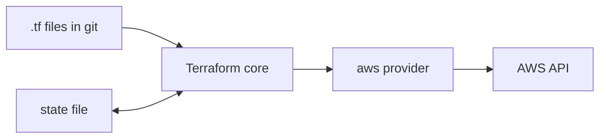

## Hook

Two bike stations were built from the same plan. Months later, one has 12 docks and the other has 14. Somebody added two docks one afternoon, and nobody wrote it down. Now the rebalancing trucks keep getting the numbers wrong, and nobody remembers why the stations differ.

That is Spoke's cloud today. Staging and prod were meant to be twins. Then someone clicked a change into the cloud console, and now a change that works in staging breaks prod. This ticket puts the plan for every database, bucket and queue into code, in git, where every change is written down.

## Concept

### Click-ops and snowflake servers

A **cloud console** is the website where you create databases, networks and servers by clicking. It is great for learning. For running a business, it has four problems:

- **No record.** Nobody can see who changed the database size, when, or why.
- **No review.** A click goes live at once. Nobody checks it first, the way a pull request is checked.
- **No repeat.** Building a third environment, or a second city, means clicking it all again, and missing a step.
- **Drift.** Environments that started the same slowly stop being the same.

```callout jargon
**Click-ops** means running infrastructure by hand in a web console. A **snowflake server** is a machine changed by hand so often that nobody could rebuild it exactly: like a snowflake, no two are the same.
```

**Infrastructure** means everything your code runs on: networks, servers, databases, buckets, queues, DNS names and access rules.

### Infrastructure as code

**Infrastructure as code** (IaC) means describing that infrastructure in text files, keeping them in git, and letting a tool make the cloud match them.

Everything you learned about code now applies to infrastructure:

| Code habit | What it gives infrastructure |
|---|---|
| Git history | who changed what, when and why, for every database and bucket |
| Pull requests | a teammate reviews a change before it touches prod |
| Reuse | one module builds staging, prod, and later Bramford |
| CI | checks and plans run on every change, like tests |
| Revert | a bad change is undone the same way it was made |

The best-known IaC tool is **Terraform**. Others work the same way: OpenTofu (an open-source fork of Terraform), Pulumi (infrastructure in real programming languages), and AWS CloudFormation.

### Declarative versus imperative

There are two ways to tell a computer what to build.

**Imperative**: give the steps. "Create a database. Then make it bigger. Then add a backup." Run that script twice, and you may get two databases, or an error.

**Declarative**: describe the result. "There is one Postgres database called `spoke-rides-prod`, size large, with backups." The tool compares that with what exists and works out the steps itself.

```callout jargon
**Idempotent** means doing it twice has the same effect as doing it once. Applying a declarative file a second time changes nothing, because the world already matches.
```

You have seen this before. A Kubernetes Deployment is declarative, and its controllers close the gap (the desired-state card in [Running on Kubernetes](/t/module-09-architecture/topic-10-kubernetes)). Terraform brings the same idea to the cloud underneath the cluster.

### Terraform in one picture

Terraform has three parts:

- **Configuration**: `.tf` files written in **HCL**, HashiCorp Configuration Language. They say what should exist.
- **Providers**: plug-ins that know how to talk to one platform's API. The `aws` provider creates AWS things; others handle Google Cloud, Azure, GitHub, Kubernetes, DNS companies and hundreds more.
- **State**: a file that remembers which real objects Terraform manages. It gets its own cards below.



Terraform core reads the code and the state, works out a plan, and asks the provider to make the API calls.

### Syntax: providers and resources

```hcl
terraform {
  required_providers {
    aws = {
      source  = "hashicorp/aws"
      version = "~> 6.0"            # any 6.x, never 7.0
    }
  }
}

provider "aws" {
  region = "eu-west-1"
}

resource "aws_s3_bucket" "receipts" {
  bucket = "spoke-receipts-prod"
}
```

A **resource** block is one thing that should exist. It has two labels: the **type** (`aws_s3_bucket`, defined by the provider) and a **local name** (`receipts`, your choice). Together they make the resource's **address**: `aws_s3_bucket.receipts`. Inside the braces are its **arguments**: the settings.

The `version` line pins the provider, like a dependency version in `pom.xml`. `terraform init` writes the exact versions it chose into `.terraform.lock.hcl`. Commit that file, so everyone runs the same provider.

### References build the dependency graph

Resources refer to each other with `type.name.attribute`:

```hcl
resource "aws_security_group" "rides_db" {
  name = "spoke-rides-db"
}

resource "aws_db_instance" "rides" {
  identifier                  = "spoke-rides-prod"
  engine                      = "postgres"
  instance_class              = "db.m6g.large"
  allocated_storage           = 100
  username                    = "spoke"
  manage_master_user_password = true
  vpc_security_group_ids      = [aws_security_group.rides_db.id]
}
```

`aws_security_group.rides_db.id` is only known once the group exists. So Terraform knows the database must wait for the group. From all the references it builds a **dependency graph**, then creates things in order, and unrelated things in parallel. It is the same graph idea as `needs:` in [GitHub Actions in depth](/t/module-09a-platform/topic-03-github-actions), but Terraform finds the arrows itself.

Order in the file does not matter. Only the references do.

### Variables, outputs and data sources

Hard-coding `"spoke-rides-prod"` makes the code good for one environment only. **Input variables** make it reusable:

```hcl
variable "environment" {
  type        = string
  description = "dev, staging or prod"
}

variable "db_size" {
  type    = string
  default = "db.m6g.large"
}

resource "aws_db_instance" "rides" {
  identifier     = "spoke-rides-${var.environment}"
  instance_class = var.db_size
  # ...
}

output "rides_db_endpoint" {
  value = aws_db_instance.rides.endpoint
}
```

- **Variables** come from a `.tfvars` file, the command line, or `TF_VAR_` environment variables: `environment = "staging"`.
- **Outputs** print values after an apply, and other configurations can read them, such as the database address the app needs.
- A **data source** reads something that exists but is not managed here. Examples: the newest approved machine image, or a network another team owns:

```hcl
data "aws_vpc" "main" {
  tags = { Name = "spoke-main" }
}
```

A `resource` says "make this exist". A `data` block says "look this up".

### The workflow: init, plan, apply, destroy

```bash
terraform init       # download providers, connect to the state backend
terraform fmt        # format the files
terraform validate   # check the syntax and the types
terraform plan       # show what would change, change nothing
terraform apply      # show the plan again, ask "yes", then make the changes
terraform destroy    # plan to delete everything this configuration manages
```

`plan` is the heart of Terraform. It compares three things: the code, the state, and the real objects it reads back from the cloud. Then it lists exactly what it would create, change or delete.

`terraform plan -out=tfplan` saves the plan to a file. `terraform apply tfplan` then applies **exactly** that plan, without asking again. That matters in CI: the plan a reviewer read is the plan that runs.

### Reading a plan

Terraform prints a plan like this (trimmed, with long ids shortened):

```text
Terraform will perform the following actions:

  # aws_db_instance.rides will be updated in-place
  ~ resource "aws_db_instance" "rides" {
        identifier     = "spoke-rides-prod"
      ~ instance_class = "db.m6g.large" -> "db.m6g.xlarge"
        # (38 unchanged attributes hidden)
    }

  # aws_s3_bucket.receipts must be replaced
-/+ resource "aws_s3_bucket" "receipts" {
      ~ bucket = "spoke-receipts" -> "spoke-receipts-prod" # forces replacement
        # (9 unchanged attributes hidden)
    }

Plan: 1 to add, 1 to change, 1 to destroy.
```

| Symbol | Meaning |
|---|---|
| `+` | create |
| `-` | destroy |
| `~` | update in place: the object stays, a setting changes |
| `-/+` | **replace**: destroy, then create a new one |
| `<=` | read a data source |

Read every `-` and `-/+` twice. Some settings cannot change in place: a bucket cannot be renamed, so a new name means delete and recreate. On a bucket of receipts or a database of rides, "replace" means "lose the data". The line `# forces replacement` names the setting to blame.

### The state file

Code says `aws_db_instance.rides`. AWS knows the database as `spoke-rides-prod`, with its own internal id. The **state file**, `terraform.tfstate`, connects the two. It is JSON, and for every resource it stores the address, the real object's id, and every attribute Terraform last saw.

Without state, Terraform could not tell "this database is mine, and its size changed" from "this is someone else's database". State lets it:

- map each address in the code to one real object;
- spot a resource deleted from the code, and plan to destroy the real one;
- know the dependency order for deleting things;
- avoid reading every attribute of every object on every run, on big setups.

Things in the cloud that are not in state are invisible to Terraform. It never touches them, and never warns about them.

### Remote state and locking

By default the state is a local file on one laptop. That breaks the moment two people use it: each has a different copy, and each plans against stale facts.

So teams keep state in a **remote backend**: shared storage that everyone, and CI, reads and writes.

```hcl
terraform {
  backend "s3" {
    bucket       = "spoke-terraform-state"
    key          = "prod/core.tfstate"
    region       = "eu-west-1"
    encrypt      = true
    use_lockfile = true             # take a lock while planning and applying
  }
}
```

A **state lock** stops two applies at once. While Tsunade's apply runs, Kakashi's waits or fails with an error about acquiring the state lock. Without a lock, both could write the state at the same moment and corrupt it. Google Cloud Storage and HCP Terraform lock on their own; older S3 setups used a DynamoDB table for the lock.

Turn on versioning in the state bucket too. Then a broken state can be rolled back to yesterday's copy.

### State traps: never hand-edit, secrets live in state

**Never edit the state file by hand.** One wrong id and Terraform may plan to destroy a real database, or lose track of it. Use the commands built for it:

| Need | Command |
|---|---|
| A resource was renamed in code | a `moved` block, or `terraform state mv` |
| Stop managing something, without deleting it | a `removed` block, or `terraform state rm` |
| Start managing something that exists | an `import` block, or `terraform import` |

**Secrets end up in state.** The state stores every attribute in plain text, including a database password set in code. Marking a variable `sensitive = true` only hides it from the screen, not from the state file.

So: encrypt the state backend, let very few people and jobs read it, and never commit `terraform.tfstate` to git. Better still, keep the secret out of Terraform entirely. `manage_master_user_password = true` in the database example lets AWS create the password and keep it in its own secret store. Recent Terraform versions also offer write-only arguments for some resources, which never reach state.

### Drift: when reality wanders

**Drift** is a difference between the code and the real world, made outside Terraform. Someone clicked "Modify" in the console. A script changed a setting. A support engineer opened a port during an incident.

`terraform plan` reads the real objects first, so it shows drift as a change it would make to put things back:

```animate
title: A console click becomes drift
kind: scene
nodes:
  - { id: git, label: "Code in git", emoji: "📄", value: "db.m6g.large" }
  - { id: tf, label: Terraform, emoji: "🧭", value: idle, col: 1 }
  - { id: db, label: "Prod database", emoji: "🗄️", value: "db.m6g.large", col: 2 }
  - { id: console, label: "Cloud console", emoji: "🖱️", row: 1, col: 2 }
steps:
  - say: Code, state and the real database all say db.m6g.large. A plan would show no changes.
    focus: [git, db]
  - say: During a busy weekend, someone clicks Modify in the console and picks a bigger size.
    send: { from: console, to: db, label: "Modify size" }
    set: { db: "db.m6g.xlarge" }
  - say: Nobody updates the code. The two environments are no longer twins, and git does not know.
    focus: [git]
  - say: The next terraform plan reads the real database and sees xlarge where the code says large.
    send: { from: tf, to: db, label: "read" }
    set: { tf: "1 to change" }
  - say: The plan shows ~ instance_class "db.m6g.xlarge" -> "db.m6g.large". Drift is visible at last.
    focus: [tf]
  - say: Now the team decides. Was the click right? Put xlarge in the code. Was it wrong? Apply, and the code wins.
    set: { tf: "decided in a PR" }
```

Never blindly apply drift away. The click may have stopped an outage, and shrinking the database back could start one. Find out why, then make the code say what is right.

`terraform plan -refresh-only` shows only the drift, without proposing any changes. Many teams run a plan every night and alert when it is not empty. That is how drift is caught in days instead of months.

### Modules: reusable building blocks

A **module** is a folder of `.tf` files with variables going in and outputs coming out. It is to Terraform what a method is to Java.

```hcl
module "rides_db" {
  source         = "../modules/postgres"     # a folder, a git URL or a registry name
  name           = "spoke-rides-${var.environment}"
  instance_class = var.environment == "prod" ? "db.m6g.large" : "db.t4g.medium"
  backups_days   = var.environment == "prod" ? 14 : 1
}

output "rides_db_endpoint" {
  value = module.rides_db.endpoint
}
```

The `postgres` module holds Spoke's rules once: encryption on, backups on, no public access. Every environment and every city uses it, so they cannot forget a rule. Version shared modules like libraries: `source = "git::https://github.com/spoke/tf-modules.git//postgres?ref=v1.4.0"`.

Keep modules small and focused. A module that builds "everything" ends up with fifty variables and nobody dares to change it.

### Environments: workspaces or directories

Spoke has `dev`, `staging` and `prod`. Each needs its own state, or a staging apply could change prod. Two common layouts:

**Workspaces**: one folder of code, several states. `terraform workspace select staging` switches state, and the code can read `terraform.workspace`.

**Separate directories**: one small folder per environment, each calling the same modules with its own values and its own backend key.

```text
infra/
  modules/
    postgres/
    service/
  envs/
    staging/main.tf     # module "rides_db" { ... instance_class = "db.t4g.medium" }
    prod/main.tf        # module "rides_db" { ... instance_class = "db.m6g.large" }
```

Most teams pick directories for long-lived environments like staging and prod. Every difference is visible in code. Each folder can use a different backend, cloud account and access rules, so a staging credential cannot touch prod. Workspaces suit short-lived copies, such as one environment per feature branch.

### Bringing existing things in: import

Spoke's prod database was clicked into existence two years ago. Writing a `resource` block for it is not enough. Terraform would plan to **create** a second one, because the state does not know the old one.

An `import` block adopts it:

```hcl
import {
  to = aws_db_instance.rides
  id = "spoke-rides-prod"
}
```

The next plan says it will import the database. Write the `resource` block to match the real settings, or let `terraform plan -generate-config-out=generated.tf` draft it for you. Then plan until it shows no changes. A clean plan means the code describes reality exactly. Only then is the database safely under Terraform.

### lifecycle: prevent_destroy and friends

Some resources must never be deleted by accident. A `lifecycle` block changes how Terraform treats one resource:

```hcl
resource "aws_db_instance" "rides" {
  # ...
  lifecycle {
    prevent_destroy = true         # any plan that would destroy this fails
  }
}
```

| Setting | What it does |
|---|---|
| `prevent_destroy = true` | the plan stops with an error instead of deleting or replacing this resource |
| `create_before_destroy = true` | for a replacement, build the new one first, then delete the old one |
| `ignore_changes = [tags]` | stop treating changes to these arguments as drift, when something else owns them |

`prevent_destroy` only guards against plans made from code that still has the block. Delete the resource block, and the guard goes with it. So pair it with cloud-side protection too, such as `deletion_protection = true` on the database.

### Plans in pull requests

Infrastructure changes follow the same path as code changes:

1. Open a pull request with the `.tf` change.
2. CI runs `fmt`, `validate`, the policy checks, and `terraform plan`. It posts the plan as a comment.
3. A reviewer reads the **plan**, not just the code. One renamed argument can turn into `-/+` on a database.
4. After merge, CI applies the saved plan for that environment. Prod waits for an approval, like the prod environment in the release pipeline.

CI gets cloud access through OIDC, as in the GitHub Actions ticket, so no cloud key is stored in GitHub. Once this works, nobody needs write access in the console at all. Give people read-only access, plus an emergency role that pages the team when used.

### Immutable infrastructure versus patching

There are two ways to change a running server.

**Patching** (mutable): log in, or run a script, to upgrade packages and edit files in place. Over months, every server collects its own history of changes. They drift into snowflakes.

**Immutable**: never change a running server. Build a new image with the change, start new servers from it, move traffic over, and delete the old ones. You already do this with containers: a new version is a new image tagged with its version and commit, such as `2.6.0-3f9c2b7a1d4e`, never a container edited by hand.

```callout analogy
Patching is repainting a bike while someone rides it. Immutable is rolling a freshly built bike into the dock and taking the old one away.
```

Immutable infrastructure makes every server match its image exactly, and makes rollback simple: start the old image again. Terraform's `-/+` replacement and Kubernetes rolling updates are both immutable thinking.

### GitOps: the cluster pulls from git

Terraform builds the cloud: networks, databases, the Kubernetes cluster itself. What runs **inside** the cluster changes many times a day. **GitOps** handles that part.

With **GitOps**, a git repository holds the desired state of the cluster: every manifest, Helm chart or Kustomize overlay (see [Helm and Kustomize](/t/module-09a-platform/topic-05-helm-kustomize)). An agent **inside** the cluster, such as **Argo CD** or **Flux**, keeps comparing the cluster with git, and changes the cluster to match.

```animate
title: Argo CD keeps prod matching git
kind: scene
nodes:
  - { id: ci, label: "Release pipeline", emoji: "🤖", value: "image 2.6.0-3f9c2b7a1d4e" }
  - { id: git, label: "Config repo", emoji: "📄", value: "2.5.3-7b2e9f1c0a8d", col: 1 }
  - { id: argo, label: "Argo CD", emoji: "🔁", value: synced, col: 2 }
  - { id: k8s, label: "Prod cluster", emoji: "☸️", value: "2.5.3-7b2e9f1c0a8d", row: 1, col: 2 }
  - { id: human, label: "kubectl edit", emoji: "✋", row: 1, col: 1 }
steps:
  - say: The release pipeline pushed a new image. It does not touch the cluster. It opens a commit that changes the image tag in the config repo.
    send: { from: ci, to: git, label: "bump tag to 2.6.0-3f9c2b7a1d4e" }
    set: { git: "2.6.0-3f9c2b7a1d4e" }
  - say: Argo CD compares git with the cluster. They differ, so it reports OutOfSync.
    set: { argo: OutOfSync }
    focus: [argo]
  - say: Argo CD applies the change from inside the cluster. Kubernetes rolls out the new Pods.
    send: { from: argo, to: k8s, label: sync }
    set: { k8s: "2.6.0-3f9c2b7a1d4e", argo: synced }
  - say: Later, someone changes replicas by hand with kubectl edit. The cluster has drifted from git.
    send: { from: human, to: k8s, label: "replicas: 50" }
    set: { argo: OutOfSync }
  - say: With self-heal on, Argo CD puts it back. To really change replicas, change git, in a reviewed pull request.
    send: { from: argo, to: k8s, label: "back to git" }
    set: { argo: synced }
```

This is the reconciliation loop from the desired-state card, one level up. Kubernetes controllers make Pods match a Deployment; Argo CD makes the Deployments match git.

**Pull, not push.** In a push setup, CI holds the cluster's admin keys and runs `kubectl apply`. In GitOps, CI only writes to git, and the agent inside the cluster pulls. The powerful cluster credentials never leave the cluster. Rollback is `git revert`. And "what is running in prod?" has one answer: read the repository.

```callout jargon
**Reconciliation** is comparing what should be with what is, and acting on the difference, over and over. **Sync** is Argo CD's word for one round of making the cluster match git. **Self-heal** is reverting changes made outside git.
```

### Policy as code

Reviewers get tired, and some rules must hold every single time: no public buckets, every database encrypted, no `0.0.0.0/0` open to the database port. **Policy as code** writes those rules as code and runs them automatically, like tests for infrastructure.

The best-known engine is **OPA** (Open Policy Agent), with policies in a language called **Rego**. A policy reads the plan as JSON (`terraform show -json tfplan`) and returns a list of reasons to deny it:

```text
deny "aws_s3_bucket.exports: buckets must block public access"
deny "aws_db_instance.rides: storage_encrypted must be true"
```

Where policies run:

- **In CI, on the plan**: Conftest runs OPA policies against the plan, and a deny fails the check. HCP Terraform has its own engine, Sentinel, and also runs OPA.
- **Static scanners**: tools like Checkov and Trivy read `.tf` files for known mistakes, with no plan needed.
- **In the cluster**: Gatekeeper (OPA again) or Kyverno refuse a manifest that breaks a rule, even one applied by Argo CD.

A failing policy names the rule and the resource, so the fix is clear before anything reaches the cloud.

### In an interview

**Recognise it.** "How do you manage infrastructure across environments?" "Staging and prod behave differently." "How do you deploy to many clusters?" "Someone changed prod by hand."

**The answer shape.** Infrastructure as declarative code in git. Every change goes through a pull request with a plan for review. State is remote, locked and encrypted, with secrets kept out where possible. Environments use separate state, built from shared modules. Drift is caught by scheduled plans, and the cluster runs GitOps with policy checks on the way in.

**Classic questions.**

1. What is in the Terraform state file, and why is it sensitive?
2. Two engineers apply at the same time. What protects you?
3. A plan shows `-/+` on the production database. What do you do?
4. Push-based deploys versus GitOps pull: trade-offs?
5. How do you bring hand-made resources under Terraform? (`import`, then plan until there are no changes.)

## Worked example

Tsunade's ticket: staging and prod drifted, and nobody knows how. Here is how Spoke fixes it, step by step.

**1. Import what exists.** The prod database was made by hand. The team writes a resource block and an import block in `infra/envs/prod/main.tf`:

```hcl
import {
  to = module.rides_db.aws_db_instance.this
  id = "spoke-rides-prod"
}

module "rides_db" {
  source         = "../../modules/postgres"
  name           = "spoke-rides-prod"
  instance_class = "db.m6g.large"
  backups_days   = 14
}
```

**2. Plan, and read the drift.** The first plan reports the import, and one surprise (trimmed):

```text
  # module.rides_db.aws_db_instance.this will be updated in-place
  # (imported from "spoke-rides-prod")
  ~ resource "aws_db_instance" "this" {
        identifier     = "spoke-rides-prod"
      ~ instance_class = "db.m6g.xlarge" -> "db.m6g.large"
        # (38 unchanged attributes hidden)
    }

Plan: 1 to import, 0 to add, 1 to change, 0 to destroy.
```

That is the clicked change. Someone raised prod to `xlarge`, and staging never got it.

**3. Decide, in code.** The metrics show prod needs the bigger size at the morning rush. So the code changes to match reality, not the other way round:

```hcl
  instance_class = "db.m6g.xlarge"     # raised by hand in March for the 08:00 rush; now in code
```

The next plan shows the import and **no changes**. The code now tells the truth.

**4. Lock it down.** The `postgres` module gets `lifecycle { prevent_destroy = true }` and `deletion_protection = true`. Console access becomes read-only. A nightly `terraform plan` in CI alerts the team when it is not empty.

**5. Make the twins match on purpose.** Staging's folder calls the same module. Its differences are now written down, in one place, where a reviewer can see them:

```hcl
module "rides_db" {
  source         = "../../modules/postgres"
  name           = "spoke-rides-staging"
  instance_class = "db.t4g.medium"     # smaller on purpose: staging traffic is tiny
  backups_days   = 1
}
```

The next time a change works in staging and breaks prod, the first question has an answer in git: how are they different?

## Try it

`terraform plan` compares the code with the state, refreshed from the real world. Here is a tiny model of that comparison.

```java run
import java.util.Map;
import java.util.TreeMap;
import java.util.TreeSet;

public class Main {
    public static void main(String[] args) {
        // What the .tf files in git say should exist: address -> one setting.
        Map<String, String> code = new TreeMap<>(Map.of(
                "aws_db_instance.rides", "db.m6g.large",
                "aws_s3_bucket.receipts", "versioning on",
                "aws_sqs_queue.ride_events", "keep 4 days"));
        // The state file: what Terraform created earlier, with what it found in the cloud just now.
        Map<String, String> state = new TreeMap<>(Map.of(
                "aws_db_instance.rides", "db.m6g.xlarge",          // someone clicked a bigger size in the console
                "aws_s3_bucket.receipts", "versioning on",
                "aws_s3_bucket.old_exports", "versioning off"));   // removed from the code last week

        int add = 0, change = 0, destroy = 0;
        for (String address : new TreeSet<>(union(code, state))) {
            String want = code.get(address);
            String have = state.get(address);
            if (have == null) {
                System.out.println("  + " + address + " will be created (" + want + ")");
                add++;
            } else if (want == null) {
                System.out.println("  - " + address + " will be destroyed");
                destroy++;
            } else if (!want.equals(have)) {
                System.out.println("  ~ " + address + " will be updated: " + have + " -> " + want);
                change++;
            }
        }
        System.out.println("Plan: " + add + " to add, " + change + " to change, " + destroy + " to destroy.");
    }

    static TreeSet<String> union(Map<String, String> a, Map<String, String> b) {
        TreeSet<String> all = new TreeSet<>(a.keySet());
        all.addAll(b.keySet());
        return all;
    }
}
```

1. Change the code's database size to `db.m6g.xlarge`, the way Spoke did. Which line disappears?
2. Delete `aws_s3_bucket.old_exports` from `state`, as `terraform state rm` would. The bucket still exists in the cloud. What does the plan say about it now, and why is that dangerous to forget?
3. Add a real cloud object that is in neither map. Why can the plan never see it?

## Recap

- Infrastructure as code keeps networks, databases and buckets in git, with history, review, reuse and CI. Declarative files say what should exist, and applying them twice changes nothing.
- Terraform reads `.tf` files (resources, variables, outputs, data sources), uses providers to call cloud APIs, and builds a dependency graph from references. `plan` shows `+`, `~`, `-` and `-/+` before `apply` changes anything.
- The state file maps code addresses to real objects. Keep it remote, locked, encrypted and out of git. Never hand-edit it, and remember that secrets set through Terraform end up inside it.
- Drift is a change made outside the code, and `plan` shows it. Fix it in code, through a pull request. Use modules for reuse, separate state per environment, `import` for what exists, and `prevent_destroy` for what must survive.
- Immutable infrastructure replaces instead of patching. GitOps agents such as Argo CD and Flux pull the cluster's desired state from git and reconcile it. Policy as code, such as OPA, checks every plan against the rules.

## Common mistakes

**1. Fixing it in the console "just this once".**

```text
Console: Modify database spoke-rides-prod -> instance class db.m6g.xlarge
```

Symptom: it works, and nobody writes it down. Months later, a routine apply puts the old size back in the middle of the morning rush. Or staging and prod quietly behave differently. Fix: make the change in code, through a pull request. In a real emergency, click, then put the same change in code the same day.

**2. Committing the state file.**

```text
git add terraform.tfstate
```

Symptom: everyone with the repository can read every attribute of every resource, including passwords set through Terraform. Two people's copies also go out of date and overwrite each other. Fix: a remote, encrypted, locked backend. Add `*.tfstate` and `*.tfstate.*` to `.gitignore`, and rotate any secret that was committed.

**3. Applying without reading the plan.**

```bash
terraform apply -auto-approve
```

Symptom: a harmless-looking rename in a pull request turned into `-/+` on the receipts bucket. The apply deleted the bucket and made an empty one. Fix: review the plan in the pull request, apply the saved plan file, and put `prevent_destroy` on resources that hold data.

**4. Writing a resource block for something that already exists.**

```hcl
resource "aws_db_instance" "rides" {
  identifier = "spoke-rides-prod"     # this database was made by hand two years ago
  # ...
}
```

Symptom: the plan says `+ create`, because the state has never heard of the database. The apply then fails because the name is taken, or, with a slightly different name, builds a second, empty database. Fix: an `import` block, then plan until it shows no changes.

**5. One state for every environment.**

```text
infra/main.tf     # staging and prod resources together, one state file
```

Symptom: a plan meant for staging also shows changes to prod, and one typo can touch both. Every apply needs prod credentials, even for a staging tweak. Fix: separate state per environment, through separate directories calling shared modules, each with its own backend key and credentials.
