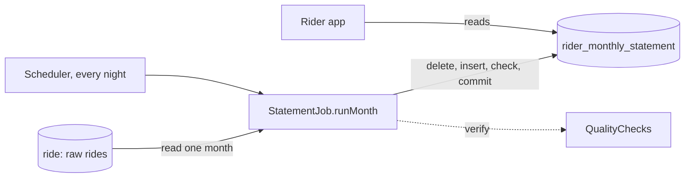

## The design

Riders want a monthly statement: rides, total paid, longest ride, their rank in their city, and the change from last month. Computing that live, for 100,000 riders, every time one opens the app, would be slow. So a nightly job builds the statements once, into their own table. The app only reads that table.

```callout jargon
A **data mart** is a table, or a few, built from raw data for one use, such as statements or a finance dashboard. A **nightly job** is a program a scheduler starts once a night. A **backfill** reruns a job for past dates, for example after a bug fix.
```



The raw `ride` table is the source of truth. The job never changes it. If the statements are ever wrong, you fix the job and rebuild them from the rides. That only works if a rebuild is safe, which is the heart of this feature.

### A month starts at midnight in Riverton

Rides are saved as instants in UTC. But a rider who docks at 23:30 on 31 October in Riverton thinks of it as an October ride. In UTC it is already 03:30 on 1 November.

So the job draws month lines at **midnight in Riverton**, `America/New_York`, for every city. Riverton runs 4 hours behind UTC in summer, and 5 hours behind in winter. In 2026 the clocks go back on 1 November, so November is one hour longer than a plain 30 days.

```callout jargon
A **time zone** such as `America/New_York` is a set of rules: the offset from UTC on each date, including clock changes. An **offset** such as `-04:00` is just a number of hours. A zone can have different offsets on different dates, which is why you store the zone, not the offset.
```

### Syntax: a month's first moment in a time zone

```java
import java.time.OffsetDateTime;
import java.time.YearMonth;
import java.time.ZoneId;
import java.time.ZoneOffset;

public class MonthStarts {
    static final ZoneId RIVERTON = ZoneId.of("America/New_York");

    static OffsetDateTime startInUtc(YearMonth month) {
        return month.atDay(1).atStartOfDay(RIVERTON).withZoneSameInstant(ZoneOffset.UTC).toOffsetDateTime();
    }

    public static void main(String[] args) {
        for (YearMonth month = YearMonth.of(2026, 10); !month.isAfter(YearMonth.of(2026, 12)); month = month.plusMonths(1)) {
            System.out.println(month + " starts at " + startInUtc(month));
        }
    }
}
```

```text
2026-10 starts at 2026-10-01T04:00Z
2026-11 starts at 2026-11-01T04:00Z
2026-12 starts at 2026-12-01T05:00Z
```

`atStartOfDay(zone)` asks the zone's rules what midnight is on that date. `withZoneSameInstant(ZoneOffset.UTC)` shows the same moment in UTC. A month is then a half-open range: `started_at >= start AND started_at < end`, where `end` is the next month's start.

### Rank and change: two window functions

Both columns are [window functions](/t/module-09b-data/topic-01-advanced-sql). Each row keeps its own values, and also sees the other rows in its window.

- **`RANK() OVER (PARTITION BY city ORDER BY total_cents DESC)`** numbers riders inside each city, biggest total first. Ties share a rank and the next one skips: 1000, 700, 700, 300 rank 1, 2, 2, 4. `DENSE_RANK` would give 1, 2, 2, 3, and `ROW_NUMBER` would split the tie into 2 and 3, in no fixed order. Spoke's statement says "you are 4th", so `RANK` it is.
- **`LAG(total_cents) OVER (PARTITION BY city, rider_id ORDER BY ...)`** reads the previous row's total in the same window. Subtract it, and you have the change.

The trap is that `LAG` reads the previous **row**, not the previous **month**. A rider who rode in August and October, but not September, has August as October's previous row. Their statement would say "+150 since last month", comparing with a month two back. So the job reads only two months of rides, this one and the calendar month before. Then the previous row can only be last month, or nothing at all, which gives NULL.

### A rerun must give the same answer

Jobs fail and get rerun. Schedulers retry. Engineers backfill a quarter after a fix. Each time, riders must see the same numbers. A job with that property is **idempotent**: running it twice is the same as running it once.

The job rebuilds a whole month at a time: delete that month's rows, then insert them again from the raw rides. An insert alone would add duplicates. An upsert (`MERGE`) alone would leave a row behind for a rider whose only ride was removed.

```callout jargon
To be **idempotent** is to give the same result however many times you run it. A month is a **partition** of the data mart here: a slice the job always replaces whole, never edits row by row.
```

### Delete and insert in one transaction

Between the delete and the insert, the month is empty. If the insert then fails, riders open the app to no statement at all. So the delete, the insert and the checks all run in **one transaction**. Until the commit, other readers still see last night's rows.

```animate
title: A rerun that fails its checks
kind: scene
nodes:
  - { id: job, label: StatementJob, emoji: "⚙️", row: 0, col: 0 }
  - { id: mart, label: rider_monthly_statement, emoji: "🗄️", value: "October: last night's rows", row: 0, col: 3 }
  - { id: qc, label: QualityChecks, emoji: "🔍", row: 2, col: 1 }
  - { id: app, label: Rider app, emoji: "📱", row: 2, col: 4 }
steps:
  - say: The job turns off auto-commit. Everything it does now is one transaction, invisible to others until it commits.
    focus: [job]
  - say: It deletes October's rows, inside the transaction. The rider app still reads last night's rows.
    send: { from: job, to: mart, label: "DELETE 2026-10" }
    set: { mart: "October: being rebuilt" }
  - say: It inserts October again from the raw rides.
    send: { from: job, to: mart, label: "INSERT 2026-10" }
  - say: Then the checks run on the same connection. A refund was saved as a ride of -250 cents, so no-negative-fares fails.
    send: { from: job, to: qc, label: "verify" }
    set: { qc: "no-negative-fares failed" }
  - say: The job rolls back. The delete and the insert both vanish, and October is exactly as it was.
    send: { from: qc, to: job, label: "DataQualityException", back: true }
    set: { mart: "October: last night's rows" }
  - say: Riders keep last night's statements, and the on-call engineer gets an error that names the check.
    send: { from: app, to: mart, label: "read October" }
```

### Checks before the commit

A bug in the job, or bad raw data, should stop the job, not reach riders. So three checks run inside the transaction, after the insert and before the commit:

1. **no-negative-fares**: a fare below 0 means bad raw data, such as a refund saved as a ride.
2. **totals-match**: the statements add up to exactly the raw rides' total. Money must never appear or vanish.
3. **every-rider-has-a-row**: everyone who rode gets a statement.

When a check fails, the job rolls back and throws a `DataQualityException` naming the check. "Data quality check failed: totals-match" tells the on-call engineer where to look, at 3 a.m., without reading the code.

### Backfill: oldest month first

`backfill(from, to)` runs `runMonth` for each month in order, each in its own transaction. A failure stops it at that month. The months before stay built, and the months after are not run. Fix the data, then rerun the same backfill: it is idempotent, so the months that already worked come out the same.

Real schedulers, like the DAG tools in [Data pipelines](/t/module-09b-data/topic-07-data-pipelines), work the same way. Each night is a partition, and a backfill replays partitions.

## What you build

Five stages, one check class each. Do them in order, and run the checks after each one. The README has every column, rule and name the checks test.

| Stage | Check class | TODOs | What you write |
|---|---|---|---|
| 1 | `Stage1MonthAndTotalsTest` | 1, 2 | `MonthRange.of` in Riverton time; `runMonth` inserts count, total and longest ride |
| 2 | `Stage2RankAndChangeTest` | 3 | `city_rank` with `RANK`, `change_cents` with `LAG` against the calendar month before |
| 3 | `Stage3RerunTest` | 4 | one transaction: delete the month, insert, verify, commit; roll back on failure |
| 4 | `Stage4QualityChecksTest` | 5 | `QualityChecks.verify`: three checks, in order, each with its name |
| 5 | `Stage5BackfillTest` | 6 | `backfill(from, to)`: oldest first, stops at a failure, safe to repeat |

### The rubric: green checks are the floor

Once your checks pass, review your job the way a data engineer would. Mark each line **Meets** or **Not yet**.

| Area | Meets the bar when… |
|---|---|
| Correctness | Every month line is midnight in Riverton, as a half-open range. No fixed offsets anywhere. |
| Idempotency | Any month can run any number of times, in any order, and gives the same rows. |
| Atomicity | No reader can ever see a half-built month. One transaction covers delete, insert and checks. |
| Safety | Every check names itself in its error. A failed check leaves last night's rows in place. |
| SQL | Every value is a `?` parameter. Window functions do the ranking, not a Java loop. |

## Recap

- A data mart is built from raw data, and can always be rebuilt from it. That only works if a rebuild is safe.
- Month lines belong to a time zone, not an offset. Let `ZoneId` work out midnight, then compare with a half-open range.
- `RANK` shares ties and skips the next rank. `LAG` reads the previous row, so give it only the month before.
- Idempotent means delete the whole partition and insert it again, in one transaction. An insert duplicates, and an upsert leaves stale rows.
- Checks run inside the transaction, before the commit. A failure rolls back and names itself.
- A backfill runs partitions oldest first, each in its own transaction, and stops at the first failure.

## Common mistakes

**1. Midnight in UTC.**

```java nocompile
OffsetDateTime start = month.atDay(1).atStartOfDay().atOffset(ZoneOffset.UTC);
```

```text
midnight on 1 October in Riverton (America/New_York, summer time, UTC-4) is 04:00 UTC, not 00:00 UTC ==> expected: <2026-10-01T04:00:00Z> but was: <2026-10-01T00:00:00Z>
```

Rides in the last evening hours of each month land in the next month, and finance's months no longer match the riders'. Fix: `atStartOfDay(MonthRange.RIVERTON)`, then convert to UTC.

**2. A fixed offset of -4 hours.**

```java nocompile
OffsetDateTime end = month.plusMonths(1).atDay(1).atStartOfDay().atOffset(ZoneOffset.ofHours(-4));
```

```text
midnight on 1 December in Riverton is winter time (UTC-5): 05:00 UTC. Let ZoneId work it out with atStartOfDay(MonthRange.RIVERTON); never add a fixed offset ==> expected: <2026-12-01T05:00:00Z> but was: <2026-12-01T04:00:00Z>
```

October passes, so this looks right for half the year. Fix: a `ZoneId`, which knows when the clocks change.

**3. `DENSE_RANK` instead of `RANK`.** Symptom: the stage 2 check says "rider-2 and rider-3 tie on 700, so both are 2 and rider-4 is 4, not 3 (that would be DENSE_RANK)". Both are fine SQL, but the README's rule is `RANK`. Fix: `RANK() OVER (PARTITION BY city ORDER BY total_cents DESC)`.

**4. `MERGE` instead of delete and insert.**

```text
Data quality check failed: totals-match (statements add up to 1540 cents, the raw rides to 1350 cents)
```

The upsert updated rider-7 and rider-8, but rider-10's ride was removed, and their old 190-cent row stayed. Your own check caught it, which is exactly its job. Fix: delete the whole month, then insert.

**5. Leaving auto-commit on.**

```text
the failed run deleted October's rows before its insert failed. In one transaction that delete is rolled back too, so riders still see last night's statements. Turn off auto-commit, and roll back on any failure. The job said: ...
```

With auto-commit, each statement commits on its own. The delete is permanent before the insert even starts. Fix: `connection.setAutoCommit(false)` first, `commit()` at the end, and `rollback()` in the `catch`.
