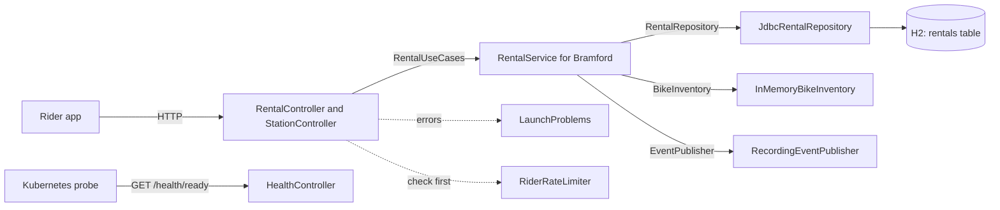

## The design

In [the capstone ticket](/t/module-10-professional/topic-06-capstone) you built Bramford's rentals core: plain Java, one city per `CityConfig`, ports all around. Now you wrap that same core in a real Spring Boot service. The core does not change by a single line. Everything you add is an adapter or a cross-cutting part around it.



### The service on one page

This is the design doc's summary, the way the checklist taught it.

- **Goal:** riders rent and return bikes at Bramford's five stations, over HTTP, with rentals saved in a database.
- **Non-goals:** no CARGO, no memberships, no payments in this service (billing listens for `RideEnded`).
- **API:** `POST /rentals` (201 and `Location`), `GET /rentals/{id}`, `POST /rentals/{id}/end`, `GET /stations/{id}/availability`.
- **Errors:** Problem Details, one advice class, the error catalog in the README.
- **Retries:** an optional `Idempotency-Key` header on `POST /rentals`.
- **Data:** one `rentals` table, with a unique constraint that blocks two active rentals of one bike.
- **Launch:** a readiness check that waits for the stations, and at most 5 rental starts per rider a minute.

The composition root, `LaunchWiring`, builds Bramford's core with `CityConfig.bramford()`. Launching another city later means another config, not another service.

### Statuses: why 404, 409 and 422

Each status tells the app what to do next. Pick it from the cause, not from habit.

- **404** when the thing does not exist in Bramford: a rental, a station like `harbor`, a bike like `B-1042`.
- **409** when the request clashes with the current state, and might work later. The bike is out, the rider is riding, or the ride has ended.
- **422** when the request is well formed but can never work here. Examples: a CARGO bike in Bramford, or a reused idempotency key.
- **400** when the body itself is broken: a missing or blank field.

### Syntax: a switch over a sealed family

`RentalException` is sealed, as in [sealed types](/t/module-05-advanced-java/topic-12-sealed-types). So a `switch` with [pattern matching](/t/module-05-advanced-java/topic-13-pattern-matching) can list every kind, and needs no `default`.

```java nocompile
return switch (ex) {
    case RentalException.RentalNotFound e -> problem(HttpStatus.NOT_FOUND, "rental-not-found", "Rental not found", e);
    case RentalException.BikeUnavailable e -> problem(HttpStatus.CONFLICT, "bike-unavailable", "Bike unavailable", e);
    // ... one case for each kind
};
```

Without a `default`, the compiler checks that every kind has a case. If someone adds a ninth kind to the core, this advice stops compiling until it is mapped. That is far better than a surprise 500 in production.

### Syntax: an optional request header

```java nocompile
@PostMapping
public ResponseEntity<RentalResponse> start(@Valid @RequestBody StartRentalRequest request,
        @RequestHeader(value = "Idempotency-Key", required = false) String idempotencyKey) {
```

`@RequestHeader` copies one header into a parameter. With `required = false`, a request without it gets `null`, and the core then treats the start as a normal one.

A retry with the same key gets the same answer as the first time: `201` with the same rental and the same `Location`. The app cannot tell a replay from the original, and does not need to.

### Syntax: JdbcTemplate

`JdbcTemplate` is Spring's helper for plain SQL. It opens and closes connections, and turns `SQLException` into Spring's `DataAccessException` family.

```java nocompile
int changed = jdbc.update("UPDATE rentals SET fare_cents = ? WHERE id = ?", 540, "rental-17");
List<Rental> rows = jdbc.query("SELECT ... FROM rentals WHERE rider_id = ?", JdbcRentalRepository::toRental, "rider-7");
Long next = jdbc.queryForObject("SELECT NEXT VALUE FOR rental_ids", Long.class);
```

`update` runs `INSERT`, `UPDATE` or `DELETE` and returns how many rows changed. `query` runs a `SELECT` and turns each row into an object with a row mapper. The `?` marks are filled in order, so a rider id can never inject SQL.

When a unique constraint refuses a row, `JdbcTemplate` throws `DuplicateKeyException`, a kind of `DataIntegrityViolationException`. `LaunchProblems` turns that into `409 conflict`.

### The database is the last line of defence

The core checks that a bike is free before it starts a rental. But Bramford runs on two or more servers. Two of them can check the same bike in the same millisecond, and both see "free".

```animate
title: Two servers, one bike
kind: scene
nodes:
  - { id: a, label: Server A, emoji: "🖥️", row: 0, col: 0 }
  - { id: b, label: Server B, emoji: "🖥️", row: 2, col: 0 }
  - { id: db, label: rentals table, emoji: "🗄️", row: 1, col: 3, value: "no active BR-2044" }
  - { id: app, label: Rider app, emoji: "📱", row: 2, col: 5 }
steps:
  - say: Two riders tap Unlock on BR-2044 at Bramford Central. Each request lands on a different server.
    focus: [a, b]
  - say: Both servers ask their own view of the fleet. Both see BR-2044 docked and free.
    set: { a: "BR-2044 free?", b: "BR-2044 free?" }
  - say: Server A inserts its rental. active_bike_id is BR-2044, and the insert works.
    send: { from: a, to: db, label: "INSERT active BR-2044" }
    set: { db: "active: BR-2044" }
  - say: Server B inserts too. The UNIQUE constraint on active_bike_id refuses the second row.
    send: { from: b, to: db, label: "INSERT active BR-2044" }
    focus: [db]
  - say: JdbcTemplate throws DuplicateKeyException. LaunchProblems turns it into 409 conflict, not a 500.
    send: { from: b, to: app, label: "409 conflict" }
  - say: One bike, one rental. When the ride ends, active_bike_id becomes NULL, so the bike can be rented again.
    set: { db: "ended: active_bike_id NULL" }
```

A Java lock, such as `synchronized`, only guards one server. The database sees every server's inserts, so it can enforce the rule for all of them.

### Readiness without Actuator

On a real Spring Boot service you would add Actuator and its `/actuator/health/readiness`. It is not on this project's classpath, so `HealthController` is hand-made. The idea is the same as in [Kubernetes](/t/module-09-architecture/topic-10-kubernetes):

- **`/health/live`** answers `200` while the process runs. Kubernetes restarts a pod that fails it.
- **`/health/ready`** answers `200` only when the pod can serve riders, here when all five stations are loaded. Until then it answers `503`, and Kubernetes sends no traffic to the pod.

A pod with one station loaded is not ready. Riders at the other four would see "station not found".

### A rate limit per rider

`RiderRateLimiter` is a **sliding-window log**, from [Resilience](/t/module-09-architecture/topic-09-resilience). It keeps each rider's recent request times in a queue, oldest first.

1. Drop times that are 60 seconds old or more.
2. If 5 are left, refuse: `429` with `Retry-After`, the seconds until the oldest one drops out, rounded up.
3. Otherwise, add now and let the request through.

A queue never holds more than 5 times, because a refused request is not added. So each check takes O(1) time, and each rider costs O(1) space: at most 5 instants. The `Clock` is injected, so the checks can move time without waiting.

## What you build

Six stages, one test class each. Do them in order, and run the checks after each stage. The README has every status, field and header the checks test.

| Stage | Check class | TODOs | What you write |
|---|---|---|---|
| 1 | `Stage1RentalApiTest` | 1 to 3 | `RentalController`: start (201 and `Location`), find, end |
| 2 | `Stage2StationsTest` | 4 | `StationController`: availability for one Bramford station |
| 3 | `Stage3ErrorsTest` | 5 to 7 | `LaunchProblems`: one case per error kind, the 400 with `errors`; `@NotBlank` and `@Valid` |
| 4 | `Stage4IdempotencyTest` | 8 | the `Idempotency-Key` header, passed to the core |
| 5 | `Stage5PersistenceTest` | 9 to 12 | `JdbcRentalRepository`: constraints, `save`, finders; then plug it into `LaunchWiring` |
| 6 | `Stage6LaunchReadinessTest` | 13 to 16 | `/health/ready`, `RiderRateLimiter`, and the 429 with `Retry-After` |

After stage 5, stages 1 to 4 must still pass, now on the database. That is the hexagon paying off: you swapped storage, and not one rule moved.

### The rubric: green checks are the floor

All six stages green means the feature works. That is the floor, not the finish line. At a big tech firm, a reviewer also asks: would I be happy to be on call for this?

So once your checks pass, review your own code against Tsunade's rubric. Mark each line **Meets** or **Not yet**.

| Area | Meets the SDE 2 bar when… |
|---|---|
| Correctness | A retry with the same `Idempotency-Key` never makes a second rental, and every request ends in exactly one answer. |
| Design | Controllers only translate HTTP. No rule moved out of the core, and `LaunchWiring` is the only place that builds objects. |
| Errors | Every `RentalException` kind maps to one status, in `LaunchProblems` only. No stack trace or SQL text reaches a rider. |
| Data | Every SQL statement uses `?` parameters, never string concatenation. The UNIQUE constraint, not a Java check, stops double rentals. |
| Limits | `RiderRateLimiter` is safe when two requests arrive at once, and it drops old timestamps, so one busy rider cannot fill the memory. |
| Readability | Names say what things are. No leftover `TODO` lines, no dead code, and no method longer than a screen. |
| Tests | You added one check of your own for a case the six stages miss, such as ending the same rental twice through the API. |

```callout tip
"Ready to ship" means every stage green **and** every rubric line at Meets. Tsunade's solution opens once your checks pass. Compare yours with it line by line, the way a reviewer would.
```

## Recap

- The service is the capstone core plus adapters around it. Controllers drive it; JDBC, the fleet and events are driven. One composition root wires them.
- Every error is Problem Details from one advice class. A switch over the sealed `RentalException` forces a status for every kind.
- `Idempotency-Key` makes retries safe: same rider, key and body give the same `201`, and a different body is `422`.
- The database guards the rule Java cannot: a UNIQUE `active_bike_id` allows one active rental per bike, across all servers.
- Launch readiness: `/health/ready` waits for every station, and a per-rider sliding window answers `429` with a rounded-up `Retry-After`.

## Common mistakes

**1. Building the JDBC adapter but never plugging it in.**

```java nocompile
@Bean
public RentalRepository rentalRepository(JdbcTemplate jdbc) {
    return new InMemoryRentalRepository();   // still the map
}
```

```text
The RentalRepository bean should be a JdbcRentalRepository, but was InMemoryRentalRepository. Change one line in LaunchWiring.rentalRepository. ==> expected: <true> but was: <false>
```

Every other check still passes, which makes this easy to miss. A restart would lose every rental. Fix: return `new JdbcRentalRepository(jdbc)` from the composition root.

**2. Keeping `active_bike_id` after the ride ends.**

```java nocompile
String activeBikeId = r.bikeId();   // even for an ended rental
```

```text
Unique index or primary key violation: "PUBLIC.ONE_ACTIVE_RENTAL_PER_BIKE INDEX PUBLIC.ONE_ACTIVE_RENTAL_PER_BIKE_INDEX_6 ON PUBLIC.RENTALS(ACTIVE_BIKE_ID NULLS FIRST) VALUES ( /* 5 */ 'BR-7011' )"
```

The first ride ended, but its row still claims the bike, so nobody can ever rent BR-7011 again. Fix: `r.isActive() ? r.bikeId() : null`, so ended rows hold NULL.

**3. Forgetting `@Valid`.**

```java nocompile
public ResponseEntity<RentalResponse> start(@RequestBody StartRentalRequest request, ...)
```

```text
The API should answer 400 (invalid-request). Map the exception in LaunchProblems. ==> expected: <400> but was: <404>
```

The `@NotBlank` annotations are there, but nothing checks them. The blank bike id reaches the core, which answers "bike not found". Fix: put `@Valid` before each `@RequestBody`.

**4. Rounding `Retry-After` down.**

```java nocompile
long seconds = waitMillis / 1000;   // 600 ms left gives 0
```

```text
0.6 s are left. Round UP to whole seconds: 1, never 0 ==> expected: <1> but was: <0>
```

`Retry-After: 0` tells the app to try again at once, and it gets another 429. Fix: `Math.max(1, (waitMillis + 999) / 1000)`.

**5. Ready as soon as one station loads.**

```java nocompile
boolean ready = loaded > 0;
```

```text
/health/ready should answer 503 ==> expected: <503> but was: <200>
```

Kubernetes sends riders to a pod that knows one station of five. Fix: ready only when `loadedCount()` equals `expectedCount()`.
