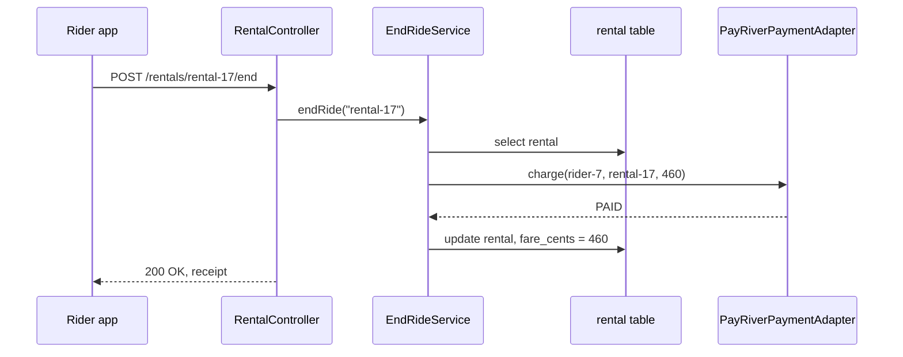

## Hook

Imagine your first day in a huge library with no catalogue. You need one fact, on one page, in one of 10,000 books. You would not start reading at shelf A. You would ask where the history section is, look at the spines, open the index, and follow the clues.

The payments service has about 400,000 lines of Java. Reading them all would take months, and you would forget most of it. Your bug is in a few lines somewhere. In this ticket you learn how professionals find their way in a big codebase. Where to start, which tools to use, and how to ask git why the code looks the way it does.

## Concept

### Reading is most of the job

```callout jargon
A **codebase** is all the code of a project: source files, tests, build files, configuration and scripts, usually kept in one git repository.
```

Writing new code feels like the real work. But before you change one line, you must understand the lines around it. Engineers at big companies spend far more time reading code than writing it. Most changes are small edits to code someone else wrote years ago.

You will never read the whole codebase, and you do not need to. The goal is narrower: **understand enough to change one thing safely**. That means knowing the shape of the whole system, and one path through it in detail.

```callout analogy
Learning a city works the same way. First you learn the main roads and districts. Then you learn your route to work in detail, every turn. Side streets come later, one at a time, when you need them.
```

### A plan: outside in, then one path deep

Here is a plan that works on any codebase, in this order:

1. **Read the outside**: the README, the build file, the folder layout.
2. **Run it**: start it locally, then run its tests.
3. **Find the entry points**: where requests, jobs and messages come in.
4. **Trace one request** from the door to the database and back.
5. **Read the tests** for the code on that path.
6. **Follow the data**: tables, columns and events.
7. **Write a map** of what you learned.

Steps 1 and 2 give you the main roads. Steps 3 to 6 give you one route in detail. Step 7 means you never have to learn it twice.

### Start from the outside: README, build file, folders

**The README** says what the service does, how to run it, and often who owns it. Read it first, even when it is out of date. An out-of-date README is your first small fix.

**The build file**, `pom.xml` or `build.gradle` from [Maven](/t/module-07-tooling/topic-01-maven), tells you a lot quickly:

- the Java version;
- the frameworks, such as Spring Boot, JPA or Kafka;
- the libraries, which hint at the work: a PayRiver client means payments, Flyway means database migrations.

**The folder layout** shows how the code is split. Here are the files that matter for your bug, in a trimmed copy of the payments repository:

```text
./README.md
./docs/adr/0007-payriver-amounts.md
./src/main/java/spoke/payments/adapter/PayRiverPaymentAdapter.java
./src/main/java/spoke/payments/core/EndRideService.java
./src/main/java/spoke/payments/core/EndRideUseCase.java
./src/main/java/spoke/payments/core/PaymentPort.java
./src/main/java/spoke/payments/persistence/JpaRentalStore.java
./src/main/java/spoke/payments/persistence/RentalJpaRepository.java
./src/main/java/spoke/payments/web/RentalController.java
./src/main/resources/db/migration/V3__create_rental.sql
./src/test/java/spoke/payments/adapter/PayRiverPaymentAdapterTest.java
```

The package names already tell a story: `web`, `core`, `persistence`, `adapter`. That is [ports and adapters](/t/module-09-architecture/topic-02-hexagonal-architecture). `docs/adr` holds architecture decision records: short notes of why a decision was made. `db/migration` holds the database's history.

### Run it, then run the tests

Reading code you cannot run is like learning to swim from a book. Get the service running on your laptop on day one.

- Follow the README's steps exactly. Write down every step that was missing or wrong.
- Run the full test suite, such as `./mvnw test`. Green tests prove your setup works.
- Send one real request, for example with `curl`, and watch the logs.

If it does not start, that is useful too. You now know which parts depend on a database, a message broker or a secret. Fix the README as you go: the next new joiner will thank you.

```callout tip
Gojo says: getting a big service running locally can take a whole day. That is normal, not a sign you are slow. Ask for help after you have tried the README properly.
```

### Find the entry points

```callout jargon
An **entry point** is a place where work enters the program from outside: a request, a timer, a message or a command.
```

Code does nothing on its own. Something calls it. Find the doors, and you can follow any path inward. In a Spring service, look for:

| Door | What to search for |
|---|---|
| The app starting | `public static void main`, `@SpringBootApplication`, `CommandLineRunner` |
| HTTP requests | `@RestController`, `@GetMapping`, `@PostMapping` |
| Timers | `@Scheduled` methods: nightly reports, cleanup jobs |
| Messages | `@KafkaListener`, `@RabbitListener`, from [messaging](/t/module-09-architecture/topic-04-messaging) |
| Events inside the app | `@EventListener` |

A search for `@PostMapping` lists every write the service accepts. That one list is a good summary of what the service does.

### Trace one request end to end

Pick one real request, ideally the one with your bug, and follow it through every layer. For Spoke's payments service, that is `POST /rentals/rental-17/end`.

```animate
title: Tracing POST /rentals/rental-17/end
kind: scene
nodes:
  - { id: app, label: Rider app, emoji: "📱", row: 0, col: 0 }
  - { id: ctrl, label: RentalController, emoji: "🚪", row: 0, col: 2 }
  - { id: svc, label: EndRideService, emoji: "⚙️", row: 1, col: 2 }
  - { id: store, label: JpaRentalStore, emoji: "🗂️", row: 2, col: 1 }
  - { id: db, label: rental table, emoji: "🗄️", row: 3, col: 0 }
  - { id: adapter, label: PayRiverPaymentAdapter, emoji: "🔌", row: 2, col: 3 }
  - { id: payriver, label: PayRiver, emoji: "🏦", row: 3, col: 4 }
steps:
  - say: The request comes in by the door. A search for "/{id}/end" finds RentalController.
    send: { from: app, to: ctrl, label: "POST /rentals/rental-17/end" }
    focus: [ctrl]
  - say: The controller only calls an interface, EndRideUseCase. "Go to implementation" lands on EndRideService.
    send: { from: ctrl, to: svc, label: "endRide(rental-17)" }
  - say: The service loads the rental through its store port. JPA turns that into a select.
    send: [{ from: svc, to: store, label: "findById" }, { from: store, to: db, label: "select ... where id = ?" }]
  - say: The service works out the fare. A 24-minute CLASSIC ride is 100 + 24 × 15 = 460 cents.
    focus: [svc]
    set: { svc: "fare 460" }
  - say: It asks the adapter to charge 460 cents. The adapter turns cents into PayRiver's format, and sends 4.00. The bug lives on this hop.
    send: [{ from: svc, to: adapter, label: "charge 460" }, { from: adapter, to: payriver, label: "amount 4.00" }]
    focus: [adapter]
  - say: The ended rental is saved, fare and all. Then the receipt goes back to the app.
    send: [{ from: svc, to: store, label: "save" }, { from: store, to: db, label: "update rental" }, { from: ctrl, to: app, label: "200 OK, receipt", back: true }]
```

At each hop, write down the class, the method and what data goes in and out. These are the layers you built in [layered architecture](/t/module-09-architecture/topic-01-layered-architecture): web, service, persistence, plus an adapter for the outside world.

### Read the tests as documentation

Comments can lie, because nobody runs them. Tests are run on every build, so they must match what the code really does. That makes them the most honest documentation you have.

- **Test names** list the rules: "rejects a CARGO bike in Bramford", "refunds a ride under one minute".
- **Test setup** shows how to build the objects and what a realistic input looks like.
- **Assertions** show the exact expected outputs.

Read the tests next to the code they test. Also notice what the tests do *not* cover. The payments test checks only one amount:

```java nocompile
@Test
@DisplayName("700 cents is sent to PayRiver as 7.00")
void amountHasTwoDecimals() {
    assertEquals("7.00", PayRiverPaymentAdapter.toPayRiverAmount(700));
}
```

700 cents has no cents part. A test with 460 cents would say much more. Keep that thought: it matters in the worked example.

### Follow the data

Code changes often. Data lasts for years. So the tables and the events often explain a system faster than the classes do.

- **Read the schema.** The migration files, such as `V3__create_rental.sql`, list every table, column and type. `fare_cents bigint` tells you money is whole cents, without reading one class.
- **Look at real rows.** On a local or test database, see what a rental row really holds.
- **Follow the events.** If the service publishes `RideEnded`, find who listens to it. Events show how services talk to each other.

Data also helps you **cut the search in half**. Check the value at two points on the path. If it is right at one and wrong at the next, the bug is between them. For your bug, the rental row says `fare_cents = 460`, and PayRiver says `4.00`. So the bug is after the fare was worked out correctly, on the way out to PayRiver.

### IDE navigation

Your IDE understands Java, not just text. These moves are faster and more precise than reading files one by one. The keys are IntelliJ IDEA's defaults, macOS first, then Windows and Linux:

| Move | Keys | What it answers |
|---|---|---|
| Go to declaration | ⌘B / Ctrl+B | Where is this class, method or field defined? |
| Go to implementation | ⌥⌘B / Ctrl+Alt+B | Which classes implement this interface? |
| Find usages | ⌥F7 / Alt+F7 | Who calls this method, or reads this field? |
| Call hierarchy | ⌃⌥H / Ctrl+Alt+H | The whole tree of callers, up to the entry points |
| Type hierarchy | ⌃H / Ctrl+H | Parents and children of a class |
| Search everywhere | ⇧⇧ / Shift Shift | Any class, file or action by name |

"Go to implementation" matters a lot in Spring code. Controllers often call an interface, such as `EndRideUseCase`. Go to declaration lands on the interface, which has no body. Go to implementation finds `EndRideService`, where the work happens. In VS Code, the matching keys are F12 for definition and Shift+F12 for references.

### Syntax: searching text with rg and git grep

The IDE finds Java symbols. For plain text, such as a URL, an error message or a config key, use a search tool.

```bash
git grep -n "toPayRiverAmount"
```

```text
docs/adr/0007-payriver-amounts.md:9:Convert in one place, PayRiverPaymentAdapter.toPayRiverAmount, with BigDecimal.valueOf(cents, 2).
src/main/java/spoke/payments/adapter/PayRiverPaymentAdapter.java:24:        var request = new PayRiverChargeRequest(riderId, toPayRiverAmount(amountCents), CURRENCY, rentalId);
src/main/java/spoke/payments/adapter/PayRiverPaymentAdapter.java:34:    static String toPayRiverAmount(long cents) {
src/test/java/spoke/payments/adapter/PayRiverPaymentAdapterTest.java:13:        assertEquals("7.00", PayRiverPaymentAdapter.toPayRiverAmount(700));
```

`-n` adds line numbers. `git grep` searches only files git tracks, so build output never clutters the results. `rg`, short for ripgrep, is a fast search tool that does the same in any folder and skips files listed in `.gitignore`. `rg -n "/rentals" src` finds the URL in code and config alike.

Search for the most unusual text you have. An error message from a log line, such as `PayRiver charge failed for`, usually leads straight to the one line that wrote it.

### Syntax: git log -S and -G

Git remembers every version of every line. Two options search that history for text.

```bash
git log -S "cents / 100" --oneline
```

```text
41b19c7 Tidy PayRiver amount formatting
```

`-S` is called the **pickaxe**. It lists the commits that changed how many times the text appears: the commit that added it, and the one that removed it. Only one commit ever added `cents / 100`.

`-G` takes a regular expression and lists every commit whose diff adds or removes a matching line:

```bash
git log -G 'valueOf\(cents' --oneline
```

```text
41b19c7 Tidy PayRiver amount formatting
93e4398 Add ADR 0007: PayRiver amounts as decimal strings
1a932a2 Add PayRiver payment adapter
```

`-G` is wider: it also found the ADR, whose text mentions `valueOf(cents, 2)`. Add `-p` to either command to see each commit's diff, or `-- src` to search only one folder.

```callout jargon
A **regular expression**, or regex, is a pattern for matching text. In `valueOf\(cents`, the backslash means "a real bracket", because a bare `(` has a special meaning in a regex.
```

### Syntax: git blame and git show

`git blame` shows, for each line, the last commit that changed it, who made it and when.

```bash
git blame -L 33,35 src/main/java/spoke/payments/adapter/PayRiverPaymentAdapter.java
```

```text
1a932a2c (Tsunade 2026-03-02 10:00:00 -0500 33)     /** PayRiver wants a decimal string with two digits after the dot: 460 cents is "4.60". */
1a932a2c (Tsunade 2026-03-02 10:00:00 -0500 34)     static String toPayRiverAmount(long cents) {
41b19c76 (Kakashi 2026-10-27 17:45:00 -0400 35)         return BigDecimal.valueOf(cents / 100).setScale(2).toPlainString();
```

`-L 33,35` limits it to those lines. Blame tells you *when* and *who*. To learn *why*, open the commit with `git show 41b19c7`. It prints the message and the diff. Here is the part that matters:

```text
    Tidy PayRiver amount formatting
    
    Use setScale(2) so the amount always has two decimals.

-        return BigDecimal.valueOf(cents, 2).toPlainString();
+        return BigDecimal.valueOf(cents / 100).setScale(2).toPlainString();
```

```callout warning
Despite its name, `git blame` is not for blaming. The last person to touch a line may only have reformatted it. Use blame to find context and someone to ask, never to point fingers. Good teams run blameless reviews of mistakes, as in [on-call](/t/module-09-architecture/topic-08-observability).
```

If a big reformatting commit hides the real history, `git blame -w` ignores whitespace changes. `git log -L 33,35:path/to/File.java` shows every change to those lines over time.

### Watch it run: debugger, logs and traces

Reading tells you what the code *should* do. Running it shows what it *does*.

**The debugger.** Put a breakpoint in `PayRiverPaymentAdapter.charge` and send one request locally. When it stops, look at `amountCents` and at the request being built. You will see `460` go in and `"4.00"` come out. You learned this in [debugging](/t/module-06-craft/topic-11-debugging). In a strange codebase, "Step Into" walks you through layers you did not know existed.

**Logs and traces.** In production you cannot pause the code, but you can read what it left behind. From [observability](/t/module-09-architecture/topic-08-observability):

- Search the logs for the rental id, such as `rental-17`, to see every line written about that ride.
- Take the trace id from one of those lines. A trace shows every service and database call the request made, with timings.

A trace is a map of the real path, drawn for you by the system itself.

### Patterns you already know

Big codebases look scary until you notice the same few shapes again and again. You have met most of them already:

- **Layers**: `web`, `service`, `persistence` folders. Requests go down, answers come back up.
- **Ports and adapters**: an interface in `core`, an implementation in `adapter`. `PaymentPort` and `PayRiverPaymentAdapter` are a pair.
- **Strategy**: an interface with several versions, chosen at runtime. Fare rules per city often look like this. See [behavioral patterns](/t/module-06-craft/topic-05-behavioral-patterns).
- **Factories and builders**: `Rental.start(...)`, `RideReceipt.builder()`. See [creational patterns](/t/module-06-craft/topic-03-creational-patterns).
- **Proxies**: `@Transactional` makes Spring wrap your bean in a proxy. That is why stack traces show names like `EndRideService$$SpringCGLIB$$0`.

```callout jargon
A **proxy** is an object that stands in front of another and adds work around each call, such as starting and committing a transaction, as in [transactions](/t/module-08-backend/topic-10-transactions).
```

Naming a pattern tells you where to look next. See an interface in `core`? Its adapter is in `adapter` or `persistence`.

### Unfamiliar Java without panic

Big codebases use features you have not met yet. You do not need to master each one before reading on. Get its gist and keep going.

- **An annotation you do not know.** Hover over it to read its Javadoc, then ask "which framework reads this?". Spring, JPA, JUnit and Jackson each have their own.
- **Heavy generics.** Read from the outside in: `Map<String, List<Rental>>` is a map from text to lists of rentals.
- **A stream chain.** Read it top to bottom as steps: filter, then group, then sum. Rewrite it as a loop in your head if it helps.

```java
import java.util.List;
import java.util.Map;
import java.util.TreeMap;
import java.util.stream.Collectors;

public class Main {
    record Ride(String id, String station, long fareCents) {}

    public static void main(String[] args) {
        List<Ride> rides = List.of(
                new Ride("rental-17", "harbor", 700),
                new Ride("rental-18", "uptown", 400),
                new Ride("rental-19", "harbor", 0),
                new Ride("rental-20", "harbor", 460));

        // What you might find in the codebase
        Map<String, Long> paidByStation = rides.stream()
                .filter(r -> r.fareCents() > 0)
                .collect(Collectors.groupingBy(Ride::station, TreeMap::new, Collectors.summingLong(Ride::fareCents)));

        // The same steps, written as a loop you already know
        Map<String, Long> byLoop = new TreeMap<>();
        for (Ride r : rides) {
            if (r.fareCents() > 0) {
                byLoop.merge(r.station(), r.fareCents(), Long::sum);
            }
        }

        System.out.println(paidByStation);
        System.out.println(byLoop);
    }
}
```

Both print `{harbor=1160, uptown=400}`. Each version visits every ride once. With n rides and s stations, a `TreeMap` insert costs O(log s), so both take O(n log s) time and O(s) extra space.

### Make a map

Write down what you learn, while you learn it. A short notes file beats a perfect memory. For each path you trace, note:

- the entry point and its URL or trigger;
- each class and method on the path, in order;
- the tables it reads and writes, and the events it sends;
- questions you still have, and who might know.

A small diagram is often clearest. You can use the same [sequence diagrams](/t/module-06-craft/topic-07-uml-basics) you learned for design:



Then share it. A map in the team's docs folder helps the next new joiner, and it is a cheap first pull request.

### Legacy code: pin it, then change it

```callout jargon
**Legacy code** is code that is hard to change safely, usually because it has few tests and its authors have moved on. Age alone does not make code legacy.
```

In [refactoring](/t/module-06-craft/topic-06-refactoring) you learned the safe way in. It applies to every unfamiliar codebase:

1. **Pin the current behaviour first.** Write characterization tests that record what the code does today, right or wrong. Now any accidental change turns a test red.
2. **For a bug, write a failing test first.** It proves you found the bug, and it stops the bug from coming back.
3. **Change in small, safe steps.** Run the tests after each one. Commit often.

**The Boy Scout rule**: leave the code a little cleaner than you found it. Rename one confusing variable, add one missing test, fix one stale comment. Keep these tidy-ups small, and in their own commit or PR, so reviewers can tell them apart from the real change.

What not to do: rewrite a module you understood for one afternoon. Code that looks strange often handles a case you have not met yet.

### Asking good questions

Asking for help is part of the job, not a failure. The trick is asking well, at the right time.

**When.** Many teams use a rule of thumb: try on your own for about 30 minutes. If you are not closer to the answer, ask. Too early, and you skip the learning. Too late, and you burn a day that one sentence would have saved.

**How.** A good question has four parts:

```text
I'm tracing why rider-7 was charged 4.00 USD for a 460-cent fare (SPK-1002).
What I tried: the rental row has fare_cents = 460; a breakpoint shows
toPayRiverAmount(460) returns "4.00".
What I expect: "4.60", as ADR 0007 says.
Question: is PayRiverPaymentAdapter the only place we format amounts, or does
the refund path have its own copy?
```

What you are doing, what you tried, what you expected, and one specific question. It shows respect for the other person's time, and it often answers itself while you write it.

Ask in the team channel rather than a private message when you can. The answer then helps everyone who has the same question later.

### Architecture decision records

```callout jargon
An **architecture decision record** (ADR) is a short document that records one important decision: the situation, what was decided, and what follows from it. ADRs are numbered and never deleted, only replaced by newer ones.
```

Code shows *what* the system does. ADRs show *why*. They live in the repository, often in `docs/adr`, and use a simple shape:

```text
# 7. Send PayRiver amounts as decimal strings

Status: accepted (2026-03-09)

## Context
Spoke keeps money as whole cents in a long. PayRiver's API wants a decimal string, like "4.60".

## Decision
Convert in one place, PayRiverPaymentAdapter.toPayRiverAmount, with BigDecimal.valueOf(cents, 2).

## Consequences
No double or float ever holds money. Integer division by 100 is not allowed: it drops the cents.
```

When code looks odd, check the ADRs before you "fix" it. And when you make a decision the next person will wonder about, write one. A later ticket covers writing documentation like this.

### The SDE 2 expectation

A junior engineer is expected to find their way in a codebase with help. At SDE 2, the bar is higher:

- **Ramp up quickly.** Within a few weeks on a new team, you ship real changes to code you did not write, without hand-holding.
- **Work across boundaries.** You can follow a bug into another team's service, read their code, and send them a precise report or a fix.
- **Help others ramp up.** You fix the README, write the map, answer questions in the team channel, and pair with new joiners.

Promotion documents show it with lines like "fixed a bug in a service they had never seen". Or "wrote the onboarding guide that new joiners now use".

### In an interview

Interviewers cannot hand you 400,000 lines, so they ask about it instead:

- "Tell me about a time you had to learn a large, unfamiliar codebase quickly."
- "Walk me through how you debugged a hard production issue."
- "How would you start on your first week on this team?"

Answer with a real story and a clear method: outside in, entry points, trace one path, read the tests, use git history, ask good questions. Name the tools you used. End with a result: "found the bug in two days, and wrote a map the next joiner used".

Some coding rounds also give you existing code to extend instead of a blank file. The same skills apply: read before you type, find the entry point, and say out loud what each part does.

## Worked example

Here is the whole hunt for your first bug, step by step.

### The bug report and the door

The report: rider-7's receipt for rental-17 says 460 cents. PayRiver's dashboard shows a charge of 4.00 USD. Riders are being undercharged, and nobody knows since when.

First, find the door. Receipts are made when a ride ends, so search for the end-ride URL:

```bash
rg -n '"/rentals"|"/\{id\}/end"' src
```

```text
src/main/java/spoke/payments/web/RentalController.java:11:@RequestMapping("/rentals")
src/main/java/spoke/payments/web/RentalController.java:20:    @PostMapping("/{id}/end")
```

One controller, one method. That is where the trace starts.

### Following the call

The controller is thin. It only passes the id to an interface:

```java nocompile
@PostMapping("/{id}/end")
public RideReceipt end(@PathVariable String id) {
    return endRide.endRide(id);
}
```

`endRide` is an `EndRideUseCase`, an interface. Go to implementation finds `EndRideService`. Here is its method:

```java nocompile
@Override
@Transactional
public RideReceipt endRide(String rentalId) {
    Rental rental = rentals.findById(rentalId).orElseThrow(() -> new RideNotFoundException(rentalId));
    Instant now = clock.instant();
    long minutes = Duration.between(rental.startedAt(), now).toMinutes();
    long fare = rental.type().fareCents(minutes);
    PaymentResult payment = payments.charge(rental.riderId(), rental.id(), fare);
    rentals.save(rental.end(now, fare, payment));
    return new RideReceipt(rental.id(), minutes, fare, payment);
}
```

The same `fare` goes to `payments.charge(...)`, into the saved row and onto the receipt. The row and the receipt both say 460, so the fare maths is fine. The difference must appear inside `payments.charge`.

`payments` is a `PaymentPort`. A search finds its one implementation:

```bash
git grep -n "implements PaymentPort"
```

```text
src/main/java/spoke/payments/adapter/PayRiverPaymentAdapter.java:11:public class PayRiverPaymentAdapter implements PaymentPort {
```

Inside, `charge` builds the request with `toPayRiverAmount(amountCents)`, and that method has one line:

```java nocompile
static String toPayRiverAmount(long cents) {
    return BigDecimal.valueOf(cents / 100).setScale(2).toPlainString();
}
```

`cents / 100` is integer division. 460 / 100 is 4, and the 60 cents are thrown away before `setScale(2)` adds `.00`. A breakpoint here confirms it: `460` in, `"4.00"` out.

### Asking git why

The code says what happens. Git says when and why. `git log -S "cents / 100"` finds a single commit, `41b19c7`, from 27 October. `git blame` points line 35 at the same commit. `git show 41b19c7` reveals a tidy-up:

```text
-        return BigDecimal.valueOf(cents, 2).toPlainString();
+        return BigDecimal.valueOf(cents / 100).setScale(2).toPlainString();
```

The old line was right. `BigDecimal.valueOf(cents, 2)` means "cents, with the decimal point moved two places left". And `git grep` had already found ADR 0007, which says integer division is not allowed. So now you know two things. Every fare with a cents part has been undercharged since 27 October. And the ADR explains the right fix.

Why did nobody notice? The only test used 700 cents, which has no cents part. Both versions turn 700 into `"7.00"`. A test that cannot fail on the bug cannot catch it, as you saw in [code reviews](/t/module-10-professional/topic-01-code-reviews).

### Pin it, fix it, leave it better

First, a failing test that shows the bug, with the cases that matter:

```java nocompile
@ParameterizedTest
@CsvSource({"460, 4.60", "99, 0.99", "1225, 12.25", "0, 0.00", "700, 7.00"})
@DisplayName("cents become a two-decimal PayRiver amount, keeping every cent")
void keepsEveryCent(long cents, String expected) {
    assertEquals(expected, PayRiverPaymentAdapter.toPayRiverAmount(cents),
            cents + " cents should be sent as " + expected);
}
```

It fails on `460`. Then the fix: put back the line the ADR asks for, `BigDecimal.valueOf(cents, 2).toPlainString()`. The test turns green.

Then the report back, short and precise: what broke, since when, why, the fix, and how to find the affected rides. Every ride ended since 27 October whose fare is not a whole number of dollars was undercharged. A query on `fare_cents % 100 <> 0` finds them. Whether to charge riders the difference is a business decision, not yours alone, so you raise it.

Last comes the Boy Scout step, in its own small PR. It adds a link to ADR 0007 in the method's comment, and your map of the end-ride path.

## Try it

Here are the method before and after the "tidy" commit, side by side. Run it and see which fares break.

```java run
import java.math.BigDecimal;

public class Main {
    // Before 27 October: the version ADR 0007 asks for
    static String before(long cents) {
        return BigDecimal.valueOf(cents, 2).toPlainString();
    }

    // After the "tidy" commit
    static String after(long cents) {
        return BigDecimal.valueOf(cents / 100).setScale(2).toPlainString();
    }

    public static void main(String[] args) {
        long[] fares = {460, 700, 1225, 99};
        for (long cents : fares) {
            System.out.println(cents + " cents -> before " + before(cents) + ", after " + after(cents));
        }
    }
}
```

It prints:

```text
460 cents -> before 4.60, after 4.00
700 cents -> before 7.00, after 7.00
1225 cents -> before 12.25, after 12.00
99 cents -> before 0.99, after 0.00
```

1. Which fares are safe from the bug? Add a few more to the array and find the rule.
2. A 10-minute EBIKE ride costs 100 + 10 × 30 cents. Is it safe? What about an 11-minute CLASSIC ride?
3. Add a `long` that sums what Spoke lost across all the fares in the array.

## Recap

- You never read a whole codebase. Learn its shape from the outside (README, build file, folders, running it and its tests), then one path in detail.
- Find the entry points (main, controllers, scheduled jobs, message listeners) and trace one request through every layer to the database and back. Check the data at each hop to cut the search in half.
- Use the right tool. IDE navigation finds Java symbols, `git grep` or `rg` find text, and `git log -S`/`-G` find when text changed. `git blame` and `git show` tell you why. Watch real runs with a debugger, logs and traces.
- Read tests as honest documentation, recognise patterns you know, write a map, and read ADRs before "fixing" odd code.
- In legacy code, pin behaviour with tests before you change it, take small safe steps, and leave it a little cleaner. Ask after about 30 minutes stuck, with what you tried, what you expected and one specific question.

## Common mistakes

**1. Reading files top to bottom, alphabetically.**

```text
day 1: adapter/AuditAdapter.java ... adapter/BankAdapter.java ... adapter/CardAdapter.java
day 3: still in adapter/, bug not found, nothing remembered
```

Symptom: days of reading, no clear picture, and nothing to show. Fix: start from the entry point of your bug and follow only that path. Read other code only when the path leads into it.

**2. Trusting comments over code and tests.**

```java nocompile
/** PayRiver wants a decimal string with two digits after the dot: 460 cents is "4.60". */
static String toPayRiverAmount(long cents) {
    return BigDecimal.valueOf(cents / 100).setScale(2).toPlainString();   // returns "4.00"
}
```

Symptom: you skip the buggy method because its comment describes the right behaviour. Fix: comments describe what someone intended. Run the code, or read its tests, to see what it really does.

**3. Using git blame to blame.**

```text
41b19c76 (Kakashi 2026-10-27 17:45:00 -0400 35)  ...   ->  "Kakashi broke payments!"
```

Symptom: a teammate feels attacked, and people stop making tidy-ups at all. Fix: use blame for context and to find who might know more. Talk about the commit and the missing test, not the person. The team's safety net failed, not one engineer.

**4. Rewriting what you do not understand.**

```text
"This adapter is a mess. I'll rewrite the whole payments module this sprint."
```

Symptom: the rewrite drops cases the old code handled quietly, such as retries or rounding, and new bugs reach riders. Fix: pin behaviour with characterization tests, change in small steps, and read the ADRs and history first.

**5. Asking too early, or far too late.**

```text
09:02  "how does payments work?"
...
17:40  (after a whole day stuck) "is there a second place we format amounts?"
```

Symptom: the first question is too vague to answer. The second came eight hours late. Fix: try for about 30 minutes, then ask a specific question with what you tried and what you expected.
