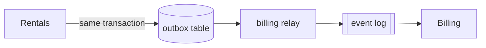

## Hook

Imagine borrowing a friend's bike with a strange gear lever. If a sticky note on the handlebar says "push down twice for first gear", you ride off. Without it, you stand there pushing things, or you phone your friend at midnight.

Spoke just had that night. At 3 a.m. the billing relay got stuck. The on-call engineer could see riders were not being charged, but nobody had written down how to restart it safely. Everyone waited two hours for the one person who knew. The same month, a new hire spent a week getting the rider API to run on a laptop.

Kakashi wants this fixed. In this ticket you learn which documents a team needs, who each one is for, and how to write them so people actually read them.

## Concept

### Why documentation matters

Code tells a computer what to do. It rarely tells a person **why**, **how to run it**, or **what to do when it breaks**. That knowledge lives in someone's head until it is written down.

```callout jargon
The **bus factor** is how many people would have to leave (or be hit by a bus) before a project stalls, because nobody left knows how it works. A bus factor of 1 means one person holds the key knowledge.
```

Spoke's billing relay had a bus factor of 1. Four kinds of cost follow from that:

- **Onboarding:** every new hire asks the same questions. Each answer costs a senior engineer's afternoon.
- **On-call:** the person awake at 3 a.m. is rarely the person who wrote the code.
- **Forgotten decisions:** a year later, nobody remembers why fares live in code, so someone "fixes" it and breaks billing.
- **Slower reviews:** a reviewer who does not know the intent can only check the syntax.

Writing a page takes an hour. It saves that hour every time someone would have asked. Good docs are how a team scales past the people who were there at the start.

### Who reads it, and why: the four kinds

Before you write, answer two questions. **Who is reading?** A new hire, a teammate, the on-call engineer, another team calling your API, or a rider. **What are they trying to do right now?** Learn, finish a task, look something up, or understand a choice.

```callout jargon
**Diátaxis** is a widely used way to sort documentation into four kinds, by what the reader needs: **tutorials**, **how-to guides**, **reference** and **explanation**.
```

| Kind | The reader wants to | Spoke example |
|---|---|---|
| Tutorial | learn by doing, step by step, with a safe result | "Your first day: run the rider API and rent a test bike" |
| How-to guide | finish one real task they already understand | "How to restart the billing relay" |
| Reference | look up exact facts | the Javadoc of `FareCalculator`, the OpenAPI file |
| Explanation | understand why things are the way they are | "Why billing reads events instead of calling rentals" |

Mixing them hurts. A tutorial that stops to explain history loses the beginner. A reference page full of stories hides the fact you came for. Write each page as one kind, and link to the others.

### The README: the front door

```callout jargon
A **README** is the file at the top of a repository (usually `README.md`) that a newcomer opens first. **Markdown** is the plain-text format it is written in: `#` makes a heading, `-` a bullet, and backticks mark code.
```

A good README answers, in this order:

1. **What is this?** One or two sentences, plus who uses it.
2. **How do I run it?** Exact commands, from a fresh clone, with what you need installed first.
3. **How do I test it?** The command, and how long it takes.
4. **How do I deploy it?** Or a link to the page that says.
5. **Who owns it?** A team name and a chat channel, so questions go somewhere.

Link out for anything longer: architecture, runbooks, decision records. A README is a front door, not the whole house. The test of a good one: a new hire runs the service on day one without asking anybody.

### A Spoke README

Here is the README the rider API should have had. The new hire would have needed an hour, not a week.

```text
# rider-api

The HTTP API that the rider app calls to find, rent and return bikes in Riverton.
Owned by Team Rentals (#rentals-team). On call: see docs/runbooks/.

## Before you start
- Java 21 and Docker (for the local database)
- Clone, then run: git config core.hooksPath .githooks

## Run it locally
docker compose up -d postgres        # a local database on port 5432
./mvnw spring-boot:run               # the API on http://localhost:8080
curl localhost:8080/stations/harbor/availability

## Test it
./mvnw verify                        # unit and integration tests, about 3 minutes

## Deploy it
Merging to main deploys to staging. Production: see docs/deploy.md.

## Learn more
- docs/architecture.md   how rentals, billing and payments fit together
- docs/adr/              why we made the big decisions
- docs/runbooks/         what to do when an alert fires
```

Notice what is there: real commands you can paste, a way to check it worked (the `curl`), and the time a test run takes. Notice what is not: history, opinions, or a wall of text.

### Comments explain why, not what

A comment that repeats the code adds reading time and nothing else. Worse, when the code changes and the comment does not, it lies.

The code already says **what** happens. A comment earns its place when it says **why**: a business rule, a trap, a link to the ticket that explains it.

```java
public class RideTimer {
    // Bad: says what the code already says.
    // add 59 then divide by 60
    static long minutesWhat(long seconds) {
        return (seconds + 59) / 60;
    }

    // Good: says why, which the code cannot.
    // Riders pay for every started minute: a 61-second ride is 2 minutes.
    // Adding 59 before dividing rounds up without floating point.
    static long billableMinutes(long seconds) {
        return (seconds + 59) / 60;
    }
}
```

Other comments worth writing:

- A warning: "this runs inside the payment transaction, so keep it fast".
- A surprising choice: "a plain loop, because the stream version allocated too much in profiling".
- A pointer to an outside rule: "receipts show local time, and Bramford uses Europe/London".

### A comment that should be code

Sometimes you reach for a comment because the code is unclear. Often the better fix is clearer code: a well-named method, variable or constant says the same thing, and the compiler keeps it honest.

```java run
public class Main {
    public static void main(String[] args) {
        Rider ada = new Rider("rider-7", false, true, 1);
        // Before: a comment had to explain the condition.
        // check the rider is allowed to rent: not banned, has a card, fewer than 3 open rentals
        if (!ada.banned() && ada.cardOnFile() && ada.openRentals() < 3) {
            System.out.println("before: " + ada.id() + " may rent");
        }
        // After: the name says it, so the comment can go.
        if (ada.canRent()) {
            System.out.println("after:  " + ada.id() + " may rent");
        }
    }
}

record Rider(String id, boolean banned, boolean cardOnFile, int openRentals) {
    static final int MAX_OPEN_RENTALS = 3;   // a rider may hold at most 3 bikes at once

    boolean canRent() {
        return !banned && cardOnFile && openRentals < MAX_OPEN_RENTALS;
    }
}
```

Both print the same line. But `canRent()` can be tested on its own, reused, and found by search. The magic number 3 now has a name. This is the "extract method" and "named constant" moves from [refactoring](/t/module-06-craft/topic-06-refactoring), used to remove a comment.

Rule of thumb: if a comment explains **what** a block does, try a name first. Keep the comment only for the **why**.

### TODO hygiene

```callout jargon
A **TODO comment** marks work that is knowingly unfinished, such as `// TODO: handle refunds`. **Tech debt** is the pile of such shortcuts that make future changes slower.
```

TODOs are fine when they are honest and findable. They rot when they are vague. A big codebase can hold thousands of `// TODO fix later` lines that nobody owns. Good team rules:

- Every TODO names a ticket: `// TODO(SPK-2041): Bramford has no CARGO bikes, reject them here`.
- The ticket says who owns it and when it matters.
- Never merge a TODO that hides a bug riders will hit. Fix it or open the ticket first.

A check in CI can enforce the first rule. This one scans lines and flags TODOs with no ticket:

```java run
import java.util.List;
import java.util.regex.Pattern;

public class Main {
    // A good TODO names a ticket, such as TODO(SPK-1003): ...
    static final Pattern WITH_TICKET = Pattern.compile("TODO\\(SPK-\\d+\\)");

    public static void main(String[] args) {
        List<String> lines = List.of(
                "long fare = unlock + perMinute * minutes;",
                "// TODO fix this later",
                "// TODO(SPK-2041): Bramford has no CARGO bikes, reject them here",
                "return fare;",
                "// TODO: handle refunds");

        int missing = 0;
        for (int i = 0; i < lines.size(); i++) {
            String line = lines.get(i);
            if (line.contains("TODO") && !WITH_TICKET.matcher(line).find()) {
                System.out.println("line " + (i + 1) + " needs a ticket: " + line.strip());
                missing++;
            }
        }
        System.out.println(missing + " TODO(s) without a ticket");
    }
}
```

It prints:

```text
line 2 needs a ticket: // TODO fix this later
line 5 needs a ticket: // TODO: handle refunds
2 TODO(s) without a ticket
```

It reads each character a constant number of times, so it takes O(C) time for C characters in all, and O(1) extra space.

### Javadoc: the contract of a public method

```callout jargon
**Javadoc** is a comment that starts with `/**` and sits just above a class, method or field. The `javadoc` tool turns these comments into web pages. A method's **contract** is the promise between it and its callers: what it needs, what it gives back, and what it does when things go wrong.
```

A caller should be able to use a public method from its Javadoc alone, without reading the body. For each public method, say:

- **What it does**, in one sentence. The first sentence becomes the summary in the generated index.
- **Each parameter**: units (cents? minutes?), allowed range, whether `null` is allowed.
- **What it returns**, including special cases, such as an empty list rather than `null`.
- **What it throws**, and when.
- **Thread safety**, if it matters: can many threads call it at once?

```callout jargon
A **precondition** is what must be true before a call, such as "minutes is 0 or more". A **postcondition** is what is true after it, such as "the result is never negative".
```

Do not Javadoc everything. Private helpers and obvious getters rarely need it. Public APIs that other teams call always do.

### Syntax: a Javadoc comment

```java
/**
 * Works out what a Spoke ride costs, in whole cents.
 *
 * <p>Instances are immutable, so one calculator can be shared by many threads.
 */
public final class FareCalculator {

    /** What riders pay to unlock any bike in Riverton, in cents. */
    public static final long UNLOCK_CENTS = 100;

    /**
     * Returns the fare for one ride: the unlock fee plus a price per started minute.
     *
     * <p>For example, {@code fareCents("EBIKE", 10)} returns {@code 400}:
     * 100 to unlock plus 10 minutes at 30 cents.
     *
     * @param bikeType the bike's type: {@code "CLASSIC"}, {@code "EBIKE"} or {@code "CARGO"}
     * @param minutes  how long the ride lasted, rounded up to whole minutes; must be 0 or more
     * @return the fare in cents, never negative
     * @throws IllegalArgumentException if {@code minutes} is negative or the bike type is unknown
     */
    public long fareCents(String bikeType, long minutes) {
        if (minutes < 0) {
            throw new IllegalArgumentException("minutes must be 0 or more, got " + minutes);
        }
        long perMinute = switch (bikeType) {
            case "CLASSIC" -> 15;
            case "EBIKE" -> 30;
            case "CARGO" -> 25;
            default -> throw new IllegalArgumentException("unknown bike type: " + bikeType);
        };
        return UNLOCK_CENTS + perMinute * minutes;
    }
}
```

The parts: a summary sentence, then `<p>` for each new paragraph. `{@code ...}` shows code in a code font. `@param` describes one parameter by name. `@return` describes the result. `@throws` names an exception and when it happens. A worked example inside the comment is often the most useful line of all.

### Generating docs with the javadoc tool

The JDK ships a `javadoc` tool. Point it at your sources and it writes a small website: one page per class, an index and a search box.

```bash
javadoc -d api -Xdoclint:all FareCalculator.java
```

`-d api` puts the pages in a folder called `api`. `-Xdoclint:all` turns on checks for missing or broken comments. In a real run on a class where one method has a partial comment, it prints:

```text
Refunds.java:11: warning: no @param for minutesLost
    public static long refundCents(long paidCents, long minutesLost) {
                       ^
Refunds.java:11: warning: no @return
    public static long refundCents(long paidCents, long minutesLost) {
                       ^
2 warnings
```

Those warnings are useful in CI: a public method cannot quietly lose its docs. Maven and Gradle run the same tool (`./mvnw javadoc:javadoc`), and libraries publish the result next to their jar. Your IDE shows the same text when you hover over a method name.

### API documentation with OpenAPI

Javadoc documents Java code for Java callers. Other teams, and the rider app, call Spoke over HTTP. They need the **HTTP contract**: paths, request bodies, responses and error types.

[API docs and errors](/t/module-08-backend/topic-12-api-docs-errors) showed **OpenAPI**: a machine-readable file that lists every endpoint. From it, tools draw a browsable page, generate client code, and check that responses match.

Good API docs add what a schema cannot say:

- An example request and response for every endpoint, such as `POST /rentals` with `{"bikeId":"B-1042"}` giving `201 Created`.
- Every error type, with when it happens and what the caller should do, such as `bike-unavailable`: "pick another bike".
- Limits and promises: rate limits, which fields may be added later, how long a deprecated version lives.

Generate the schema from the code, so it cannot drift. Write the examples and error advice by hand, because that is where the human value is.

### Design docs and RFCs

```callout jargon
A **design doc** (also called an **RFC**, "request for comments") is a short document written before a big change. It describes the problem and a proposed solution, so teammates can find mistakes while they are still cheap to fix.
```

Changing a plan in a document costs minutes. Changing it after three weeks of code costs weeks. That is why big companies ask for a design doc before any large change. Large means it touches several teams, money or data, or takes more than a couple of weeks.

A common shape, in this order:

1. **Context:** what exists today, and what problem we have.
2. **Goals and non-goals:** what this change must achieve, and what it deliberately will not do.
3. **The proposal:** the design, with a diagram, the API, data changes and key code.
4. **Alternatives considered:** other ways, and why we did not pick them.
5. **Risks:** what could go wrong, and how we lower each risk.
6. **Rollout:** how it reaches production safely, and how to undo it.
7. **Open questions:** what we do not know yet, and who will decide.

```callout jargon
A **non-goal** is something a reader might expect the project to do, which it explicitly will not. Writing non-goals stops scope from quietly growing.
```

Keep it short: two to six pages. Share it early as a draft, invite comments, then hold a review meeting if needed. The worked example below is a real one for Bramford.

### Architecture decision records

Design docs are long and describe a whole change. A decision often outlives them. Two years later someone asks, "why are fares in code and not in the database?".

```callout jargon
An **architecture decision record** (ADR) is a short file that records one important decision: its **status**, the **context**, the **decision** itself, and its **consequences**. ADRs live in the repo, numbered, such as `docs/adr/0012-fares-in-code.md`.
```

```text
# ADR-0012: Keep fares in code, one table per city

Status: Accepted (2026-11-26, after the design review)

Context: Spoke is launching Bramford, its second city, with different fares.
Fares change about twice a year. Product does not need to change them without a deploy.

Decision: Each city gets a fare table in code (unlock cents, per-minute cents per bike type).
A missing bike type means that type is not offered in the city.

Consequences:
+ Fare changes are reviewed in a PR and covered by tests, one test class per city.
+ No new database table, admin screen or permissions.
- Changing a fare needs a deploy, about 30 minutes.
- Revisit when we pass 5 cities or Product asks for fare changes without a deploy.
```

Status is one of **Proposed**, **Accepted**, **Deprecated** or **Superseded by ADR-00NN**. You never rewrite an accepted ADR. If the decision changes, write a new ADR and mark the old one superseded. The history of **why** stays intact.

### Runbooks for 3 a.m.

[Observability](/t/module-09-architecture/topic-08-observability) linked every alert to a runbook, and the [on-call ticket](/t/module-07-tooling/topic-08-shell-on-call) gave you the shell tools. A runbook is the page that joins them.

```callout jargon
A **runbook** is a step-by-step page for one alert or one operational task. It is written in calm daylight, for someone reading it half-asleep, who may never have seen this service.
```

Every runbook has four parts:

- **Symptoms:** which alert fired, and what riders see.
- **Checks:** commands and dashboards that confirm the cause, each with the result you expect.
- **Safe actions:** steps that cannot make things worse, in order, with how to tell if each worked.
- **Escalation:** when to stop and who to call, with names or a rota, not "someone from payments".

Here is the one Spoke was missing:

```text
# Runbook: billing relay stuck

Symptoms: alert BillingOutboxBacklog (more than 500 unsent outbox rows for 10 minutes).
Riders finish rides but are not charged. Nothing is lost: the events wait in the outbox.

Checks
1. Dashboard "Billing relay": the "sent per minute" graph is flat at 0.
2. Unsent rows, in the rentals database (read-only):
     SELECT COUNT(*) FROM outbox WHERE sent = FALSE;
   Expect a number that grows each time you run it.
3. Relay logs: kubectl logs deployment/billing-relay -n billing --tail=100
   Look for "broker unreachable" or a repeated stack trace.

Safe actions
1. Restart the relay: kubectl rollout restart deployment/billing-relay -n billing
   This is safe. Delivery is at least once and billing ignores events it has seen.
2. Within 5 minutes, "sent per minute" should jump and the unsent count should fall.

Never: delete outbox rows, or mark them sent by hand. Riders would never be charged.

Escalate if the count is not falling 15 minutes after the restart:
page the Billing on-call (rota "billing-primary"), then post in #incidents.
```

```animate
title: The 3 a.m. page, with a runbook
kind: scene
nodes:
  - { id: alert, label: Alert, emoji: "🚨", value: quiet, row: 0, col: 0 }
  - { id: oncall, label: On-call engineer, emoji: "🧑‍💻", row: 1, col: 1 }
  - { id: runbook, label: Runbook, emoji: "📖", row: 0, col: 2 }
  - { id: dash, label: Dashboard, emoji: "📊", row: 2, col: 2 }
  - { id: relay, label: Billing relay, emoji: "🔁", value: stuck, row: 1, col: 4 }
steps:
  - say: At 3:02 a.m. the unsent outbox rows pass 500. The alert pages the on-call engineer.
    set: { alert: firing }
    send: { from: alert, to: oncall, label: "BillingOutboxBacklog" }
  - say: The page links straight to the runbook. Nobody has to remember anything at 3 a.m.
    send: { from: oncall, to: runbook, label: "open" }
  - say: "Check 1: the dashboard. Sent per minute is flat at zero, so the relay is stuck."
    send: { from: oncall, to: dash, label: "check" }
    focus: [dash]
  - say: Safe action 1 says a restart is safe, because billing ignores events it has already seen.
    send: { from: oncall, to: relay, label: "rollout restart" }
    set: { relay: restarting }
  - say: Within a few minutes the relay drains the backlog. Every waiting rider is charged once.
    set: { relay: draining, alert: resolved }
  - say: Fixed in 15 minutes, not two hours. Tomorrow, the team improves the runbook with anything that was unclear.
    focus: [runbook]
```

After each incident, update the runbook with whatever confused you. A runbook nobody has followed for a year is probably wrong; some teams rehearse them in practice drills.

### Changelogs and release notes

```callout jargon
A **changelog** is a file in the repo, usually `CHANGELOG.md`, listing what changed in each version, for developers who use the code. **Release notes** describe the same release for its users, in their words.
```

A common changelog style ("Keep a Changelog") groups changes under **Added**, **Changed**, **Deprecated**, **Removed**, **Fixed** and **Security**, newest version first:

```text
## [2.6.0] - 2027-02-01
### Added
- Fares per city. Bramford: unlock 120 cents, EBIKE 35 cents a minute. (#412)
- Bramford receipts show local time (Europe/London).
### Changed
- GET /rentals/{id} now includes "cityId".
### Fixed
- GET /stations/{id}/availability no longer counts broken docks as free. (#405)
```

The rider-facing release note for the same version says: "Spoke is now in Bramford! Find bikes at Castle Hill, Canal Street, Market Square, University and Bramford Central." No ticket keys, no field names.

Write the changelog line in the same PR as the change, while you remember it. Version numbers follow semantic versioning from [Maven](/t/module-07-tooling/topic-01-maven): a breaking change bumps the first number.

### Docs as code

```callout jargon
**Docs as code** means treating documentation like source code: it lives in the same repository, is written in plain text such as Markdown, is reviewed in pull requests, and is checked by CI.
```

Why it works:

- **One change, one PR.** The code that adds Bramford fares and the README, ADR and changelog lines that describe it merge together. Docs cannot fall behind by a release.
- **Review.** A reviewer reads the docs diff next to the code diff, and asks "the README still says Riverton only?".
- **History.** `git log docs/runbooks/billing-relay.md` shows who changed a step and why.
- **Checks.** CI can fail on broken links, missing Javadoc, or code samples that no longer compile.

This app does exactly that. Its content checker compiles and runs every Java block in every lesson, so no lesson can show broken code.

```animate
title: One pull request, code and docs together
kind: scene
nodes:
  - { id: you, label: You, emoji: "🧑‍💻" }
  - { id: pr, label: Pull request, emoji: "🔀", value: "code + docs" }
  - { id: ci, label: CI checks, emoji: "🤖" }
  - { id: reviewer, label: Reviewer, emoji: "👀" }
  - { id: main, label: main branch, emoji: "🌳" }
steps:
  - say: You change the fare code, and in the same branch the README, the ADR and the changelog.
    send: { from: you, to: pr, label: "push" }
  - say: CI builds the code, runs javadoc with doclint, and checks every link in the docs.
    send: { from: pr, to: ci, label: "run checks" }
    set: { ci: green }
  - say: The reviewer reads the docs diff beside the code diff. One comment asks for the Bramford stations in the README.
    send: { from: reviewer, to: pr, label: "comment" }
    focus: [reviewer]
  - say: You fix it in the same PR. Code and docs are approved together.
    send: { from: you, to: pr, label: "push fix" }
    set: { pr: approved }
  - say: They merge as one commit. The docs on main always describe the code on main.
    send: { from: pr, to: main, label: "merge" }
```

Wikis still have a place for team pages and meeting notes. But anything that describes how the code works belongs next to the code.

### Writing clearly

Busy people skim. Write for the skimmer.

- **Lead with the point.** The first sentence says the conclusion or the action. Details come after.
- **Short sentences**, one idea each. Active voice: "the relay publishes events", not "events are published".
- **Concrete examples.** "`POST /rentals` with `{"bikeId":"B-1042"}`" beats "send the appropriate request".
- **Headings and lists**, so the reader can jump to their part.
- **Define words** the first time, or link to where they are defined.

```callout jargon
**BLUF** ("bottom line up front") is a writing habit: put the conclusion or request in the first line, then the reasons.
```

A diagram often replaces a page. Write diagrams **as text**, such as Mermaid, so they live in the repo and change in PRs like everything else:



Compare two openings:

- "This document discusses various considerations regarding fares."
- "Bramford needs its own fares before launch; this doc proposes a fare table per city."

The second tells you everything in one line.

### Keeping docs from rotting

A wrong doc is worse than none: people trust it. Docs rot when code changes and nobody updates them. Habits that slow the rot:

- **Owners.** Each page names an owning team. Unowned pages get deleted, not kept "just in case".
- **Update in the same PR.** Add a "docs updated?" checkbox to the team's pull request template, the checklist shown on every new [pull request](/t/module-07-tooling/topic-03-git-workflow).
- **Generate what you can.** Javadoc, OpenAPI schemas and config references come from the code, so they cannot drift.
- **Test what you can.** Compile code samples, check links, and run the README's commands in CI on a fresh machine.
- **Date and review.** "Last checked: 2026-11" at the top tells readers how much to trust it. Review runbooks after every incident.
- **Less is more.** Ten accurate pages beat a hundred stale ones. Delete what nobody reads.

### The SDE 2 expectation

Writing is a big part of a mid-level engineer's job, and promotion reviews look for it. An SDE 2 is expected to:

- **Write the design doc** for features they own, get it reviewed, and update it when the plan changes.
- **Review others' docs** with useful comments: missing non-goals, an untested risk, a rollout with no undo.
- **Leave a trail:** an ADR for decisions that matter, a runbook for anything that can page someone, a README that works.
- **Raise the bus factor** of their own work, so a teammate can take over during a holiday.

A junior engineer writes code that works. A mid-level engineer makes sure the team can run, change and understand that code without them.

### In an interview

Documentation shows up in the **behavioural** round, a later ticket in this module. Questions to expect:

- "Tell me about a design you proposed. How did you get feedback?" Talk through your design doc: the goals, the alternatives you rejected, and one comment that changed your plan.
- "How do you onboard onto a new codebase?" Mention reading the README and ADRs, and fixing the README when it was wrong.
- "Tell me about an incident." Mention the runbook you used, or the one you wrote afterwards.

In the **system design** round from [system design](/t/module-09-architecture/topic-06-system-design), the structure you speak is a design doc out loud: requirements, a proposal, trade-offs and risks. Naming non-goals early ("I'll leave payments out of scope") is a strong signal.

## Worked example

Here is the design doc for Bramford's fares, shortened. Jiraiya wants Bramford priced differently from Riverton, and Tsunade asked for a doc before any code.

### Context, goals and non-goals

```text
# Design: fares per city
Author: you · Reviewers: Tsunade, Billing team · Status: In review · Last updated 2026-11-18

## Context
FareCalculator hard-codes Riverton's fares: unlock 100 cents, then per minute CLASSIC 15,
EBIKE 30, CARGO 25. Spoke launches Bramford, its second city, with different fares:
unlock 120, CLASSIC 15, EBIKE 35. Bramford has no CARGO bikes.

## Goals
- A ride is priced with the fares of the city it starts in.
- Renting a CARGO bike in Bramford is refused with a clear error, before the bike unlocks.
- Riverton fares and receipts do not change.

## Non-goals
- Surge or time-of-day pricing.
- An admin screen for changing fares.
- Memberships in Bramford (a later ticket).
```

The non-goals matter most for reviewers. Without them, someone would ask for surge pricing "while you are in there", and the launch would slip.

### The proposal and the alternatives

The proposal names the new type and shows how it behaves. A small runnable sketch beats a paragraph:

```java run
import java.util.Map;

public class Main {
    public static void main(String[] args) {
        CityFares riverton = new CityFares("riverton", 100,
                Map.of(BikeType.CLASSIC, 15L, BikeType.EBIKE, 30L, BikeType.CARGO, 25L));
        CityFares bramford = new CityFares("bramford", 120,
                Map.of(BikeType.CLASSIC, 15L, BikeType.EBIKE, 35L));

        System.out.println("Riverton, EBIKE, 10 min: " + riverton.fareCents(BikeType.EBIKE, 10));
        System.out.println("Bramford, EBIKE, 10 min: " + bramford.fareCents(BikeType.EBIKE, 10));
        try {
            bramford.fareCents(BikeType.CARGO, 10);
        } catch (IllegalArgumentException e) {
            System.out.println("Bramford, CARGO: " + e.getMessage());
        }
    }
}

enum BikeType { CLASSIC, EBIKE, CARGO }

record CityFares(String cityId, long unlockCents, Map<BikeType, Long> perMinuteCents) {
    long fareCents(BikeType type, long minutes) {
        Long perMinute = perMinuteCents.get(type);
        if (perMinute == null) {
            throw new IllegalArgumentException(type + " bikes are not offered in " + cityId);
        }
        return unlockCents + perMinute * minutes;
    }
}
```

It prints:

```text
Riverton, EBIKE, 10 min: 400
Bramford, EBIKE, 10 min: 470
Bramford, CARGO: CARGO bikes are not offered in bramford
```

A fare lookup is one map read, O(1) time and space. The doc then lists the alternatives, each with the reason it lost:

```text
## Alternatives considered
1. An if/else on the city inside FareCalculator.
   Smallest change today, but every new city edits the same method. Rejected.
2. A fares table in the database, with an admin screen.
   Fares change without a deploy, but needs a migration, an admin UI and permissions.
   Too much for two cities. Revisit at 5 cities (see ADR-0012).
3. A separate pricing service.
   Another service to run and call on every ride end, for one map lookup. Rejected.
```

"Alternatives considered" is where reviewers learn you thought it through. If you cannot name one alternative, you have not explored the problem yet.

### Risks, rollout and open questions

```text
## Risks
- Wrong fare charged (money!). Lower it: one test class per city with known fares,
  and in staging compare old and new fares for every Riverton ride for a week.
- Billing prices old events without a city. Lower it: events gain "cityId";
  a missing cityId means Riverton, so old events still price correctly.
- Time zones: Bramford receipts must use Europe/London.

## Rollout
1. Ship CityFares behind the flag "fares-per-city", off. Riverton uses it in shadow mode:
   compute both fares, charge the old one, log any difference.
2. After a week with zero differences, switch Riverton to the new code.
3. Turn on Bramford for staff riders, then for everyone on launch day.
Undo: turn the flag off. No data migration to reverse.

## Open questions
- Which error type does the API return for CARGO in Bramford? (Owner: Rentals team, by 25 Nov)
- Does Bramford need a different unlock fee at night? (Owner: Jiraiya)
```

The rollout uses the feature flags from [shipping to production](/t/module-07-tooling/topic-07-shipping-to-production), plus **shadow mode**: the new code computes every fare next to the old code, but riders are charged the old fare, and any difference is logged. Every risk has a way to lower it, and every open question has an owner and a date. When the review agrees, the decision becomes ADR-0012, and the doc stays linked from it.

## Try it

This small check is the kind CI runs on a README. Run it, then make the README pass.

```java run
import java.util.List;

public class Main {
    public static void main(String[] args) {
        String readme = """
                # rider-api
                The HTTP API that rider apps call to rent and return bikes.

                ## Run it locally
                ./mvnw spring-boot:run

                ## Owners
                Team Rentals, #rentals-team
                """;

        List<String> required = List.of("## Run it locally", "## Test it", "## Deploy it", "## Owners");
        int found = 0;
        for (String heading : required) {
            if (readme.contains(heading)) {
                found++;
            } else {
                System.out.println("missing: " + heading);
            }
        }
        System.out.println(found + " of " + required.size() + " sections present");
    }
}
```

It prints `missing: ## Test it`, `missing: ## Deploy it` and `2 of 4 sections present`. For H required headings and a README of C characters, it takes O(H × C) time and O(1) extra space.

1. Add a `## Test it` section with a real command, and a `## Deploy it` section. Run it until it says 4 of 4.
2. Add `"## Before you start"` to the required list. What would a new hire need installed first?
3. Write, in three lines, the "Symptoms" part of a runbook for an alert you invent, such as "station availability is stale".

## Recap

- Docs keep knowledge out of one person's head: they raise the bus factor and speed up onboarding, on-call and reviews. Write for one reader and one purpose: tutorial, how-to guide, reference or explanation.
- A README says what the code is, how to run, test and deploy it, and who owns it. Comments explain why, not what; a clear name often beats a comment; every TODO names a ticket.
- Javadoc states a public method's contract: parameters, return value, exceptions and thread safety, with `{@code}`, `@param`, `@return` and `@throws`. OpenAPI does the same for HTTP.
- A design doc covers context, goals and non-goals, the proposal, alternatives, risks, rollout and open questions. An ADR records one decision. A runbook lists symptoms, checks, safe actions and escalation.
- Treat docs as code: in the repo, reviewed in the same PR, checked by CI, owned and pruned. An SDE 2 writes the design doc for what they own.

## Common mistakes

**1. A comment that repeats the code, and then lies.**

```java
public class Pricing {
    // EBIKE costs 30 cents a minute
    static final long EBIKE_PER_MINUTE = 35;
}
```

Symptom: someone changed the price to 35 and missed the comment. The next reader trusts the comment and quotes riders the wrong fare. Fix: delete comments that only say what the code says. Let the name carry the meaning, and keep comments for the why.

**2. A README that says only "run the app".**

```text
# rider-api
Run the app.
```

Symptom: every new hire spends days guessing the Java version, the database, the ports and the test command. Each one asks the same senior engineer. Fix: exact commands from a fresh clone, a way to check it worked, how to test, how to deploy, and who owns it.

**3. Javadoc that skips the contract.**

```java
/** Refund rules for rides cut short. */
public final class Refunds {
    private Refunds() {
    }

    /**
     * Returns how much to give back to a rider.
     *
     * @param paidCents what the rider paid, in cents
     */
    public static long refundCents(long paidCents, long minutesLost) {
        return Math.min(paidCents, minutesLost * 30);
    }
}
```

Symptom: `javadoc -Xdoclint:all` warns `no @param for minutesLost` and `no @return`. Callers guess whether minutesLost may be negative and whether the result is capped. Fix: document every parameter with units and range, the return value, and every exception. Turn on doclint in CI so it cannot happen again.

**4. Docs in a wiki nobody updates.**

```text
wiki/Rider-API-setup   last edited 2024-03   "Use Java 11 and run ./start.sh"
repo                   Java 21, start.sh deleted two years ago
```

Symptom: the docs describe a system that no longer exists, so people stop trusting any docs. Fix: keep docs that describe code in the repo, and update them in the same PR as the code. Give each page an owner, and delete what is stale.

**5. A design doc with no non-goals and no alternatives.**

```text
# Fares per city
We will add a CityFares class. Done.
```

Symptom: reviewers cannot tell what is out of scope, so the scope grows in comments. Nobody knows why other options lost, so the same debate restarts a month later. Fix: write non-goals, at least two alternatives with the reason each lost, risks with how to lower them, and a rollout with an undo.
