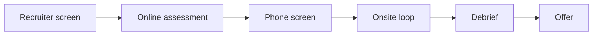
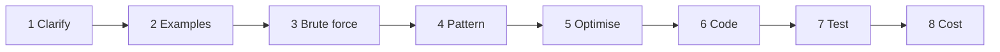

## Hook

In a driving test, reaching the end of the route is not enough. The examiner watches how you get there. Do you check the mirrors? Do you signal? What do you do when a cyclist pulls out?

A job interview at a big tech company works the same way. Getting the right answer matters, but the interviewer mostly watches how you get there. This ticket shows you what they watch, round by round, so you can show it on purpose.

## Concept

### How a big-tech loop works

Most big tech companies hire in the same stages. Each stage filters out some candidates before the next, more expensive one.



1. **Recruiter screen** (about 30 minutes): a chat about your background, the level you aim for, and timing. Rarely technical.
2. **Online assessment** (60 to 90 minutes): one to three coding problems on a website, alone. Hidden tests grade your code automatically.
3. **Phone screen** (45 to 60 minutes): one engineer, a shared code editor, one or two coding problems.
4. **Onsite loop**: four to six interviews of 45 to 60 minutes, usually on one day, often by video. For SDE 2 the usual set is **two coding rounds, one low-level design round, one system design round and one behavioural round**.
5. **Debrief**: the interviewers compare notes and decide. Then the recruiter calls with an offer, or with a no.

```callout jargon
The **loop** is the set of interviews on the big day; "onsite" is the old name, from when you had to visit. An **online assessment** (OA) is a timed coding test that a computer grades. The **debrief** is the meeting where interviewers decide together.
```

### What each round scores

Each interviewer scores you on a few fixed areas, called **signals**, then writes a short report.

| Round | What you are asked | What they score |
|---|---|---|
| Coding (two of them) | One or two algorithm problems in 45 minutes | Problem solving, clean code, communication, testing |
| Low-level design | "Design the classes for a parking lot" | Modelling, clear responsibilities, interfaces, extension, thread safety |
| System design | "Design a ride-tracking service" | Requirements, numbers, trade-offs, handling failure |
| Behavioural | "Tell me about a time you..." | Ownership, conflict, impact, learning from mistakes |

```callout jargon
A **signal** is one thing an interviewer is told to look for, such as "tests their own code". Each report ends with a score, usually on a scale like **strong no hire, no hire, hire, strong hire**.
```

One weak round can be balanced by strong ones. A red flag, such as being rude or making things up, usually cannot.

### SDE 1 and SDE 2

**SDE** means Software Development Engineer. SDE 1 is the entry level. SDE 2 is mid-level, usually after two to four years. The coding bar is similar. What changes is **scope**: how big a piece of work you can own alone.

| | SDE 1 | SDE 2 |
|---|---|---|
| Scope | Well-defined tasks | Whole features, end to end |
| Ownership | Finishes the ticket | Owns the feature in production: on-call, fixes, follow-ups |
| Design | Follows a design | Writes the design doc for a component |
| Ambiguity | Needs a clear ticket | Turns a vague request into a plan |
| Others | Learns from seniors | Reviews code and mentors interns |

```callout jargon
A **level** is a step on the career ladder, such as SDE 1, SDE 2 or Senior. **Scope** is how big and vague a problem you can own without help.
```

So for SDE 2, interviewers expect you to **drive** the design rounds without being led. Your behavioural stories should show a whole feature, not one ticket.

### The coding round in eight steps

Strong candidates follow the same steps every time. That leaves their brain free for the problem itself.



A rough clock for a 45-minute round with one problem:

| Minutes | Steps |
|---|---|
| 0 to 5 | Clarify and work through examples |
| 5 to 15 | Brute force, pattern, optimised plan, agreed with the interviewer |
| 15 to 35 | Code, talking as you go |
| 35 to 45 | Test by hand, fix, state the cost, answer follow-ups |

Say each step out loud as you start it: "Let me check a few edge cases first." The interviewer can then steer you, and you never lose your place.

### Steps 1 and 2: clarify, then examples

Problems are left vague on purpose. Asking good questions is part of the score. Ask about:

- **Input**: what type, and can it be empty? Can it hold duplicates, negatives or very large values?
- **Size**: how big can n get? That decides how fast your answer must be.
- **Output**: what do you return when there is no answer, or when two answers tie?

The size tells you the target. A computer does roughly 100 million simple steps a second, so:

| n up to | A fast enough answer |
|---|---|
| 20 | O(2ⁿ), trying every subset |
| 10,000 | O(n²) |
| 1,000,000 | O(n log n) or O(n) |
| 1,000,000,000 | O(log n) or O(1) per question |

Then write two or three small examples, including one edge case, and agree on the answers. Watch for **overflow**: fares in cents times a million rides do not fit in an `int`.

```callout jargon
An **edge case** is an input at the edge of what is allowed: empty, one item, all the same, the biggest value. **Overflow** is when a number grows past what its type can hold, and wraps round to a wrong value.
```

### Step 3: brute force first, with its cost

Say the simplest answer that is surely correct, and its cost in [Big-O](/t/module-04-dsa/topic-01-big-o). For example: "I could check every pair of rides. There are n × (n − 1) ÷ 2 pairs, so that is O(n²) time and O(1) space."

Why say it, when you know it is slow?

- It proves you can solve the problem at all.
- It gives you a correct answer to test the fast one against.
- Its waste shows you what to improve. Whatever the brute force repeats, a better idea avoids.

You rarely need to code it. Say it, give its cost, then ask: "Shall I look for something faster?"

### Step 4: find the pattern

Most interview problems are one of about fifteen patterns in disguise. The words in the problem give the pattern away. You met each one in module 4.

| The problem says | Try this pattern | Ticket |
|---|---|---|
| sorted, pair with a total | Two pointers | [Two pointers and windows](/t/module-04-dsa/topic-13-two-pointers) |
| longest or shortest run, at most k, window | Sliding window | [Two pointers and windows](/t/module-04-dsa/topic-13-two-pointers) |
| range totals, run that adds up to k | Prefix sums, often with a HashMap | [Two pointers and windows](/t/module-04-dsa/topic-13-two-pointers) |
| seen before, count, group | HashMap or HashSet | [Hash tables](/t/module-04-dsa/topic-08-hash-tables) |
| sorted, first or last at least x | Binary search | [Searching](/t/module-04-dsa/topic-03-searching) |
| top k, k-th largest, merge k sorted lists | Heap | [Heaps](/t/module-04-dsa/topic-10-heaps) |
| next bigger, brackets, undo | Stack, monotonic stack | [Stacks and queues](/t/module-04-dsa/topic-07-stacks-queues) |
| every combination, every order | Backtracking | [Backtracking](/t/module-04-dsa/topic-14-backtracking) |
| fewest stops, grid, connected areas | BFS or DFS | [Graphs](/t/module-04-dsa/topic-11-graphs) |
| jobs with must-finish-first rules | Topological sort | [Directed graphs](/t/module-04-dsa/topic-15-topological-sort) |
| fastest route, roads with times | Dijkstra | [Dijkstra](/t/module-04-dsa/topic-16-dijkstra) |
| number of ways, cheapest, best total with choices | Dynamic programming | [DP patterns](/t/module-04-dsa/topic-17-dp-patterns) |
| bookings, meetings, overlaps | Sort, then greedy | [Greedy and intervals](/t/module-04-dsa/topic-18-greedy-intervals) |
| prefix search, which groups are joined | Trie, union-find | [Tries and union-find](/t/module-04-dsa/topic-19-tries-union-find) |
| flags, the one unpaired item | Bit tricks | [Bit manipulation](/t/module-04-dsa/topic-20-bit-manipulation) |

```callout tip
Gojo says: no row fits? Ask what your brute force does twice. Looking something up again and again wants a HashSet. Re-sorting wants a heap. Re-adding the same numbers wants prefix sums.
```

### Steps 5 and 6: optimise, then code out loud

**Optimise.** Remove the repeated work, often by spending memory to save time. Then say the new plan and its cost before you type: "A HashSet makes each lookup O(1), so the whole thing is O(n). Shall I code that?" A nod here saves you from coding the wrong idea.

**Code out loud.** Talk about what each part is for, not every keystroke: "First I handle the empty input. Now I skip days that are not the start of a streak."

- Use clear names: `longestStreak` and `rode`, not `f` and `s`.
- Pull a messy step into a small helper method.
- Handle the edge cases you agreed on at the top.
- Skip clever one-liners. The interviewer must follow you in real time.

Interviewers usually ask for real code in a language you choose. Java is a fine choice; say so at the start.

### Steps 7 and 8: test by hand, then state the cost

Do not say "I think it works". Prove it. Walk through your code with a small example, line by line, saying each variable's value as it changes. Then try the edge cases from step 1: empty, one item, duplicates, negatives, the largest values.

Finding your own bug is a strong signal. An off-by-one, such as `i <= n` where you meant `i < n`, is the classic one.

Then state the cost, with a reason: "O(n) time, because each day goes into the set once and each streak is walked once. O(n) space, for the set." Mention what you traded: "Sorting would use O(1) extra space, but cost O(n log n)."

### What the interviewer writes down

Interviewers write evidence, not feelings. Their notes look like this:

- "Asked about duplicates and empty input before coding." *Problem solving.*
- "Gave the O(n²) brute force, then found the O(n) HashSet idea with no hint." *Problem solving.*
- "Clean names, small helper, handled empty input at the top." *Coding.*
- "Explained each step; took the hint about sorting and used it well." *Communication.*
- "Walked through a 4-day example and caught their own off-by-one." *Testing.*

A correct answer typed in silence leaves almost nothing to write. A talked-through answer that needed one small hint often scores better. A hint costs a little. Silence costs a lot.

### When you are stuck

Everyone gets stuck. The interviewer is watching what you do next.

1. **Say it.** "I'm stuck on how to avoid walking the same streak twice." Now the interviewer knows where you are.
2. **Go small.** Solve a tiny example by hand, and notice what your brain did. That is often the algorithm.
3. **Simplify.** Solve an easier version first: sorted input, no duplicates, only positive numbers. Then remove the limit.
4. **Run the table.** Go through the patterns in step 4 out loud.
5. **Ask a focused hint.** "Would sorting help here?" is better than "I don't know". Then use the hint, and say how it changes your plan.

```callout warning
Never go quiet for more than a minute. Thinking out loud, even when it is messy, gives the interviewer something to help with.
```

### The low-level design round

A **low-level design** (LLD) round asks for the classes behind a feature: a parking lot, an elevator, a library. You learned the method in [Object-oriented design from requirements](/t/module-06-craft/topic-13-object-oriented-design). In the round, move through it in this order:

1. **Requirements**: ask questions until each rule is a sentence you could test. Say what is out of scope.
2. **Entities**: the nouns that matter, and which are entities, values or services.
3. **Classes and relationships**: who owns whom, and who calls whom.
4. **APIs**: the public methods, their inputs and outputs, and their errors.
5. **Patterns**: only those that solve a real problem here, such as a strategy for something that varies.
6. **Extensibility and concurrency**: the next likely feature should be new code, not edits. Two users at the same moment must not break a rule.

For SDE 2, you lead all six steps. The interviewer should not need to ask "and what about two threads?".

### An LLD walk-through: rider alerts

The prompt: "Design how Spoke sends alerts to riders." Questions turn it into three rules. Alerts go by push, email or both. A rider never gets the same alert twice. SMS is coming next quarter.

| Noun | Becomes | Why |
|---|---|---|
| Alert | a record `Alert(alertId, riderId, text)` | a few values that never change |
| Channel | an interface `AlertChannel` with `send(alert)` | push, email and SMS vary; the service should not care |
| Alert service | a class `AlertService` | owns the channels and the "never twice" rule |

The service only knows the interface. That is the **strategy pattern**, so SMS is a new class, not an edit. And "never twice" must hold when a retry and the first try run on two threads at once.

```java
import java.util.ArrayList;
import java.util.List;
import java.util.Set;
import java.util.concurrent.ConcurrentHashMap;

public class Main {
    record Alert(String alertId, String riderId, String text) {}

    interface AlertChannel {                       // one way to reach a rider
        void send(Alert alert);
    }

    static class AlertService {
        private final List<AlertChannel> channels;
        private final Set<String> sent = ConcurrentHashMap.newKeySet();

        AlertService(List<AlertChannel> channels) {
            this.channels = List.copyOf(channels);
        }

        boolean notify(Alert alert) {
            if (!sent.add(alert.alertId())) {      // check and claim in one atomic step
                return false;                      // a retry, or another thread, got here first
            }
            for (AlertChannel channel : channels) {
                channel.send(alert);
            }
            return true;
        }
    }

    public static void main(String[] args) {
        List<AlertChannel> channels = new ArrayList<>();
        channels.add(a -> System.out.println("push  -> " + a.riderId() + ": " + a.text()));
        channels.add(a -> System.out.println("email -> " + a.riderId() + ": " + a.text()));
        channels.add(a -> System.out.println("sms   -> " + a.riderId() + ": " + a.text()));   // new: no edit to AlertService

        AlertService alerts = new AlertService(channels);
        Alert due = new Alert("evt-1001", "rider-7", "B-1042 is due back in 10 minutes");
        System.out.println("first:  " + alerts.notify(due));
        System.out.println("repeat: " + alerts.notify(due));
    }
}
```

It prints:

```text
push  -> rider-7: B-1042 is due back in 10 minutes
email -> rider-7: B-1042 is due back in 10 minutes
sms   -> rider-7: B-1042 is due back in 10 minutes
first:  true
repeat: false
```

`Set.add` returns `false` when the id is already there. On a concurrent set, that check and the add are one step, so two threads can never both get `true`. Checking with `contains` first, then adding later, would let both through. `notify` costs O(c) for c channels.

### The system design round

The **system design** round asks for a whole service: "design a URL shortener", "design ride tracking". Use the eight steps from [System design](/t/module-09-architecture/topic-06-system-design), on a clock:

| Minutes | What you do |
|---|---|
| 0 to 5 | Requirements: what it must do, and how well |
| 5 to 10 | Numbers: requests a second at peak, data a year |
| 10 to 15 | API and data model |
| 15 to 25 | High-level design: clients, load balancer, services, stores, queues |
| 25 to 40 | Deep dives into the two or three hardest parts |
| 40 to 45 | Bottlenecks, failures, and what you would do next |

What separates an SDE 2 answer from a junior one:

| Junior answer | Senior answer |
|---|---|
| "Add a cache." | "Map reads peak at 11,000 a second, so a cache with a 5-second TTL takes most of them. A rider may see a dock count 5 seconds old." |
| "Use a big database." | "Ride starts peak at 15 a second, so one Postgres leader is plenty for rentals. Read replicas take the map's misses." |
| (nothing about failure) | "If the leader dies, a replica takes over in about 30 seconds. Rentals fail in that window, so the app retries with an idempotency key." |

The pattern: **numbers** behind each choice, the **trade-off** said out loud, and a plan for **failure**.

### The behavioural round: STAR

Behavioural questions start with "Tell me about a time...". Answer with **STAR**: four parts in order.

```callout jargon
**STAR** stands for **S**ituation (where and when), **T**ask (what you had to do), **A**ction (what you did), **R**esult (what happened, with numbers if you can).
```

Spend about 10% on the situation, 10% on the task, 60% on your actions and 20% on the result. Two minutes in all. Say **"I"**, not "we": the interviewer is hiring you, not your team. End with a measurable result, and one thing you learned.

"Tell me about a disagreement in code review":

```text
Weak:   We had a disagreement about caching once. We talked it through and it was fine.

Strong: (S) At Spoke, Tsunade's pull request cached station data for 60 seconds.
        (T) I owned the live map, and riders were seeing full stations as free.
        (A) I measured it: 1 in 8 "free dock" taps failed. I shared the numbers in the
            review, proposed 5 seconds, and offered to load-test it myself.
        (R) We shipped 5 seconds. Failed taps fell to 1 in 200, and database load rose only 4%.
            I learned to bring data to a review, not opinions.
```

### Your story bank

Prepare six to eight true stories before the loop, written in STAR. One good story can answer several questions. Cover at least:

- **Conflict**: you and a teammate wanted different things.
- **Failure**: something you built broke. What you did, and what changed after.
- **Impact**: the work you are proudest of, with numbers.
- **Ambiguity**: a vague request you turned into a plan.
- **Leadership without authority**: you got people to follow a plan you could not order them to.
- **A disagreement in code review**: you pushed back, or changed your mind, for a good reason.

Your Spoke tickets are a start: an incident you fixed, a design you wrote, a review you gave.

Some companies publish the values their questions test. Amazon's **Leadership Principles** are the best-known set, with names such as *Customer Obsession*, *Ownership*, *Dive Deep*, *Bias for Action* and *Have Backbone; Disagree and Commit*. Read the values of each company you interview with, and map a story to each.

### Questions to ask the interviewer

Most rounds end with "Do you have any questions for me?". Always have two or three. Good questions show you think like a teammate:

- "What does a great first six months look like in this role?"
- "How does the team decide what to build next?"
- "What does on-call look like, and how often?"
- "What is the hardest technical problem the team has right now?"

Skip questions the careers page answers. Save pay questions for the recruiter, not the engineer.

### Preparing over weeks

Cramming does not work for interviews, because the skill is recall under pressure. **Spaced practice** does: you solve a problem, then solve it again after three days and after a week, from memory. That is how this app's review queue works.

| Weeks | Focus |
|---|---|
| 1 and 2 | One pattern a day: two problems, timed, out loud |
| 3 and 4 | Mixed problems, so you must spot the pattern yourself; two LLD prompts a week |
| 5 and 6 | System design prompts, and writing your story bank |
| 7 and 8 | **Mock interviews**: a friend plays interviewer, with the full clock |

Time yourself: about 25 minutes for a medium problem, start to tested code. Keep a log of every problem: its pattern, your mistake, and the date to redo it.

```callout jargon
A **mock interview** is a practice interview with someone playing the interviewer. It trains the part solo practice cannot: talking while you think, with someone watching.
```

### Offers in one card

An offer names a **level** and a **pay package**. The level matters most, because it sets the pay range and your next promotion.

- **Base salary**: the fixed yearly pay.
- **Bonus**: extra cash, sometimes once when you join (a sign-on bonus), sometimes yearly based on results.
- **Equity**: part ownership of the company, as shares. It **vests**, which means it becomes yours bit by bit, often over four years.

```callout tip
Gojo says: it is normal to ask questions about an offer, to ask for a few days to decide, and to ask politely whether the level or package can change. Recruiters expect it.
```

### In an interview

Your one-page checklist for the loop.

- **Every round:** say each step out loud, keep talking when stuck, and leave five minutes for your questions.
- **Coding:** clarify inputs, sizes and edge cases. Agree examples. Say the brute force and its cost. Find the pattern. Agree the plan before coding. Code with clear names. Test by hand with an example and the edge cases. State time and space, with reasons.
- **Low-level design:** requirements and scope, entities, classes and relationships, APIs, patterns with a reason, then extension and two threads at once.
- **System design:** requirements, numbers, API and data, high level, deep dives, then bottlenecks and failures. Name every trade-off.
- **Behavioural:** STAR, "I" not "we", a number in every result, and one lesson learned.
- **After:** write down what you were asked while you still remember. It shapes your next practice week.

## Worked example

Here is a full coding round on a problem module 4 never set. Jiraiya wants loyalty badges, so the interviewer asks: "Given the days a rider rode, return their longest streak of consecutive days."

### Minutes 0 to 15: clarify, examples, brute force

```text
You:   Are the days numbers, like day 0, day 1? Are they sorted?
Them:  Whole numbers from 0 to 3,650. Not sorted.
You:   Can a day appear twice, if the rider rode twice that day?
Them:  Yes.
You:   How many days at most? And with no days at all, I return 0?
Them:  Up to a million entries. Yes, 0.
You:   Examples: {12, 4, 13, 5, 30, 14, 6, 13, 7} gives 4, for days 4 to 7.
       {} gives 0. {9} gives 1. {3, 3, 3} gives 1, because a repeat is not a new day.
Them:  Agreed.
You:   Brute force: for each day, count up while the next day is in the array.
       Each "is it there?" scans the array, O(n). A streak can be n long, from n starts.
       That is O(n³) at worst. A million entries rules it out.
```

The brute force, said out loud and written only if asked:

```java
static int longestStreakSlow(int[] days) {      // O(n³) worst case, O(1) space
    int best = 0;
    for (int start : days) {
        int length = 1;
        while (contains(days, start + length)) {
            length++;
        }
        best = Math.max(best, length);
    }
    return best;
}

static boolean contains(int[] days, int day) {   // O(n): scans every entry
    for (int d : days) {
        if (d == day) {
            return true;
        }
    }
    return false;
}
```

The questions found two edge cases, repeats and an empty input, before any code. The size, a million, set the target: O(n log n) or better.

### Minutes 15 to 40: the pattern, the code, the test

```text
You:   The waste is "is it there?" again and again. "Seen before" means a HashSet: O(1) each.
       Sorting first would also work, at O(n log n). Can I beat that?
       One more waste: from day 5 I'd walk 5, 6, 7, and from day 6 walk 6, 7 again.
       So I only start counting at a day whose day before is NOT in the set.
       Then every day is walked once in all: O(n) time, O(n) space. Shall I code that?
Them:  Go ahead.
```

```java run
import java.util.HashSet;
import java.util.Set;

public class Main {
    // O(n) time, O(n) space.
    static int longestStreak(int[] days) {
        Set<Integer> rode = new HashSet<>();
        for (int day : days) {
            rode.add(day);                         // duplicates collapse into one
        }
        int best = 0;
        for (int day : rode) {
            if (rode.contains(day - 1)) {
                continue;                          // not the first day of a streak
            }
            int length = 1;
            while (rode.contains(day + length)) {
                length++;
            }
            best = Math.max(best, length);
        }
        return best;
    }

    public static void main(String[] args) {
        System.out.println(longestStreak(new int[] {12, 4, 13, 5, 30, 14, 6, 13, 7}));
        System.out.println(longestStreak(new int[] {}));
        System.out.println(longestStreak(new int[] {9}));
        System.out.println(longestStreak(new int[] {3, 3, 3}));
    }
}
```

It prints `4`, `0`, `1` and `1`: every agreed example. Then the candidate tests by hand on a short input, out loud:

```animate
title: Testing the streak code by hand
kind: code
code: |
  int[] days = {5, 3, 4, 9};
  java.util.Set<Integer> rode = new java.util.HashSet<>();
  for (int day : days) rode.add(day);
  int best = 0;
  for (int day : rode) {
      if (rode.contains(day - 1)) continue;
      int length = 1;
      while (rode.contains(day + length)) length++;
      best = Math.max(best, length);
  }
  System.out.println("longest streak: " + best);
steps:
  - line: 1
    vars: { days: "@d" }
    objects: { d: { type: "int[]", fields: { "0": 5, "1": 3, "2": 4, "3": 9 } } }
    say: Four ride days, not sorted. I expect 3, for days 3, 4 and 5.
  - line: 3
    vars: { rode: '{3, 4, 5, 9}' }
    say: Every day goes into the set once. Each lookup is now O(1).
  - line: 4
    vars: { best: 0 }
    say: No streak found yet.
  - line: 6
    vars: { day: 3 }
    say: Day 3. Is day 2 in the set? No, so a streak starts here.
  - line: 8
    vars: { length: 3 }
    say: Day 4 is there, day 5 is there, day 6 is not. The streak is 3 long.
  - line: 9
    vars: { best: 3 }
    say: best becomes 3.
  - line: 6
    vars: { day: 4, length: ~ }
    say: Day 4. Day 3 is in the set, so 4 is inside a streak already counted. Skip it.
  - line: 6
    vars: { day: 5 }
    say: Day 5 is skipped the same way. No streak is walked twice.
  - line: 8
    vars: { day: 9, length: 1 }
    say: Day 9 has no day 8 before it and no day 10 after it. A streak of 1.
  - line: 11
    out: "longest streak: 3"
    say: best stays 3. That matches the answer I predicted.
```

```text
You:   Edge cases: empty gives 0, the loop never runs. Repeats collapse in the set.
       Days only go up to 3,650, so day + length cannot overflow.
       Cost: O(n) time, each day added once and walked once. O(n) space for the set.
Them:  What if the days came as a stream that never ends?
You:   Then I'd keep streaks as ranges and join neighbours as days arrive,
       which is union-find. Shall I sketch it?
```

That last answer is a **follow-up**. Interviewers often add one at the end, to see how far you can go.

## Try it

A candidate wrote this for "return the second-highest different fare, or -1 if there is none". It passes their one example. Test it like an interviewer.

```java run
public class Main {
    // A candidate's answer: the second-highest different fare, or -1 if there is none.
    static int secondHighest(int[] fares) {
        int highest = 0;
        int second = 0;
        for (int fare : fares) {
            if (fare > highest) {
                second = highest;
                highest = fare;
            } else if (fare > second) {
                second = fare;
            }
        }
        return second;
    }

    public static void main(String[] args) {
        System.out.println(secondHighest(new int[] {250, 700, 400}));   // the happy path
        System.out.println(secondHighest(new int[] {700, 700}));        // duplicates
        System.out.println(secondHighest(new int[] {}));                // empty
    }
}
```

1. Predict all three lines, then run it. It prints `400`, `700` and `0`. Which two are wrong?
2. Fix the duplicates bug: a fare equal to `highest` must not become `second`.
3. Fix the empty case so it returns `-1`. Then add a test with refunds, `{-50, -200}`. What should it return, and does your fix handle it?

## Recap

- A big-tech loop runs from recruiter screen to online assessment, phone screen and an onsite loop of about five rounds. Each interviewer scores fixed signals and writes evidence.
- SDE 2 means owning whole features: you drive the design rounds and tell stories about features, not tickets.
- The coding round has eight steps: clarify, examples, brute force with its cost, pattern, optimise, code out loud, test by hand, state the cost.
- Design rounds reward requirements first, interfaces where change is likely, atomic steps for concurrent users, and numbers behind every trade-off.
- Behavioural answers use STAR, say "I", and end with a number. Prepare a story bank and practise with spaced, timed mock interviews.

## Common mistakes

**1. Coding before you clarify.**

```text
Them: Return the longest streak of ride days.
You:  (sorts the array and starts typing at once)
```

Symptom: twenty minutes in, the interviewer asks "what about a day that appears twice?". Your scan of the sorted days breaks the streak at every repeat, and you restart with fifteen minutes left. Fix: spend the first five minutes on input, size, edge cases and examples.

**2. An off-by-one you never tested.**

```java
int[] minutes = {12, 7, 30, 18, 25};
int total = 0;
for (int i = 0; i <= minutes.length; i++) {
    total += minutes[i];
}
System.out.println(total);
```

```text
Exception in thread "main" java.lang.ArrayIndexOutOfBoundsException: Index 5 out of bounds for length 5
```

Symptom: the last step runs past the end. In an interview there is no compiler to tell you. Fix: `i < minutes.length`, and walk a small example by hand before you say "done".

**3. An int that overflows on big inputs.**

```java
int ridesPerDay = 60_000;
int fareCents = 450;
int days = 365;
int yearCents = ridesPerDay * fareCents * days;
System.out.println(yearCents);
```

```text
1265065408
```

The true answer is 9,855,000,000, more than an `int` holds, so it wraps round to a wrong number with no error. Fix: `long yearCents = (long) ridesPerDay * fareCents * days;` prints `9855000000`. Ask about sizes in step 1.

**4. Coding in silence.**

```text
Them: (forty minutes of typing, then) So, how does it work?
```

Symptom: your code is right, but the report says "could not judge problem solving" and "did not communicate". Fix: say the plan before you code, and say what each part is for while you type.

**5. A "we" story with no result.**

```text
We had a slow endpoint, so we added a cache, and it was better.
```

Symptom: the interviewer cannot tell what you did, or whether it mattered. Fix: use STAR, in the first person, with a number. "I found the query took 900 ms. I added a 5-second cache and cut it to 40 ms at peak."

**6. A design with no numbers or trade-offs.**

```text
I'd use microservices, Kafka, Redis and sharded Cassandra.
```

Symptom: the interviewer asks "why?" for each one, and you have no answer. Fix: estimate the load first, pick the simplest design that carries it, and say what each choice gives up.
