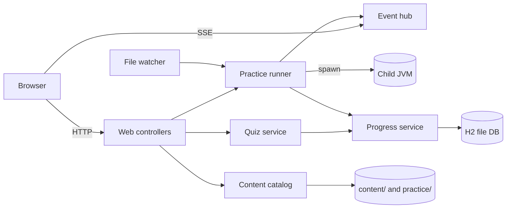

# Architecture

JavaQuest is a local, single-user learning app. One command starts it. It serves at http://localhost:2026, renders stored content, runs your practice code in a separate JVM, and saves your progress on disk.

## Technology decisions

| Area | Choice | Reason |
|---|---|---|
| Runtime | Java 21 LTS | Required. Virtual threads and records are used in the app itself. |
| Build | Maven 3.9+ with the Maven Wrapper (`mvnw`) | Required. The wrapper means no global Maven install. |
| Server | Spring Boot 4.1.2 with Web MVC. Later milestones add starters only when they need them. | Mature, one runnable JAR, well documented. |
| Frontend | One static page plus plain ES modules with hash routes, no Node build | One command start. Nothing to compile for the frontend. |
| Editor | Monaco 0.57, vendored under `static/vendor/monaco/`, with the TypeScript, CSS, HTML and JSON language services removed (5.6 MB left) | Works offline. Same editor as VS Code. Also colours static code in KB pages. |
| Markdown | flexmark-java on the server, with a fenced-block extension for `java run`, `mermaid` and `callout` blocks | Rendering is deterministic. No client-side Markdown parser. |
| Diagrams | Mermaid, vendored | Diagrams live as text in lessons. |
| Content data | YAML read by Jackson 3 into Java records that check their own fields. Unknown and missing fields are rejected. | Readable to author, strict to load, with one definition of each format in code. |
| Database | H2 in file mode at `~/.javaquest/progress` | Pure Java, no native driver. Survives restarts. SQLite needs a native library; H2 does not. |
| Migrations | Flyway | Progress data survives app upgrades. |
| Live updates | Server-Sent Events (SSE) | One-way server to browser push is all the file watcher needs. Simpler than WebSockets. |
| Tests in practice | JUnit 6 (the Jupiter API, same as JUnit 5 for learners) run through the console launcher's standalone jar | Structured results with no Maven start-up cost per run. One jar serves both the runner and the IDE. |
| Styling | Hand-written CSS with custom properties, light and dark themes | Small, no framework, easy to theme. |

## Repository layout

```
javaquest/
  pom.xml                     # parent POM: Java 21, dependency versions
  mvnw, mvnw.cmd, .mvn/       # Maven Wrapper
  run.sh                      # build if needed, then start the app (run.bat deferred)
  runner/                     # compiles and tests practice code in a child JVM; shared by app and tools
  content-model/              # content formats, catalog, quiz draw and grading; shared by app and tools
  app/                        # Spring Boot application
    src/main/java/dev/javaquest/
      lesson/                 # Markdown to HTML for KB pages
      practice/               # practice service and file watcher
      progress/               # XP, mastery, streaks, badges, spaced repetition
      quiz/                   # question variants, grading
      web/                    # controllers, SSE endpoint
    src/main/resources/
      static/                 # css, js modules, vendor/monaco, vendor/mermaid, mascot art
      db/migration/           # Flyway SQL
  content/                    # immutable lesson content (see CONTENT_SPEC.md)
    module-01-basics/
      module.yaml
      topic-01-variables/{meta.yaml, lesson.md, quiz.yaml}
  practice/                   # your editable code
    pom.xml                   # lets your IDE resolve JUnit and see sources
    module-01-basics/topic-01-variables/
      src/Variables.java          # skeleton with // TODO markers
      test/VariablesTest.java     # JUnit 5 tests
      solution/Variables.java     # reference solution
  tools/                      # content checker and practice verifier (Maven module)
  docs/
  BUILD_STATE.md
  build_state.json
```

`content/` and `practice/**/{skeleton,test,solution}` are written once and never regenerated. `practice/**/src` is yours to edit. The app writes inside the repo only when you save in its editor, or press "Reset", which copies `skeleton/` back over `src/` after asking you.

## Runtime components



- **Content catalog.** Reads `content/` once at startup, checks every file, and holds an in-memory index. A validation error stops startup with the file path and the problem. In dev mode a flag reloads content on change.
- **Quiz service.** Picks question variants, grades answers, and records weak concepts. Grading is pure data comparison with no code execution.
- **Practice runner.** Compiles and tests your code in a child JVM (see Sandboxing). One run at a time per topic. Queued runs for the same topic collapse into the latest one.
- **File watcher.** Uses the `directory-watcher` library on `practice/`, which listens to native file events (FSEvents on macOS). A change to a `.java` file under a topic's `src/` waits 300 ms for more saves, then triggers a test run, pushed to the page over SSE. Measured with JDK 21.0.13 on macOS: the JDK `WatchService` took 2.2 to 2.5 s to notice a save, because it polls on macOS. The native watcher takes 0.36 to 0.39 s including the 300 ms wait (3 saves each). The test run then takes 0.35 to 0.56 s.
- **Progress service.** Applies the rules in GAMIFICATION.md. All state changes go through it.

## Editor flow: Run and Submit

- The Monaco editor loads `practice/<module>/<topic>/src/*.java` from disk. Saving in the browser writes the same file, so the browser and your IDE edit one copy.
- If the file changes on disk while it is open in the browser, the page offers to reload it. It never silently overwrites.
- **Run** compiles and runs `main` and shows stdout and stderr. It earns no credit.
- **Submit** compiles your code and runs the topic's JUnit tests. It records the result.
- Snippets marked `java run` in lessons run through the same runner, as JShell-style single files.

## Sandboxing: what it does and does not do

Each run spawns a fresh JVM with `ProcessBuilder`:

```
java -Xmx256m -Xss1m -XX:+UseSerialGC -XX:TieredStopAtLevel=1
     -Djava.io.tmpdir=<run dir> -cp <run dir>/classes:<junit jars>
     org.junit.platform.console.ConsoleLauncher --select-class <Test> --reports-dir <run dir>
```

| Limit | Value | How it is enforced |
|---|---|---|
| Wall-clock time | 10 s per run (compile and test each) | Parent kills the process tree with `ProcessHandle.destroyForcibly()` |
| Heap | 256 MB | `-Xmx` |
| Thread stack | 1 MB | `-Xss`, so runaway recursion fails fast with a StackOverflowError |
| Output | 64 KB stdout and stderr each | Parent truncates the stream |
| Classpath | the JDK, your topic's classes, its test, JUnit (plus Mockito or Spring test jars for topics that declare them) | Explicit `-cp`. No app classes. |
| Working directory | a fresh temp directory, deleted after the run | `ProcessBuilder.directory` |
| Concurrency | at most 2 child JVMs at once | Semaphore in the runner |

Measured in M1 on an Apple Silicon Mac: a full submit of the hello-world topic (compile, start the child JVM, run 2 tests) took 0.49 s the first time and 0.30 to 0.33 s after that (6 runs). The 10 s limit is about 20 times a normal run. It stays at 10 s to leave room for slower machines and heavier tests. The heap limit has not been tuned; 256 MB is still a guess.

Running out of memory ends the whole child JVM, because JUnit rethrows `OutOfMemoryError`. The runner reports this as `CRASHED`, and the output contains `java.lang.OutOfMemoryError`. `System.exit` in learner code is also reported as `CRASHED`.

**This is not a security sandbox.** Java 21 has deprecated the Security Manager for removal, so the child JVM can still read and write any file your user account can reach, open network connections, and start other processes. The limits above stop accidents such as infinite loops, memory blow-ups and huge output. They do not stop malicious code. That is acceptable here because the only code that runs is code you wrote or chose to paste, on your own machine. Two further measures reduce the exposure:

- The server binds to `127.0.0.1` only, so nothing on the network can submit code.
- Every POST carries a per-session CSRF token, so a web page in another tab cannot submit code to the local server.

Stronger isolation such as containers or OS sandbox profiles is out of scope. It would break the one-command start.

## Spring Boot and backend topics

Module 8 and 9 exercises need Spring on the classpath. Each such topic declares `runner: spring` in `meta.yaml`. The runner then adds a fixed, pre-downloaded set of Spring Boot test jars, resolved once by `practice/pom.xml` into `~/.m2`. These runs get a 60 s limit and 512 MB of heap, because a Spring context starts slowly. These values are also estimates until M1 measures them.

## Persistence

H2 file database at `~/.javaquest/progress.mv.db` (set `--javaquest.data-dir` to move it). Flyway creates the tables from `app/src/main/resources/db/migration/`. It lives outside the repo, so a `git pull` never touches your progress. Tables:

- `topic_progress(topic_id, quiz_best, quiz_attempts, tests_passed, failed_runs, hints_used, failed_runs_at_last_hint, solution_viewed, mastered_at, last_seen)`
- `quiz_attempt(id, topic_id, seed, score, passed, weak_concepts, created_at)`
- `test_run(id, topic_id, source, outcome, passed, total, duration_ms, result_json, created_at)` where `source` is `BROWSER` or `IDE`. The latest row feeds the checks panel after a restart.
- `review_card(topic_id, ease, interval_days, due_on, repetitions)` for spaced repetition
- `xp_event(id, kind, amount, topic_id, created_at)`, the ledger that XP totals derive from
- `badge(id, earned_at)`
- `streak(day)`, one row per active day

Export and import as JSON from the settings page give you a backup.

## Accessibility and UI

- WCAG 2.2 AA contrast in both themes. The theme follows the system setting and can be overridden.
- Full keyboard use. Drag-and-order questions also work with arrow keys and buttons.
- `prefers-reduced-motion` turns off confetti and mascot animation.
- Responsive from 360 px wide. On narrow screens the editor stacks below the lesson.
- Error messages explain in plain words first. The raw compiler output sits behind a "Show details" toggle.

## Testing the app

- Unit tests for grading, mastery, XP and spaced repetition rules.
- An integration test that runs the practice runner on a passing and a failing fixture.
- `tools/` verifier: for every practice topic, the solution must pass and the skeleton must compile and fail. Command: `./mvnw -q -pl tools dependency:properties exec:java@verify-practice`. It writes the result into `build_state.json` and exits with status 1 when a topic fails.
- Content checker: `./mvnw -q -pl tools dependency:properties exec:java@check-content`. It loads every file, checks prerequisites against the curriculum, compiles every `java` block, runs every `java run` snippet, and runs every predict-the-output question to compare its answer.

## Risks

| Risk | Mitigation |
|---|---|
| macOS file watching is slow | ~~Measured in M1: under 2 s. No fallback needed.~~ Remeasured: 2.2 to 2.5 s with the JDK watcher. Replaced by native events: 0.36 to 0.39 s. |
| Spring topics run slowly | Longer limit, and a progress message in the UI. |
| Monaco bundle size (about 10 MB unpacked) | Vendored once. Served with long cache headers. |
| Content volume (136 graded units) | Built one module per milestone, verified by the tools before commit. |
