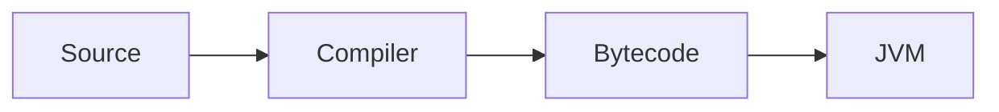

# Content specification

All content is written once, committed, and only read at runtime. The app validates every file at startup against JSON Schemas in `app/src/main/resources/schema/`. A file that fails validation stops startup with its path and the error.

## Naming

- Module folder: `module-NN-<slug>`, for example `module-01-basics`.
- Topic folder: `topic-NN-<slug>`, plus `boss` and `mini-project` in every module.
- Topic ID: `<module folder>/<topic folder>`. IDs never change once committed, because progress rows refer to them.
- Java package for practice: `jq.mNN.<slug with dots removed>`, for example `jq.m01.variables`.

## module.yaml

```yaml
id: module-01-basics
title: Java basics
project: The fare kiosk
summary: Store values, make decisions, repeat work, and package code into methods.
unlockAfter: module-00-foundations/boss   # omit for module 0
mascotIntro: "Every program starts with remembering things. Let's build some memory boxes!"
```

## meta.yaml (per topic)

```yaml
id: module-01-basics/topic-01-variables
title: "Variables: boxes with labels"
order: 1
minutes: 8                     # estimated reading time, 5 to 10
prerequisites: [module-00-foundations/boss]
concepts: [declaration, assignment, naming, reassignment]   # used to tag quiz questions and weak spots
practice:
  kind: code                   # code | quiz
  runner: plain                # plain | mockito | spring; every library is on every run's classpath, but spring gets at least 60 s and 512 MB
  mainClass: jq.m01.variables.Variables   # fully qualified, for the Run button, optional
  timeoutSeconds: 10           # optional override
# The runner finds test classes by scanning the compiled test/ folder, so no test class name is needed.
xp: { quiz: 50, code: 100 }
ticket:                        # the real-world problem, see docs/STORY.md
  key: SPK-0101
  from: maya                   # maya | theo | priya | sam
  title: "Kiosk forgets how long a ride took"
  body: >
    Riders say the kiosk shows 0 minutes on every receipt. It needs to remember the ride length
    so it can work out the fare. Can you take this one?
hints:                         # exactly 3, from gentle to explicit, shown as messages from Byte
  - "A variable needs a type, a name, and a value."
  - "For whole numbers, use int. For text, use String."
  - "Try: int age = 15;"
review: true                   # include in spaced repetition
```

## lesson.md

Markdown with front matter-free body. Required section headings, in this order:

```markdown
## Hook
A short story or analogy. No code yet.

## Concept
The idea in small steps. Define every new word the first time it appears.

## Worked example
Code with a line-by-line explanation.

## Try it
A runnable snippet the learner changes and runs.

## Recap
3 to 5 bullet points.

## Common mistakes
Each mistake shows the wrong code, the error the learner will see, and the fix.
```

Quiz and coding challenge come from `quiz.yaml` and `practice/`. The page inserts them between "Try it" and "Recap".

Special fenced blocks:

````markdown
```java run
// Runs in the sandbox when the learner presses Run. Must compile on Java 21.
System.out.println("Hi!");
```

```java
// Display only. Still compiled by the content checker unless marked `java nocompile`.
// The checker tries the block as written, then as statements inside main, then as class members.
// A Syntax-box fragment that uses variables from earlier text cannot compile alone: mark it `java nocompile`.
```

```java run crash
// Runnable like `java run`, for a snippet that shows an exception on purpose.
// The content checker requires it to end with an exception.
```



```callout tip
Byte says: names should describe what the box holds.
```
````

Callout kinds: `tip`, `warning`, `analogy`, `jargon` (defines a term).

To link to another ticket, use its path: `[equals and hashCode](/t/module-02-oop/topic-10-equals-hashcode-tostring)`. The link opens in the app without a reload.

Style rules: sentences under 25 words, second person, friendly, no unexplained jargon, reading time 5 to 10 minutes.

### How the page plays a lesson

The app shows a lesson as short cards in a lesson player, not as one long page (`app/.../static/js/lesson.js`):

1. **Your ticket**: the teammate's ticket, plus "In this ticket you'll learn", taken from the `## Recap` bullets. Write the Recap so it reads well as this overview.
2. **One card per `###` subsection** (or per `##` section that has none). Keep each subsection to one idea: a few short paragraphs, a code block, maybe a callout. Long subsections make long cards.
3. **Common mistakes** become collapsed accordions. Start each mistake with a bold title paragraph, such as `**1. Forgetting the semicolon.**`, so the title shows and the detail opens on a tap.
4. **Recap**, then the onboarding check (one question at a time), then the code, then a celebration when the ticket is done.

Tickets open one at a time: a ticket opens when every ticket before it is mastered.

### Quick reference notes

When a ticket is finished, the Notes page shows a quick reference built from its lesson (`QuickReference.java`), so write these parts with that in mind:

- **Key points**: the `## Recap` bullets.
- **Syntax**: every `### Syntax: <name>` subsection, with its first `java` block and the first paragraph after that block. Put the short, general form in that first block.
- **Words to know**: every `callout jargon`.
- **Common mistakes**: each bold title paragraph in `## Common mistakes`, its first `java` block, and the paragraphs up to the next title (the error and the fix).

### Animations (```animate)

An animation shows an idea happening step by step, with one short caption per step from Byte. Learners press Watch, or step through with the buttons. **Every topic should have at least one animation**, placed in the Concept or Worked example where the idea is hardest to picture: variables changing, a loop running, objects and references, a request travelling to a server. Animations replace reading, so a long paragraph that only describes steps can shrink to one sentence plus the animation.

The block holds YAML. The content checker parses every animation, and for a `code` animation it also runs the program and checks that the `out` lines match what it really prints.

**`code`**: a program, stepped line by line.

````markdown
```animate
title: The kiosk remembers a ride           # required: a short name, shown above the animation
kind: code
code: |                                     # Java, like a ```java block: statements, or whole classes
  String bikeId = "B-1042";
  int minutes = 20;
  minutes = 35;
  System.out.println(minutes);
steps:                                      # 2 to 24 steps
  - line: 1                                 # the line highlighted in this step (1-based; 0 or none = no line)
    vars: { bikeId: '"B-1042"' }            # variables CHANGED in this step; show text with its quotes
    say: Java makes a String box called bikeId.   # required: one or two short sentences, at most 240 characters
  - line: 2
    vars: { minutes: 20 }
    say: Then an int box called minutes, holding 20.
  - line: 3
    vars: { minutes: 35 }
    say: minutes gets 35. The old 20 is thrown away.
  - line: 4
    out: "35"                               # what the program prints in this step (one or more lines)
    say: println shows what is in the box right now.
```
````

- Values show exactly as written, so quote anything that must keep its form: text with its quotes (`'"Ada"'`), chars (`"'A'"`), and doubles ending in `.0` (`'3.0'`, because an unquoted `3.0` shows as `3`).
- `vars` and `objects` are changes: a variable keeps its value until a later step changes it. Give `~` to remove one (it went out of scope).
- Objects: `objects: { b1: { type: Bike, fields: { id: '"B-1042"', minutes: 12 } } }`. A variable or field whose value is `"@b1"` draws an arrow to that object. Use objects for anything made with `new`: objects, arrays (`type: "int[]"`, fields `0`, `1`, ...), lists.
- All `out` lines together must equal the program's real output, in order. If the program prints nothing, use no `out`.

**`scene`**: boxes and messages, for ideas that are not one program: hardware, the JVM, git, HTTP, a database.

````markdown
```animate
title: A rider taps Unlock
kind: scene
nodes:                                      # 1 to 8 boxes
  - { id: app, label: Rider app, emoji: "📱" }             # id: lowercase letters, digits, dashes
  - { id: api, label: Spoke API, emoji: "🖥️", value: idle }  # value: a small changing label (optional)
  - { id: db, label: Database, emoji: "🗄️", row: 1, col: 1 } # row 0-3, col 0-5 place it on a grid (default: one row)
steps:
  - say: The rider taps Unlock.
    focus: [app]                            # highlight boxes in this step
  - say: The app sends a request to the API.
    send: { from: app, to: api, label: "POST /rentals" }
    set: { api: busy }                      # change box values (they stay until changed again)
  - say: The API answers.
    send: { from: api, to: app, label: "201 Created", back: true }   # back: drawn as a reply
    show: [db]                              # boxes listed in any show start hidden until shown; hide: removes
```
````

- `send` takes one message or a list; several messages in one step travel one after another.
- `links` (top level, optional) draws lines that are always there, such as a folder and its parent folder, or two stations on a route: `links: [{ from: home, to: spoke }, { from: spoke, to: logs, label: "cd logs" }]`.
- Keep scenes small: three to five boxes read best.

Writing good animations:

- 4 to 8 steps is the sweet spot. Each caption says what happens and why, in plain words, under 25 words a sentence.
- Use the Spoke story: bikes, stations, fares, riders.
- Do not duplicate a `java run` snippet: an animation shows how the code runs, and a snippet lets the learner change it.

## quiz.yaml

A quiz has a pool of questions. Each attempt draws `drawCount` questions with a seed, at least one per concept where possible. A retry uses a new seed, so learners see different variants.

```yaml
topic: module-01-basics/topic-01-variables
drawCount: 6
passPercent: 80
questions:
  - id: q01
    type: mcq
    concept: declaration
    prompt: "Which line declares a whole-number variable?"
    choices: ["int age = 15;", "age = 15;", "int = 15;", "15 = age;"]
    answer: 0
    explain: "A declaration needs a type (int), a name (age) and, optionally, a value."
    reteach: "## Concept"        # lesson section to show again if missed

  - id: q02
    type: fill-blank
    concept: naming
    prompt: "Complete: ___ name = \"Ada\";"
    answers: ["String"]            # accepted answers, trimmed and case-sensitive
    explain: "Text values use the String type."

  - id: q03
    type: predict-output
    concept: reassignment
    code: |
      int x = 3;
      x = x + 2;
      System.out.println(x);
    answer: "5"                    # compared after trimming trailing whitespace
    explain: "x starts at 3, then becomes 3 + 2."

  - id: q04
    type: order
    concept: declaration
    prompt: "Put the lines in an order that prints 10."
    items: ["int a = 4;", "int b = a + 6;", "System.out.println(b);"]
    # correct order is the listed order; the UI shuffles it

  - id: q05
    type: spot-the-bug
    concept: declaration
    code: |
      int count = "five";
      System.out.println(count);
    bugLine: 1
    explain: "\"five\" is text, but count is an int."

  - id: q06
    type: mcq
    concept: naming
    variants:                      # same question, different surface values
      - { prompt: "Which name follows Java convention?", choices: ["userAge", "UserAge", "user_age", "1age"], answer: 0 }
      - { prompt: "Which variable name is valid and conventional?", choices: ["totalScore", "Total-Score", "2score", "total score"], answer: 0 }
    explain: "Java variables use camelCase and cannot start with a digit."
```

The content checker (`exec:java@check-content`) runs every `predict-output` snippet and checks the stated answer against real output. A fill-blank prompt should be the code line only, because the page shows it in the code font.

## Practice files

```
practice/module-01-basics/topic-01-variables/
  README.md                 # the task in plain words, same text as the UI
  src/jq/m01/variables/Variables.java   # the learner's copy; add src/ and test/ to practice/pom.xml so the IDE sees them
  skeleton/jq/m01/variables/Variables.java   # pristine starting code, identical to src/ when written; Reset copies it back
  test/jq/m01/variables/VariablesTest.java
  solution/jq/m01/variables/Variables.java
```

Skeleton rules:

- It compiles. Each unfinished part is marked `// TODO 1: ...`, numbered, with a one-line instruction.
- Unfinished methods return a placeholder value such as `0`, `null` or `""`, so the tests fail with a clear message rather than a compile error.

Test rules:

- JUnit 5 only, plus Mockito or Spring Test where `runner` says so.
- Every assertion has a beginner-readable message: `assertEquals(15, Variables.age(), "age() should return 15, the age you stored");`
- `@DisplayName` on every test, written as a sentence. The UI shows it.
- Tests run in under 2 seconds on the solution, apart from Spring topics.
- Tests never touch the network. File tests use `@TempDir`.

Verification, recorded in `build_state.json` per topic by `./mvnw -q -pl tools dependency:properties exec:java@verify-practice`:

- `solutionPasses`: the tests pass when compiled against `solution/`.
- `skeletonFails`: the tests fail, without a compile error, against `skeleton/`. The learner's `src/` is never used for verification.

## Boss and mini-project folders

Same layout as a topic, with these differences:

- A boss is shown as an incident with key `INC-MM`, raised by Theo. A mini-project is a feature with key `FEAT-MM`, asked for by Priya.
- There is no `quiz.yaml`. The catalog rejects one. The checks are the whole task, so mastery is the checks alone.
- `practice.kind` must be `code`. Use `order: 99` for the boss and `order: 100` for the mini-project so they come after the topics. The catalog sorts by `order`, not by folder name.
- `review: false`. Incidents and features are not reviewed.
- Their `lesson.md` is a brief, not a full lesson. An incident uses `## What happened`, `## What you need`, `## The tiers`, `## Recap`, `## Common mistakes`. A feature uses `## The design`, `## What you build`, `## Recap`, `## Common mistakes`. Any new syntax gets a `### Syntax:` box.

Boss tiers come from test class names. Put the bronze checks in a class whose name ends in `BronzeTest`, silver in `SilverTest`, gold in `GoldTest`, for example `KioskBronzeTest`. A tier passes when it has at least one check and all of its checks pass. Passing bronze resolves the incident. Silver and gold earn bonus XP. The solution must pass all three tiers, and the skeleton must fail.
